# ML decoders: results

> **Real-data sections are headed HARDWARE (device, calibration set, batch); everything else is SIMULATED (development), not the evaluation.** Sal's direction is to train and evaluate the decoders on Garnet and Emerald data (InfoRecord); simulated sets serve pre-training and development only.

Generated by `python -m mlDecoder.report` from the result JSONs under `mlDecoder/results/` (not committed). Do not edit by hand. The runs behind this file:

- `mwpm/20261024-151329-mwpm_smoke` (mwpm_smoke, complete, 6 points, commit `01951f8`, dirty tree)
- `mwpm/20261024-151409-mwpm_full` (mwpm_full, complete, 144 points, commit `01951f8`, dirty tree)
- `mlp/20261024-154917-mlp_smoke` (mlp_smoke, complete, 1 points, commit `01951f8`, dirty tree)
- `mlp/20261024-154937-mlp_smoke` (mlp_smoke, complete, 1 points, commit `01951f8`, dirty tree)
- `mlp/20261024-155006-mlp_full` (mlp_full, complete, 72 points, commit `01951f8`, dirty tree)
- `mlp/20261024-165956-mlp_headroom` (mlp_headroom, complete, 1 points, commit `01951f8`, dirty tree)
- `mlp/20261024-170503-mlp_freshleak` (mlp_freshleak, complete, 1 points, commit `01951f8`, dirty tree)
- `rnn_lstm/20261024-191223-rnn_lstm_full` (rnn_lstm_full, complete, 66 points, commit `e6dba33`)
- `rnn_lstm/20261024-195414-rnn_lstm_emerald` (rnn_lstm_emerald, complete, 66 points, commit `07c4b9d`, dirty tree)

Machine: AMD Ryzen 9 8945HS w/ Radeon 780M Graphics (16 logical CPUs), NVIDIA GeForce RTX 4060 Laptop GPU (8187 MiB); Python 3.13.13; numpy 2.5.4, pymatching 2.4.0, scipy 1.18.1, stim 1.16.0, torch 2.14.1+cu132.

**Definitions.** P_L is the fraction of test shots whose predicted observable flip is wrong. Intervals are Wilson 95% for one decoder, and paired-bootstrap 95% (10,000 resamples of the shots) for a difference on the same shots. ε_L is the per-round rate from `challenge.decoding.fit_ler`: **no SPAM**, P(r) = [1 − (1 − 2ε)^r]/2, is the challenge's own form; **SPAM** fits an amplitude A as well. Speeds are measured on this laptop, after a warm-up, at a given batch size; PyMatching runs on one CPU thread.

## HARDWARE: rnn_lstm, pilot smoke test (loader and decoders; not a result), run `20261024-202528-pilot-20261024-195414`

Pre-trained models from `20261024-195414-rnn_lstm_emerald`. Correlated MWPM's weights come from the decoder prior (`calibrated_coherence` with {'t2': 'ramsey', 'readout': 'asym', 'qnd': 'excess'} on the run's device patch); "uniform" is correlated MWPM with uniform-model weights. ΔP_L is paired against correlated MWPM on the same shots (bootstrap 95%).

**emerald_eA_Z**: 1 runs (HARDWARE, calibration sets 23e12f6b, batches [0]).

| R | N | rnn_lstm_pretrained P_L [95%] | ΔP_L vs corr [95%] | corr MWPM [95%] | uniform | always 0 |
|---:|---:|---:|---:|---:|---:|---:|
| 3 | 1,000 | 0.1280 [0.1087, 0.1501] | +8.00e-03 [-4.00e-03, 0.0210] tie | 0.1200 [0.1013, 0.1416] | 0.1200 | 0.3360 |

**emerald_eA_X**: 0 runs (, calibration sets –, batches []).

## HARDWARE: rnn_lstm, pilot smoke test (loader and decoders; not a result), run `20261024-202542-pilot-20261024-191223`

Pre-trained models from `20261024-191223-rnn_lstm_full`. Correlated MWPM's weights come from the decoder prior (`calibrated_coherence` with {'t2': 'ramsey', 'readout': 'asym', 'qnd': 'excess'} on the run's device patch); "uniform" is correlated MWPM with uniform-model weights. ΔP_L is paired against correlated MWPM on the same shots (bootstrap 95%).

**garnet_pA_Z**: 1 runs (HARDWARE, calibration sets a18a947f, batches [0]).

| R | N | rnn_lstm_pretrained P_L [95%] | ΔP_L vs corr [95%] | corr MWPM [95%] | uniform | always 0 |
|---:|---:|---:|---:|---:|---:|---:|
| 3 | 1,000 | 0.2240 [0.1992, 0.2509] | +7.00e-03 [-0.0130, 0.0270] tie | 0.2170 [0.1926, 0.2436] | 0.2220 | 0.3790 |

**garnet_pA_X**: 0 runs (, calibration sets –, batches []).

## HARDWARE: rnn_lstm, test split, run `20261024-210821-finetune-20261024-191223`

Pre-trained models from `20261024-191223-rnn_lstm_full`. Correlated MWPM's weights come from the decoder prior (`calibrated_coherence` with {'t2': 'ramsey', 'readout': 'asym', 'qnd': 'excess'} on the run's device patch); "uniform" is correlated MWPM with uniform-model weights. ΔP_L is paired against correlated MWPM on the same shots (bootstrap 95%).

The validation split (the fine-tuning batches' held-out 20%) served early stopping and the cascade's τ, so numbers on it lean optimistic. The test batch, never trained or tuned on, is the honest number.

**garnet_pA_Z**: 23 runs (HARDWARE, calibration sets a18a947f, batches [0, 1, 2]); fine-tuned on 88,000 shots of batches [1, 2], early-stopped on 22,000, 87 s (early stop: no val improvement in 15 evaluations).
Cascade τ = 0.00, tuned on 22,000 validation shots (one-standard-error rule; the argmin τ was 0.00), re-tuned on validation at 2026-10-25T01:46 UTC (the replaced entry is kept). Relay-BP and its MWPM fallback use the **calibrated** prior, chosen on validation by the same test: correlated MWPM fails 7,263 shots with calibrated weights and 7,608 with uniform weights, of 22,000 (1 SE 75.8).

**garnet_pA_X**: 22 runs (HARDWARE, calibration sets a18a947f, batches [1, 2]); fine-tuned on 88,000 shots of batches [1, 2], early-stopped on 22,000, 112 s (early stop: no val improvement in 15 evaluations).
Cascade τ = 0.00, tuned on 22,000 validation shots (one-standard-error rule; the argmin τ was 0.03), re-tuned on validation at 2026-10-25T01:47 UTC (the replaced entry is kept). Relay-BP and its MWPM fallback use the **calibrated** prior, chosen on validation by the same test: correlated MWPM fails 7,890 shots with calibrated weights and 7,879 with uniform weights, of 22,000 (1 SE 79.7).

## HARDWARE: rnn_lstm, test split, run `20261024-211525-finetune-20261024-195414`

Pre-trained models from `20261024-195414-rnn_lstm_emerald`. Correlated MWPM's weights come from the decoder prior (`calibrated_coherence` with {'t2': 'ramsey', 'readout': 'asym', 'qnd': 'excess'} on the run's device patch); "uniform" is correlated MWPM with uniform-model weights. ΔP_L is paired against correlated MWPM on the same shots (bootstrap 95%).

The validation split (the fine-tuning batches' held-out 20%) served early stopping and the cascade's τ, so numbers on it lean optimistic. The test batch, never trained or tuned on, is the honest number.

**emerald_eA_Z**: 23 runs (HARDWARE, calibration sets 23e12f6b, batches [0, 1, 2]); fine-tuned on 35,200 shots of batches [1, 2], early-stopped on 8,800, 86 s (early stop: no val improvement in 15 evaluations).
Cascade τ = 0.00, tuned on 8,800 validation shots (one-standard-error rule; the argmin τ was 0.10), re-tuned on validation at 2026-10-25T01:48 UTC (the replaced entry is kept). Relay-BP and its MWPM fallback use the **calibrated** prior, chosen on validation by the same test: correlated MWPM fails 2,060 shots with calibrated weights and 2,238 with uniform weights, of 8,800 (1 SE 39.5).

**emerald_eA_X**: 22 runs (HARDWARE, calibration sets 23e12f6b, batches [1, 2]); fine-tuned on 35,200 shots of batches [1, 2], early-stopped on 8,800, 81 s (early stop: no val improvement in 15 evaluations).
Cascade τ = 0.19, tuned on 8,800 validation shots (one-standard-error rule; the argmin τ was 0.21), re-tuned on validation at 2026-10-25T01:49 UTC (the replaced entry is kept). Relay-BP and its MWPM fallback use the **uniform** prior, chosen on validation by the same test: correlated MWPM fails 1,934 shots with calibrated weights and 1,807 with uniform weights, of 8,800 (1 SE 37.3).

## HARDWARE: rnn_lstm, test split, run `20261024-215152-finetune-20261024-191223`

Pre-trained models from `20261024-191223-rnn_lstm_full`. Correlated MWPM's weights come from the decoder prior (`calibrated_coherence` with {'t2': 'ramsey', 'readout': 'asym', 'qnd': 'excess'} on the run's device patch); "uniform" is correlated MWPM with uniform-model weights. ΔP_L is paired against correlated MWPM on the same shots (bootstrap 95%).

The validation split (the fine-tuning batches' held-out 20%) served early stopping and the cascade's τ, so numbers on it lean optimistic. The test batch, never trained or tuned on, is the honest number.

**garnet_pA_Z**: 34 runs (HARDWARE, calibration sets a18a947f, batches [0, 1, 2, 3]); fine-tuned on 88,000 shots of batches [1, 2], early-stopped on 22,000, 87 s (early stop: no val improvement in 15 evaluations).
Cascade τ = 0.00, tuned on 22,000 validation shots (one-standard-error rule; the argmin τ was 0.00), re-tuned on validation at 2026-10-25T01:46 UTC (the replaced entry is kept); τ from `20261024-210821-finetune-20261024-191223`. Relay-BP and its MWPM fallback use the **calibrated** prior, chosen on validation by the same test: correlated MWPM fails 7,263 shots with calibrated weights and 7,608 with uniform weights, of 22,000 (1 SE 75.8).

Pooled over its 11 points (55,000 shots, the same number at each R); ΔP_L is paired, from the summed discordant shots (bootstrap 95%):

| Decoder | Failures (P_L) | ΔP_L vs corr MWPM [95%] | ΔP_L vs uniform-weight MWPM [95%] |
|---:|---:|---:|---:|
| rnn_lstm_pretrained | 20,689 (0.3762) | -9.49e-03 [-0.0136, -5.38e-03] **win** | -0.0215 [-0.0261, -0.0170] **win** |
| rnn_lstm_finetuned | 20,222 (0.3677) | -0.0180 [-0.0223, -0.0137] **win** | -0.0300 [-0.0347, -0.0253] **win** |
| rnn_lstm_cascade | 20,222 (0.3677) | -0.0180 [-0.0223, -0.0137] **win** | -0.0300 [-0.0347, -0.0253] **win** |
| relay_bp | 20,875 (0.3795) | -6.11e-03 [-0.0100, -2.16e-03] **win** | -0.0182 [-0.0228, -0.0135] **win** |
| mwpm_corr | 21,211 (0.3857) | – | – |
| mwpm_corr_uniform | 21,874 (0.3977) | +0.0121 [7.53e-03, 0.0165] loss | – |
| mwpm | 21,241 (0.3862) | – | – |

| R | N | rnn_lstm_pretrained P_L [95%] | ΔP_L vs corr [95%] | rnn_lstm_finetuned P_L [95%] | ΔP_L vs corr [95%] | rnn_lstm_cascade P_L [95%] | ΔP_L vs corr [95%] | relay_bp P_L [95%] | ΔP_L vs corr [95%] | corr MWPM [95%] | uniform | always 0 |
|---:|---:|---:|---:|---:|---:|---:|---:|---:|---:|---:|---:|---:|
| 1 | 5,000 | 0.0218 [0.0181, 0.0262] | -8.80e-03 [-0.0118, -6.00e-03] **win** | 0.0216 [0.0179, 0.0260] | -9.00e-03 [-0.0120, -6.00e-03] **win** | 0.0216 [0.0179, 0.0260] | -9.00e-03 [-0.0120, -6.00e-03] **win** | 0.0306 [0.0262, 0.0357] | 0 [0, 0] tie | 0.0306 [0.0262, 0.0357] | 0.0204 | 0.0892 |
| 2 | 5,000 | 0.2078 [0.1968, 0.2193] | -0.0174 [-0.0238, -0.0110] **win** | 0.2028 [0.1919, 0.2142] | -0.0224 [-0.0292, -0.0156] **win** | 0.2028 [0.1919, 0.2142] | -0.0224 [-0.0292, -0.0156] **win** | 0.2214 [0.2101, 0.2331] | -3.80e-03 [-8.60e-03, 1.00e-03] tie | 0.2252 [0.2138, 0.2370] | 0.2460 | 0.3000 |
| 3 | 5,000 | 0.2912 [0.2788, 0.3039] | -0.0250 [-0.0346, -0.0152] **win** | 0.2660 [0.2539, 0.2784] | -0.0502 [-0.0618, -0.0386] **win** | 0.2660 [0.2539, 0.2784] | -0.0502 [-0.0618, -0.0386] **win** | 0.2968 [0.2843, 0.3096] | -0.0194 [-0.0280, -0.0106] **win** | 0.3162 [0.3035, 0.3292] | 0.3332 | 0.3912 |
| 4 | 5,000 | 0.3456 [0.3325, 0.3589] | -0.0284 [-0.0392, -0.0174] **win** | 0.3296 [0.3167, 0.3428] | -0.0444 [-0.0568, -0.0320] **win** | 0.3296 [0.3167, 0.3428] | -0.0444 [-0.0568, -0.0320] **win** | 0.3630 [0.3498, 0.3764] | -0.0110 [-0.0216, -4.00e-04] **win** | 0.3740 [0.3607, 0.3875] | 0.3904 | 0.4386 |
| 5 | 5,000 | 0.3894 [0.3760, 0.4030] | -0.0186 [-0.0306, -6.60e-03] **win** | 0.3726 [0.3593, 0.3861] | -0.0354 [-0.0488, -0.0216] **win** | 0.3726 [0.3593, 0.3861] | -0.0354 [-0.0488, -0.0216] **win** | 0.4014 [0.3879, 0.4151] | -6.60e-03 [-0.0178, 4.80e-03] tie | 0.4080 [0.3945, 0.4217] | 0.4326 | 0.4638 |
| 6 | 5,000 | 0.4148 [0.4012, 0.4285] | -0.0230 [-0.0360, -0.0100] **win** | 0.4134 [0.3998, 0.4271] | -0.0244 [-0.0386, -9.40e-03] **win** | 0.4134 [0.3998, 0.4271] | -0.0244 [-0.0386, -9.40e-03] **win** | 0.4314 [0.4177, 0.4452] | -6.40e-03 [-0.0188, 5.80e-03] tie | 0.4378 [0.4241, 0.4516] | 0.4536 | 0.4774 |
| 8 | 5,000 | 0.4592 [0.4454, 0.4730] | -0.0218 [-0.0364, -7.00e-03] **win** | 0.4638 [0.4500, 0.4776] | -0.0172 [-0.0330, -1.00e-03] **win** | 0.4638 [0.4500, 0.4776] | -0.0172 [-0.0330, -1.00e-03] **win** | 0.4768 [0.4630, 0.4907] | -4.20e-03 [-0.0182, 0.0102] tie | 0.4810 [0.4672, 0.4949] | 0.4912 | 0.4934 |
| 10 | 5,000 | 0.4982 [0.4843, 0.5121] | +0.0160 [0, 0.0318] tie | 0.4852 [0.4714, 0.4991] | +3.00e-03 [-0.0140, 0.0200] tie | 0.4852 [0.4714, 0.4991] | +3.00e-03 [-0.0140, 0.0200] tie | 0.4736 [0.4598, 0.4875] | -8.60e-03 [-0.0238, 6.80e-03] tie | 0.4822 [0.4684, 0.4961] | 0.4964 | 0.5074 |
| 12 | 5,000 | 0.5016 [0.4877, 0.5155] | +7.20e-03 [-0.0100, 0.0244] tie | 0.4970 [0.4831, 0.5109] | +2.60e-03 [-0.0156, 0.0206] tie | 0.4970 [0.4831, 0.5109] | +2.60e-03 [-0.0156, 0.0206] tie | 0.4826 [0.4688, 0.4965] | -0.0118 [-0.0284, 4.80e-03] tie | 0.4944 [0.4806, 0.5083] | 0.5046 | 0.5090 |
| 15 | 5,000 | 0.4998 [0.4859, 0.5137] | +8.20e-03 [-0.0102, 0.0262] tie | 0.5002 [0.4863, 0.5141] | +8.60e-03 [-0.0102, 0.0274] tie | 0.5002 [0.4863, 0.5141] | +8.60e-03 [-0.0102, 0.0274] tie | 0.4958 [0.4819, 0.5097] | +4.20e-03 [-0.0136, 0.0220] tie | 0.4916 [0.4778, 0.5055] | 0.5048 | 0.5020 |
| 20 | 5,000 | 0.5084 [0.4945, 0.5222] | +7.20e-03 [-0.0122, 0.0264] tie | 0.4922 [0.4784, 0.5061] | -9.00e-03 [-0.0286, 0.0106] tie | 0.4922 [0.4784, 0.5061] | -9.00e-03 [-0.0286, 0.0106] tie | 0.5016 [0.4877, 0.5155] | +4.00e-04 [-0.0182, 0.0188] tie | 0.5012 [0.4873, 0.5151] | 0.5016 | 0.5084 |

**garnet_pA_X**: 33 runs (HARDWARE, calibration sets a18a947f, batches [1, 2, 3]); fine-tuned on 88,000 shots of batches [1, 2], early-stopped on 22,000, 112 s (early stop: no val improvement in 15 evaluations).
Cascade τ = 0.00, tuned on 22,000 validation shots (one-standard-error rule; the argmin τ was 0.03), re-tuned on validation at 2026-10-25T01:47 UTC (the replaced entry is kept); τ from `20261024-210821-finetune-20261024-191223`. Relay-BP and its MWPM fallback use the **calibrated** prior, chosen on validation by the same test: correlated MWPM fails 7,890 shots with calibrated weights and 7,879 with uniform weights, of 22,000 (1 SE 79.7).

Pooled over its 11 points (55,000 shots, the same number at each R); ΔP_L is paired, from the summed discordant shots (bootstrap 95%):

| Decoder | Failures (P_L) | ΔP_L vs corr MWPM [95%] | ΔP_L vs uniform-weight MWPM [95%] |
|---:|---:|---:|---:|
| rnn_lstm_pretrained | 21,176 (0.3850) | +5.98e-03 [1.25e-03, 0.0106] loss | -9.09e-05 [-4.60e-03, 4.40e-03] tie |
| rnn_lstm_finetuned | 19,891 (0.3617) | -0.0174 [-0.0221, -0.0127] **win** | -0.0235 [-0.0282, -0.0187] **win** |
| rnn_lstm_cascade | 19,892 (0.3617) | -0.0174 [-0.0221, -0.0127] **win** | -0.0234 [-0.0282, -0.0187] **win** |
| relay_bp | 20,772 (0.3777) | -1.36e-03 [-5.47e-03, 2.82e-03] tie | -7.44e-03 [-0.0120, -2.82e-03] **win** |
| mwpm_corr | 20,847 (0.3790) | – | – |
| mwpm_corr_uniform | 21,181 (0.3851) | +6.07e-03 [1.45e-03, 0.0107] loss | – |
| mwpm | 20,941 (0.3807) | – | – |

| R | N | rnn_lstm_pretrained P_L [95%] | ΔP_L vs corr [95%] | rnn_lstm_finetuned P_L [95%] | ΔP_L vs corr [95%] | rnn_lstm_cascade P_L [95%] | ΔP_L vs corr [95%] | relay_bp P_L [95%] | ΔP_L vs corr [95%] | corr MWPM [95%] | uniform | always 0 |
|---:|---:|---:|---:|---:|---:|---:|---:|---:|---:|---:|---:|---:|
| 1 | 5,000 | 0.0348 [0.0301, 0.0402] | -2.40e-03 [-5.40e-03, 6.00e-04] tie | 0.0382 [0.0332, 0.0439] | +1.00e-03 [-3.40e-03, 5.60e-03] tie | 0.0382 [0.0332, 0.0439] | +1.00e-03 [-3.40e-03, 5.60e-03] tie | 0.0352 [0.0304, 0.0407] | -2.00e-03 [-4.00e-03, 0] tie | 0.0372 [0.0323, 0.0428] | 0.0374 | 0.1478 |
| 2 | 5,000 | 0.2304 [0.2189, 0.2423] | +0.0258 [0.0176, 0.0342] loss | 0.1876 [0.1770, 0.1987] | -0.0170 [-0.0260, -7.80e-03] **win** | 0.1876 [0.1770, 0.1987] | -0.0170 [-0.0260, -7.80e-03] **win** | 0.2084 [0.1974, 0.2199] | +3.80e-03 [-1.60e-03, 9.20e-03] tie | 0.2046 [0.1936, 0.2160] | 0.2216 | 0.4026 |
| 3 | 5,000 | 0.3174 [0.3046, 0.3304] | +0.0350 [0.0232, 0.0470] loss | 0.2562 [0.2443, 0.2685] | -0.0262 [-0.0378, -0.0142] **win** | 0.2562 [0.2443, 0.2685] | -0.0262 [-0.0378, -0.0142] **win** | 0.2846 [0.2723, 0.2973] | +2.20e-03 [-5.60e-03, 0.0102] tie | 0.2824 [0.2701, 0.2950] | 0.3152 | 0.4620 |
| 4 | 5,000 | 0.3522 [0.3391, 0.3655] | 0 [-0.0132, 0.0134] tie | 0.3092 [0.2965, 0.3222] | -0.0430 [-0.0560, -0.0294] **win** | 0.3092 [0.2965, 0.3222] | -0.0430 [-0.0560, -0.0294] **win** | 0.3434 [0.3304, 0.3567] | -8.80e-03 [-0.0190, 1.20e-03] tie | 0.3522 [0.3391, 0.3655] | 0.3552 | 0.4628 |
| 5 | 5,000 | 0.4140 [0.4004, 0.4277] | +3.80e-03 [-0.0118, 0.0196] tie | 0.3810 [0.3676, 0.3945] | -0.0292 [-0.0446, -0.0136] **win** | 0.3810 [0.3676, 0.3945] | -0.0292 [-0.0446, -0.0136] **win** | 0.4166 [0.4030, 0.4303] | +6.40e-03 [-5.80e-03, 0.0186] tie | 0.4102 [0.3966, 0.4239] | 0.4116 | 0.4822 |
| 6 | 5,000 | 0.4352 [0.4215, 0.4490] | +4.00e-04 [-0.0164, 0.0170] tie | 0.3968 [0.3833, 0.4104] | -0.0380 [-0.0548, -0.0216] **win** | 0.3968 [0.3833, 0.4104] | -0.0380 [-0.0548, -0.0216] **win** | 0.4316 [0.4179, 0.4454] | -3.20e-03 [-0.0164, 0.0100] tie | 0.4348 [0.4211, 0.4486] | 0.4328 | 0.4966 |
| 8 | 5,000 | 0.4740 [0.4602, 0.4879] | +0.0170 [-6.00e-04, 0.0348] tie | 0.4516 [0.4378, 0.4654] | -5.40e-03 [-0.0234, 0.0126] tie | 0.4516 [0.4378, 0.4654] | -5.40e-03 [-0.0234, 0.0126] tie | 0.4650 [0.4512, 0.4788] | +8.00e-03 [-7.60e-03, 0.0234] tie | 0.4570 [0.4432, 0.4708] | 0.4702 | 0.5008 |
| 10 | 5,000 | 0.4858 [0.4720, 0.4997] | -3.80e-03 [-0.0226, 0.0146] tie | 0.4726 [0.4588, 0.4865] | -0.0170 [-0.0360, 1.40e-03] tie | 0.4728 [0.4590, 0.4867] | -0.0168 [-0.0356, 1.80e-03] tie | 0.4822 [0.4684, 0.4961] | -7.40e-03 [-0.0246, 9.40e-03] tie | 0.4896 [0.4758, 0.5035] | 0.4848 | 0.4996 |
| 12 | 5,000 | 0.5014 [0.4875, 0.5153] | +2.00e-03 [-0.0168, 0.0206] tie | 0.4942 [0.4804, 0.5081] | -5.20e-03 [-0.0244, 0.0138] tie | 0.4942 [0.4804, 0.5081] | -5.20e-03 [-0.0244, 0.0138] tie | 0.4830 [0.4692, 0.4969] | -0.0164 [-0.0342, 1.40e-03] tie | 0.4994 [0.4855, 0.5133] | 0.4924 | 0.5084 |
| 15 | 5,000 | 0.4928 [0.4790, 0.5067] | -9.40e-03 [-0.0284, 9.60e-03] tie | 0.4902 [0.4764, 0.5041] | -0.0120 [-0.0314, 7.20e-03] tie | 0.4902 [0.4764, 0.5041] | -0.0120 [-0.0314, 7.20e-03] tie | 0.5028 [0.4889, 0.5167] | +6.00e-04 [-0.0180, 0.0188] tie | 0.5022 [0.4883, 0.5161] | 0.5060 | 0.4964 |
| 20 | 5,000 | 0.4972 [0.4833, 0.5111] | -2.60e-03 [-0.0216, 0.0168] tie | 0.5006 [0.4867, 0.5145] | +8.00e-04 [-0.0188, 0.0202] tie | 0.5006 [0.4867, 0.5145] | +8.00e-04 [-0.0188, 0.0202] tie | 0.5016 [0.4877, 0.5155] | +1.80e-03 [-0.0172, 0.0212] tie | 0.4998 [0.4859, 0.5137] | 0.5090 | 0.5008 |

Speed on this laptop (warmed; end to end, numpy in and out). Decoder: CUDA throughput at batch 65,536 and latency per shot at batch 1, CPU (1 thread) latency at batch 1 and throughput at batch 4,096; correlated MWPM on one CPU thread.

| group | R | CUDA shots/s (b=65536) | CUDA µs (b=1) | CPU-1 µs (b=1) | CPU-1 shots/s (b=4096) | corr MWPM shots/s | corr MWPM µs (b=1) |
|---:|---:|---:|---:|---:|---:|---:|---:|
| garnet_pA_Z | 3 | – | 2,836.3 | 571.2 | 61k | – | 13.4 |
| garnet_pA_Z | 20 | – | 2,938.0 | 695.5 | 10k | – | 93.4 |
| garnet_pA_X | 3 | – | 2,669.9 | 698.9 | 62k | – | 10.3 |
| garnet_pA_X | 20 | – | 2,682.6 | 703.1 | 9k | – | 87.5 |

### rnn_lstm (finetune), run `20261024-215152-finetune-20261024-191223`

| group | noise | options | p | basis | decoder | #R | ε_L A=1 [95%] | χ²/dof (p) | ε_L SPAM [95%] | A | χ²/dof (p)  | ε/ε_corr A=1 [95%] | ε/ε_corr SPAM [95%, reduced] | min corr k |
|---:|---|---:|---:|---|---|---:|---:|---:|---:|---:|---:|---:|---:|---:|
| garnet_pA_X | calibrated_coherence | ramsey-w1096-mf-noleak-asym-qndx | 0.001 | X | mwpm_corr | 11 | 0.1197 [0.1168, 0.1226] | 405.6/10 (p=0.00) | 0.1197 [0.1168, 0.1226] | 1.000 | 405.6/9 (p=0.00) | – | – | 186 |
| garnet_pA_X | calibrated_coherence | ramsey-w1096-mf-noleak-asym-qndx | 0.001 | X | mwpm | 11 | 0.1224 [0.1195, 0.1255] | 417.2/10 (p=0.00) | 0.1224 [0.1195, 0.1255] | 1.000 | 417.2/9 (p=0.00) | 1.023 [1.008, 1.037] | 1.023 [1.010, 1.037] | 186 |
| garnet_pA_X | calibrated_coherence | ramsey-w1096-mf-noleak-asym-qndx | 0.001 | X | mwpm_corr_uniform | 11 | 0.1254 [0.1223, 0.1285] | 418.3/10 (p=0.00) | 0.1254 [0.1223, 0.1285] | 1.000 | 418.3/9 (p=0.00) | 1.047 [1.024, 1.073] | 1.047 [1.023, 1.072] | 186 |
| garnet_pA_X | calibrated_coherence | ramsey-w1096-mf-noleak-asym-qndx | 0.001 | X | relay_bp | 11 | 0.1193 [0.1165, 0.1223] | 416.9/10 (p=0.00) | 0.1193 [0.1165, 0.1223] | 1.000 | 416.9/9 (p=0.00) | 0.997 [0.979, 1.015] | 0.997 [0.978, 1.014] | 186 |
| garnet_pA_X | calibrated_coherence | ramsey-w1096-mf-noleak-asym-qndx | 0.001 | X | rnn_lstm_cascade | 11 | 0.1063 [0.1038, 0.1089] | 303.9/10 (p=0.00) | 0.1063 [0.1038, 0.1089] | 1.000 | 303.9/9 (p=0.00) | 0.888 [0.866, 0.911] | 0.888 [0.869, 0.909] | 186 |
| garnet_pA_X | calibrated_coherence | ramsey-w1096-mf-noleak-asym-qndx | 0.001 | X | rnn_lstm_finetuned | 11 | 0.1063 [0.1038, 0.1089] | 303.8/10 (p=0.00) | 0.1063 [0.1038, 0.1089] | 1.000 | 303.8/9 (p=0.00) | 0.888 [0.866, 0.910] | 0.888 [0.871, 0.908] | 186 |
| garnet_pA_X | calibrated_coherence | ramsey-w1096-mf-noleak-asym-qndx | 0.001 | X | rnn_lstm_pretrained | 11 | 0.1266 [0.1235, 0.1298] | 448.8/10 (p=0.00) | 0.1266 [0.1235, 0.1298] | 1.000 | 448.8/9 (p=0.00) | 1.058 [1.032, 1.082] | 1.058 [1.036, 1.080] | 186 |
| garnet_pA_Z | calibrated_coherence | ramsey-w1096-mf-noleak-asym-qndx | 0.001 | Z | mwpm_corr | 11 | 0.1272 [0.1241, 0.1304] | 494.9/10 (p=0.00) | 0.1272 [0.1241, 0.1304] | 1.000 | 494.9/9 (p=0.00) | – | – | 153 |
| garnet_pA_Z | calibrated_coherence | ramsey-w1096-mf-noleak-asym-qndx | 0.001 | Z | mwpm | 11 | 0.1282 [0.1251, 0.1314] | 506.1/10 (p=0.00) | 0.1282 [0.1251, 0.1314] | 1.000 | 506.1/9 (p=0.00) | 1.008 [0.997, 1.018] | 1.008 [0.997, 1.017] | 153 |
| garnet_pA_Z | calibrated_coherence | ramsey-w1096-mf-noleak-asym-qndx | 0.001 | Z | mwpm_corr_uniform | 11 | 0.1364 [0.1331, 0.1398] | 680.1/10 (p=0.00) | 0.1364 [0.1331, 0.1398] | 1.000 | 680.1/9 (p=0.00) | 1.072 [1.050, 1.095] | 1.072 [1.047, 1.093] | 153 |
| garnet_pA_Z | calibrated_coherence | ramsey-w1096-mf-noleak-asym-qndx | 0.001 | Z | relay_bp | 11 | 0.1221 [0.1191, 0.1251] | 456.0/10 (p=0.00) | 0.1221 [0.1191, 0.1251] | 1.000 | 456.0/9 (p=0.00) | 0.959 [0.943, 0.977] | 0.959 [0.943, 0.976] | 153 |
| garnet_pA_Z | calibrated_coherence | ramsey-w1096-mf-noleak-asym-qndx | 0.001 | Z | rnn_lstm_cascade | 11 | 0.1104 [0.1078, 0.1131] | 474.3/10 (p=0.00) | 0.1104 [0.1078, 0.1131] | 1.000 | 474.3/9 (p=0.00) | 0.868 [0.850, 0.887] | 0.868 [0.853, 0.888] | 153 |
| garnet_pA_Z | calibrated_coherence | ramsey-w1096-mf-noleak-asym-qndx | 0.001 | Z | rnn_lstm_finetuned | 11 | 0.1104 [0.1078, 0.1131] | 474.3/10 (p=0.00) | 0.1104 [0.1078, 0.1131] | 1.000 | 474.3/9 (p=0.00) | 0.868 [0.849, 0.887] | 0.868 [0.847, 0.888] | 153 |
| garnet_pA_Z | calibrated_coherence | ramsey-w1096-mf-noleak-asym-qndx | 0.001 | Z | rnn_lstm_pretrained | 11 | 0.1162 [0.1135, 0.1191] | 511.8/10 (p=0.00) | 0.1162 [0.1135, 0.1191] | 1.000 | 511.8/9 (p=0.00) | 0.914 [0.897, 0.932] | 0.914 [0.897, 0.932] | 153 |

**Sensitivity fits** (mlDecoder's, not the team's `fit_ler`): the A = 1 form refit on R ≥ 3 and R ≥ 5, and a free-amplitude fit with A in (0, 2], written P_L = [1 − (1 − 2ε)^(R − R₀)]/2 with R₀ = ln A / −ln(1 − 2ε). The **headline is the A = 1 all-R fit** (the challenge's formula); "trusted" names the first fit, in the order all-R, free A, R ≥ 3, R ≥ 5, whose Pearson p ≥ 0.05. A > 1 (significant by the likelihood-ratio p) is the boundary-round effect of the no-reset circuit, not SPAM: round 1 has only basis-type detectors and round 2's detector is m₂ alone, so the curve starts R₀ rounds late. With A forced to 1, dropping early rounds shrinks that bias but does not remove it.

| group | noise | options | p | basis | decoder | A=1 all R | A=1 R≥3 | A=1 R≥5 | free A | A | R₀ | LR p (A>1) | trusted |
|---:|---|---:|---:|---|---|---:|---:|---:|---:|---:|---:|---:|---:|
| garnet_pA_X | calibrated_coherence | ramsey-w1096-mf-noleak-asym-qndx | 0.001 | X | mwpm_corr | 0.1197 [0.1168, 0.1226] (p=6e-81) | 0.1341 [0.1301, 0.1383] (p=0.0014) | 0.1442 [0.1374, 0.1517] (p=0.59) | 0.1632 [0.1579, 0.1686] (p=0.063) | 1.36957 | 0.80 | 2.2e-109 | free A, all R |
| garnet_pA_X | calibrated_coherence | ramsey-w1096-mf-noleak-asym-qndx | 0.001 | X | mwpm | 0.1224 [0.1195, 0.1255] (p=2.1e-83) | 0.1385 [0.1343, 0.1430] (p=0.021) | 0.1480 [0.1408, 0.1560] (p=0.62) | 0.1686 [0.1632, 0.1743] (p=0.16) | 1.39077 | 0.80 | 2.5e-113 | free A, all R |
| garnet_pA_X | calibrated_coherence | ramsey-w1096-mf-noleak-asym-qndx | 0.001 | X | mwpm_corr_uniform | 0.1254 [0.1223, 0.1285] (p=1.2e-83) | 0.1411 [0.1367, 0.1457] (p=0.37) | 0.1457 [0.1389, 0.1534] (p=0.7) | 0.1744 [0.1686, 0.1804] (p=0.00014) | 1.41234 | 0.80 | 2.7e-111 | A=1, R>=3 |
| garnet_pA_X | calibrated_coherence | ramsey-w1096-mf-noleak-asym-qndx | 0.001 | X | relay_bp | 0.1193 [0.1165, 0.1223] (p=2.3e-83) | 0.1333 [0.1293, 0.1375] (p=0.0008) | 0.1449 [0.1381, 0.1526] (p=0.7) | 0.1638 [0.1585, 0.1692] (p=0.0015) | 1.37650 | 0.81 | 1.7e-111 | A=1, R>=5 |
| garnet_pA_X | calibrated_coherence | ramsey-w1096-mf-noleak-asym-qndx | 0.001 | X | rnn_lstm_cascade | 0.1063 [0.1038, 0.1089] (p=2.3e-59) | 0.1152 [0.1120, 0.1186] (p=0.00053) | 0.1229 [0.1180, 0.1283] (p=0.43) | 0.1376 [0.1332, 0.1421] (p=0.0012) | 1.26659 | 0.73 | 1.3e-77 | A=1, R>=5 |
| garnet_pA_X | calibrated_coherence | ramsey-w1096-mf-noleak-asym-qndx | 0.001 | X | rnn_lstm_finetuned | 0.1063 [0.1038, 0.1089] (p=2.4e-59) | 0.1152 [0.1120, 0.1186] (p=0.00054) | 0.1229 [0.1180, 0.1282] (p=0.43) | 0.1376 [0.1331, 0.1421] (p=0.0012) | 1.26653 | 0.73 | 1.4e-77 | A=1, R>=5 |
| garnet_pA_X | calibrated_coherence | ramsey-w1096-mf-noleak-asym-qndx | 0.001 | X | rnn_lstm_pretrained | 0.1266 [0.1235, 0.1298] (p=3.8e-90) | 0.1421 [0.1376, 0.1468] (p=0.17) | 0.1484 [0.1412, 0.1564] (p=0.84) | 0.1783 [0.1724, 0.1844] (p=3.6e-07) | 1.43639 | 0.82 | 1.6e-118 | A=1, R>=3 |
| garnet_pA_Z | calibrated_coherence | ramsey-w1096-mf-noleak-asym-qndx | 0.001 | Z | mwpm_corr | 0.1272 [0.1241, 0.1304] (p=5.5e-100) | 0.1452 [0.1406, 0.1501] (p=0.75) | 0.1474 [0.1404, 0.1553] (p=0.66) | 0.1827 [0.1768, 0.1889] (p=0.00056) | 1.47267 | 0.85 | 2.7e-138 | A=1, R>=3 |
| garnet_pA_Z | calibrated_coherence | ramsey-w1096-mf-noleak-asym-qndx | 0.001 | Z | mwpm | 0.1282 [0.1251, 0.1314] (p=2.2e-102) | 0.1467 [0.1420, 0.1516] (p=0.37) | 0.1488 [0.1416, 0.1569] (p=0.28) | 0.1848 [0.1788, 0.1910] (p=0.0002) | 1.48245 | 0.85 | 9.3e-141 | A=1, R>=3 |
| garnet_pA_Z | calibrated_coherence | ramsey-w1096-mf-noleak-asym-qndx | 0.001 | Z | mwpm_corr_uniform | 0.1364 [0.1331, 0.1398] (p=1.2e-139) | 0.1603 [0.1550, 0.1660] (p=0.23) | 0.1688 [0.1594, 0.1798] (p=0.54) | 0.2081 [0.2015, 0.2149] (p=0.00023) | 1.63851 | 0.92 | 6e-203 | A=1, R>=3 |
| garnet_pA_Z | calibrated_coherence | ramsey-w1096-mf-noleak-asym-qndx | 0.001 | Z | relay_bp | 0.1221 [0.1191, 0.1251] (p=1.1e-91) | 0.1368 [0.1326, 0.1412] (p=0.24) | 0.1406 [0.1342, 0.1477] (p=0.44) | 0.1722 [0.1666, 0.1779] (p=5.7e-06) | 1.42334 | 0.84 | 2.4e-124 | A=1, R>=3 |
| garnet_pA_Z | calibrated_coherence | ramsey-w1096-mf-noleak-asym-qndx | 0.001 | Z | rnn_lstm_cascade | 0.1104 [0.1078, 0.1131] (p=1.4e-95) | 0.1216 [0.1181, 0.1252] (p=0.00064) | 0.1281 [0.1229, 0.1338] (p=0.045) | 0.1530 [0.1483, 0.1578] (p=2.1e-08) | 1.37085 | 0.86 | 2.8e-132 | none |
| garnet_pA_Z | calibrated_coherence | ramsey-w1096-mf-noleak-asym-qndx | 0.001 | Z | rnn_lstm_finetuned | 0.1104 [0.1078, 0.1131] (p=1.4e-95) | 0.1216 [0.1181, 0.1252] (p=0.00064) | 0.1281 [0.1229, 0.1338] (p=0.045) | 0.1530 [0.1483, 0.1578] (p=2.1e-08) | 1.37085 | 0.86 | 2.8e-132 | none |
| garnet_pA_Z | calibrated_coherence | ramsey-w1096-mf-noleak-asym-qndx | 0.001 | Z | rnn_lstm_pretrained | 0.1162 [0.1135, 0.1191] (p=1.3e-103) | 0.1303 [0.1265, 0.1344] (p=0.013) | 0.1340 [0.1283, 0.1403] (p=0.013) | 0.1644 [0.1593, 0.1696] (p=1.2e-07) | 1.41784 | 0.88 | 8.4e-145 | none |

Speed on this laptop (warmed; end to end, numpy in and out). Decoder: CUDA throughput at batch 65,536 and latency per shot at batch 1, CPU (1 thread) latency at batch 1 and throughput at batch 4,096; correlated MWPM on one CPU thread.

| group | R | CUDA shots/s (b=65536) | CUDA µs (b=1) | CPU-1 µs (b=1) | CPU-1 shots/s (b=4096) | corr MWPM shots/s | corr MWPM µs (b=1) |
|---:|---:|---:|---:|---:|---:|---:|---:|
| garnet_pA_Z | 3 | – | 2,836.3 | 571.2 | 61k | – | 13.4 |
| garnet_pA_Z | 20 | – | 2,938.0 | 695.5 | 10k | – | 93.4 |
| garnet_pA_X | 3 | – | 2,669.9 | 698.9 | 62k | – | 10.3 |
| garnet_pA_X | 20 | – | 2,682.6 | 703.1 | 9k | – | 87.5 |

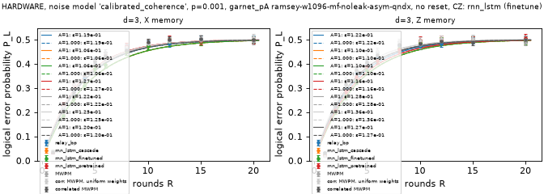

## HARDWARE: rnn_lstm, test split, run `20261024-220320-finetune-20261024-195414`

Pre-trained models from `20261024-195414-rnn_lstm_emerald`. Correlated MWPM's weights come from the decoder prior (`calibrated_coherence` with {'t2': 'ramsey', 'readout': 'asym', 'qnd': 'excess'} on the run's device patch); "uniform" is correlated MWPM with uniform-model weights. ΔP_L is paired against correlated MWPM on the same shots (bootstrap 95%).

The validation split (the fine-tuning batches' held-out 20%) served early stopping and the cascade's τ, so numbers on it lean optimistic. The test batch, never trained or tuned on, is the honest number.

**emerald_eA_Z**: 34 runs (HARDWARE, calibration sets 23e12f6b, batches [0, 1, 2, 3]); fine-tuned on 35,200 shots of batches [1, 2], early-stopped on 8,800, 86 s (early stop: no val improvement in 15 evaluations).
Cascade τ = 0.00, tuned on 8,800 validation shots (one-standard-error rule; the argmin τ was 0.10), re-tuned on validation at 2026-10-25T01:48 UTC (the replaced entry is kept); τ from `20261024-211525-finetune-20261024-195414`. Relay-BP and its MWPM fallback use the **calibrated** prior, chosen on validation by the same test: correlated MWPM fails 2,060 shots with calibrated weights and 2,238 with uniform weights, of 8,800 (1 SE 39.5).

Pooled over its 11 points (22,000 shots, the same number at each R); ΔP_L is paired, from the summed discordant shots (bootstrap 95%):

| Decoder | Failures (P_L) | ΔP_L vs corr MWPM [95%] | ΔP_L vs uniform-weight MWPM [95%] |
|---:|---:|---:|---:|
| rnn_lstm_pretrained | 5,129 (0.2331) | +2.27e-04 [-4.59e-03, 5.14e-03] tie | -3.86e-03 [-9.55e-03, 1.82e-03] tie |
| rnn_lstm_finetuned | 4,994 (0.2270) | -5.91e-03 [-0.0115, -5.91e-04] **win** | -0.0100 [-0.0158, -4.23e-03] **win** |
| rnn_lstm_cascade | 4,994 (0.2270) | -5.91e-03 [-0.0115, -5.91e-04] **win** | -0.0100 [-0.0158, -4.23e-03] **win** |
| relay_bp | 5,108 (0.2322) | -7.27e-04 [-5.18e-03, 3.77e-03] tie | -4.82e-03 [-0.0104, 8.18e-04] tie |
| mwpm_corr | 5,124 (0.2329) | – | – |
| mwpm_corr_uniform | 5,214 (0.2370) | +4.09e-03 [-1.32e-03, 9.50e-03] tie | – |
| mwpm | 5,305 (0.2411) | – | – |

| R | N | rnn_lstm_pretrained P_L [95%] | ΔP_L vs corr [95%] | rnn_lstm_finetuned P_L [95%] | ΔP_L vs corr [95%] | rnn_lstm_cascade P_L [95%] | ΔP_L vs corr [95%] | relay_bp P_L [95%] | ΔP_L vs corr [95%] | corr MWPM [95%] | uniform | always 0 |
|---:|---:|---:|---:|---:|---:|---:|---:|---:|---:|---:|---:|---:|
| 1 | 2,000 | 8.50e-03 [5.31e-03, 0.0136] | -1.00e-03 [-3.00e-03, 1.00e-03] tie | 8.50e-03 [5.31e-03, 0.0136] | -1.00e-03 [-3.50e-03, 1.50e-03] tie | 8.50e-03 [5.31e-03, 0.0136] | -1.00e-03 [-3.50e-03, 1.50e-03] tie | 9.00e-03 [5.70e-03, 0.0142] | -5.00e-04 [-2.50e-03, 1.00e-03] tie | 9.50e-03 [6.09e-03, 0.0148] | 9.50e-03 | 0.0710 |
| 2 | 2,000 | 0.0805 [0.0694, 0.0932] | -4.00e-03 [-9.50e-03, 1.50e-03] tie | 0.0810 [0.0698, 0.0938] | -3.50e-03 [-0.0100, 3.00e-03] tie | 0.0810 [0.0698, 0.0938] | -3.50e-03 [-0.0100, 3.00e-03] tie | 0.0815 [0.0703, 0.0943] | -3.00e-03 [-8.50e-03, 2.50e-03] tie | 0.0845 [0.0731, 0.0975] | 0.0890 | 0.2690 |
| 3 | 2,000 | 0.1050 [0.0923, 0.1192] | +6.50e-03 [-3.00e-03, 0.0165] tie | 0.1010 [0.0885, 0.1150] | +2.50e-03 [-8.50e-03, 0.0135] tie | 0.1010 [0.0885, 0.1150] | +2.50e-03 [-8.50e-03, 0.0135] tie | 0.0970 [0.0848, 0.1108] | -1.50e-03 [-8.50e-03, 5.50e-03] tie | 0.0985 [0.0862, 0.1123] | 0.1080 | 0.2760 |
| 4 | 2,000 | 0.1585 [0.1432, 0.1752] | -2.00e-03 [-0.0130, 9.00e-03] tie | 0.1520 [0.1369, 0.1684] | -8.50e-03 [-0.0215, 4.00e-03] tie | 0.1520 [0.1369, 0.1684] | -8.50e-03 [-0.0215, 4.00e-03] tie | 0.1475 [0.1326, 0.1637] | -0.0130 [-0.0225, -3.50e-03] **win** | 0.1605 [0.1451, 0.1772] | 0.1600 | 0.3540 |
| 5 | 2,000 | 0.1860 [0.1696, 0.2036] | +6.00e-03 [-7.00e-03, 0.0190] tie | 0.1820 [0.1657, 0.1995] | +2.00e-03 [-0.0130, 0.0170] tie | 0.1820 [0.1657, 0.1995] | +2.00e-03 [-0.0130, 0.0170] tie | 0.1815 [0.1652, 0.1990] | +1.50e-03 [-8.50e-03, 0.0120] tie | 0.1800 [0.1638, 0.1974] | 0.1930 | 0.3730 |
| 6 | 2,000 | 0.2115 [0.1942, 0.2299] | -4.50e-03 [-0.0185, 9.50e-03] tie | 0.2045 [0.1874, 0.2227] | -0.0115 [-0.0270, 4.50e-03] tie | 0.2045 [0.1874, 0.2227] | -0.0115 [-0.0270, 4.50e-03] tie | 0.2115 [0.1942, 0.2299] | -4.50e-03 [-0.0170, 8.00e-03] tie | 0.2160 [0.1985, 0.2346] | 0.2190 | 0.4100 |
| 8 | 2,000 | 0.2655 [0.2466, 0.2853] | -2.00e-03 [-0.0185, 0.0140] tie | 0.2605 [0.2417, 0.2802] | -7.00e-03 [-0.0255, 0.0120] tie | 0.2605 [0.2417, 0.2802] | -7.00e-03 [-0.0255, 0.0120] tie | 0.2655 [0.2466, 0.2853] | -2.00e-03 [-0.0165, 0.0130] tie | 0.2675 [0.2486, 0.2873] | 0.2785 | 0.4215 |
| 10 | 2,000 | 0.3060 [0.2862, 0.3266] | -7.50e-03 [-0.0265, 0.0120] tie | 0.3235 [0.3034, 0.3443] | +0.0100 [-0.0115, 0.0320] tie | 0.3235 [0.3034, 0.3443] | +0.0100 [-0.0115, 0.0320] tie | 0.3320 [0.3117, 0.3529] | +0.0185 [1.00e-03, 0.0365] loss | 0.3135 [0.2935, 0.3342] | 0.3285 | 0.4630 |
| 12 | 2,000 | 0.3610 [0.3402, 0.3823] | -3.50e-03 [-0.0250, 0.0185] tie | 0.3570 [0.3363, 0.3783] | -7.50e-03 [-0.0315, 0.0165] tie | 0.3570 [0.3363, 0.3783] | -7.50e-03 [-0.0315, 0.0165] tie | 0.3605 [0.3397, 0.3818] | -4.00e-03 [-0.0240, 0.0165] tie | 0.3645 [0.3437, 0.3858] | 0.3685 | 0.4675 |
| 15 | 2,000 | 0.4120 [0.3906, 0.4337] | -0.0110 [-0.0340, 0.0125] tie | 0.3840 [0.3629, 0.4055] | -0.0390 [-0.0640, -0.0140] **win** | 0.3840 [0.3629, 0.4055] | -0.0390 [-0.0640, -0.0140] **win** | 0.4125 [0.3911, 0.4342] | -0.0105 [-0.0320, 0.0115] tie | 0.4230 [0.4015, 0.4448] | 0.4055 | 0.4815 |
| 20 | 2,000 | 0.4700 [0.4482, 0.4919] | +0.0255 [1.00e-03, 0.0505] loss | 0.4430 [0.4214, 0.4649] | -1.50e-03 [-0.0280, 0.0250] tie | 0.4430 [0.4214, 0.4649] | -1.50e-03 [-0.0280, 0.0250] tie | 0.4555 [0.4338, 0.4774] | +0.0110 [-0.0130, 0.0355] tie | 0.4445 [0.4228, 0.4664] | 0.4475 | 0.4925 |

**emerald_eA_X**: 33 runs (HARDWARE, calibration sets 23e12f6b, batches [1, 2, 3]); fine-tuned on 35,200 shots of batches [1, 2], early-stopped on 8,800, 81 s (early stop: no val improvement in 15 evaluations).
Cascade τ = 0.19, tuned on 8,800 validation shots (one-standard-error rule; the argmin τ was 0.21), re-tuned on validation at 2026-10-25T01:49 UTC (the replaced entry is kept); τ from `20261024-211525-finetune-20261024-195414`. Relay-BP and its MWPM fallback use the **uniform** prior, chosen on validation by the same test: correlated MWPM fails 1,934 shots with calibrated weights and 1,807 with uniform weights, of 8,800 (1 SE 37.3).

Pooled over its 11 points (22,000 shots, the same number at each R); ΔP_L is paired, from the summed discordant shots (bootstrap 95%):

| Decoder | Failures (P_L) | ΔP_L vs corr MWPM [95%] | ΔP_L vs uniform-weight MWPM [95%] |
|---:|---:|---:|---:|
| rnn_lstm_pretrained | 4,286 (0.1948) | -0.0106 [-0.0159, -5.45e-03] **win** | -3.59e-03 [-8.59e-03, 1.50e-03] tie |
| rnn_lstm_finetuned | 4,237 (0.1926) | -0.0129 [-0.0180, -7.82e-03] **win** | -5.82e-03 [-0.0108, -9.08e-04] **win** |
| rnn_lstm_cascade | 4,254 (0.1934) | -0.0121 [-0.0173, -6.91e-03] **win** | -5.05e-03 [-9.68e-03, -3.18e-04] **win** |
| relay_bp | 4,521 (0.2055) | +4.55e-05 [-5.41e-03, 5.55e-03] tie | +7.09e-03 [2.27e-03, 0.0120] loss |
| mwpm_corr | 4,520 (0.2055) | – | – |
| mwpm_corr_uniform | 4,365 (0.1984) | -7.05e-03 [-0.0122, -1.86e-03] **win** | – |
| mwpm | 4,574 (0.2079) | – | – |

| R | N | rnn_lstm_pretrained P_L [95%] | ΔP_L vs corr [95%] | rnn_lstm_finetuned P_L [95%] | ΔP_L vs corr [95%] | rnn_lstm_cascade P_L [95%] | ΔP_L vs corr [95%] | relay_bp P_L [95%] | ΔP_L vs corr [95%] | corr MWPM [95%] | uniform | always 0 |
|---:|---:|---:|---:|---:|---:|---:|---:|---:|---:|---:|---:|---:|
| 1 | 2,000 | 0.0105 [6.88e-03, 0.0160] | -2.50e-03 [-6.50e-03, 1.50e-03] tie | 9.50e-03 [6.09e-03, 0.0148] | -3.50e-03 [-7.00e-03, 0] tie | 9.50e-03 [6.09e-03, 0.0148] | -3.50e-03 [-7.00e-03, -5.00e-04] **win** | 0.0130 [8.89e-03, 0.0190] | 0 [-3.00e-03, 3.00e-03] tie | 0.0130 [8.89e-03, 0.0190] | 0.0120 | 0.0535 |
| 2 | 2,000 | 0.0395 [0.0318, 0.0490] | -6.00e-03 [-0.0120, 0] tie | 0.0375 [0.0300, 0.0468] | -8.00e-03 [-0.0135, -2.50e-03] **win** | 0.0370 [0.0296, 0.0462] | -8.50e-03 [-0.0145, -3.00e-03] **win** | 0.0385 [0.0309, 0.0479] | -7.00e-03 [-0.0135, -1.00e-03] **win** | 0.0455 [0.0372, 0.0555] | 0.0355 | 0.1545 |
| 3 | 2,000 | 0.0785 [0.0675, 0.0911] | -9.00e-03 [-0.0180, 0] tie | 0.0800 [0.0689, 0.0927] | -7.50e-03 [-0.0160, 1.00e-03] tie | 0.0805 [0.0694, 0.0932] | -7.00e-03 [-0.0155, 1.50e-03] tie | 0.0860 [0.0745, 0.0991] | -1.50e-03 [-0.0110, 8.00e-03] tie | 0.0875 [0.0759, 0.1007] | 0.0815 | 0.2210 |
| 4 | 2,000 | 0.1040 [0.0914, 0.1181] | -0.0185 [-0.0300, -6.50e-03] **win** | 0.1050 [0.0923, 0.1192] | -0.0175 [-0.0290, -6.00e-03] **win** | 0.1050 [0.0923, 0.1192] | -0.0175 [-0.0290, -5.50e-03] **win** | 0.1140 [0.1008, 0.1287] | -8.50e-03 [-0.0220, 4.50e-03] tie | 0.1225 [0.1089, 0.1376] | 0.1135 | 0.2845 |
| 5 | 2,000 | 0.1430 [0.1283, 0.1590] | -0.0125 [-0.0260, 5.00e-04] tie | 0.1435 [0.1288, 0.1595] | -0.0120 [-0.0250, 1.00e-03] tie | 0.1390 [0.1245, 0.1549] | -0.0165 [-0.0300, -3.50e-03] **win** | 0.1485 [0.1336, 0.1648] | -7.00e-03 [-0.0225, 8.50e-03] tie | 0.1555 [0.1403, 0.1720] | 0.1510 | 0.3330 |
| 6 | 2,000 | 0.1610 [0.1455, 0.1778] | -0.0210 [-0.0365, -5.50e-03] **win** | 0.1585 [0.1432, 0.1752] | -0.0235 [-0.0380, -8.50e-03] **win** | 0.1585 [0.1432, 0.1752] | -0.0235 [-0.0390, -8.00e-03] **win** | 0.1730 [0.1571, 0.1902] | -9.00e-03 [-0.0250, 7.50e-03] tie | 0.1820 [0.1657, 0.1995] | 0.1740 | 0.3530 |
| 8 | 2,000 | 0.2340 [0.2160, 0.2531] | +3.50e-03 [-0.0145, 0.0220] tie | 0.2245 [0.2068, 0.2433] | -6.00e-03 [-0.0235, 0.0115] tie | 0.2250 [0.2072, 0.2438] | -5.50e-03 [-0.0235, 0.0120] tie | 0.2470 [0.2286, 0.2664] | +0.0165 [-2.50e-03, 0.0360] tie | 0.2305 [0.2126, 0.2495] | 0.2265 | 0.4095 |
| 10 | 2,000 | 0.2840 [0.2647, 0.3042] | -8.50e-03 [-0.0300, 0.0125] tie | 0.2780 [0.2588, 0.2980] | -0.0145 [-0.0345, 5.50e-03] tie | 0.2760 [0.2569, 0.2960] | -0.0165 [-0.0360, 3.50e-03] tie | 0.2930 [0.2735, 0.3133] | +5.00e-04 [-0.0210, 0.0220] tie | 0.2925 [0.2730, 0.3128] | 0.2905 | 0.4345 |
| 12 | 2,000 | 0.3145 [0.2945, 0.3352] | -0.0200 [-0.0420, 2.50e-03] tie | 0.3180 [0.2980, 0.3387] | -0.0165 [-0.0375, 4.50e-03] tie | 0.3155 [0.2955, 0.3362] | -0.0190 [-0.0410, 3.50e-03] tie | 0.3300 [0.3097, 0.3509] | -4.50e-03 [-0.0280, 0.0190] tie | 0.3345 [0.3142, 0.3555] | 0.3245 | 0.4670 |
| 15 | 2,000 | 0.3505 [0.3299, 0.3717] | -0.0170 [-0.0405, 6.50e-03] tie | 0.3495 [0.3289, 0.3707] | -0.0180 [-0.0415, 5.50e-03] tie | 0.3585 [0.3378, 0.3798] | -9.00e-03 [-0.0325, 0.0150] tie | 0.3790 [0.3580, 0.4005] | +0.0115 [-0.0130, 0.0370] tie | 0.3675 [0.3466, 0.3889] | 0.3635 | 0.4815 |
| 20 | 2,000 | 0.4235 [0.4020, 0.4453] | -5.50e-03 [-0.0320, 0.0210] tie | 0.4145 [0.3931, 0.4362] | -0.0145 [-0.0410, 0.0125] tie | 0.4225 [0.4010, 0.4443] | -6.50e-03 [-0.0330, 0.0200] tie | 0.4385 [0.4169, 0.4603] | +9.50e-03 [-0.0180, 0.0375] tie | 0.4290 [0.4075, 0.4508] | 0.4100 | 0.4880 |

Speed on this laptop (warmed; end to end, numpy in and out). Decoder: CUDA throughput at batch 65,536 and latency per shot at batch 1, CPU (1 thread) latency at batch 1 and throughput at batch 4,096; correlated MWPM on one CPU thread.

| group | R | CUDA shots/s (b=65536) | CUDA µs (b=1) | CPU-1 µs (b=1) | CPU-1 shots/s (b=4096) | corr MWPM shots/s | corr MWPM µs (b=1) |
|---:|---:|---:|---:|---:|---:|---:|---:|
| emerald_eA_Z | 3 | – | 2,834.6 | 735.0 | skip | – | 8.6 |
| emerald_eA_Z | 20 | – | 3,323.8 | 798.0 | skip | – | 47.3 |
| emerald_eA_X | 3 | – | 2,680.1 | 492.2 | skip | – | 8.4 |
| emerald_eA_X | 20 | – | 2,782.1 | 763.7 | skip | – | 44.4 |

### rnn_lstm (finetune), run `20261024-220320-finetune-20261024-195414`

| group | noise | options | p | basis | decoder | #R | ε_L A=1 [95%] | χ²/dof (p) | ε_L SPAM [95%] | A | χ²/dof (p)  | ε/ε_corr A=1 [95%] | ε/ε_corr SPAM [95%, reduced] | min corr k |
|---:|---|---:|---:|---|---|---:|---:|---:|---:|---:|---:|---:|---:|---:|
| emerald_eA_X | calibrated_coherence | ramsey-w1036-mf-noleak-asym-qndx | 0.001 | X | mwpm_corr | 11 | 0.0374 [0.0361, 0.0388] | 91.8/10 (p=0.00) | 0.0374 [0.0361, 0.0388] | 1.000 | 91.8/9 (p=0.00) | – | – | 26 (short at R=1,2) |
| emerald_eA_X | calibrated_coherence | ramsey-w1036-mf-noleak-asym-qndx | 0.001 | X | mwpm | 11 | 0.0382 [0.0369, 0.0397] | 88.6/10 (p=0.00) | 0.0382 [0.0369, 0.0397] | 1.000 | 88.6/9 (p=0.00) | 1.022 [0.995, 1.049] | 1.022 [0.996, 1.049] | 26 (short at R=1,2) |
| emerald_eA_X | calibrated_coherence | ramsey-w1036-mf-noleak-asym-qndx | 0.001 | X | mwpm_corr_uniform | 11 | 0.0356 [0.0343, 0.0370] | 108.5/10 (p=0.00) | 0.0356 [0.0343, 0.0370] | 1.000 | 108.5/9 (p=0.00) | 0.952 [0.919, 0.985] | 0.952 [0.921, 0.983] | 26 (short at R=1,2) |
| emerald_eA_X | calibrated_coherence | ramsey-w1036-mf-noleak-asym-qndx | 0.001 | X | relay_bp | 11 | 0.0373 [0.0360, 0.0387] | 126.9/10 (p=0.00) | 0.0373 [0.0360, 0.0387] | 1.000 | 126.9/9 (p=0.00) | 0.997 [0.960, 1.032] | 0.997 [0.961, 1.030] | 26 (short at R=1,2) |
| emerald_eA_X | calibrated_coherence | ramsey-w1036-mf-noleak-asym-qndx | 0.001 | X | rnn_lstm_cascade | 11 | 0.0342 [0.0330, 0.0355] | 120.0/10 (p=0.00) | 0.0342 [0.0330, 0.0355] | 1.000 | 120.0/9 (p=0.00) | 0.915 [0.883, 0.949] | 0.915 [0.886, 0.945] | 26 (short at R=1,2) |
| emerald_eA_X | calibrated_coherence | ramsey-w1036-mf-noleak-asym-qndx | 0.001 | X | rnn_lstm_finetuned | 11 | 0.0341 [0.0329, 0.0354] | 111.2/10 (p=0.00) | 0.0341 [0.0329, 0.0354] | 1.000 | 111.2/9 (p=0.00) | 0.911 [0.881, 0.944] | 0.911 [0.882, 0.937] | 26 (short at R=1,2) |
| emerald_eA_X | calibrated_coherence | ramsey-w1036-mf-noleak-asym-qndx | 0.001 | X | rnn_lstm_pretrained | 11 | 0.0346 [0.0334, 0.0359] | 114.9/10 (p=0.00) | 0.0346 [0.0334, 0.0359] | 1.000 | 114.9/9 (p=0.00) | 0.925 [0.892, 0.959] | 0.925 [0.892, 0.954] | 26 (short at R=1,2) |
| emerald_eA_Z | calibrated_coherence | ramsey-w1036-mf-noleak-asym-qndx | 0.001 | Z | mwpm_corr | 11 | 0.0453 [0.0437, 0.0469] | 97.3/10 (p=0.00) | 0.0453 [0.0437, 0.0469] | 1.000 | 97.3/9 (p=0.00) | – | – | 19 (short at R=1) |
| emerald_eA_Z | calibrated_coherence | ramsey-w1036-mf-noleak-asym-qndx | 0.001 | Z | mwpm | 11 | 0.0479 [0.0462, 0.0496] | 107.9/10 (p=0.00) | 0.0479 [0.0462, 0.0496] | 1.000 | 107.9/9 (p=0.00) | 1.057 [1.034, 1.082] | 1.057 [1.034, 1.080] | 19 (short at R=1) |
| emerald_eA_Z | calibrated_coherence | ramsey-w1036-mf-noleak-asym-qndx | 0.001 | Z | mwpm_corr_uniform | 11 | 0.0467 [0.0451, 0.0484] | 82.7/10 (p=0.00) | 0.0467 [0.0451, 0.0484] | 1.000 | 82.7/9 (p=0.00) | 1.031 [0.996, 1.067] | 1.031 [0.996, 1.069] | 19 (short at R=1) |
| emerald_eA_Z | calibrated_coherence | ramsey-w1036-mf-noleak-asym-qndx | 0.001 | Z | relay_bp | 11 | 0.0449 [0.0434, 0.0466] | 104.6/10 (p=0.00) | 0.0449 [0.0434, 0.0466] | 1.000 | 104.6/9 (p=0.00) | 0.993 [0.966, 1.021] | 0.993 [0.965, 1.021] | 19 (short at R=1) |
| emerald_eA_Z | calibrated_coherence | ramsey-w1036-mf-noleak-asym-qndx | 0.001 | Z | rnn_lstm_cascade | 11 | 0.0436 [0.0421, 0.0452] | 83.0/10 (p=0.00) | 0.0436 [0.0421, 0.0452] | 1.000 | 83.0/9 (p=0.00) | 0.964 [0.930, 0.998] | 0.964 [0.933, 1.001] | 19 (short at R=1) |
| emerald_eA_Z | calibrated_coherence | ramsey-w1036-mf-noleak-asym-qndx | 0.001 | Z | rnn_lstm_finetuned | 11 | 0.0436 [0.0421, 0.0452] | 83.0/10 (p=0.00) | 0.0436 [0.0421, 0.0452] | 1.000 | 83.0/9 (p=0.00) | 0.964 [0.931, 0.996] | 0.964 [0.932, 0.998] | 19 (short at R=1) |
| emerald_eA_Z | calibrated_coherence | ramsey-w1036-mf-noleak-asym-qndx | 0.001 | Z | rnn_lstm_pretrained | 11 | 0.0452 [0.0436, 0.0468] | 100.1/10 (p=0.00) | 0.0452 [0.0436, 0.0468] | 1.000 | 100.1/9 (p=0.00) | 0.998 [0.967, 1.028] | 0.998 [0.967, 1.027] | 19 (short at R=1) |

**Sensitivity fits** (mlDecoder's, not the team's `fit_ler`): the A = 1 form refit on R ≥ 3 and R ≥ 5, and a free-amplitude fit with A in (0, 2], written P_L = [1 − (1 − 2ε)^(R − R₀)]/2 with R₀ = ln A / −ln(1 − 2ε). The **headline is the A = 1 all-R fit** (the challenge's formula); "trusted" names the first fit, in the order all-R, free A, R ≥ 3, R ≥ 5, whose Pearson p ≥ 0.05. A > 1 (significant by the likelihood-ratio p) is the boundary-round effect of the no-reset circuit, not SPAM: round 1 has only basis-type detectors and round 2's detector is m₂ alone, so the curve starts R₀ rounds late. With A forced to 1, dropping early rounds shrinks that bias but does not remove it.

| group | noise | options | p | basis | decoder | A=1 all R | A=1 R≥3 | A=1 R≥5 | free A | A | R₀ | LR p (A>1) | trusted |
|---:|---|---:|---:|---|---|---:|---:|---:|---:|---:|---:|---:|---:|
| emerald_eA_X | calibrated_coherence | ramsey-w1036-mf-noleak-asym-qndx | 0.001 | X | mwpm_corr | 0.0374 [0.0361, 0.0388] (p=2.3e-15) | 0.0389 [0.0375, 0.0404] (p=6.6e-05) | 0.0403 [0.0386, 0.0420] (p=0.0087) | 0.0434 [0.0416, 0.0452] (p=0.25) | 1.07181 | 0.76 | 3e-22 | free A, all R |
| emerald_eA_X | calibrated_coherence | ramsey-w1036-mf-noleak-asym-qndx | 0.001 | X | mwpm | 0.0382 [0.0369, 0.0397] (p=1e-14) | 0.0399 [0.0384, 0.0415] (p=0.005) | 0.0414 [0.0397, 0.0432] (p=0.73) | 0.0445 [0.0426, 0.0464] (p=0.38) | 1.07412 | 0.77 | 2e-22 | free A, all R |
| emerald_eA_X | calibrated_coherence | ramsey-w1036-mf-noleak-asym-qndx | 0.001 | X | mwpm_corr_uniform | 0.0356 [0.0343, 0.0370] (p=1.1e-18) | 0.0372 [0.0358, 0.0387] (p=2.2e-05) | 0.0387 [0.0371, 0.0404] (p=0.023) | 0.0414 [0.0397, 0.0432] (p=0.025) | 1.07115 | 0.79 | 5e-25 | none |
| emerald_eA_X | calibrated_coherence | ramsey-w1036-mf-noleak-asym-qndx | 0.001 | X | relay_bp | 0.0373 [0.0360, 0.0387] (p=2e-22) | 0.0390 [0.0376, 0.0405] (p=6.3e-09) | 0.0407 [0.0391, 0.0424] (p=5.4e-05) | 0.0435 [0.0417, 0.0453] (p=0.00074) | 1.07494 | 0.79 | 8.2e-27 | none |
| emerald_eA_X | calibrated_coherence | ramsey-w1036-mf-noleak-asym-qndx | 0.001 | X | rnn_lstm_cascade | 0.0342 [0.0330, 0.0355] (p=5.1e-21) | 0.0357 [0.0344, 0.0371] (p=4.5e-08) | 0.0371 [0.0356, 0.0387] (p=9.1e-05) | 0.0400 [0.0384, 0.0417] (p=0.011) | 1.07160 | 0.83 | 1.8e-27 | none |
| emerald_eA_X | calibrated_coherence | ramsey-w1036-mf-noleak-asym-qndx | 0.001 | X | rnn_lstm_finetuned | 0.0341 [0.0329, 0.0354] (p=3.1e-19) | 0.0355 [0.0342, 0.0369] (p=9.7e-07) | 0.0370 [0.0354, 0.0385] (p=0.0015) | 0.0398 [0.0382, 0.0415] (p=0.044) | 1.07073 | 0.82 | 2.6e-26 | none |
| emerald_eA_X | calibrated_coherence | ramsey-w1036-mf-noleak-asym-qndx | 0.001 | X | rnn_lstm_pretrained | 0.0346 [0.0334, 0.0359] (p=5.6e-20) | 0.0361 [0.0347, 0.0374] (p=3.1e-08) | 0.0377 [0.0361, 0.0393] (p=0.00058) | 0.0403 [0.0387, 0.0420] (p=0.012) | 1.07061 | 0.81 | 7.1e-26 | none |
| emerald_eA_Z | calibrated_coherence | ramsey-w1036-mf-noleak-asym-qndx | 0.001 | Z | mwpm_corr | 0.0453 [0.0437, 0.0469] (p=1.9e-16) | 0.0466 [0.0449, 0.0484] (p=2.5e-05) | 0.0480 [0.0460, 0.0501] (p=0.0054) | 0.0536 [0.0513, 0.0559] (p=0.0011) | 1.09415 | 0.79 | 3.3e-23 | none |
| emerald_eA_Z | calibrated_coherence | ramsey-w1036-mf-noleak-asym-qndx | 0.001 | Z | mwpm | 0.0479 [0.0462, 0.0496] (p=1.4e-18) | 0.0496 [0.0477, 0.0515] (p=5.7e-06) | 0.0509 [0.0488, 0.0531] (p=0.00061) | 0.0572 [0.0547, 0.0596] (p=0.00085) | 1.10375 | 0.81 | 6e-26 | none |
| emerald_eA_Z | calibrated_coherence | ramsey-w1036-mf-noleak-asym-qndx | 0.001 | Z | mwpm_corr_uniform | 0.0467 [0.0451, 0.0484] (p=1.5e-13) | 0.0481 [0.0463, 0.0499] (p=0.021) | 0.0494 [0.0474, 0.0516] (p=0.37) | 0.0553 [0.0529, 0.0578] (p=0.015) | 1.09639 | 0.79 | 6.2e-22 | A=1, R>=5 |
| emerald_eA_Z | calibrated_coherence | ramsey-w1036-mf-noleak-asym-qndx | 0.001 | Z | relay_bp | 0.0449 [0.0434, 0.0466] (p=6.4e-18) | 0.0464 [0.0447, 0.0481] (p=2.3e-06) | 0.0483 [0.0463, 0.0504] (p=0.0055) | 0.0534 [0.0512, 0.0557] (p=0.0068) | 1.09676 | 0.82 | 4.1e-26 | none |
| emerald_eA_Z | calibrated_coherence | ramsey-w1036-mf-noleak-asym-qndx | 0.001 | Z | rnn_lstm_cascade | 0.0436 [0.0421, 0.0452] (p=1.3e-13) | 0.0449 [0.0433, 0.0467] (p=0.007) | 0.0461 [0.0442, 0.0481] (p=0.12) | 0.0515 [0.0493, 0.0538] (p=0.018) | 1.09045 | 0.80 | 6.9e-22 | A=1, R>=5 |
| emerald_eA_Z | calibrated_coherence | ramsey-w1036-mf-noleak-asym-qndx | 0.001 | Z | rnn_lstm_finetuned | 0.0436 [0.0421, 0.0452] (p=1.3e-13) | 0.0449 [0.0433, 0.0467] (p=0.007) | 0.0461 [0.0442, 0.0481] (p=0.12) | 0.0515 [0.0493, 0.0538] (p=0.018) | 1.09045 | 0.80 | 6.9e-22 | A=1, R>=5 |
| emerald_eA_Z | calibrated_coherence | ramsey-w1036-mf-noleak-asym-qndx | 0.001 | Z | rnn_lstm_pretrained | 0.0452 [0.0436, 0.0468] (p=5.3e-17) | 0.0467 [0.0450, 0.0485] (p=4.8e-05) | 0.0478 [0.0459, 0.0499] (p=0.00081) | 0.0537 [0.0514, 0.0560] (p=0.0025) | 1.09698 | 0.82 | 8.6e-25 | none |

Speed on this laptop (warmed; end to end, numpy in and out). Decoder: CUDA throughput at batch 65,536 and latency per shot at batch 1, CPU (1 thread) latency at batch 1 and throughput at batch 4,096; correlated MWPM on one CPU thread.

| group | R | CUDA shots/s (b=65536) | CUDA µs (b=1) | CPU-1 µs (b=1) | CPU-1 shots/s (b=4096) | corr MWPM shots/s | corr MWPM µs (b=1) |
|---:|---:|---:|---:|---:|---:|---:|---:|
| emerald_eA_Z | 3 | – | 2,834.6 | 735.0 | skip | – | 8.6 |
| emerald_eA_Z | 20 | – | 3,323.8 | 798.0 | skip | – | 47.3 |
| emerald_eA_X | 3 | – | 2,680.1 | 492.2 | skip | – | 8.4 |
| emerald_eA_X | 20 | – | 2,782.1 | 763.7 | skip | – | 44.4 |

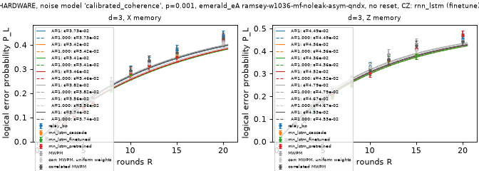

## The bar: MWPM on the frozen test sets

Correlated MWPM (`challenge.decoding.make_matcher(noisy, correlated=True)`) and uncorrelated MWPM on the same frozen shots. N is sized from a correlated-MWPM pilot so that MWPM expects at least 100 failures (×1.25 margin, at least 100,000 shots, capped at 10⁷). Δ is P_L(MWPM) − P_L(correlated MWPM). Speed columns: throughput at batch 65,536 and latency per shot at batch 1, one thread. Leakage sets come from `challenge.leakage.sample_leakage`, decoded with the static Pauli DEM (a model mismatch the team's pipeline records).

### calibrated_coherence, p = 0.001, emerald-23e12f6b-eA-ramsey-w1036-mf-noleak-asym-qndx

| d | basis | R | N | corr k | corr P_L [95%] | MWPM k | MWPM P_L [95%] | Δ MWPM − corr [95%] | corr shots/s | corr µs (b=1) | MWPM shots/s | MWPM µs (b=1) | dataset |
|---:|---|---:|---:|---:|---:|---:|---:|---:|---:|---:|---:|---:|---:|
| 3 | X | 1 | 100,000 | 1608 | 0.0161 [0.0153, 0.0169] | 1620 | 0.0162 [0.0154, 0.0170] | +1.20e-04 [-1.00e-05, 2.60e-04] | – | – | – | – | `5ad9f7899fa7` |
| 3 | X | 2 | 100,000 | 9088 | 0.0909 [0.0891, 0.0927] | 9310 | 0.0931 [0.0913, 0.0949] | +2.22e-03 [1.62e-03, 2.82e-03] | – | – | – | – | `666f0de27220` |
| 3 | X | 3 | 100,000 | 17108 | 0.1711 [0.1688, 0.1734] | 17480 | 0.1748 [0.1725, 0.1772] | +3.72e-03 [2.72e-03, 4.72e-03] | – | – | – | – | `836539a1f28a` |
| 3 | X | 4 | 100,000 | 23154 | 0.2315 [0.2289, 0.2342] | 23729 | 0.2373 [0.2347, 0.2399] | +5.75e-03 [4.46e-03, 7.03e-03] | – | – | – | – | `d1fa034f312a` |
| 3 | X | 5 | 100,000 | 28413 | 0.2841 [0.2813, 0.2869] | 29095 | 0.2909 [0.2881, 0.2938] | +6.82e-03 [5.32e-03, 8.30e-03] | – | – | – | – | `dfad940a2fcb` |
| 3 | X | 6 | 100,000 | 32554 | 0.3255 [0.3226, 0.3285] | 33353 | 0.3335 [0.3306, 0.3365] | +7.99e-03 [6.27e-03, 9.70e-03] | – | – | – | – | `bc902840c4c2` |
| 3 | X | 8 | 100,000 | 38623 | 0.3862 [0.3832, 0.3893] | 39206 | 0.3921 [0.3890, 0.3951] | +5.83e-03 [3.80e-03, 7.84e-03] | – | – | – | – | `fffba0e48eb1` |
| 3 | X | 10 | 100,000 | 42640 | 0.4264 [0.4233, 0.4295] | 43078 | 0.4308 [0.4277, 0.4339] | +4.38e-03 [2.12e-03, 6.61e-03] | – | – | – | – | `d8ba2be34f85` |
| 3 | X | 12 | 100,000 | 45306 | 0.4531 [0.4500, 0.4561] | 45650 | 0.4565 [0.4534, 0.4596] | +3.44e-03 [9.50e-04, 5.93e-03] | – | – | – | – | `1735a68a6d0a` |
| 3 | X | 15 | 100,000 | 47377 | 0.4738 [0.4707, 0.4769] | 47778 | 0.4778 [0.4747, 0.4809] | +4.01e-03 [1.29e-03, 6.79e-03] | – | – | – | – | `faebcbdf97a4` |
| 3 | X | 20 | 100,000 | 49300 | 0.4930 [0.4899, 0.4961] | 49336 | 0.4934 [0.4903, 0.4965] | +3.60e-04 [-2.69e-03, 3.40e-03] | – | – | – | – | `33d987c3c556` |
| 3 | Z | 1 | 100,000 | 1023 | 0.0102 [9.62e-03, 0.0109] | 1023 | 0.0102 [9.62e-03, 0.0109] | 0 [0, 0] | – | – | – | – | `29c200fb2f7b` |
| 3 | Z | 2 | 100,000 | 3520 | 0.0352 [0.0341, 0.0364] | 3626 | 0.0363 [0.0351, 0.0374] | +1.06e-03 [6.80e-04, 1.45e-03] | – | – | – | – | `20da7bc3ec5a` |
| 3 | Z | 3 | 100,000 | 6328 | 0.0633 [0.0618, 0.0648] | 6510 | 0.0651 [0.0636, 0.0666] | +1.82e-03 [1.10e-03, 2.54e-03] | – | – | – | – | `bd12d207f45b` |
| 3 | Z | 4 | 100,000 | 8844 | 0.0884 [0.0867, 0.0902] | 9094 | 0.0909 [0.0892, 0.0927] | +2.50e-03 [1.53e-03, 3.46e-03] | – | – | – | – | `4dbfb965dd8f` |
| 3 | Z | 5 | 100,000 | 11563 | 0.1156 [0.1137, 0.1176] | 11937 | 0.1194 [0.1174, 0.1214] | +3.74e-03 [2.55e-03, 4.92e-03] | – | – | – | – | `3b5e9d997884` |
| 3 | Z | 6 | 100,000 | 13851 | 0.1385 [0.1364, 0.1407] | 14302 | 0.1430 [0.1409, 0.1452] | +4.51e-03 [3.18e-03, 5.84e-03] | – | – | – | – | `53d411f5c035` |
| 3 | Z | 8 | 100,000 | 18460 | 0.1846 [0.1822, 0.1870] | 18890 | 0.1889 [0.1865, 0.1913] | +4.30e-03 [2.71e-03, 5.92e-03] | – | – | – | – | `57b910b64978` |
| 3 | Z | 10 | 100,000 | 22295 | 0.2230 [0.2204, 0.2255] | 22960 | 0.2296 [0.2270, 0.2322] | +6.65e-03 [4.87e-03, 8.45e-03] | – | – | – | – | `70e2327433a3` |
| 3 | Z | 12 | 100,000 | 25627 | 0.2563 [0.2536, 0.2590] | 26177 | 0.2618 [0.2591, 0.2645] | +5.50e-03 [3.46e-03, 7.49e-03] | – | – | – | – | `dc5d36a3754b` |
| 3 | Z | 15 | 100,000 | 30145 | 0.3014 [0.2986, 0.3043] | 30837 | 0.3084 [0.3055, 0.3112] | +6.92e-03 [4.68e-03, 9.12e-03] | – | – | – | – | `93c80337935d` |
| 3 | Z | 20 | 100,000 | 35591 | 0.3559 [0.3529, 0.3589] | 36274 | 0.3627 [0.3598, 0.3657] | +6.83e-03 [4.28e-03, 9.36e-03] | – | – | – | – | `4b42c5b89e78` |

### calibrated_coherence, p = 0.001, garnet-a18a947f-pA-ramsey-w1096-mf-noleak-asym-qndx

| d | basis | R | N | corr k | corr P_L [95%] | MWPM k | MWPM P_L [95%] | Δ MWPM − corr [95%] | corr shots/s | corr µs (b=1) | MWPM shots/s | MWPM µs (b=1) | dataset |
|---:|---|---:|---:|---:|---:|---:|---:|---:|---:|---:|---:|---:|---:|
| 3 | X | 1 | 100,000 | 2347 | 0.0235 [0.0225, 0.0244] | 2361 | 0.0236 [0.0227, 0.0246] | +1.40e-04 [5.00e-05, 2.40e-04] | – | – | – | – | `2c70933bb764` |
| 3 | X | 2 | 100,000 | 15434 | 0.1543 [0.1521, 0.1566] | 15686 | 0.1569 [0.1546, 0.1591] | +2.52e-03 [1.70e-03, 3.33e-03] | – | – | – | – | `af3f48214664` |
| 3 | X | 3 | 100,000 | 26377 | 0.2638 [0.2610, 0.2665] | 26494 | 0.2649 [0.2622, 0.2677] | +1.17e-03 [1.20e-04, 2.24e-03] | – | – | – | – | `bd5d137c6837` |
| 3 | X | 4 | 100,000 | 34102 | 0.3410 [0.3381, 0.3440] | 34251 | 0.3425 [0.3396, 0.3455] | +1.49e-03 [3.00e-04, 2.69e-03] | – | – | – | – | `3974c65bd775` |
| 3 | X | 5 | 100,000 | 39201 | 0.3920 [0.3890, 0.3950] | 39461 | 0.3946 [0.3916, 0.3976] | +2.60e-03 [1.13e-03, 4.06e-03] | – | – | – | – | `931bd9ad64b5` |
| 3 | X | 6 | 100,000 | 42953 | 0.4295 [0.4265, 0.4326] | 43094 | 0.4309 [0.4279, 0.4340] | +1.41e-03 [-2.70e-04, 3.08e-03] | – | – | – | – | `7e777971f09a` |
| 3 | X | 8 | 100,000 | 46628 | 0.4663 [0.4632, 0.4694] | 46702 | 0.4670 [0.4639, 0.4701] | +7.40e-04 [-1.30e-03, 2.73e-03] | – | – | – | – | `297bcb47ee70` |
| 3 | X | 10 | 100,000 | 48663 | 0.4866 [0.4835, 0.4897] | 48681 | 0.4868 [0.4837, 0.4899] | +1.80e-04 [-2.11e-03, 2.50e-03] | – | – | – | – | `677b0cfb8cbf` |
| 3 | X | 12 | 100,000 | 49521 | 0.4952 [0.4921, 0.4983] | 49348 | 0.4935 [0.4904, 0.4966] | -1.73e-03 [-4.24e-03, 8.40e-04] | – | – | – | – | `f461ace952e9` |
| 3 | X | 15 | 100,000 | 49884 | 0.4988 [0.4957, 0.5019] | 49690 | 0.4969 [0.4938, 0.5000] | -1.94e-03 [-4.74e-03, 8.50e-04] | – | – | – | – | `df26339a950c` |
| 3 | X | 20 | 100,000 | 49901 | 0.4990 [0.4959, 0.5021] | 50016 | 0.5002 [0.4971, 0.5033] | +1.15e-03 [-2.04e-03, 4.24e-03] | – | – | – | – | `415b66b3b36e` |
| 3 | Z | 1 | 100,000 | 1986 | 0.0199 [0.0190, 0.0207] | 1986 | 0.0199 [0.0190, 0.0207] | 0 [0, 0] | – | – | – | – | `2fa1b4de9bdb` |
| 3 | Z | 2 | 100,000 | 5423 | 0.0542 [0.0528, 0.0557] | 5471 | 0.0547 [0.0533, 0.0561] | +4.80e-04 [1.10e-04, 8.50e-04] | – | – | – | – | `dd5408960a66` |
| 3 | Z | 3 | 100,000 | 9641 | 0.0964 [0.0946, 0.0983] | 9814 | 0.0981 [0.0963, 0.1000] | +1.73e-03 [1.07e-03, 2.39e-03] | – | – | – | – | `25cca7d1e2e8` |
| 3 | Z | 4 | 100,000 | 13246 | 0.1325 [0.1304, 0.1346] | 13488 | 0.1349 [0.1328, 0.1370] | +2.42e-03 [1.57e-03, 3.29e-03] | – | – | – | – | `1a9cfd545a2b` |
| 3 | Z | 5 | 100,000 | 16718 | 0.1672 [0.1649, 0.1695] | 16967 | 0.1697 [0.1674, 0.1720] | +2.49e-03 [1.47e-03, 3.53e-03] | – | – | – | – | `75a1a8a38424` |
| 3 | Z | 6 | 100,000 | 19676 | 0.1968 [0.1943, 0.1992] | 19920 | 0.1992 [0.1967, 0.2017] | +2.44e-03 [1.24e-03, 3.63e-03] | – | – | – | – | `fad6cc27fe4c` |
| 3 | Z | 8 | 100,000 | 25416 | 0.2542 [0.2515, 0.2569] | 25584 | 0.2558 [0.2531, 0.2586] | +1.68e-03 [2.60e-04, 3.17e-03] | – | – | – | – | `363e981f9233` |
| 3 | Z | 10 | 100,000 | 29853 | 0.2985 [0.2957, 0.3014] | 30165 | 0.3016 [0.2988, 0.3045] | +3.12e-03 [1.45e-03, 4.76e-03] | – | – | – | – | `d0c69996ef69` |
| 3 | Z | 12 | 100,000 | 33526 | 0.3353 [0.3323, 0.3382] | 33478 | 0.3348 [0.3319, 0.3377] | -4.80e-04 [-2.36e-03, 1.36e-03] | – | – | – | – | `16d8203cf4fc` |
| 3 | Z | 15 | 100,000 | 38034 | 0.3803 [0.3773, 0.3834] | 38202 | 0.3820 [0.3790, 0.3850] | +1.68e-03 [-4.00e-04, 3.79e-03] | – | – | – | – | `df5d1ef0d9e6` |
| 3 | Z | 20 | 100,000 | 42597 | 0.4260 [0.4229, 0.4290] | 42905 | 0.4290 [0.4260, 0.4321] | +3.08e-03 [6.60e-04, 5.51e-03] | – | – | – | – | `4968c3cf2c41` |

### calibrated_leakage, p = 0.001, emerald-23e12f6b-eA-ramsey-w1036-mf-leakro-asym-qndx

| d | basis | R | N | corr k | corr P_L [95%] | MWPM k | MWPM P_L [95%] | Δ MWPM − corr [95%] | corr shots/s | corr µs (b=1) | MWPM shots/s | MWPM µs (b=1) | dataset |
|---:|---|---:|---:|---:|---:|---:|---:|---:|---:|---:|---:|---:|---:|
| 3 | X | 1 | 100,000 | 3438 | 0.0344 [0.0333, 0.0355] | 3470 | 0.0347 [0.0336, 0.0359] | +3.20e-04 [1.40e-04, 5.00e-04] | – | – | – | – | `7fe54a2e7511` |
| 3 | X | 2 | 100,000 | 13663 | 0.1366 [0.1345, 0.1388] | 14017 | 0.1402 [0.1380, 0.1423] | +3.54e-03 [2.69e-03, 4.39e-03] | – | – | – | – | `afaed500656b` |
| 3 | X | 3 | 100,000 | 23231 | 0.2323 [0.2297, 0.2349] | 23630 | 0.2363 [0.2337, 0.2389] | +3.99e-03 [2.69e-03, 5.27e-03] | – | – | – | – | `fc18c7018f89` |
| 3 | X | 4 | 100,000 | 30294 | 0.3029 [0.3001, 0.3058] | 30731 | 0.3073 [0.3045, 0.3102] | +4.37e-03 [2.73e-03, 5.93e-03] | – | – | – | – | `8f243c042f3f` |
| 3 | X | 5 | 100,000 | 35770 | 0.3577 [0.3547, 0.3607] | 36392 | 0.3639 [0.3609, 0.3669] | +6.22e-03 [4.25e-03, 8.15e-03] | – | – | – | – | `a00ff3af45fb` |
| 3 | X | 6 | 100,000 | 39828 | 0.3983 [0.3952, 0.4013] | 40060 | 0.4006 [0.3976, 0.4036] | +2.32e-03 [1.70e-04, 4.46e-03] | – | – | – | – | `14949d5e0fef` |
| 3 | X | 8 | 100,000 | 44646 | 0.4465 [0.4434, 0.4495] | 45014 | 0.4501 [0.4471, 0.4532] | +3.68e-03 [1.15e-03, 6.23e-03] | – | – | – | – | `7347b7044649` |
| 3 | X | 10 | 100,000 | 47178 | 0.4718 [0.4687, 0.4749] | 47235 | 0.4723 [0.4693, 0.4754] | +5.70e-04 [-2.26e-03, 3.38e-03] | – | – | – | – | `77c3434c1832` |
| 3 | X | 12 | 100,000 | 48875 | 0.4888 [0.4857, 0.4918] | 48851 | 0.4885 [0.4854, 0.4916] | -2.40e-04 [-3.37e-03, 2.86e-03] | – | – | – | – | `5c4674347852` |
| 3 | X | 15 | 100,000 | 49373 | 0.4937 [0.4906, 0.4968] | 49416 | 0.4942 [0.4911, 0.4973] | +4.30e-04 [-2.94e-03, 3.89e-03] | – | – | – | – | `266261c86cf3` |
| 3 | X | 20 | 100,000 | 49882 | 0.4988 [0.4957, 0.5019] | 49608 | 0.4961 [0.4930, 0.4992] | -2.74e-03 [-6.42e-03, 9.70e-04] | – | – | – | – | `839edaa0d728` |
| 3 | Z | 1 | 100,000 | 2807 | 0.0281 [0.0271, 0.0291] | 2807 | 0.0281 [0.0271, 0.0291] | 0 [0, 0] | – | – | – | – | `b32889753b9d` |
| 3 | Z | 2 | 100,000 | 8257 | 0.0826 [0.0809, 0.0843] | 8399 | 0.0840 [0.0823, 0.0857] | +1.42e-03 [8.20e-04, 2.02e-03] | – | – | – | – | `2021b057a786` |
| 3 | Z | 3 | 100,000 | 13401 | 0.1340 [0.1319, 0.1361] | 13634 | 0.1363 [0.1342, 0.1385] | +2.33e-03 [1.29e-03, 3.37e-03] | – | – | – | – | `a8cd052abed6` |
| 3 | Z | 4 | 100,000 | 18155 | 0.1815 [0.1792, 0.1840] | 18522 | 0.1852 [0.1828, 0.1876] | +3.67e-03 [2.30e-03, 5.03e-03] | – | – | – | – | `cb4b818cc54c` |
| 3 | Z | 5 | 100,000 | 22564 | 0.2256 [0.2231, 0.2282] | 23031 | 0.2303 [0.2277, 0.2329] | +4.67e-03 [3.01e-03, 6.31e-03] | – | – | – | – | `596a07b02569` |
| 3 | Z | 6 | 100,000 | 26537 | 0.2654 [0.2626, 0.2681] | 26700 | 0.2670 [0.2643, 0.2698] | +1.63e-03 [-2.40e-04, 3.50e-03] | – | – | – | – | `ac83ec549949` |
| 3 | Z | 8 | 100,000 | 32721 | 0.3272 [0.3243, 0.3301] | 32921 | 0.3292 [0.3263, 0.3321] | +2.00e-03 [-2.40e-04, 4.31e-03] | – | – | – | – | `04ee46429b8d` |
| 3 | Z | 10 | 100,000 | 37918 | 0.3792 [0.3762, 0.3822] | 37918 | 0.3792 [0.3762, 0.3822] | 0 [-2.54e-03, 2.58e-03] | – | – | – | – | `83fe10fc16ae` |
| 3 | Z | 12 | 100,000 | 41192 | 0.4119 [0.4089, 0.4150] | 41515 | 0.4152 [0.4121, 0.4182] | +3.23e-03 [4.10e-04, 6.10e-03] | – | – | – | – | `b50d7724f265` |
| 3 | Z | 15 | 100,000 | 44702 | 0.4470 [0.4439, 0.4501] | 44772 | 0.4477 [0.4446, 0.4508] | +7.00e-04 [-2.50e-03, 3.86e-03] | – | – | – | – | `40d85b677842` |
| 3 | Z | 20 | 100,000 | 47614 | 0.4761 [0.4730, 0.4792] | 47876 | 0.4788 [0.4757, 0.4819] | +2.62e-03 [-9.70e-04, 6.16e-03] | – | – | – | – | `58565ac5e0dc` |

### leakage, p = 0.001

| d | basis | R | N | corr k | corr P_L [95%] | MWPM k | MWPM P_L [95%] | Δ MWPM − corr [95%] | corr shots/s | corr µs (b=1) | MWPM shots/s | MWPM µs (b=1) | dataset |
|---:|---|---:|---:|---:|---:|---:|---:|---:|---:|---:|---:|---:|---:|
| 3 | X | 1 | 100,000 | 504 | 5.04e-03 [4.62e-03, 5.50e-03] | 504 | 5.04e-03 [4.62e-03, 5.50e-03] | 0 [0, 0] | 8,167k | 3.3 | 20,638k | 3.4 | `531235be9aeb` |
| 3 | X | 2 | 100,000 | 1329 | 0.0133 [0.0126, 0.0140] | 1306 | 0.0131 [0.0124, 0.0138] | -2.30e-04 [-6.60e-04, 2.00e-04] | 2,882k | 3.7 | 8,601k | 3.4 | `a96ed13e4d94` |
| 3 | X | 3 | 100,000 | 2289 | 0.0229 [0.0220, 0.0238] | 2287 | 0.0229 [0.0220, 0.0238] | -2.00e-05 [-6.80e-04, 6.30e-04] | 1,467k | 4.1 | 4,194k | 3.6 | `d4fdd88ec15a` |
| 3 | X | 5 | 100,000 | 4288 | 0.0429 [0.0416, 0.0442] | 4231 | 0.0423 [0.0411, 0.0436] | -5.70e-04 [-1.56e-03, 4.20e-04] | 643k | 5.1 | 1,753k | 4.0 | `e5c3fcaeedf1` |
| 3 | X | 8 | 100,000 | 7593 | 0.0759 [0.0743, 0.0776] | 7490 | 0.0749 [0.0733, 0.0765] | -1.03e-03 [-2.41e-03, 3.40e-04] | 309k | 7.1 | 806k | 4.7 | `0d8577d46213` |
| 3 | X | 10 | 100,000 | 9632 | 0.0963 [0.0945, 0.0982] | 9592 | 0.0959 [0.0941, 0.0978] | -4.00e-04 [-2.03e-03, 1.23e-03] | 223k | 8.6 | 569k | 5.3 | `4b15e7920620` |
| 3 | Z | 1 | 100,000 | 404 | 4.04e-03 [3.67e-03, 4.45e-03] | 404 | 4.04e-03 [3.67e-03, 4.45e-03] | 0 [0, 0] | 8,945k | 3.6 | 21,862k | 3.2 | `873eea11919e` |
| 3 | Z | 2 | 100,000 | 1318 | 0.0132 [0.0125, 0.0139] | 1310 | 0.0131 [0.0124, 0.0138] | -8.00e-05 [-5.30e-04, 3.80e-04] | 2,984k | 3.6 | 8,758k | 3.4 | `086e41ace01a` |
| 3 | Z | 3 | 100,000 | 2372 | 0.0237 [0.0228, 0.0247] | 2293 | 0.0229 [0.0220, 0.0239] | -7.90e-04 [-1.50e-03, -5.00e-05] | 1,467k | 4.2 | 4,216k | 3.5 | `b83027e84a52` |
| 3 | Z | 5 | 100,000 | 4602 | 0.0460 [0.0447, 0.0473] | 4420 | 0.0442 [0.0429, 0.0455] | -1.82e-03 [-2.89e-03, -7.40e-04] | 631k | 5.0 | 1,683k | 3.9 | `3367974d2f0e` |
| 3 | Z | 8 | 100,000 | 7998 | 0.0800 [0.0783, 0.0817] | 7538 | 0.0754 [0.0738, 0.0770] | -4.60e-03 [-6.10e-03, -3.09e-03] | 316k | 6.8 | 805k | 4.7 | `d9a12cb07637` |
| 3 | Z | 10 | 100,000 | 10254 | 0.1025 [0.1007, 0.1044] | 9683 | 0.0968 [0.0950, 0.0987] | -5.71e-03 [-7.44e-03, -3.97e-03] | 224k | 8.1 | 537k | 5.6 | `ac93dfb97803` |
| 5 | X | 1 | 200,000 | 251 | 1.26e-03 [1.11e-03, 1.42e-03] | 251 | 1.26e-03 [1.11e-03, 1.42e-03] | 0 [0, 0] | 2,334k | 4.0 | 5,944k | 3.8 | `6fa0143e1da6` |
| 5 | X | 2 | 100,000 | 521 | 5.21e-03 [4.78e-03, 5.68e-03] | 544 | 5.44e-03 [5.00e-03, 5.92e-03] | +2.30e-04 [-1.20e-04, 5.90e-04] | 589k | 5.5 | 1,697k | 4.6 | `c5bb3c5d6e0f` |
| 5 | X | 3 | 100,000 | 1073 | 0.0107 [0.0101, 0.0114] | 1235 | 0.0123 [0.0117, 0.0131] | +1.62e-03 [1.04e-03, 2.20e-03] | 308k | 7.1 | 832k | 4.8 | `244f4b07e579` |
| 5 | X | 5 | 100,000 | 2757 | 0.0276 [0.0266, 0.0286] | 2911 | 0.0291 [0.0281, 0.0302] | +1.54e-03 [5.90e-04, 2.48e-03] | 123k | 12.2 | 320k | 6.8 | `d0f6592d8563` |
| 5 | X | 8 | 100,000 | 6153 | 0.0615 [0.0601, 0.0630] | 6276 | 0.0628 [0.0613, 0.0643] | +1.23e-03 [-1.90e-04, 2.67e-03] | 55k | 22.2 | 143k | 11.1 | `c2d9cbbe8f5f` |
| 5 | X | 10 | 100,000 | 8309 | 0.0831 [0.0814, 0.0848] | 8515 | 0.0852 [0.0834, 0.0869] | +2.06e-03 [3.70e-04, 3.73e-03] | 39k | 31.7 | 99k | 15.5 | `2a6bf276ecb0` |
| 5 | Z | 1 | 200,000 | 238 | 1.19e-03 [1.05e-03, 1.35e-03] | 238 | 1.19e-03 [1.05e-03, 1.35e-03] | 0 [0, 0] | 2,595k | 3.7 | 5,870k | 3.4 | `c2a626b4187c` |
| 5 | Z | 2 | 100,000 | 517 | 5.17e-03 [4.74e-03, 5.63e-03] | 534 | 5.34e-03 [4.91e-03, 5.81e-03] | +1.70e-04 [-1.60e-04, 5.00e-04] | 653k | 5.0 | 1,803k | 3.9 | `e1875b541ac2` |
| 5 | Z | 3 | 100,000 | 1073 | 0.0107 [0.0101, 0.0114] | 1089 | 0.0109 [0.0103, 0.0116] | +1.60e-04 [-4.00e-04, 7.20e-04] | 297k | 6.8 | 846k | 4.7 | `b278413b361b` |
| 5 | Z | 5 | 100,000 | 2744 | 0.0274 [0.0264, 0.0285] | 2925 | 0.0293 [0.0282, 0.0303] | +1.81e-03 [9.00e-04, 2.74e-03] | 125k | 12.3 | 329k | 6.7 | `58447fb57353` |
| 5 | Z | 8 | 100,000 | 6061 | 0.0606 [0.0591, 0.0621] | 6165 | 0.0617 [0.0602, 0.0632] | +1.04e-03 [-3.70e-04, 2.49e-03] | 55k | 22.1 | 140k | 10.6 | `7694eb7f9af3` |
| 5 | Z | 10 | 100,000 | 8584 | 0.0858 [0.0841, 0.0876] | 8688 | 0.0869 [0.0852, 0.0886] | +1.04e-03 [-6.70e-04, 2.75e-03] | 40k | 29.6 | 99k | 14.2 | `daa18ed816cd` |
| 7 | X | 1 | 500,000 | 171 | 3.42e-04 [2.94e-04, 3.97e-04] | 171 | 3.42e-04 [2.94e-04, 3.97e-04] | 0 [0, 0] | 826k | 6.2 | 2,086k | 5.0 | `e8c7e43e602f` |
| 7 | X | 2 | 100,000 | 180 | 1.80e-03 [1.56e-03, 2.08e-03] | 227 | 2.27e-03 [1.99e-03, 2.58e-03] | +4.70e-04 [2.20e-04, 7.30e-04] | 204k | 10.7 | 545k | 6.8 | `9df3e2dc973b` |
| 7 | X | 3 | 100,000 | 487 | 4.87e-03 [4.46e-03, 5.32e-03] | 583 | 5.83e-03 [5.38e-03, 6.32e-03] | +9.60e-04 [5.40e-04, 1.39e-03] | 127k | 11.3 | 336k | 6.8 | `80af8e4ad594` |
| 7 | X | 5 | 100,000 | 1779 | 0.0178 [0.0170, 0.0186] | 1876 | 0.0188 [0.0179, 0.0196] | +9.70e-04 [1.40e-04, 1.79e-03] | 50k | 24.4 | 129k | 11.6 | `cc68ade768ac` |
| 7 | X | 8 | 100,000 | 4913 | 0.0491 [0.0478, 0.0505] | 5205 | 0.0520 [0.0507, 0.0534] | +2.92e-03 [1.53e-03, 4.29e-03] | 21k | 51.5 | 56k | 22.4 | `c136ae24146b` |
| 7 | X | 10 | 100,000 | 7486 | 0.0749 [0.0732, 0.0765] | 7708 | 0.0771 [0.0754, 0.0787] | +2.22e-03 [5.50e-04, 3.89e-03] | skip | 69.5 | 38k | 29.5 | `2d7f19723227` |
| 7 | Z | 1 | 700,000 | 200 | 2.86e-04 [2.49e-04, 3.28e-04] | 200 | 2.86e-04 [2.49e-04, 3.28e-04] | 0 [0, 0] | 1,252k | 4.1 | 3,023k | 3.7 | `486c1de5a1fc` |
| 7 | Z | 2 | 100,000 | 191 | 1.91e-03 [1.66e-03, 2.20e-03] | 214 | 2.14e-03 [1.87e-03, 2.45e-03] | +2.30e-04 [-3.00e-05, 4.90e-04] | 290k | 6.9 | 791k | 4.8 | `52632024bc25` |
| 7 | Z | 3 | 100,000 | 523 | 5.23e-03 [4.80e-03, 5.70e-03] | 639 | 6.39e-03 [5.91e-03, 6.90e-03] | +1.16e-03 [7.30e-04, 1.59e-03] | 87k | 17.3 | 249k | 8.9 | `bae2cb163965` |
| 7 | Z | 5 | 100,000 | 1848 | 0.0185 [0.0177, 0.0193] | 2001 | 0.0200 [0.0192, 0.0209] | +1.53e-03 [6.80e-04, 2.37e-03] | 36k | 36.0 | 92k | 16.0 | `45db018e9237` |
| 7 | Z | 8 | 100,000 | 4993 | 0.0499 [0.0486, 0.0513] | 5168 | 0.0517 [0.0503, 0.0531] | +1.75e-03 [3.90e-04, 3.13e-03] | 21k | 54.8 | 55k | 22.6 | `7625eab4f1eb` |
| 7 | Z | 10 | 100,000 | 7661 | 0.0766 [0.0750, 0.0783] | 7830 | 0.0783 [0.0767, 0.0800] | +1.69e-03 [-2.00e-05, 3.37e-03] | skip | 72.7 | 37k | 31.7 | `f49795fd6f6f` |

### uniform, p = 0.001

| d | basis | R | N | corr k | corr P_L [95%] | MWPM k | MWPM P_L [95%] | Δ MWPM − corr [95%] | corr shots/s | corr µs (b=1) | MWPM shots/s | MWPM µs (b=1) | dataset |
|---:|---|---:|---:|---:|---:|---:|---:|---:|---:|---:|---:|---:|---:|
| 3 | X | 1 | 200,000 | 253 | 1.27e-03 [1.12e-03, 1.43e-03] | 253 | 1.27e-03 [1.12e-03, 1.43e-03] | 0 [0, 0] | 10,153k | 3.7 | 25,021k | 3.8 | `7e6f8fbb40b3` |
| 3 | X | 2 | 100,000 | 265 | 2.65e-03 [2.35e-03, 2.99e-03] | 260 | 2.60e-03 [2.30e-03, 2.94e-03] | -5.00e-05 [-2.40e-04, 1.40e-04] | 4,349k | 3.8 | 12,858k | 3.5 | `23af3977f6de` |
| 3 | X | 3 | 100,000 | 428 | 4.28e-03 [3.89e-03, 4.70e-03] | 462 | 4.62e-03 [4.22e-03, 5.06e-03] | +3.40e-04 [7.00e-05, 6.10e-04] | 2,769k | 4.1 | 8,220k | 4.4 | `3ed4d27f932a` |
| 3 | X | 5 | 100,000 | 704 | 7.04e-03 [6.54e-03, 7.58e-03] | 780 | 7.80e-03 [7.27e-03, 8.36e-03] | +7.60e-04 [3.90e-04, 1.14e-03] | 1,606k | 4.6 | 4,827k | 3.8 | `66814cf64de9` |
| 3 | X | 8 | 100,000 | 1257 | 0.0126 [0.0119, 0.0133] | 1403 | 0.0140 [0.0133, 0.0148] | +1.46e-03 [9.40e-04, 1.99e-03] | 997k | 5.0 | 2,831k | 3.9 | `9337971f067c` |
| 3 | X | 10 | 100,000 | 1427 | 0.0143 [0.0136, 0.0150] | 1617 | 0.0162 [0.0154, 0.0170] | +1.90e-03 [1.32e-03, 2.48e-03] | 776k | 5.4 | 2,057k | 4.4 | `a9c9873a72cc` |
| 3 | Z | 1 | 200,000 | 200 | 1.00e-03 [8.71e-04, 1.15e-03] | 200 | 1.00e-03 [8.71e-04, 1.15e-03] | 0 [0, 0] | 9,107k | 3.7 | 26,024k | 3.6 | `91fe39c5ea78` |
| 3 | Z | 2 | 100,000 | 245 | 2.45e-03 [2.16e-03, 2.78e-03] | 264 | 2.64e-03 [2.34e-03, 2.98e-03] | +1.90e-04 [3.00e-05, 3.50e-04] | 4,824k | 3.7 | 12,852k | 3.7 | `4cccfde0a465` |
| 3 | Z | 3 | 100,000 | 396 | 3.96e-03 [3.59e-03, 4.37e-03] | 417 | 4.17e-03 [3.79e-03, 4.59e-03] | +2.10e-04 [-6.00e-05, 4.80e-04] | 2,919k | 4.2 | 8,326k | 3.6 | `1ea5a653cfd4` |
| 3 | Z | 5 | 100,000 | 764 | 7.64e-03 [7.12e-03, 8.20e-03] | 748 | 7.48e-03 [6.96e-03, 8.03e-03] | -1.60e-04 [-6.00e-04, 2.80e-04] | 1,675k | 4.5 | 4,563k | 3.9 | `8aaeb87d0548` |
| 3 | Z | 8 | 100,000 | 1173 | 0.0117 [0.0111, 0.0124] | 1284 | 0.0128 [0.0122, 0.0136] | +1.11e-03 [5.40e-04, 1.68e-03] | 998k | 5.2 | 2,946k | 3.9 | `254e2333776a` |
| 3 | Z | 10 | 100,000 | 1563 | 0.0156 [0.0149, 0.0164] | 1618 | 0.0162 [0.0154, 0.0170] | +5.50e-04 [-1.40e-04, 1.22e-03] | 760k | 5.2 | 2,293k | 4.3 | `4144e2522067` |
| 5 | X | 1 | 1,000,000 | 146 | 1.46e-04 [1.24e-04, 1.72e-04] | 146 | 1.46e-04 [1.24e-04, 1.72e-04] | 0 [0, 0] | 4,281k | 3.4 | 9,978k | 3.3 | `435e16edefe4` |
| 5 | X | 2 | 300,000 | 97 | 3.23e-04 [2.65e-04, 3.94e-04] | 118 | 3.93e-04 [3.28e-04, 4.71e-04] | +7.00e-05 [2.00e-05, 1.20e-04] | 1,505k | 3.9 | 4,218k | 3.4 | `57b5aa57a0d6` |
| 5 | X | 3 | 200,000 | 127 | 6.35e-04 [5.34e-04, 7.55e-04] | 165 | 8.25e-04 [7.08e-04, 9.61e-04] | +1.90e-04 [9.00e-05, 2.90e-04] | 887k | 4.6 | 2,598k | 3.8 | `b0de0f6f8211` |
| 5 | X | 5 | 200,000 | 195 | 9.75e-04 [8.47e-04, 1.12e-03] | 313 | 1.56e-03 [1.40e-03, 1.75e-03] | +5.90e-04 [4.40e-04, 7.40e-04] | 456k | 5.7 | 1,310k | 4.2 | `aa0e7cb95a74` |
| 5 | X | 8 | 100,000 | 199 | 1.99e-03 [1.73e-03, 2.29e-03] | 300 | 3.00e-03 [2.68e-03, 3.36e-03] | +1.01e-03 [7.30e-04, 1.31e-03] | 280k | 7.7 | 767k | 4.8 | `6a06b8856619` |
| 5 | X | 10 | 100,000 | 178 | 1.78e-03 [1.54e-03, 2.06e-03] | 367 | 3.67e-03 [3.31e-03, 4.06e-03] | +1.89e-03 [1.57e-03, 2.21e-03] | 218k | 8.8 | 617k | 5.2 | `60590553ab07` |
| 5 | Z | 1 | 1,400,000 | 158 | 1.13e-04 [9.66e-05, 1.32e-04] | 158 | 1.13e-04 [9.66e-05, 1.32e-04] | 0 [0, 0] | 4,564k | 3.5 | 9,497k | 3.2 | `e9dfbdbab1b9` |
| 5 | Z | 2 | 400,000 | 132 | 3.30e-04 [2.78e-04, 3.91e-04] | 161 | 4.03e-04 [3.45e-04, 4.70e-04] | +7.25e-05 [3.00e-05, 1.17e-04] | 1,415k | 4.6 | 3,968k | 3.9 | `47199d92313d` |
| 5 | Z | 3 | 300,000 | 148 | 4.93e-04 [4.20e-04, 5.79e-04] | 209 | 6.97e-04 [6.08e-04, 7.98e-04] | +2.03e-04 [1.30e-04, 2.80e-04] | 825k | 5.2 | 2,397k | 4.5 | `2da151877373` |
| 5 | Z | 5 | 200,000 | 206 | 1.03e-03 [8.99e-04, 1.18e-03] | 294 | 1.47e-03 [1.31e-03, 1.65e-03] | +4.40e-04 [2.95e-04, 5.95e-04] | 324k | 9.0 | 900k | 5.7 | `af00d690e10a` |
| 5 | Z | 8 | 100,000 | 150 | 1.50e-03 [1.28e-03, 1.76e-03] | 265 | 2.65e-03 [2.35e-03, 2.99e-03] | +1.15e-03 [8.80e-04, 1.43e-03] | 186k | 12.2 | 532k | 7.6 | `cf52e2358b6c` |
| 5 | Z | 10 | 100,000 | 213 | 2.13e-03 [1.86e-03, 2.44e-03] | 331 | 3.31e-03 [2.97e-03, 3.69e-03] | +1.18e-03 [8.60e-04, 1.51e-03] | 146k | 12.5 | 444k | 8.2 | `edf1c0062ea5` |
| 7 | X | 1 | 9,000,000 | 119 | 1.32e-05 [1.11e-05, 1.58e-05] | 119 | 1.32e-05 [1.11e-05, 1.58e-05] | 0 [0, 0] | 2,052k | 3.7 | 4,871k | 3.5 | `ff3252bbafd5` |
| 7 | X | 2 | 3,800,000 | 176 | 4.63e-05 [4.00e-05, 5.37e-05] | 203 | 5.34e-05 [4.66e-05, 6.13e-05] | +7.11e-06 [7.89e-07, 1.34e-05] | 488k | 7.7 | 1,365k | 5.7 | `29eebdd91d20` |
| 7 | X | 3 | 1,800,000 | 131 | 7.28e-05 [6.13e-05, 8.64e-05] | 220 | 1.22e-04 [1.07e-04, 1.39e-04] | +4.94e-05 [3.56e-05, 6.39e-05] | 260k | 9.0 | 815k | 6.0 | `99a59887e7ea` |
| 7 | X | 5 | 1,200,000 | 151 | 1.26e-04 [1.07e-04, 1.48e-04] | 287 | 2.39e-04 [2.13e-04, 2.68e-04] | +1.13e-04 [8.67e-05, 1.40e-04] | 196k | 8.4 | 601k | 5.3 | `99e34c61ec6a` |
| 7 | X | 8 | 700,000 | 134 | 1.91e-04 [1.62e-04, 2.27e-04] | 355 | 5.07e-04 [4.57e-04, 5.63e-04] | +3.16e-04 [2.67e-04, 3.66e-04] | 128k | 11.4 | 363k | 6.6 | `834b41206e71` |
| 7 | X | 10 | 700,000 | 201 | 2.87e-04 [2.50e-04, 3.30e-04] | 456 | 6.51e-04 [5.94e-04, 7.14e-04] | +3.64e-04 [3.09e-04, 4.21e-04] | 102k | 14.3 | 290k | 7.3 | `27ad467549be` |
| 7 | Z | 1 | 10,000,000 (cap) | 99 | 9.90e-06 [8.13e-06, 1.21e-05] | 99 | 9.90e-06 [8.13e-06, 1.21e-05] | 0 [0, 0] | 2,309k | 3.7 | 5,611k | 3.6 | `87009bfafe99` |
| 7 | Z | 2 | 2,900,000 | 111 | 3.83e-05 [3.18e-05, 4.61e-05] | 158 | 5.45e-05 [4.66e-05, 6.37e-05] | +1.62e-05 [9.31e-06, 2.34e-05] | 744k | 5.3 | 2,144k | 3.9 | `b81a11153105` |
| 7 | Z | 3 | 2,500,000 | 160 | 6.40e-05 [5.48e-05, 7.47e-05] | 270 | 1.08e-04 [9.59e-05, 1.22e-04] | +4.40e-05 [3.32e-05, 5.56e-05] | 401k | 6.2 | 1,185k | 4.2 | `ae3a5ecc53f2` |
| 7 | Z | 5 | 1,200,000 | 131 | 1.09e-04 [9.20e-05, 1.30e-04] | 272 | 2.27e-04 [2.01e-04, 2.55e-04] | +1.17e-04 [9.25e-05, 1.43e-04] | 217k | 8.0 | 620k | 5.2 | `47ab3505dba3` |
| 7 | Z | 8 | 800,000 | 162 | 2.02e-04 [1.74e-04, 2.36e-04] | 399 | 4.99e-04 [4.52e-04, 5.50e-04] | +2.96e-04 [2.51e-04, 3.42e-04] | 130k | 11.8 | 371k | 6.5 | `53acc6500698` |
| 7 | Z | 10 | 600,000 | 134 | 2.23e-04 [1.89e-04, 2.64e-04] | 448 | 7.47e-04 [6.81e-04, 8.19e-04] | +5.23e-04 [4.58e-04, 5.90e-04] | 104k | 14.6 | 294k | 7.1 | `befb2be66a0a` |

### calibrated_leakage, p = 0.003, garnet-a18a947f-pA-ramsey-w1096-mf-leakro-asym-qndx

| d | basis | R | N | corr k | corr P_L [95%] | MWPM k | MWPM P_L [95%] | Δ MWPM − corr [95%] | corr shots/s | corr µs (b=1) | MWPM shots/s | MWPM µs (b=1) | dataset |
|---:|---|---:|---:|---:|---:|---:|---:|---:|---:|---:|---:|---:|---:|
| 3 | X | 1 | 100,000 | 4134 | 0.0413 [0.0401, 0.0426] | 4142 | 0.0414 [0.0402, 0.0427] | +8.00e-05 [-3.00e-05, 2.00e-04] | – | – | – | – | `7a07bdb45074` |
| 3 | X | 2 | 100,000 | 20175 | 0.2018 [0.1993, 0.2042] | 20528 | 0.2053 [0.2028, 0.2078] | +3.53e-03 [2.51e-03, 4.56e-03] | – | – | – | – | `6c392755b242` |
| 3 | X | 3 | 100,000 | 32062 | 0.3206 [0.3177, 0.3235] | 32258 | 0.3226 [0.3197, 0.3255] | +1.96e-03 [6.90e-04, 3.23e-03] | – | – | – | – | `c75338382c11` |
| 3 | X | 4 | 100,000 | 39257 | 0.3926 [0.3895, 0.3956] | 39282 | 0.3928 [0.3898, 0.3959] | +2.50e-04 [-1.16e-03, 1.70e-03] | – | – | – | – | `4182747934ec` |
| 3 | X | 5 | 100,000 | 43417 | 0.4342 [0.4311, 0.4372] | 43627 | 0.4363 [0.4332, 0.4393] | +2.10e-03 [3.20e-04, 3.89e-03] | – | – | – | – | `5ed8c49c287d` |
| 3 | X | 6 | 100,000 | 46204 | 0.4620 [0.4590, 0.4651] | 46319 | 0.4632 [0.4601, 0.4663] | +1.15e-03 [-8.70e-04, 3.17e-03] | – | – | – | – | `a5f371337e71` |
| 3 | X | 8 | 100,000 | 48945 | 0.4894 [0.4864, 0.4925] | 48948 | 0.4895 [0.4864, 0.4926] | +3.00e-05 [-2.40e-03, 2.50e-03] | – | – | – | – | `072319a8521c` |
| 3 | X | 10 | 100,000 | 49346 | 0.4935 [0.4904, 0.4966] | 49486 | 0.4949 [0.4918, 0.4980] | +1.40e-03 [-1.38e-03, 4.17e-03] | – | – | – | – | `7c06ef05fcf5` |
| 3 | X | 12 | 100,000 | 49719 | 0.4972 [0.4941, 0.5003] | 49596 | 0.4960 [0.4929, 0.4991] | -1.23e-03 [-4.23e-03, 1.82e-03] | – | – | – | – | `d375d3b9b569` |
| 3 | X | 15 | 100,000 | 49831 | 0.4983 [0.4952, 0.5014] | 49854 | 0.4985 [0.4954, 0.5016] | +2.30e-04 [-3.12e-03, 3.54e-03] | – | – | – | – | `3d74bddb746e` |
| 3 | X | 20 | 100,000 | 50105 | 0.5010 [0.4980, 0.5041] | 49998 | 0.5000 [0.4969, 0.5031] | -1.07e-03 [-4.73e-03, 2.64e-03] | – | – | – | – | `82becc20f27c` |
| 3 | Z | 1 | 100,000 | 3979 | 0.0398 [0.0386, 0.0410] | 3979 | 0.0398 [0.0386, 0.0410] | 0 [0, 0] | – | – | – | – | `02730d4fedb8` |
| 3 | Z | 2 | 100,000 | 10261 | 0.1026 [0.1007, 0.1045] | 10374 | 0.1037 [0.1019, 0.1056] | +1.13e-03 [6.20e-04, 1.66e-03] | – | – | – | – | `177238b0c3c3` |
| 3 | Z | 3 | 100,000 | 17029 | 0.1703 [0.1680, 0.1726] | 17150 | 0.1715 [0.1692, 0.1738] | +1.21e-03 [3.40e-04, 2.09e-03] | – | – | – | – | `fa8504270619` |
| 3 | Z | 4 | 100,000 | 22607 | 0.2261 [0.2235, 0.2287] | 22748 | 0.2275 [0.2249, 0.2301] | +1.41e-03 [2.90e-04, 2.54e-03] | – | – | – | – | `6339ec51c02f` |
| 3 | Z | 5 | 100,000 | 27618 | 0.2762 [0.2734, 0.2790] | 27694 | 0.2769 [0.2742, 0.2797] | +7.60e-04 [-5.80e-04, 2.12e-03] | – | – | – | – | `207627f421cf` |
| 3 | Z | 6 | 100,000 | 31512 | 0.3151 [0.3122, 0.3180] | 31615 | 0.3161 [0.3133, 0.3190] | +1.03e-03 [-5.60e-04, 2.58e-03] | – | – | – | – | `0698fbce4c70` |
| 3 | Z | 8 | 100,000 | 37798 | 0.3780 [0.3750, 0.3810] | 37916 | 0.3792 [0.3762, 0.3822] | +1.18e-03 [-8.40e-04, 3.13e-03] | – | – | – | – | `a44593473787` |
| 3 | Z | 10 | 100,000 | 42143 | 0.4214 [0.4184, 0.4245] | 42002 | 0.4200 [0.4170, 0.4231] | -1.41e-03 [-3.69e-03, 8.50e-04] | – | – | – | – | `456f6e6de915` |
| 3 | Z | 12 | 100,000 | 44736 | 0.4474 [0.4443, 0.4504] | 44739 | 0.4474 [0.4443, 0.4505] | +3.00e-05 [-2.48e-03, 2.54e-03] | – | – | – | – | `19c09099be13` |
| 3 | Z | 15 | 100,000 | 47049 | 0.4705 [0.4674, 0.4736] | 47178 | 0.4718 [0.4687, 0.4749] | +1.29e-03 [-1.49e-03, 4.11e-03] | – | – | – | – | `e85ee1198bbd` |
| 3 | Z | 20 | 100,000 | 48983 | 0.4898 [0.4867, 0.4929] | 49094 | 0.4909 [0.4878, 0.4940] | +1.11e-03 [-2.16e-03, 4.27e-03] | – | – | – | – | `785559375736` |

### leakage, p = 0.003

| d | basis | R | N | corr k | corr P_L [95%] | MWPM k | MWPM P_L [95%] | Δ MWPM − corr [95%] | corr shots/s | corr µs (b=1) | MWPM shots/s | MWPM µs (b=1) | dataset |
|---:|---|---:|---:|---:|---:|---:|---:|---:|---:|---:|---:|---:|---:|
| 3 | X | 1 | 100,000 | 2520 | 0.0252 [0.0242, 0.0262] | 2520 | 0.0252 [0.0242, 0.0262] | 0 [0, 0] | 3,499k | 3.6 | 8,889k | 3.2 | `71b7a96634b5` |
| 3 | X | 2 | 100,000 | 6216 | 0.0622 [0.0607, 0.0637] | 6253 | 0.0625 [0.0610, 0.0640] | +3.70e-04 [-5.00e-04, 1.24e-03] | 1,047k | 4.2 | 3,156k | 3.5 | `ae622901870e` |
| 3 | X | 3 | 100,000 | 9944 | 0.0994 [0.0976, 0.1013] | 9870 | 0.0987 [0.0969, 0.1006] | -7.40e-04 [-1.97e-03, 5.00e-04] | 552k | 5.2 | 1,525k | 4.0 | `4bc3413e6695` |
| 3 | X | 4 | 100,000 | 13810 | 0.1381 [0.1360, 0.1403] | 13797 | 0.1380 [0.1358, 0.1401] | -1.30e-04 [-1.68e-03, 1.45e-03] | – | – | – | – | `7e695825e66e` |
| 3 | X | 5 | 100,000 | 17232 | 0.1723 [0.1700, 0.1747] | 17557 | 0.1756 [0.1732, 0.1779] | +3.25e-03 [1.40e-03, 5.07e-03] | 244k | 7.5 | 633k | 5.1 | `25bf3efe67eb` |
| 3 | X | 6 | 100,000 | 20387 | 0.2039 [0.2014, 0.2064] | 20597 | 0.2060 [0.2035, 0.2085] | +2.10e-03 [1.00e-05, 4.14e-03] | – | – | – | – | `439d69ae564c` |
| 3 | X | 8 | 100,000 | 26295 | 0.2630 [0.2602, 0.2657] | 26314 | 0.2631 [0.2604, 0.2659] | +1.90e-04 [-2.31e-03, 2.66e-03] | 116k | 12.9 | 304k | 7.1 | `81f2ba68c16d` |
| 3 | X | 10 | 100,000 | 30726 | 0.3073 [0.3044, 0.3101] | 31162 | 0.3116 [0.3088, 0.3145] | +4.36e-03 [1.60e-03, 7.14e-03] | 85k | 16.4 | 211k | 8.9 | `341558f6ff10` |
| 3 | X | 12 | 100,000 | 34612 | 0.3461 [0.3432, 0.3491] | 35316 | 0.3532 [0.3502, 0.3561] | +7.04e-03 [4.02e-03, 0.0101] | – | – | – | – | `be6a3fc39d68` |
| 3 | X | 15 | 100,000 | 38934 | 0.3893 [0.3863, 0.3924] | 39520 | 0.3952 [0.3922, 0.3982] | +5.86e-03 [2.55e-03, 9.20e-03] | – | – | – | – | `b900291e2779` |
| 3 | X | 20 | 100,000 | 43322 | 0.4332 [0.4302, 0.4363] | 44112 | 0.4411 [0.4380, 0.4442] | +7.90e-03 [4.30e-03, 0.0116] | – | – | – | – | `22945435caae` |
| 3 | Z | 1 | 100,000 | 2091 | 0.0209 [0.0200, 0.0218] | 2091 | 0.0209 [0.0200, 0.0218] | 0 [0, 0] | 3,427k | 3.8 | 9,138k | 3.5 | `cbe2ccacafd3` |
| 3 | Z | 2 | 100,000 | 6126 | 0.0613 [0.0598, 0.0628] | 6153 | 0.0615 [0.0601, 0.0630] | +2.70e-04 [-6.20e-04, 1.16e-03] | 1,035k | 4.6 | 2,842k | 3.8 | `872a799ae3b2` |
| 3 | Z | 3 | 100,000 | 9922 | 0.0992 [0.0974, 0.1011] | 10036 | 0.1004 [0.0985, 0.1022] | +1.14e-03 [-1.30e-04, 2.42e-03] | 520k | 5.7 | 1,470k | 4.1 | `c4d8a0223a9a` |
| 3 | Z | 4 | 100,000 | 13843 | 0.1384 [0.1363, 0.1406] | 14019 | 0.1402 [0.1381, 0.1424] | +1.76e-03 [1.20e-04, 3.42e-03] | – | – | – | – | `7e8de692ba26` |
| 3 | Z | 5 | 100,000 | 17061 | 0.1706 [0.1683, 0.1730] | 17419 | 0.1742 [0.1719, 0.1766] | +3.58e-03 [1.67e-03, 5.49e-03] | 226k | 8.3 | 612k | 5.3 | `457133cac890` |
| 3 | Z | 6 | 100,000 | 20631 | 0.2063 [0.2038, 0.2088] | 20828 | 0.2083 [0.2058, 0.2108] | +1.97e-03 [-1.60e-04, 4.16e-03] | – | – | – | – | `580c755c7f9e` |
| 3 | Z | 8 | 100,000 | 26090 | 0.2609 [0.2582, 0.2636] | 26379 | 0.2638 [0.2611, 0.2665] | +2.89e-03 [3.30e-04, 5.43e-03] | 114k | 13.1 | 285k | 7.6 | `f0e95be87fcb` |
| 3 | Z | 10 | 100,000 | 30818 | 0.3082 [0.3053, 0.3110] | 31391 | 0.3139 [0.3110, 0.3168] | +5.73e-03 [2.86e-03, 8.61e-03] | 83k | 17.1 | 203k | 9.4 | `7ef972ef67bc` |
| 3 | Z | 12 | 100,000 | 35212 | 0.3521 [0.3492, 0.3551] | 35282 | 0.3528 [0.3499, 0.3558] | +7.00e-04 [-2.47e-03, 3.87e-03] | – | – | – | – | `1f64b38f844e` |
| 3 | Z | 15 | 100,000 | 39418 | 0.3942 [0.3912, 0.3972] | 39301 | 0.3930 [0.3900, 0.3960] | -1.17e-03 [-4.61e-03, 2.24e-03] | – | – | – | – | `20eb7688f8ad` |
| 3 | Z | 20 | 100,000 | 43892 | 0.4389 [0.4358, 0.4420] | 43795 | 0.4380 [0.4349, 0.4410] | -9.70e-04 [-4.79e-03, 2.72e-03] | – | – | – | – | `484bf4088513` |
| 5 | X | 1 | 100,000 | 1464 | 0.0146 [0.0139, 0.0154] | 1464 | 0.0146 [0.0139, 0.0154] | 0 [0, 0] | 750k | 5.1 | 1,810k | 3.9 | `38bb5ab3b56d` |
| 5 | X | 2 | 100,000 | 5060 | 0.0506 [0.0493, 0.0520] | 5369 | 0.0537 [0.0523, 0.0551] | +3.09e-03 [2.11e-03, 4.07e-03] | 210k | 9.4 | 545k | 5.7 | `2ebc9d7ac52e` |
| 5 | X | 3 | 100,000 | 9884 | 0.0988 [0.0970, 0.1007] | 10507 | 0.1051 [0.1032, 0.1070] | +6.23e-03 [4.75e-03, 7.74e-03] | 101k | 14.5 | 265k | 7.7 | `843532fd9a15` |
| 5 | X | 5 | 100,000 | 19835 | 0.1983 [0.1959, 0.2008] | 20577 | 0.2058 [0.2033, 0.2083] | +7.42e-03 [5.05e-03, 9.70e-03] | 43k | 28.4 | 108k | 13.1 | `d278e1e0844e` |
| 5 | X | 8 | 100,000 | 31987 | 0.3199 [0.3170, 0.3228] | 32862 | 0.3286 [0.3257, 0.3315] | +8.75e-03 [5.63e-03, 0.0119] | 20k | 52.0 | 51k | 26.5 | `e465a1dfd741` |
| 5 | X | 10 | 100,000 | 37719 | 0.3772 [0.3742, 0.3802] | 38555 | 0.3856 [0.3825, 0.3886] | +8.36e-03 [4.95e-03, 0.0118] | skip | 70.1 | 38k | 30.3 | `2bd95d344bd7` |
| 5 | Z | 1 | 100,000 | 1293 | 0.0129 [0.0122, 0.0136] | 1294 | 0.0129 [0.0123, 0.0137] | +1.00e-05 [0, 3.00e-05] | 853k | 4.7 | 2,038k | 3.8 | `7f515cfb3778` |
| 5 | Z | 2 | 100,000 | 4981 | 0.0498 [0.0485, 0.0512] | 5151 | 0.0515 [0.0502, 0.0529] | +1.70e-03 [7.40e-04, 2.65e-03] | 221k | 8.2 | 578k | 5.3 | `596ff66002a7` |
| 5 | Z | 3 | 100,000 | 9908 | 0.0991 [0.0972, 0.1009] | 10370 | 0.1037 [0.1018, 0.1056] | +4.62e-03 [3.12e-03, 6.11e-03] | 103k | 13.2 | 271k | 7.3 | `9771a38b6328` |
| 5 | Z | 5 | 100,000 | 20112 | 0.2011 [0.1986, 0.2036] | 20750 | 0.2075 [0.2050, 0.2100] | +6.38e-03 [4.04e-03, 8.68e-03] | 45k | 26.7 | 114k | 12.8 | `39a4fc008ba6` |
| 5 | Z | 8 | 100,000 | 32034 | 0.3203 [0.3175, 0.3232] | 32878 | 0.3288 [0.3259, 0.3317] | +8.44e-03 [5.31e-03, 0.0115] | 21k | 54.9 | 52k | 23.8 | `ca5af75d799d` |
| 5 | Z | 10 | 100,000 | 37942 | 0.3794 [0.3764, 0.3824] | 38452 | 0.3845 [0.3815, 0.3875] | +5.10e-03 [1.63e-03, 8.61e-03] | skip | 70.8 | 37k | 31.1 | `eb439983e3d5` |
| 7 | X | 1 | 100,000 | 834 | 8.34e-03 [7.79e-03, 8.92e-03] | 835 | 8.35e-03 [7.80e-03, 8.93e-03] | +1.00e-05 [0, 3.00e-05] | 350k | 6.4 | 819k | 4.6 | `c4ac41a4352d` |
| 7 | X | 2 | 100,000 | 4120 | 0.0412 [0.0400, 0.0424] | 4525 | 0.0452 [0.0440, 0.0466] | +4.05e-03 [3.06e-03, 5.04e-03] | 91k | 15.5 | 231k | 8.7 | `99c1509f573a` |
| 7 | X | 3 | 100,000 | 9669 | 0.0967 [0.0949, 0.0985] | 10418 | 0.1042 [0.1023, 0.1061] | +7.49e-03 [5.85e-03, 9.13e-03] | 40k | 29.6 | 105k | 13.3 | `9ca3811a1716` |
| 7 | X | 5 | 100,000 | 22180 | 0.2218 [0.2192, 0.2244] | 23074 | 0.2307 [0.2281, 0.2334] | +8.94e-03 [6.37e-03, 0.0115] | 16k | 63.8 | 42k | 29.0 | `6cd1ea4de5d8` |
| 7 | X | 8 | 100,000 | 36806 | 0.3681 [0.3651, 0.3711] | 37304 | 0.3730 [0.3700, 0.3760] | +4.98e-03 [1.49e-03, 8.41e-03] | skip | 123.2 | 20k | 55.4 | `96ba312be166` |
| 7 | X | 10 | 100,000 | 42100 | 0.4210 [0.4179, 0.4241] | 42635 | 0.4264 [0.4233, 0.4294] | +5.35e-03 [1.56e-03, 9.06e-03] | skip | 192.2 | skip | 84.2 | `37d017976285` |
| 7 | Z | 1 | 100,000 | 673 | 6.73e-03 [6.24e-03, 7.26e-03] | 674 | 6.74e-03 [6.25e-03, 7.27e-03] | +1.00e-05 [-2.00e-05, 5.00e-05] | 377k | 6.2 | 864k | 4.5 | `35da194e5e7b` |
| 7 | Z | 2 | 100,000 | 4112 | 0.0411 [0.0399, 0.0424] | 4345 | 0.0435 [0.0422, 0.0447] | +2.33e-03 [1.36e-03, 3.34e-03] | 92k | 15.2 | 239k | 7.7 | `5e21e921af4d` |
| 7 | Z | 3 | 100,000 | 9366 | 0.0937 [0.0919, 0.0955] | 10027 | 0.1003 [0.0984, 0.1021] | +6.61e-03 [4.99e-03, 8.23e-03] | 43k | 27.5 | 108k | 13.4 | `346a7e7f4e01` |
| 7 | Z | 5 | 100,000 | 22492 | 0.2249 [0.2223, 0.2275] | 23218 | 0.2322 [0.2296, 0.2348] | +7.26e-03 [4.68e-03, 9.81e-03] | 17k | 62.6 | 42k | 28.4 | `6e36c2580496` |
| 7 | Z | 8 | 100,000 | 36665 | 0.3666 [0.3637, 0.3696] | 37012 | 0.3701 [0.3671, 0.3731] | +3.47e-03 [4.00e-05, 6.88e-03] | skip | 159.9 | skip | 68.1 | `4671a64492ea` |
| 7 | Z | 10 | 100,000 | 42481 | 0.4248 [0.4217, 0.4279] | 42741 | 0.4274 [0.4243, 0.4305] | +2.60e-03 [-1.19e-03, 6.36e-03] | skip | 248.7 | skip | 94.1 | `24a9a2c39ad6` |

### uniform, p = 0.003

| d | basis | R | N | corr k | corr P_L [95%] | MWPM k | MWPM P_L [95%] | Δ MWPM − corr [95%] | corr shots/s | corr µs (b=1) | MWPM shots/s | MWPM µs (b=1) | dataset |
|---:|---|---:|---:|---:|---:|---:|---:|---:|---:|---:|---:|---:|---:|
| 3 | X | 1 | 100,000 | 1016 | 0.0102 [9.56e-03, 0.0108] | 1016 | 0.0102 [9.56e-03, 0.0108] | 0 [0, 0] | 4,350k | 3.7 | 9,134k | 3.6 | `d94a92927734` |
| 3 | X | 2 | 100,000 | 2142 | 0.0214 [0.0205, 0.0223] | 2236 | 0.0224 [0.0215, 0.0233] | +9.40e-04 [4.80e-04, 1.41e-03] | 1,695k | 4.2 | 5,129k | 3.8 | `8d7b366206c1` |
| 3 | X | 3 | 100,000 | 3232 | 0.0323 [0.0312, 0.0334] | 3458 | 0.0346 [0.0335, 0.0357] | +2.26e-03 [1.60e-03, 2.91e-03] | 1,061k | 4.9 | 3,123k | 4.1 | `e6e0ef5c74d4` |
| 3 | X | 5 | 100,000 | 5446 | 0.0545 [0.0531, 0.0559] | 5925 | 0.0592 [0.0578, 0.0607] | +4.79e-03 [3.85e-03, 5.74e-03] | 559k | 5.7 | 1,630k | 4.2 | `d880c0f24013` |
| 3 | X | 8 | 100,000 | 8442 | 0.0844 [0.0827, 0.0862] | 9336 | 0.0934 [0.0916, 0.0952] | +8.94e-03 [7.67e-03, 0.0102] | 325k | 7.2 | 951k | 5.0 | `5a1c4ed04799` |
| 3 | X | 10 | 100,000 | 10141 | 0.1014 [0.0996, 0.1033] | 11363 | 0.1136 [0.1117, 0.1156] | +0.0122 [0.0108, 0.0137] | 254k | 8.3 | 738k | 5.1 | `e4dfd011d390` |
| 3 | Z | 1 | 100,000 | 827 | 8.27e-03 [7.73e-03, 8.85e-03] | 827 | 8.27e-03 [7.73e-03, 8.85e-03] | 0 [0, 0] | 4,499k | 3.7 | 12,714k | 3.3 | `d914c64579c1` |
| 3 | Z | 2 | 100,000 | 2068 | 0.0207 [0.0198, 0.0216] | 2232 | 0.0223 [0.0214, 0.0233] | +1.64e-03 [1.17e-03, 2.12e-03] | 1,849k | 4.3 | 5,256k | 3.7 | `34620a6cf166` |
| 3 | Z | 3 | 100,000 | 3023 | 0.0302 [0.0292, 0.0313] | 3402 | 0.0340 [0.0329, 0.0352] | +3.79e-03 [3.11e-03, 4.46e-03] | 1,069k | 4.9 | 3,030k | 3.8 | `3f0b15dfa4da` |
| 3 | Z | 5 | 100,000 | 5157 | 0.0516 [0.0502, 0.0530] | 6012 | 0.0601 [0.0587, 0.0616] | +8.55e-03 [7.57e-03, 9.53e-03] | 561k | 5.7 | 1,573k | 4.3 | `d5e912e08d9b` |
| 3 | Z | 8 | 100,000 | 8041 | 0.0804 [0.0787, 0.0821] | 9358 | 0.0936 [0.0918, 0.0954] | +0.0132 [0.0118, 0.0145] | 345k | 6.8 | 988k | 4.6 | `53155bc32073` |
| 3 | Z | 10 | 100,000 | 9798 | 0.0980 [0.0962, 0.0998] | 11379 | 0.1138 [0.1118, 0.1158] | +0.0158 [0.0143, 0.0173] | 264k | 8.0 | 759k | 5.1 | `89eae052262e` |
| 5 | X | 1 | 100,000 | 322 | 3.22e-03 [2.89e-03, 3.59e-03] | 322 | 3.22e-03 [2.89e-03, 3.59e-03] | 0 [0, 0] | 1,412k | 4.4 | 3,516k | 3.5 | `fa666e9243cb` |
| 5 | X | 2 | 100,000 | 825 | 8.25e-03 [7.71e-03, 8.83e-03] | 973 | 9.73e-03 [9.14e-03, 0.0104] | +1.48e-03 [1.08e-03, 1.89e-03] | 472k | 5.8 | 1,310k | 4.2 | `9101ebc46f22` |
| 5 | X | 3 | 100,000 | 1312 | 0.0131 [0.0124, 0.0138] | 1651 | 0.0165 [0.0157, 0.0173] | +3.39e-03 [2.81e-03, 3.98e-03] | 267k | 7.2 | 751k | 4.9 | `ca85aa571356` |
| 5 | X | 5 | 100,000 | 2403 | 0.0240 [0.0231, 0.0250] | 3209 | 0.0321 [0.0310, 0.0332] | +8.06e-03 [7.17e-03, 8.94e-03] | 140k | 11.2 | 366k | 6.3 | `f1495568a848` |
| 5 | X | 8 | 100,000 | 4005 | 0.0401 [0.0389, 0.0413] | 5418 | 0.0542 [0.0528, 0.0556] | +0.0141 [0.0129, 0.0153] | 82k | 15.7 | 217k | 8.4 | `c9532402d755` |
| 5 | X | 10 | 100,000 | 5019 | 0.0502 [0.0489, 0.0516] | 6850 | 0.0685 [0.0670, 0.0701] | +0.0183 [0.0170, 0.0196] | 63k | 20.5 | 169k | 9.7 | `7e45efad10bb` |
| 5 | Z | 1 | 100,000 | 234 | 2.34e-03 [2.06e-03, 2.66e-03] | 234 | 2.34e-03 [2.06e-03, 2.66e-03] | 0 [0, 0] | 1,494k | 4.0 | 3,769k | 3.5 | `68c5e9810ad9` |
| 5 | Z | 2 | 100,000 | 710 | 7.10e-03 [6.60e-03, 7.64e-03] | 888 | 8.88e-03 [8.32e-03, 9.48e-03] | +1.78e-03 [1.38e-03, 2.19e-03] | 486k | 5.4 | 1,354k | 4.0 | `41573a3bf6fd` |
| 5 | Z | 3 | 100,000 | 1324 | 0.0132 [0.0126, 0.0140] | 1611 | 0.0161 [0.0153, 0.0169] | +2.87e-03 [2.29e-03, 3.45e-03] | 276k | 7.3 | 764k | 4.7 | `3ca82fb7108e` |
| 5 | Z | 5 | 100,000 | 2300 | 0.0230 [0.0221, 0.0239] | 3160 | 0.0316 [0.0305, 0.0327] | +8.60e-03 [7.72e-03, 9.48e-03] | 140k | 11.2 | 384k | 6.1 | `60031f0ed0bb` |
| 5 | Z | 8 | 100,000 | 3898 | 0.0390 [0.0378, 0.0402] | 5463 | 0.0546 [0.0532, 0.0561] | +0.0157 [0.0145, 0.0168] | 82k | 16.3 | 211k | 8.1 | `9b4b483ec9e5` |
| 5 | Z | 10 | 100,000 | 4961 | 0.0496 [0.0483, 0.0510] | 6810 | 0.0681 [0.0666, 0.0697] | +0.0185 [0.0172, 0.0198] | 64k | 20.1 | 167k | 10.0 | `68754f9732d4` |
| 7 | X | 1 | 200,000 | 177 | 8.85e-04 [7.64e-04, 1.03e-03] | 177 | 8.85e-04 [7.64e-04, 1.03e-03] | 0 [0, 0] | 528k | 6.0 | 1,337k | 5.1 | `4944fdd26e75` |
| 7 | X | 2 | 100,000 | 321 | 3.21e-03 [2.88e-03, 3.58e-03] | 374 | 3.74e-03 [3.38e-03, 4.14e-03] | +5.30e-04 [2.50e-04, 8.20e-04] | 178k | 9.9 | 501k | 6.5 | `17ffeb0a19b8` |
| 7 | X | 3 | 100,000 | 534 | 5.34e-03 [4.91e-03, 5.81e-03] | 755 | 7.55e-03 [7.03e-03, 8.11e-03] | +2.21e-03 [1.78e-03, 2.65e-03] | 102k | 16.3 | 280k | 8.0 | `e7dcbd56be86` |
| 7 | X | 5 | 100,000 | 1112 | 0.0111 [0.0105, 0.0118] | 1774 | 0.0177 [0.0169, 0.0186] | +6.62e-03 [5.90e-03, 7.33e-03] | 51k | 24.4 | 132k | 12.0 | `41780d1bb033` |
| 7 | X | 8 | 100,000 | 1921 | 0.0192 [0.0184, 0.0201] | 3180 | 0.0318 [0.0307, 0.0329] | +0.0126 [0.0116, 0.0136] | 29k | 43.3 | 75k | 17.9 | `5cb730fab725` |
| 7 | X | 10 | 100,000 | 2496 | 0.0250 [0.0240, 0.0259] | 4125 | 0.0413 [0.0400, 0.0425] | +0.0163 [0.0152, 0.0174] | 22k | 54.3 | 57k | 22.3 | `9d54721b092f` |
| 7 | Z | 1 | 200,000 | 142 | 7.10e-04 [6.02e-04, 8.37e-04] | 142 | 7.10e-04 [6.02e-04, 8.37e-04] | 0 [0, 0] | 573k | 5.7 | 1,447k | 4.6 | `b8f510bb0def` |
| 7 | Z | 2 | 100,000 | 243 | 2.43e-03 [2.14e-03, 2.75e-03] | 329 | 3.29e-03 [2.95e-03, 3.66e-03] | +8.60e-04 [6.00e-04, 1.13e-03] | 178k | 10.2 | 515k | 6.2 | `d0f95aad9173` |
| 7 | Z | 3 | 100,000 | 493 | 4.93e-03 [4.51e-03, 5.38e-03] | 697 | 6.97e-03 [6.47e-03, 7.50e-03] | +2.04e-03 [1.60e-03, 2.49e-03] | 102k | 15.3 | 281k | 7.9 | `30644e0d9def` |
| 7 | Z | 5 | 100,000 | 1030 | 0.0103 [9.69e-03, 0.0109] | 1626 | 0.0163 [0.0155, 0.0171] | +5.96e-03 [5.27e-03, 6.64e-03] | 52k | 24.2 | 137k | 12.7 | `9fb0d3d287a9` |
| 7 | Z | 8 | 100,000 | 1912 | 0.0191 [0.0183, 0.0200] | 3155 | 0.0316 [0.0305, 0.0327] | +0.0124 [0.0115, 0.0134] | 29k | 39.4 | 74k | 17.8 | `a4be9913f53a` |
| 7 | Z | 10 | 100,000 | 2375 | 0.0238 [0.0228, 0.0247] | 3963 | 0.0396 [0.0384, 0.0409] | +0.0159 [0.0148, 0.0170] | 28k | 41.1 | 72k | 17.8 | `399ca96801f6` |

## The LER record (steps 03 and 04)

For the latest complete run of each config: P_L at every R, both fits of 2·P_L = 1 − A(1 − 2ε)^R (`fit_ler`, A = 1 is the challenge's formula; A fitted is the SPAM form) with profile-likelihood 95% intervals and goodness of fit (Pearson χ²/dof, p-value). ε/ε_corr is the ratio to correlated MWPM on the same shots, with a paired-bootstrap 95% interval: 2,000 resamples in the A = 1 form, and a reduced 200-resample bootstrap in the SPAM form (`fit_ler(fit_spam=True)` refit per resample). Λ = ε_L(d)/ε_L(d+2). Everything here is **simulated**, under the named noise model. Per-run files: `results/<backend>/<run-id>/ler/` (`ler_points.csv`, `ler_fits.json`, one PNG per panel).

### mlp (mlp_freshleak), run `20261024-170503-mlp_freshleak`

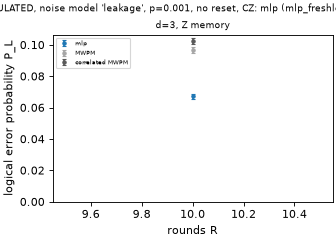

### mlp (mlp_full), run `20261024-155006-mlp_full`

| noise | p | d | basis | decoder | #R | ε_L A=1 [95%] | χ²/dof (p) | ε_L SPAM [95%] | A | χ²/dof (p)  | ε/ε_corr A=1 [95%] | ε/ε_corr SPAM [95%, reduced] | min corr k |
|---|---:|---:|---|---|---:|---:|---:|---:|---:|---:|---:|---:|---:|
| leakage | 0.001 | 3 | X | mwpm_corr | 6 | 9.34e-03 [9.22e-03, 9.46e-03] | 630.7/5 (p=0.00) | 9.34e-03 [9.22e-03, 9.46e-03] | 1.000 | 630.7/4 (p=0.00) | – | – | 504 |
| leakage | 0.001 | 3 | X | mlp | 6 | 6.70e-03 [6.60e-03, 6.80e-03] | 650.9/5 (p=0.00) | 6.70e-03 [6.60e-03, 6.80e-03] | 1.000 | 650.9/4 (p=0.00) | 0.717 [0.707, 0.727] | 0.717 [0.706, 0.730] | 504 |
| leakage | 0.001 | 3 | X | mwpm | 6 | 9.25e-03 [9.14e-03, 9.37e-03] | 627.1/5 (p=0.00) | 9.25e-03 [9.14e-03, 9.37e-03] | 1.000 | 627.1/4 (p=0.00) | 0.991 [0.981, 1.001] | 0.991 [0.982, 1.002] | 504 |
| leakage | 0.001 | 3 | Z | mwpm_corr | 6 | 9.85e-03 [9.73e-03, 9.97e-03] | 902.9/5 (p=0.00) | 9.85e-03 [9.73e-03, 9.97e-03] | 1.000 | 902.9/4 (p=0.00) | – | – | 404 |
| leakage | 0.001 | 3 | Z | mlp | 6 | 6.65e-03 [6.56e-03, 6.75e-03] | 678.3/5 (p=0.00) | 6.65e-03 [6.56e-03, 6.75e-03] | 1.000 | 678.3/4 (p=0.00) | 0.676 [0.666, 0.686] | 0.676 [0.667, 0.685] | 404 |
| leakage | 0.001 | 3 | Z | mwpm | 6 | 9.34e-03 [9.23e-03, 9.46e-03] | 739.2/5 (p=0.00) | 9.34e-03 [9.23e-03, 9.46e-03] | 1.000 | 739.2/4 (p=0.00) | 0.949 [0.939, 0.960] | 0.949 [0.940, 0.960] | 404 |
| leakage | 0.001 | 5 | X | mwpm_corr | 6 | 6.60e-03 [6.50e-03, 6.69e-03] | 2831.9/5 (p=0.00) | 6.60e-03 [6.50e-03, 6.69e-03] | 1.000 | 2831.9/4 (p=0.00) | – | – | 251 |
| leakage | 0.001 | 5 | X | mlp | 6 | 0.0149 [0.0147, 0.0150] | 9623.7/5 (p=0.00) | 0.0149 [0.0147, 0.0150] | 1.000 | 9623.7/4 (p=0.00) | 2.257 [2.222, 2.292] | 2.257 [2.221, 2.291] | 251 |
| leakage | 0.001 | 5 | X | mwpm | 6 | 6.84e-03 [6.74e-03, 6.94e-03] | 2728.4/5 (p=0.00) | 6.84e-03 [6.74e-03, 6.94e-03] | 1.000 | 2728.4/4 (p=0.00) | 1.036 [1.022, 1.051] | 1.036 [1.022, 1.050] | 251 |
| leakage | 0.001 | 5 | Z | mwpm_corr | 6 | 6.65e-03 [6.56e-03, 6.75e-03] | 3006.1/5 (p=0.00) | 6.65e-03 [6.56e-03, 6.75e-03] | 1.000 | 3006.1/4 (p=0.00) | – | – | 238 |
| leakage | 0.001 | 5 | Z | mlp | 6 | 0.0150 [0.0149, 0.0152] | 9362.0/5 (p=0.00) | 0.0150 [0.0149, 0.0152] | 1.000 | 9362.0/4 (p=0.00) | 2.260 [2.224, 2.296] | 2.260 [2.225, 2.295] | 238 |
| leakage | 0.001 | 5 | Z | mwpm | 6 | 6.80e-03 [6.71e-03, 6.90e-03] | 2978.4/5 (p=0.00) | 6.80e-03 [6.71e-03, 6.90e-03] | 1.000 | 2978.4/4 (p=0.00) | 1.023 [1.009, 1.036] | 1.023 [1.008, 1.038] | 238 |
| leakage | 0.001 | 7 | X | mwpm_corr | 6 | 4.66e-03 [4.59e-03, 4.74e-03] | 5943.4/5 (p=0.00) | 4.66e-03 [4.59e-03, 4.74e-03] | 1.000 | 5943.4/4 (p=0.00) | – | – | 171 |
| leakage | 0.001 | 7 | X | mlp | 6 | 0.0294 [0.0292, 0.0296] | 28766.0/5 (p=0.00) | 0.0294 [0.0292, 0.0296] | 1.000 | 28766.0/4 (p=0.00) | 6.301 [6.203, 6.410] | 6.301 [6.209, 6.411] | 171 |
| leakage | 0.001 | 7 | X | mwpm | 6 | 4.90e-03 [4.82e-03, 4.98e-03] | 5947.3/5 (p=0.00) | 4.90e-03 [4.82e-03, 4.98e-03] | 1.000 | 5947.3/4 (p=0.00) | 1.051 [1.035, 1.069] | 1.051 [1.036, 1.066] | 171 |
| leakage | 0.001 | 7 | Z | mwpm_corr | 6 | 4.50e-03 [4.43e-03, 4.57e-03] | 7263.9/5 (p=0.00) | 4.50e-03 [4.43e-03, 4.57e-03] | 1.000 | 7263.9/4 (p=0.00) | – | – | 191 |
| leakage | 0.001 | 7 | Z | mlp | 6 | 0.0269 [0.0267, 0.0271] | 33488.1/5 (p=0.00) | 0.0269 [0.0267, 0.0271] | 1.000 | 33488.1/4 (p=0.00) | 5.973 [5.876, 6.074] | 5.973 [5.895, 6.080] | 191 |
| leakage | 0.001 | 7 | Z | mwpm | 6 | 4.69e-03 [4.62e-03, 4.77e-03] | 7182.6/5 (p=0.00) | 4.69e-03 [4.62e-03, 4.77e-03] | 1.000 | 7182.6/4 (p=0.00) | 1.042 [1.025, 1.059] | 1.042 [1.026, 1.059] | 191 |
| uniform | 0.001 | 3 | X | mwpm_corr | 6 | 1.46e-03 [1.41e-03, 1.50e-03] | 17.5/5 (p=0.00) | 1.46e-03 [1.41e-03, 1.50e-03] | 1.000 | 17.5/4 (p=0.00) | – | – | 253 |
| uniform | 0.001 | 3 | X | mlp | 6 | 1.32e-03 [1.28e-03, 1.37e-03] | 7.3/5 (p=0.20) | 1.32e-03 [1.28e-03, 1.37e-03] | 1.000 | 7.3/4 (p=0.12) | 0.908 [0.890, 0.929] | 0.908 [0.890, 0.930] | 253 |
| uniform | 0.001 | 3 | X | mwpm | 6 | 1.61e-03 [1.56e-03, 1.65e-03] | 41.9/5 (p=0.00) | 1.61e-03 [1.56e-03, 1.65e-03] | 1.000 | 41.9/4 (p=0.00) | 1.103 [1.080, 1.126] | 1.103 [1.081, 1.127] | 253 |
| uniform | 0.001 | 3 | Z | mwpm_corr | 6 | 1.46e-03 [1.42e-03, 1.50e-03] | 53.1/5 (p=0.00) | 1.46e-03 [1.42e-03, 1.50e-03] | 1.000 | 53.1/4 (p=0.00) | – | – | 200 |
| uniform | 0.001 | 3 | Z | mlp | 6 | 1.25e-03 [1.21e-03, 1.29e-03] | 14.1/5 (p=0.02) | 1.25e-03 [1.21e-03, 1.29e-03] | 1.000 | 14.1/4 (p=0.01) | 0.854 [0.835, 0.875] | 0.854 [0.835, 0.874] | 200 |
| uniform | 0.001 | 3 | Z | mwpm | 6 | 1.52e-03 [1.48e-03, 1.57e-03] | 58.9/5 (p=0.00) | 1.52e-03 [1.48e-03, 1.57e-03] | 1.000 | 58.9/4 (p=0.00) | 1.044 [1.018, 1.070] | 1.044 [1.016, 1.067] | 200 |
| uniform | 0.001 | 5 | X | mwpm_corr | 6 | 1.89e-04 [1.77e-04, 2.01e-04] | 29.9/5 (p=0.00) | 1.89e-04 [1.77e-04, 2.01e-04] | 1.000 | 29.9/4 (p=0.00) | – | – | 97 (short at R=2) |
| uniform | 0.001 | 5 | X | mlp | 6 | 6.60e-04 [6.38e-04, 6.83e-04] | 1395.0/5 (p=0.00) | 6.60e-04 [6.38e-04, 6.83e-04] | 1.000 | 1395.0/4 (p=0.00) | 3.501 [3.307, 3.726] | 3.501 [3.315, 3.712] | 97 (short at R=2) |
| uniform | 0.001 | 5 | X | mwpm | 6 | 2.82e-04 [2.68e-04, 2.97e-04] | 135.7/5 (p=0.00) | 2.82e-04 [2.68e-04, 2.97e-04] | 1.000 | 135.7/4 (p=0.00) | 1.496 [1.424, 1.578] | 1.496 [1.437, 1.564] | 97 (short at R=2) |
| uniform | 0.001 | 5 | Z | mwpm_corr | 6 | 1.71e-04 [1.60e-04, 1.82e-04] | 47.1/5 (p=0.00) | 1.71e-04 [1.60e-04, 1.82e-04] | 1.000 | 47.1/4 (p=0.00) | – | – | 132 |
| uniform | 0.001 | 5 | Z | mlp | 6 | 5.47e-04 [5.28e-04, 5.66e-04] | 1387.6/5 (p=0.00) | 5.47e-04 [5.28e-04, 5.66e-04] | 1.000 | 1387.6/4 (p=0.00) | 3.204 [3.017, 3.414] | 3.204 [3.042, 3.414] | 132 |
| uniform | 0.001 | 5 | Z | mwpm | 6 | 2.41e-04 [2.28e-04, 2.53e-04] | 174.6/5 (p=0.00) | 2.41e-04 [2.28e-04, 2.53e-04] | 1.000 | 174.6/4 (p=0.00) | 1.408 [1.338, 1.483] | 1.408 [1.333, 1.480] | 132 |
| uniform | 0.001 | 7 | X | mwpm_corr | 6 | 2.25e-05 [2.10e-05, 2.40e-05] | 49.8/5 (p=0.00) | 2.25e-05 [2.10e-05, 2.40e-05] | 1.000 | 49.8/4 (p=0.00) | – | – | 119 |
| uniform | 0.001 | 7 | X | mlp | 6 | 1.63e-03 [1.61e-03, 1.64e-03] | 65839.4/5 (p=0.00) | 1.63e-03 [1.61e-03, 1.64e-03] | 1.000 | 65839.4/4 (p=0.00) | 72.372 [67.770, 77.348] | 72.372 [68.627, 76.587] | 119 |
| uniform | 0.001 | 7 | X | mwpm | 6 | 4.04e-05 [3.85e-05, 4.24e-05] | 387.7/5 (p=0.00) | 4.04e-05 [3.85e-05, 4.24e-05] | 1.000 | 387.7/4 (p=0.00) | 1.798 [1.701, 1.907] | 1.798 [1.714, 1.907] | 119 |
| uniform | 0.001 | 7 | Z | mwpm_corr | 6 | 1.91e-05 [1.78e-05, 2.05e-05] | 64.8/5 (p=0.00) | 1.91e-05 [1.78e-05, 2.05e-05] | 1.000 | 64.8/4 (p=0.00) | – | – | 99 (short at R=1) |
| uniform | 0.001 | 7 | Z | mlp | 6 | 1.57e-03 [1.56e-03, 1.58e-03] | 69562.4/5 (p=0.00) | 1.57e-03 [1.56e-03, 1.58e-03] | 1.000 | 69562.4/4 (p=0.00) | 82.240 [76.809, 88.166] | 82.240 [77.387, 88.166] | 99 (short at R=1) |
| uniform | 0.001 | 7 | Z | mwpm | 6 | 3.95e-05 [3.76e-05, 4.14e-05] | 524.5/5 (p=0.00) | 3.95e-05 [3.76e-05, 4.14e-05] | 1.000 | 524.5/4 (p=0.00) | 2.065 [1.940, 2.197] | 2.065 [1.953, 2.219] | 99 (short at R=1) |

**Sensitivity fits** (mlDecoder's, not the team's `fit_ler`): the A = 1 form refit on R ≥ 3 and R ≥ 5, and a free-amplitude fit with A in (0, 2], written P_L = [1 − (1 − 2ε)^(R − R₀)]/2 with R₀ = ln A / −ln(1 − 2ε). The **headline is the A = 1 all-R fit** (the challenge's formula); "trusted" names the first fit, in the order all-R, free A, R ≥ 3, R ≥ 5, whose Pearson p ≥ 0.05. A > 1 (significant by the likelihood-ratio p) is the boundary-round effect of the no-reset circuit, not SPAM: round 1 has only basis-type detectors and round 2's detector is m₂ alone, so the curve starts R₀ rounds late. With A forced to 1, dropping early rounds shrinks that bias but does not remove it.

| noise | p | d | basis | decoder | A=1 all R | A=1 R≥3 | A=1 R≥5 | free A | A | R₀ | LR p (A>1) | trusted |
|---|---:|---:|---|---|---:|---:|---:|---:|---:|---:|---:|---:|
| leakage | 0.001 | 3 | X | mwpm_corr | 9.34e-03 [9.22e-03, 9.46e-03] (p=4.8e-134) | 9.76e-03 [9.63e-03, 9.88e-03] (p=2e-49) | 0.0100 [9.91e-03, 0.0102] (p=7e-20) | 0.0107 [0.0106, 0.0109] (p=5.7e-20) | 1.01332 | 0.61 | 4.3e-130 | none |
| leakage | 0.001 | 3 | X | mlp | 6.70e-03 [6.60e-03, 6.80e-03] (p=2e-138) | 6.98e-03 [6.88e-03, 7.09e-03] (p=1.2e-81) | 7.24e-03 [7.12e-03, 7.35e-03] (p=2.6e-47) | 7.67e-03 [7.54e-03, 7.80e-03] (p=9.5e-53) | 1.00924 | 0.59 | 2.4e-95 | none |
| leakage | 0.001 | 3 | X | mwpm | 9.25e-03 [9.14e-03, 9.37e-03] (p=2.8e-133) | 9.67e-03 [9.54e-03, 9.80e-03] (p=6.2e-49) | 9.95e-03 [9.81e-03, 0.0101] (p=1.6e-21) | 0.0106 [0.0105, 0.0108] (p=6.2e-21) | 1.01313 | 0.61 | 5.8e-128 | none |
| leakage | 0.001 | 3 | Z | mwpm_corr | 9.85e-03 [9.73e-03, 9.97e-03] (p=6.2e-193) | 0.0104 [0.0103, 0.0105] (p=5e-58) | 0.0107 [0.0106, 0.0109] (p=7e-20) | 0.0116 [0.0115, 0.0118] (p=1.3e-18) | 1.01687 | 0.71 | 2e-205 | none |
| leakage | 0.001 | 3 | Z | mlp | 6.65e-03 [6.56e-03, 6.75e-03] (p=2.4e-144) | 6.94e-03 [6.84e-03, 7.05e-03] (p=1.4e-83) | 7.22e-03 [7.10e-03, 7.33e-03] (p=2.1e-43) | 7.66e-03 [7.53e-03, 7.80e-03] (p=8.7e-50) | 1.00965 | 0.62 | 6.9e-106 | none |
| leakage | 0.001 | 3 | Z | mwpm | 9.34e-03 [9.23e-03, 9.46e-03] (p=1.6e-157) | 9.81e-03 [9.69e-03, 9.94e-03] (p=2.6e-45) | 0.0101 [9.98e-03, 0.0103] (p=9.9e-15) | 0.0110 [0.0108, 0.0111] (p=7.9e-12) | 1.01524 | 0.68 | 1.4e-171 | none |
| leakage | 0.001 | 5 | X | mwpm_corr | 6.60e-03 [6.50e-03, 6.69e-03] (p=0) | 7.38e-03 [7.27e-03, 7.49e-03] (p=1.6e-245) | 7.92e-03 [7.80e-03, 8.04e-03] (p=9.6e-98) | 8.41e-03 [8.28e-03, 8.53e-03] (p=3.1e-179) | 1.01525 | 0.89 | 0 | none |
| leakage | 0.001 | 5 | X | mlp | 0.0149 [0.0147, 0.0150] (p=0) | 0.0171 [0.0169, 0.0173] (p=0) | 0.0189 [0.0187, 0.0191] (p=0) | 0.0195 [0.0192, 0.0197] (p=0) | 1.03771 | 0.93 | 0 | none |
| leakage | 0.001 | 5 | X | mwpm | 6.84e-03 [6.74e-03, 6.94e-03] (p=0) | 7.66e-03 [7.55e-03, 7.77e-03] (p=1.2e-211) | 8.16e-03 [8.04e-03, 8.28e-03] (p=1.3e-89) | 8.72e-03 [8.59e-03, 8.85e-03] (p=2.2e-151) | 1.01586 | 0.89 | 0 | none |
| leakage | 0.001 | 5 | Z | mwpm_corr | 6.65e-03 [6.56e-03, 6.75e-03] (p=0) | 7.45e-03 [7.35e-03, 7.57e-03] (p=7.9e-269) | 8.01e-03 [7.88e-03, 8.13e-03] (p=8.8e-116) | 8.50e-03 [8.37e-03, 8.62e-03] (p=1.8e-197) | 1.01554 | 0.90 | 0 | none |
| leakage | 0.001 | 5 | Z | mlp | 0.0150 [0.0149, 0.0152] (p=0) | 0.0173 [0.0171, 0.0175] (p=0) | 0.0190 [0.0188, 0.0192] (p=0) | 0.0197 [0.0195, 0.0199] (p=0) | 1.03859 | 0.94 | 0 | none |
| leakage | 0.001 | 5 | Z | mwpm | 6.80e-03 [6.71e-03, 6.90e-03] (p=0) | 7.63e-03 [7.52e-03, 7.74e-03] (p=1.8e-255) | 8.20e-03 [8.07e-03, 8.32e-03] (p=6.4e-98) | 8.70e-03 [8.57e-03, 8.82e-03] (p=7.4e-185) | 1.01595 | 0.90 | 0 | none |
| leakage | 0.001 | 7 | X | mwpm_corr | 4.66e-03 [4.59e-03, 4.74e-03] (p=0) | 5.86e-03 [5.76e-03, 5.96e-03] (p=0) | 6.46e-03 [6.35e-03, 6.56e-03] (p=1.7e-207) | 6.65e-03 [6.54e-03, 6.76e-03] (p=0) | 1.01293 | 0.96 | 0 | none |
| leakage | 0.001 | 7 | X | mlp | 0.0294 [0.0292, 0.0296] (p=0) | 0.0395 [0.0392, 0.0398] (p=0) | 0.0444 [0.0441, 0.0448] (p=0) | 0.0447 [0.0443, 0.0450] (p=0) | 1.09100 | 0.93 | 0 | none |
| leakage | 0.001 | 7 | X | mwpm | 4.90e-03 [4.82e-03, 4.98e-03] (p=0) | 6.15e-03 [6.06e-03, 6.25e-03] (p=0) | 6.75e-03 [6.64e-03, 6.86e-03] (p=1.7e-203) | 7.00e-03 [6.89e-03, 7.12e-03] (p=0) | 1.01365 | 0.96 | 0 | none |
| leakage | 0.001 | 7 | Z | mwpm_corr | 4.50e-03 [4.43e-03, 4.57e-03] (p=0) | 6.01e-03 [5.91e-03, 6.11e-03] (p=0) | 6.61e-03 [6.50e-03, 6.72e-03] (p=6.3e-208) | 6.83e-03 [6.72e-03, 6.94e-03] (p=0) | 1.01336 | 0.96 | 0 | none |
| leakage | 0.001 | 7 | Z | mlp | 0.0269 [0.0267, 0.0271] (p=0) | 0.0387 [0.0383, 0.0390] (p=0) | 0.0434 [0.0430, 0.0437] (p=0) | 0.0436 [0.0433, 0.0440] (p=0) | 1.08854 | 0.93 | 0 | none |
| leakage | 0.001 | 7 | Z | mwpm | 4.69e-03 [4.62e-03, 4.77e-03] (p=0) | 6.27e-03 [6.17e-03, 6.37e-03] (p=0) | 6.85e-03 [6.74e-03, 6.96e-03] (p=9.8e-190) | 7.13e-03 [7.02e-03, 7.24e-03] (p=0) | 1.01397 | 0.97 | 0 | none |
| uniform | 0.001 | 3 | X | mwpm_corr | 1.46e-03 [1.41e-03, 1.50e-03] (p=0.0036) | 1.48e-03 [1.44e-03, 1.53e-03] (p=0.031) | 1.49e-03 [1.44e-03, 1.54e-03] (p=0.016) | 1.52e-03 [1.46e-03, 1.58e-03] (p=0.08) | 1.00057 | 0.19 | 0.0023 | free A, all R |
| uniform | 0.001 | 3 | X | mlp | 1.32e-03 [1.28e-03, 1.37e-03] (p=0.2) | 1.34e-03 [1.29e-03, 1.38e-03] (p=0.43) | 1.34e-03 [1.30e-03, 1.39e-03] (p=0.38) | 1.35e-03 [1.29e-03, 1.41e-03] (p=0.19) | 1.00020 | 0.08 | 0.25 | A=1, all R |
| uniform | 0.001 | 3 | X | mwpm | 1.61e-03 [1.56e-03, 1.65e-03] (p=6.3e-08) | 1.66e-03 [1.61e-03, 1.71e-03] (p=0.01) | 1.67e-03 [1.62e-03, 1.73e-03] (p=0.013) | 1.73e-03 [1.67e-03, 1.80e-03] (p=0.018) | 1.00107 | 0.31 | 2e-08 | none |
| uniform | 0.001 | 3 | Z | mwpm_corr | 1.46e-03 [1.42e-03, 1.50e-03] (p=3.2e-10) | 1.51e-03 [1.47e-03, 1.56e-03] (p=0.011) | 1.54e-03 [1.49e-03, 1.59e-03] (p=0.22) | 1.61e-03 [1.55e-03, 1.67e-03] (p=0.27) | 1.00129 | 0.40 | 6.3e-13 | free A, all R |
| uniform | 0.001 | 3 | Z | mlp | 1.25e-03 [1.21e-03, 1.29e-03] (p=0.015) | 1.27e-03 [1.22e-03, 1.31e-03] (p=0.48) | 1.28e-03 [1.23e-03, 1.33e-03] (p=0.98) | 1.32e-03 [1.26e-03, 1.38e-03] (p=0.86) | 1.00063 | 0.24 | 0.00023 | free A, all R |
| uniform | 0.001 | 3 | Z | mwpm | 1.52e-03 [1.48e-03, 1.57e-03] (p=2.1e-11) | 1.58e-03 [1.53e-03, 1.63e-03] (p=0.0089) | 1.61e-03 [1.55e-03, 1.66e-03] (p=0.13) | 1.69e-03 [1.63e-03, 1.75e-03] (p=0.74) | 1.00144 | 0.42 | 3.6e-15 | free A, all R |
| uniform | 0.001 | 5 | X | mwpm_corr | 1.89e-04 [1.77e-04, 2.01e-04] (p=1.5e-05) | 2.06e-04 [1.91e-04, 2.21e-04] (p=0.0088) | 2.05e-04 [1.88e-04, 2.22e-04] (p=0.0031) | 2.16e-04 [1.97e-04, 2.35e-04] (p=0.0077) | 1.00014 | 0.33 | 7.4e-05 | none |
| uniform | 0.001 | 5 | X | mlp | 6.60e-04 [6.38e-04, 6.83e-04] (p=1.7e-299) | 8.55e-04 [8.24e-04, 8.87e-04] (p=3e-132) | 9.60e-04 [9.24e-04, 9.97e-04] (p=2.2e-80) | 9.54e-04 [9.19e-04, 9.90e-04] (p=1.6e-121) | 1.00154 | 0.81 | 7e-170 | none |
| uniform | 0.001 | 5 | X | mwpm | 2.82e-04 [2.68e-04, 2.97e-04] (p=1.4e-27) | 3.37e-04 [3.18e-04, 3.57e-04] (p=0.0019) | 3.51e-04 [3.29e-04, 3.73e-04] (p=0.043) | 3.72e-04 [3.49e-04, 3.95e-04] (p=0.0099) | 1.00047 | 0.63 | 8.3e-31 | none |
| uniform | 0.001 | 5 | Z | mwpm_corr | 1.71e-04 [1.60e-04, 1.82e-04] (p=5.3e-09) | 1.94e-04 [1.80e-04, 2.09e-04] (p=0.075) | 2.03e-04 [1.87e-04, 2.21e-04] (p=0.47) | 2.14e-04 [1.97e-04, 2.32e-04] (p=0.52) | 1.00020 | 0.48 | 9.7e-12 | free A, all R |
| uniform | 0.001 | 5 | Z | mlp | 5.47e-04 [5.28e-04, 5.66e-04] (p=6.7e-298) | 7.39e-04 [7.12e-04, 7.67e-04] (p=4.3e-115) | 8.69e-04 [8.34e-04, 9.04e-04] (p=7.2e-52) | 8.33e-04 [8.02e-04, 8.66e-04] (p=4e-99) | 1.00135 | 0.81 | 6.8e-188 | none |
| uniform | 0.001 | 5 | Z | mwpm | 2.41e-04 [2.28e-04, 2.53e-04] (p=7.7e-36) | 2.98e-04 [2.80e-04, 3.15e-04] (p=0.00017) | 3.19e-04 [2.98e-04, 3.40e-04] (p=0.24) | 3.38e-04 [3.17e-04, 3.59e-04] (p=0.13) | 1.00046 | 0.68 | 7.7e-42 | free A, all R |
| uniform | 0.001 | 7 | X | mwpm_corr | 2.25e-05 [2.10e-05, 2.40e-05] (p=1.5e-09) | 2.57e-05 [2.37e-05, 2.78e-05] (p=0.3) | 2.61e-05 [2.39e-05, 2.85e-05] (p=0.22) | 2.89e-05 [2.65e-05, 3.15e-05] (p=0.41) | 1.00003 | 0.53 | 1e-12 | free A, all R |
| uniform | 0.001 | 7 | X | mlp | 1.63e-03 [1.61e-03, 1.64e-03] (p=0) | 2.52e-03 [2.50e-03, 2.54e-03] (p=0) | 3.09e-03 [3.06e-03, 3.11e-03] (p=0) | 2.71e-03 [2.69e-03, 2.73e-03] (p=0) | 1.00510 | 0.94 | 0 | none |
| uniform | 0.001 | 7 | X | mwpm | 4.04e-05 [3.85e-05, 4.24e-05] (p=1.3e-81) | 5.49e-05 [5.20e-05, 5.80e-05] (p=5.7e-10) | 5.91e-05 [5.56e-05, 6.26e-05] (p=7.4e-05) | 6.14e-05 [5.81e-05, 6.48e-05] (p=1.9e-08) | 1.00010 | 0.81 | 1.2e-84 | none |
| uniform | 0.001 | 7 | Z | mwpm_corr | 1.91e-05 [1.78e-05, 2.05e-05] (p=1.2e-12) | 2.27e-05 [2.09e-05, 2.46e-05] (p=0.43) | 2.32e-05 [2.11e-05, 2.55e-05] (p=0.39) | 2.60e-05 [2.37e-05, 2.83e-05] (p=0.68) | 1.00003 | 0.61 | 4.5e-17 | free A, all R |
| uniform | 0.001 | 7 | Z | mlp | 1.57e-03 [1.56e-03, 1.58e-03] (p=0) | 2.39e-03 [2.37e-03, 2.40e-03] (p=0) | 3.12e-03 [3.09e-03, 3.15e-03] (p=0) | 2.66e-03 [2.64e-03, 2.68e-03] (p=0) | 1.00501 | 0.94 | 0 | none |
| uniform | 0.001 | 7 | Z | mwpm | 3.95e-05 [3.76e-05, 4.14e-05] (p=4.1e-111) | 5.36e-05 [5.09e-05, 5.65e-05] (p=1.2e-23) | 6.08e-05 [5.73e-05, 6.45e-05] (p=4.8e-10) | 6.27e-05 [5.94e-05, 6.60e-05] (p=8.8e-14) | 1.00011 | 0.86 | 1.1e-111 | none |

Λ = ε_L(d)/ε_L(d+2), no-SPAM fits, independent-bootstrap 95% interval:

| noise | p | basis | decoder | d | Λ [95%] |
|---|---:|---|---|---:|---:|
| leakage | 0.001 | X | mlp | 3→5 | 0.45 [0.44, 0.46] |
| leakage | 0.001 | X | mlp | 5→7 | 0.51 [0.50, 0.51] |
| leakage | 0.001 | X | mwpm | 3→5 | 1.35 [1.33, 1.38] |
| leakage | 0.001 | X | mwpm | 5→7 | 1.40 [1.37, 1.42] |
| leakage | 0.001 | X | mwpm_corr | 3→5 | 1.42 [1.39, 1.44] |
| leakage | 0.001 | X | mwpm_corr | 5→7 | 1.42 [1.39, 1.45] |
| leakage | 0.001 | Z | mlp | 3→5 | 0.44 [0.43, 0.45] |
| leakage | 0.001 | Z | mlp | 5→7 | 0.56 [0.55, 0.57] |
| leakage | 0.001 | Z | mwpm | 3→5 | 1.37 [1.35, 1.40] |
| leakage | 0.001 | Z | mwpm | 5→7 | 1.45 [1.42, 1.48] |
| leakage | 0.001 | Z | mwpm_corr | 3→5 | 1.48 [1.45, 1.51] |
| leakage | 0.001 | Z | mwpm_corr | 5→7 | 1.48 [1.45, 1.51] |
| uniform | 0.001 | X | mlp | 3→5 | 2.00 [1.92, 2.10] |
| uniform | 0.001 | X | mlp | 5→7 | 0.41 [0.39, 0.42] |
| uniform | 0.001 | X | mwpm | 3→5 | 5.69 [5.36, 6.04] |
| uniform | 0.001 | X | mwpm | 5→7 | 6.98 [6.48, 7.54] |
| uniform | 0.001 | X | mwpm_corr | 3→5 | 7.73 [7.18, 8.28] |
| uniform | 0.001 | X | mwpm_corr | 5→7 | 8.39 [7.69, 9.23] |
| uniform | 0.001 | Z | mlp | 3→5 | 2.28 [2.17, 2.39] |
| uniform | 0.001 | Z | mlp | 5→7 | 0.35 [0.34, 0.36] |
| uniform | 0.001 | Z | mwpm | 3→5 | 6.33 [5.97, 6.74] |
| uniform | 0.001 | Z | mwpm | 5→7 | 6.09 [5.69, 6.54] |
| uniform | 0.001 | Z | mwpm_corr | 3→5 | 8.54 [7.99, 9.16] |
| uniform | 0.001 | Z | mwpm_corr | 5→7 | 8.93 [8.12, 9.84] |

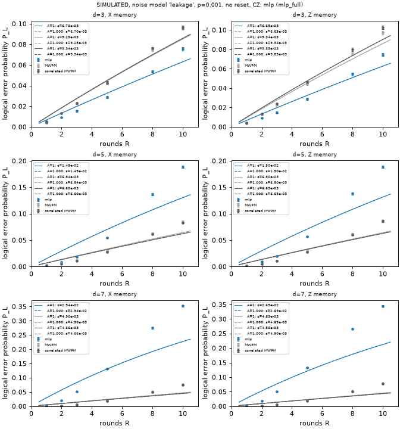

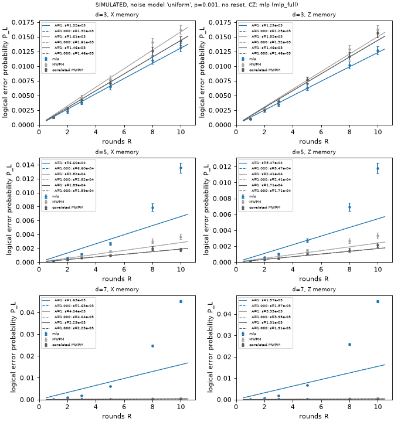

### mlp (mlp_headroom), run `20261024-165956-mlp_headroom`

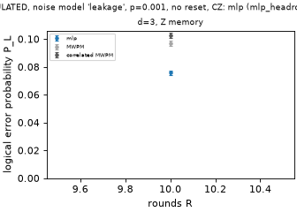

### mlp (mlp_smoke), run `20261024-154937-mlp_smoke`

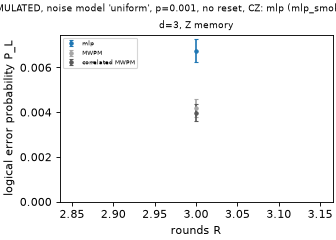

### mwpm (mwpm_full), run `20261024-151409-mwpm_full`

| noise | p | d | basis | decoder | #R | ε_L A=1 [95%] | χ²/dof (p) | ε_L SPAM [95%] | A | χ²/dof (p)  | ε/ε_corr A=1 [95%] | ε/ε_corr SPAM [95%, reduced] | min corr k |
|---|---:|---:|---|---|---:|---:|---:|---:|---:|---:|---:|---:|---:|
| leakage | 0.001 | 3 | X | mwpm_corr | 6 | 9.34e-03 [9.22e-03, 9.46e-03] | 630.7/5 (p=0.00) | 9.34e-03 [9.22e-03, 9.46e-03] | 1.000 | 630.7/4 (p=0.00) | – | – | 504 |
| leakage | 0.001 | 3 | X | mwpm | 6 | 9.25e-03 [9.14e-03, 9.37e-03] | 627.1/5 (p=0.00) | 9.25e-03 [9.14e-03, 9.37e-03] | 1.000 | 627.1/4 (p=0.00) | 0.991 [0.980, 1.001] | 0.991 [0.981, 1.001] | 504 |
| leakage | 0.001 | 3 | Z | mwpm_corr | 6 | 9.85e-03 [9.73e-03, 9.97e-03] | 902.9/5 (p=0.00) | 9.85e-03 [9.73e-03, 9.97e-03] | 1.000 | 902.9/4 (p=0.00) | – | – | 404 |
| leakage | 0.001 | 3 | Z | mwpm | 6 | 9.34e-03 [9.23e-03, 9.46e-03] | 739.2/5 (p=0.00) | 9.34e-03 [9.23e-03, 9.46e-03] | 1.000 | 739.2/4 (p=0.00) | 0.949 [0.939, 0.959] | 0.949 [0.939, 0.959] | 404 |
| leakage | 0.001 | 5 | X | mwpm_corr | 6 | 6.60e-03 [6.50e-03, 6.69e-03] | 2831.9/5 (p=0.00) | 6.60e-03 [6.50e-03, 6.69e-03] | 1.000 | 2831.9/4 (p=0.00) | – | – | 251 |
| leakage | 0.001 | 5 | X | mwpm | 6 | 6.84e-03 [6.74e-03, 6.94e-03] | 2728.4/5 (p=0.00) | 6.84e-03 [6.74e-03, 6.94e-03] | 1.000 | 2728.4/4 (p=0.00) | 1.036 [1.023, 1.051] | 1.036 [1.023, 1.051] | 251 |
| leakage | 0.001 | 5 | Z | mwpm_corr | 6 | 6.65e-03 [6.56e-03, 6.75e-03] | 3006.1/5 (p=0.00) | 6.65e-03 [6.56e-03, 6.75e-03] | 1.000 | 3006.1/4 (p=0.00) | – | – | 238 |
| leakage | 0.001 | 5 | Z | mwpm | 6 | 6.80e-03 [6.71e-03, 6.90e-03] | 2978.4/5 (p=0.00) | 6.80e-03 [6.71e-03, 6.90e-03] | 1.000 | 2978.4/4 (p=0.00) | 1.023 [1.009, 1.037] | 1.023 [1.009, 1.036] | 238 |
| leakage | 0.001 | 7 | X | mwpm_corr | 6 | 4.66e-03 [4.59e-03, 4.74e-03] | 5943.4/5 (p=0.00) | 4.66e-03 [4.59e-03, 4.74e-03] | 1.000 | 5943.4/4 (p=0.00) | – | – | 171 |
| leakage | 0.001 | 7 | X | mwpm | 6 | 4.90e-03 [4.82e-03, 4.98e-03] | 5947.3/5 (p=0.00) | 4.90e-03 [4.82e-03, 4.98e-03] | 1.000 | 5947.3/4 (p=0.00) | 1.051 [1.035, 1.068] | 1.051 [1.032, 1.066] | 171 |
| leakage | 0.001 | 7 | Z | mwpm_corr | 6 | 4.50e-03 [4.43e-03, 4.57e-03] | 7263.9/5 (p=0.00) | 4.50e-03 [4.43e-03, 4.57e-03] | 1.000 | 7263.9/4 (p=0.00) | – | – | 191 |
| leakage | 0.001 | 7 | Z | mwpm | 6 | 4.69e-03 [4.62e-03, 4.77e-03] | 7182.6/5 (p=0.00) | 4.69e-03 [4.62e-03, 4.77e-03] | 1.000 | 7182.6/4 (p=0.00) | 1.042 [1.026, 1.058] | 1.042 [1.026, 1.057] | 191 |
| uniform | 0.001 | 3 | X | mwpm_corr | 6 | 1.46e-03 [1.41e-03, 1.50e-03] | 17.5/5 (p=0.00) | 1.46e-03 [1.41e-03, 1.50e-03] | 1.000 | 17.5/4 (p=0.00) | – | – | 253 |
| uniform | 0.001 | 3 | X | mwpm | 6 | 1.61e-03 [1.56e-03, 1.65e-03] | 41.9/5 (p=0.00) | 1.61e-03 [1.56e-03, 1.65e-03] | 1.000 | 41.9/4 (p=0.00) | 1.103 [1.081, 1.126] | 1.103 [1.080, 1.123] | 253 |
| uniform | 0.001 | 3 | Z | mwpm_corr | 6 | 1.46e-03 [1.42e-03, 1.50e-03] | 53.1/5 (p=0.00) | 1.46e-03 [1.42e-03, 1.50e-03] | 1.000 | 53.1/4 (p=0.00) | – | – | 200 |
| uniform | 0.001 | 3 | Z | mwpm | 6 | 1.52e-03 [1.48e-03, 1.57e-03] | 58.9/5 (p=0.00) | 1.52e-03 [1.48e-03, 1.57e-03] | 1.000 | 58.9/4 (p=0.00) | 1.044 [1.020, 1.071] | 1.044 [1.022, 1.067] | 200 |
| uniform | 0.001 | 5 | X | mwpm_corr | 6 | 1.89e-04 [1.77e-04, 2.01e-04] | 29.9/5 (p=0.00) | 1.89e-04 [1.77e-04, 2.01e-04] | 1.000 | 29.9/4 (p=0.00) | – | – | 97 (short at R=2) |
| uniform | 0.001 | 5 | X | mwpm | 6 | 2.82e-04 [2.68e-04, 2.97e-04] | 135.7/5 (p=0.00) | 2.82e-04 [2.68e-04, 2.97e-04] | 1.000 | 135.7/4 (p=0.00) | 1.496 [1.423, 1.573] | 1.496 [1.426, 1.580] | 97 (short at R=2) |
| uniform | 0.001 | 5 | Z | mwpm_corr | 6 | 1.71e-04 [1.60e-04, 1.82e-04] | 47.1/5 (p=0.00) | 1.71e-04 [1.60e-04, 1.82e-04] | 1.000 | 47.1/4 (p=0.00) | – | – | 132 |
| uniform | 0.001 | 5 | Z | mwpm | 6 | 2.41e-04 [2.28e-04, 2.53e-04] | 174.6/5 (p=0.00) | 2.41e-04 [2.28e-04, 2.53e-04] | 1.000 | 174.6/4 (p=0.00) | 1.408 [1.339, 1.481] | 1.408 [1.337, 1.474] | 132 |
| uniform | 0.001 | 7 | X | mwpm_corr | 6 | 2.25e-05 [2.10e-05, 2.40e-05] | 49.8/5 (p=0.00) | 2.25e-05 [2.10e-05, 2.40e-05] | 1.000 | 49.8/4 (p=0.00) | – | – | 119 |
| uniform | 0.001 | 7 | X | mwpm | 6 | 4.04e-05 [3.85e-05, 4.24e-05] | 387.7/5 (p=0.00) | 4.04e-05 [3.85e-05, 4.24e-05] | 1.000 | 387.7/4 (p=0.00) | 1.798 [1.697, 1.907] | 1.798 [1.699, 1.899] | 119 |
| uniform | 0.001 | 7 | Z | mwpm_corr | 6 | 1.91e-05 [1.78e-05, 2.05e-05] | 64.8/5 (p=0.00) | 1.91e-05 [1.78e-05, 2.05e-05] | 1.000 | 64.8/4 (p=0.00) | – | – | 99 (short at R=1) |
| uniform | 0.001 | 7 | Z | mwpm | 6 | 3.95e-05 [3.76e-05, 4.14e-05] | 524.5/5 (p=0.00) | 3.95e-05 [3.76e-05, 4.14e-05] | 1.000 | 524.5/4 (p=0.00) | 2.065 [1.944, 2.192] | 2.065 [1.960, 2.194] | 99 (short at R=1) |
| leakage | 0.003 | 3 | X | mwpm_corr | 6 | 0.0401 [0.0398, 0.0404] | 1503.0/5 (p=0.00) | 0.0401 [0.0398, 0.0404] | 1.000 | 1503.0/4 (p=0.00) | – | – | 2520 |
| leakage | 0.003 | 3 | X | mwpm | 6 | 0.0405 [0.0402, 0.0408] | 1618.1/5 (p=0.00) | 0.0405 [0.0402, 0.0408] | 1.000 | 1618.1/4 (p=0.00) | 1.010 [1.004, 1.016] | 1.010 [1.005, 1.015] | 2520 |
| leakage | 0.003 | 3 | Z | mwpm_corr | 6 | 0.0396 [0.0393, 0.0399] | 1914.3/5 (p=0.00) | 0.0396 [0.0393, 0.0399] | 1.000 | 1914.3/4 (p=0.00) | – | – | 2091 |
| leakage | 0.003 | 3 | Z | mwpm | 6 | 0.0403 [0.0400, 0.0406] | 2079.6/5 (p=0.00) | 0.0403 [0.0400, 0.0406] | 1.000 | 2079.6/4 (p=0.00) | 1.018 [1.012, 1.025] | 1.018 [1.012, 1.025] | 2091 |
| leakage | 0.003 | 5 | X | mwpm_corr | 6 | 0.0470 [0.0467, 0.0473] | 7957.7/5 (p=0.00) | 0.0470 [0.0467, 0.0473] | 1.000 | 7957.7/4 (p=0.00) | – | – | 1464 |
| leakage | 0.003 | 5 | X | mwpm | 6 | 0.0490 [0.0486, 0.0493] | 8067.2/5 (p=0.00) | 0.0490 [0.0486, 0.0493] | 1.000 | 8067.2/4 (p=0.00) | 1.042 [1.035, 1.049] | 1.042 [1.035, 1.049] | 1464 |
| leakage | 0.003 | 5 | Z | mwpm_corr | 6 | 0.0472 [0.0468, 0.0475] | 8426.4/5 (p=0.00) | 0.0472 [0.0468, 0.0475] | 1.000 | 8426.4/4 (p=0.00) | – | – | 1293 |
| leakage | 0.003 | 5 | Z | mwpm | 6 | 0.0487 [0.0484, 0.0490] | 8591.3/5 (p=0.00) | 0.0487 [0.0484, 0.0490] | 1.000 | 8591.3/4 (p=0.00) | 1.032 [1.026, 1.039] | 1.032 [1.025, 1.039] | 1293 |
| leakage | 0.003 | 7 | X | mwpm_corr | 6 | 0.0524 [0.0520, 0.0527] | 15381.2/5 (p=0.00) | 0.0524 [0.0520, 0.0527] | 1.000 | 15381.2/4 (p=0.00) | – | – | 834 |
| leakage | 0.003 | 7 | X | mwpm | 6 | 0.0543 [0.0539, 0.0546] | 14861.3/5 (p=0.00) | 0.0543 [0.0539, 0.0546] | 1.000 | 14861.3/4 (p=0.00) | 1.036 [1.029, 1.043] | 1.036 [1.029, 1.042] | 834 |
| leakage | 0.003 | 7 | Z | mwpm_corr | 6 | 0.0524 [0.0520, 0.0527] | 16152.6/5 (p=0.00) | 0.0524 [0.0520, 0.0527] | 1.000 | 16152.6/4 (p=0.00) | – | – | 673 |
| leakage | 0.003 | 7 | Z | mwpm | 6 | 0.0538 [0.0534, 0.0541] | 15649.7/5 (p=0.00) | 0.0538 [0.0534, 0.0541] | 1.000 | 15649.7/4 (p=0.00) | 1.026 [1.019, 1.033] | 1.026 [1.019, 1.032] | 673 |
| uniform | 0.003 | 3 | X | mwpm_corr | 6 | 0.0112 [0.0111, 0.0113] | 17.9/5 (p=0.00) | 0.0112 [0.0111, 0.0113] | 1.000 | 17.9/4 (p=0.00) | – | – | 1016 |
| uniform | 0.003 | 3 | X | mwpm | 6 | 0.0124 [0.0122, 0.0125] | 81.9/5 (p=0.00) | 0.0124 [0.0122, 0.0125] | 1.000 | 81.9/4 (p=0.00) | 1.103 [1.095, 1.111] | 1.103 [1.096, 1.111] | 1016 |
| uniform | 0.003 | 3 | Z | mwpm_corr | 6 | 0.0106 [0.0105, 0.0107] | 62.4/5 (p=0.00) | 0.0106 [0.0105, 0.0107] | 1.000 | 62.4/4 (p=0.00) | – | – | 827 |
| uniform | 0.003 | 3 | Z | mwpm | 6 | 0.0123 [0.0122, 0.0125] | 191.4/5 (p=0.00) | 0.0123 [0.0122, 0.0125] | 1.000 | 191.4/4 (p=0.00) | 1.160 [1.150, 1.169] | 1.160 [1.152, 1.169] | 827 |
| uniform | 0.003 | 5 | X | mwpm_corr | 6 | 4.93e-03 [4.85e-03, 5.01e-03] | 131.5/5 (p=0.00) | 4.93e-03 [4.85e-03, 5.01e-03] | 1.000 | 131.5/4 (p=0.00) | – | – | 322 |
| uniform | 0.003 | 5 | X | mwpm | 6 | 6.61e-03 [6.51e-03, 6.70e-03] | 407.4/5 (p=0.00) | 6.61e-03 [6.51e-03, 6.70e-03] | 1.000 | 407.4/4 (p=0.00) | 1.340 [1.321, 1.358] | 1.340 [1.322, 1.360] | 322 |
| uniform | 0.003 | 5 | Z | mwpm_corr | 6 | 4.76e-03 [4.68e-03, 4.85e-03] | 239.6/5 (p=0.00) | 4.76e-03 [4.68e-03, 4.85e-03] | 1.000 | 239.6/4 (p=0.00) | – | – | 234 |
| uniform | 0.003 | 5 | Z | mwpm | 6 | 6.51e-03 [6.41e-03, 6.61e-03] | 578.2/5 (p=0.00) | 6.51e-03 [6.41e-03, 6.61e-03] | 1.000 | 578.2/4 (p=0.00) | 1.367 [1.348, 1.386] | 1.367 [1.350, 1.384] | 234 |
| uniform | 0.003 | 7 | X | mwpm_corr | 6 | 2.22e-03 [2.16e-03, 2.27e-03] | 286.0/5 (p=0.00) | 2.22e-03 [2.16e-03, 2.27e-03] | 1.000 | 286.0/4 (p=0.00) | – | – | 177 |
| uniform | 0.003 | 7 | X | mwpm | 6 | 3.53e-03 [3.46e-03, 3.60e-03] | 855.6/5 (p=0.00) | 3.53e-03 [3.46e-03, 3.60e-03] | 1.000 | 855.6/4 (p=0.00) | 1.595 [1.564, 1.631] | 1.595 [1.567, 1.628] | 177 |
| uniform | 0.003 | 7 | Z | mwpm_corr | 6 | 2.09e-03 [2.04e-03, 2.14e-03] | 378.8/5 (p=0.00) | 2.09e-03 [2.04e-03, 2.14e-03] | 1.000 | 378.8/4 (p=0.00) | – | – | 142 |
| uniform | 0.003 | 7 | Z | mwpm | 6 | 3.37e-03 [3.30e-03, 3.44e-03] | 951.7/5 (p=0.00) | 3.37e-03 [3.30e-03, 3.44e-03] | 1.000 | 951.7/4 (p=0.00) | 1.612 [1.577, 1.648] | 1.612 [1.575, 1.649] | 142 |

**Sensitivity fits** (mlDecoder's, not the team's `fit_ler`): the A = 1 form refit on R ≥ 3 and R ≥ 5, and a free-amplitude fit with A in (0, 2], written P_L = [1 − (1 − 2ε)^(R − R₀)]/2 with R₀ = ln A / −ln(1 − 2ε). The **headline is the A = 1 all-R fit** (the challenge's formula); "trusted" names the first fit, in the order all-R, free A, R ≥ 3, R ≥ 5, whose Pearson p ≥ 0.05. A > 1 (significant by the likelihood-ratio p) is the boundary-round effect of the no-reset circuit, not SPAM: round 1 has only basis-type detectors and round 2's detector is m₂ alone, so the curve starts R₀ rounds late. With A forced to 1, dropping early rounds shrinks that bias but does not remove it.

| noise | p | d | basis | decoder | A=1 all R | A=1 R≥3 | A=1 R≥5 | free A | A | R₀ | LR p (A>1) | trusted |
|---|---:|---:|---|---|---:|---:|---:|---:|---:|---:|---:|---:|
| leakage | 0.001 | 3 | X | mwpm_corr | 9.34e-03 [9.22e-03, 9.46e-03] (p=4.8e-134) | 9.76e-03 [9.63e-03, 9.88e-03] (p=2e-49) | 0.0100 [9.91e-03, 0.0102] (p=7e-20) | 0.0107 [0.0106, 0.0109] (p=5.7e-20) | 1.01332 | 0.61 | 4.3e-130 | none |
| leakage | 0.001 | 3 | X | mwpm | 9.25e-03 [9.14e-03, 9.37e-03] (p=2.8e-133) | 9.67e-03 [9.54e-03, 9.80e-03] (p=6.2e-49) | 9.95e-03 [9.81e-03, 0.0101] (p=1.6e-21) | 0.0106 [0.0105, 0.0108] (p=6.2e-21) | 1.01313 | 0.61 | 5.8e-128 | none |
| leakage | 0.001 | 3 | Z | mwpm_corr | 9.85e-03 [9.73e-03, 9.97e-03] (p=6.2e-193) | 0.0104 [0.0103, 0.0105] (p=5e-58) | 0.0107 [0.0106, 0.0109] (p=7e-20) | 0.0116 [0.0115, 0.0118] (p=1.3e-18) | 1.01687 | 0.71 | 2e-205 | none |
| leakage | 0.001 | 3 | Z | mwpm | 9.34e-03 [9.23e-03, 9.46e-03] (p=1.6e-157) | 9.81e-03 [9.69e-03, 9.94e-03] (p=2.6e-45) | 0.0101 [9.98e-03, 0.0103] (p=9.9e-15) | 0.0110 [0.0108, 0.0111] (p=7.9e-12) | 1.01524 | 0.68 | 1.4e-171 | none |
| leakage | 0.001 | 5 | X | mwpm_corr | 6.60e-03 [6.50e-03, 6.69e-03] (p=0) | 7.38e-03 [7.27e-03, 7.49e-03] (p=1.6e-245) | 7.92e-03 [7.80e-03, 8.04e-03] (p=9.6e-98) | 8.41e-03 [8.28e-03, 8.53e-03] (p=3.1e-179) | 1.01525 | 0.89 | 0 | none |
| leakage | 0.001 | 5 | X | mwpm | 6.84e-03 [6.74e-03, 6.94e-03] (p=0) | 7.66e-03 [7.55e-03, 7.77e-03] (p=1.2e-211) | 8.16e-03 [8.04e-03, 8.28e-03] (p=1.3e-89) | 8.72e-03 [8.59e-03, 8.85e-03] (p=2.2e-151) | 1.01586 | 0.89 | 0 | none |
| leakage | 0.001 | 5 | Z | mwpm_corr | 6.65e-03 [6.56e-03, 6.75e-03] (p=0) | 7.45e-03 [7.35e-03, 7.57e-03] (p=7.9e-269) | 8.01e-03 [7.88e-03, 8.13e-03] (p=8.8e-116) | 8.50e-03 [8.37e-03, 8.62e-03] (p=1.8e-197) | 1.01554 | 0.90 | 0 | none |
| leakage | 0.001 | 5 | Z | mwpm | 6.80e-03 [6.71e-03, 6.90e-03] (p=0) | 7.63e-03 [7.52e-03, 7.74e-03] (p=1.8e-255) | 8.20e-03 [8.07e-03, 8.32e-03] (p=6.4e-98) | 8.70e-03 [8.57e-03, 8.82e-03] (p=7.4e-185) | 1.01595 | 0.90 | 0 | none |
| leakage | 0.001 | 7 | X | mwpm_corr | 4.66e-03 [4.59e-03, 4.74e-03] (p=0) | 5.86e-03 [5.76e-03, 5.96e-03] (p=0) | 6.46e-03 [6.35e-03, 6.56e-03] (p=1.7e-207) | 6.65e-03 [6.54e-03, 6.76e-03] (p=0) | 1.01293 | 0.96 | 0 | none |
| leakage | 0.001 | 7 | X | mwpm | 4.90e-03 [4.82e-03, 4.98e-03] (p=0) | 6.15e-03 [6.06e-03, 6.25e-03] (p=0) | 6.75e-03 [6.64e-03, 6.86e-03] (p=1.7e-203) | 7.00e-03 [6.89e-03, 7.12e-03] (p=0) | 1.01365 | 0.96 | 0 | none |
| leakage | 0.001 | 7 | Z | mwpm_corr | 4.50e-03 [4.43e-03, 4.57e-03] (p=0) | 6.01e-03 [5.91e-03, 6.11e-03] (p=0) | 6.61e-03 [6.50e-03, 6.72e-03] (p=6.3e-208) | 6.83e-03 [6.72e-03, 6.94e-03] (p=0) | 1.01336 | 0.96 | 0 | none |
| leakage | 0.001 | 7 | Z | mwpm | 4.69e-03 [4.62e-03, 4.77e-03] (p=0) | 6.27e-03 [6.17e-03, 6.37e-03] (p=0) | 6.85e-03 [6.74e-03, 6.96e-03] (p=9.8e-190) | 7.13e-03 [7.02e-03, 7.24e-03] (p=0) | 1.01397 | 0.97 | 0 | none |
| uniform | 0.001 | 3 | X | mwpm_corr | 1.46e-03 [1.41e-03, 1.50e-03] (p=0.0036) | 1.48e-03 [1.44e-03, 1.53e-03] (p=0.031) | 1.49e-03 [1.44e-03, 1.54e-03] (p=0.016) | 1.52e-03 [1.46e-03, 1.58e-03] (p=0.08) | 1.00057 | 0.19 | 0.0023 | free A, all R |
| uniform | 0.001 | 3 | X | mwpm | 1.61e-03 [1.56e-03, 1.65e-03] (p=6.3e-08) | 1.66e-03 [1.61e-03, 1.71e-03] (p=0.01) | 1.67e-03 [1.62e-03, 1.73e-03] (p=0.013) | 1.73e-03 [1.67e-03, 1.80e-03] (p=0.018) | 1.00107 | 0.31 | 2e-08 | none |
| uniform | 0.001 | 3 | Z | mwpm_corr | 1.46e-03 [1.42e-03, 1.50e-03] (p=3.2e-10) | 1.51e-03 [1.47e-03, 1.56e-03] (p=0.011) | 1.54e-03 [1.49e-03, 1.59e-03] (p=0.22) | 1.61e-03 [1.55e-03, 1.67e-03] (p=0.27) | 1.00129 | 0.40 | 6.3e-13 | free A, all R |
| uniform | 0.001 | 3 | Z | mwpm | 1.52e-03 [1.48e-03, 1.57e-03] (p=2.1e-11) | 1.58e-03 [1.53e-03, 1.63e-03] (p=0.0089) | 1.61e-03 [1.55e-03, 1.66e-03] (p=0.13) | 1.69e-03 [1.63e-03, 1.75e-03] (p=0.74) | 1.00144 | 0.42 | 3.6e-15 | free A, all R |
| uniform | 0.001 | 5 | X | mwpm_corr | 1.89e-04 [1.77e-04, 2.01e-04] (p=1.5e-05) | 2.06e-04 [1.91e-04, 2.21e-04] (p=0.0088) | 2.05e-04 [1.88e-04, 2.22e-04] (p=0.0031) | 2.16e-04 [1.97e-04, 2.35e-04] (p=0.0077) | 1.00014 | 0.33 | 7.4e-05 | none |
| uniform | 0.001 | 5 | X | mwpm | 2.82e-04 [2.68e-04, 2.97e-04] (p=1.4e-27) | 3.37e-04 [3.18e-04, 3.57e-04] (p=0.0019) | 3.51e-04 [3.29e-04, 3.73e-04] (p=0.043) | 3.72e-04 [3.49e-04, 3.95e-04] (p=0.0099) | 1.00047 | 0.63 | 8.3e-31 | none |
| uniform | 0.001 | 5 | Z | mwpm_corr | 1.71e-04 [1.60e-04, 1.82e-04] (p=5.3e-09) | 1.94e-04 [1.80e-04, 2.09e-04] (p=0.075) | 2.03e-04 [1.87e-04, 2.21e-04] (p=0.47) | 2.14e-04 [1.97e-04, 2.32e-04] (p=0.52) | 1.00020 | 0.48 | 9.7e-12 | free A, all R |
| uniform | 0.001 | 5 | Z | mwpm | 2.41e-04 [2.28e-04, 2.53e-04] (p=7.7e-36) | 2.98e-04 [2.80e-04, 3.15e-04] (p=0.00017) | 3.19e-04 [2.98e-04, 3.40e-04] (p=0.24) | 3.38e-04 [3.17e-04, 3.59e-04] (p=0.13) | 1.00046 | 0.68 | 7.7e-42 | free A, all R |
| uniform | 0.001 | 7 | X | mwpm_corr | 2.25e-05 [2.10e-05, 2.40e-05] (p=1.5e-09) | 2.57e-05 [2.37e-05, 2.78e-05] (p=0.3) | 2.61e-05 [2.39e-05, 2.85e-05] (p=0.22) | 2.89e-05 [2.65e-05, 3.15e-05] (p=0.41) | 1.00003 | 0.53 | 1e-12 | free A, all R |
| uniform | 0.001 | 7 | X | mwpm | 4.04e-05 [3.85e-05, 4.24e-05] (p=1.3e-81) | 5.49e-05 [5.20e-05, 5.80e-05] (p=5.7e-10) | 5.91e-05 [5.56e-05, 6.26e-05] (p=7.4e-05) | 6.14e-05 [5.81e-05, 6.48e-05] (p=1.9e-08) | 1.00010 | 0.81 | 1.2e-84 | none |
| uniform | 0.001 | 7 | Z | mwpm_corr | 1.91e-05 [1.78e-05, 2.05e-05] (p=1.2e-12) | 2.27e-05 [2.09e-05, 2.46e-05] (p=0.43) | 2.32e-05 [2.11e-05, 2.55e-05] (p=0.39) | 2.60e-05 [2.37e-05, 2.83e-05] (p=0.68) | 1.00003 | 0.61 | 4.5e-17 | free A, all R |
| uniform | 0.001 | 7 | Z | mwpm | 3.95e-05 [3.76e-05, 4.14e-05] (p=4.1e-111) | 5.36e-05 [5.09e-05, 5.65e-05] (p=1.2e-23) | 6.08e-05 [5.73e-05, 6.45e-05] (p=4.8e-10) | 6.27e-05 [5.94e-05, 6.60e-05] (p=8.8e-14) | 1.00011 | 0.86 | 1.1e-111 | none |
| leakage | 0.003 | 3 | X | mwpm_corr | 0.0401 [0.0398, 0.0404] (p=0) | 0.0422 [0.0418, 0.0425] (p=5.9e-97) | 0.0436 [0.0432, 0.0440] (p=3.4e-26) | 0.0460 [0.0455, 0.0464] (p=2e-34) | 1.05115 | 0.52 | 0 | none |
| leakage | 0.003 | 3 | X | mwpm | 0.0405 [0.0402, 0.0408] (p=0) | 0.0426 [0.0423, 0.0430] (p=1.5e-111) | 0.0443 [0.0439, 0.0446] (p=2.9e-24) | 0.0466 [0.0461, 0.0470] (p=2.4e-41) | 1.05288 | 0.53 | 0 | none |
| leakage | 0.003 | 3 | Z | mwpm_corr | 0.0396 [0.0393, 0.0399] (p=0) | 0.0419 [0.0416, 0.0423] (p=1.8e-100) | 0.0434 [0.0430, 0.0437] (p=4.6e-32) | 0.0465 [0.0460, 0.0469] (p=1.1e-21) | 1.05978 | 0.60 | 0 | none |
| leakage | 0.003 | 3 | Z | mwpm | 0.0403 [0.0400, 0.0406] (p=0) | 0.0428 [0.0425, 0.0432] (p=2.4e-110) | 0.0444 [0.0440, 0.0448] (p=1.3e-33) | 0.0475 [0.0471, 0.0480] (p=2.6e-26) | 1.06265 | 0.61 | 0 | none |
| leakage | 0.003 | 5 | X | mwpm_corr | 0.0470 [0.0467, 0.0473] (p=0) | 0.0526 [0.0522, 0.0530] (p=0) | 0.0572 [0.0568, 0.0577] (p=4.5e-177) | 0.0598 [0.0593, 0.0603] (p=0) | 1.11135 | 0.83 | 0 | none |
| leakage | 0.003 | 5 | X | mwpm | 0.0490 [0.0486, 0.0493] (p=0) | 0.0550 [0.0546, 0.0554] (p=0) | 0.0597 [0.0592, 0.0603] (p=7.6e-177) | 0.0626 [0.0621, 0.0631] (p=0) | 1.11803 | 0.83 | 0 | none |
| leakage | 0.003 | 5 | Z | mwpm_corr | 0.0472 [0.0468, 0.0475] (p=0) | 0.0531 [0.0526, 0.0535] (p=0) | 0.0578 [0.0573, 0.0583] (p=2.8e-168) | 0.0605 [0.0600, 0.0610] (p=0) | 1.11601 | 0.85 | 0 | none |
| leakage | 0.003 | 5 | Z | mwpm | 0.0487 [0.0484, 0.0490] (p=0) | 0.0549 [0.0545, 0.0554] (p=0) | 0.0599 [0.0593, 0.0604] (p=4.2e-160) | 0.0627 [0.0622, 0.0632] (p=0) | 1.12143 | 0.86 | 0 | none |
| leakage | 0.003 | 7 | X | mwpm_corr | 0.0524 [0.0520, 0.0527] (p=0) | 0.0612 [0.0607, 0.0616] (p=0) | 0.0696 [0.0690, 0.0702] (p=0) | 0.0695 [0.0690, 0.0700] (p=0) | 1.14885 | 0.93 | 0 | none |
| leakage | 0.003 | 7 | X | mwpm | 0.0543 [0.0539, 0.0546] (p=0) | 0.0635 [0.0630, 0.0639] (p=0) | 0.0719 [0.0713, 0.0726] (p=4.1e-293) | 0.0723 [0.0718, 0.0728] (p=0) | 1.15596 | 0.93 | 0 | none |
| leakage | 0.003 | 7 | Z | mwpm_corr | 0.0524 [0.0520, 0.0527] (p=0) | 0.0613 [0.0609, 0.0618] (p=0) | 0.0702 [0.0696, 0.0708] (p=0) | 0.0699 [0.0694, 0.0704] (p=0) | 1.15235 | 0.94 | 0 | none |
| leakage | 0.003 | 7 | Z | mwpm | 0.0538 [0.0534, 0.0541] (p=0) | 0.0631 [0.0626, 0.0635] (p=0) | 0.0719 [0.0713, 0.0725] (p=2e-278) | 0.0719 [0.0714, 0.0725] (p=0) | 1.15764 | 0.94 | 0 | none |
| uniform | 0.003 | 3 | X | mwpm_corr | 0.0112 [0.0111, 0.0113] (p=0.0031) | 0.0113 [0.0111, 0.0114] (p=0.25) | 0.0113 [0.0112, 0.0115] (p=0.39) | 0.0115 [0.0113, 0.0117] (p=0.47) | 1.00262 | 0.11 | 0.00013 | free A, all R |
| uniform | 0.003 | 3 | X | mwpm | 0.0124 [0.0122, 0.0125] (p=3.4e-16) | 0.0126 [0.0124, 0.0127] (p=0.00061) | 0.0127 [0.0125, 0.0128] (p=0.33) | 0.0130 [0.0128, 0.0132] (p=0.62) | 1.00641 | 0.24 | 1.2e-19 | free A, all R |
| uniform | 0.003 | 3 | Z | mwpm_corr | 0.0106 [0.0105, 0.0107] (p=3.9e-12) | 0.0107 [0.0106, 0.0109] (p=0.094) | 0.0108 [0.0107, 0.0109] (p=0.93) | 0.0112 [0.0110, 0.0113] (p=0.056) | 1.00504 | 0.22 | 3.3e-14 | free A, all R |
| uniform | 0.003 | 3 | Z | mwpm | 0.0123 [0.0122, 0.0125] (p=1.9e-39) | 0.0126 [0.0124, 0.0127] (p=1e-05) | 0.0127 [0.0126, 0.0129] (p=0.81) | 0.0134 [0.0132, 0.0136] (p=0.15) | 1.01003 | 0.37 | 5.6e-46 | free A, all R |
| uniform | 0.003 | 5 | X | mwpm_corr | 4.93e-03 [4.85e-03, 5.01e-03] (p=1.1e-26) | 5.07e-03 [4.98e-03, 5.16e-03] (p=5.2e-08) | 5.16e-03 [5.06e-03, 5.25e-03] (p=0.016) | 5.44e-03 [5.32e-03, 5.56e-03] (p=0.18) | 1.00486 | 0.44 | 3.2e-31 | free A, all R |
| uniform | 0.003 | 5 | X | mwpm | 6.61e-03 [6.51e-03, 6.70e-03] (p=7.6e-86) | 6.89e-03 [6.79e-03, 7.00e-03] (p=1.2e-23) | 7.08e-03 [6.97e-03, 7.19e-03] (p=9.6e-06) | 7.62e-03 [7.48e-03, 7.75e-03] (p=4.9e-05) | 1.00965 | 0.63 | 6.6e-96 | none |
| uniform | 0.003 | 5 | Z | mwpm_corr | 4.76e-03 [4.68e-03, 4.85e-03] (p=9.1e-50) | 4.96e-03 [4.87e-03, 5.05e-03] (p=1.8e-07) | 5.03e-03 [4.94e-03, 5.13e-03] (p=0.00027) | 5.45e-03 [5.33e-03, 5.56e-03] (p=0.12) | 1.00655 | 0.60 | 9.6e-60 | free A, all R |
| uniform | 0.003 | 5 | Z | mwpm | 6.51e-03 [6.41e-03, 6.61e-03] (p=1e-122) | 6.86e-03 [6.75e-03, 6.96e-03] (p=5.1e-28) | 7.06e-03 [6.94e-03, 7.17e-03] (p=4.8e-07) | 7.71e-03 [7.58e-03, 7.84e-03] (p=4.4e-05) | 1.01147 | 0.73 | 1.2e-144 | none |
| uniform | 0.003 | 7 | X | mwpm_corr | 2.22e-03 [2.16e-03, 2.27e-03] (p=1e-59) | 2.37e-03 [2.31e-03, 2.43e-03] (p=2.7e-13) | 2.45e-03 [2.38e-03, 2.51e-03] (p=0.0017) | 2.65e-03 [2.57e-03, 2.72e-03] (p=0.0033) | 1.00368 | 0.69 | 1.6e-71 | none |
| uniform | 0.003 | 7 | X | mwpm | 3.53e-03 [3.46e-03, 3.60e-03] (p=1.1e-182) | 3.88e-03 [3.80e-03, 3.96e-03] (p=1e-42) | 4.06e-03 [3.98e-03, 4.15e-03] (p=7.8e-09) | 4.40e-03 [4.31e-03, 4.50e-03] (p=2.3e-21) | 1.00740 | 0.83 | 3.8e-208 | none |
| uniform | 0.003 | 7 | Z | mwpm_corr | 2.09e-03 [2.04e-03, 2.14e-03] (p=1.1e-79) | 2.27e-03 [2.21e-03, 2.33e-03] (p=7.4e-17) | 2.35e-03 [2.29e-03, 2.42e-03] (p=4.1e-05) | 2.55e-03 [2.48e-03, 2.62e-03] (p=6.7e-08) | 1.00388 | 0.76 | 1.6e-91 | none |
| uniform | 0.003 | 7 | Z | mwpm | 3.37e-03 [3.30e-03, 3.44e-03] (p=1.7e-203) | 3.72e-03 [3.65e-03, 3.80e-03] (p=1.4e-51) | 3.91e-03 [3.83e-03, 3.99e-03] (p=5.3e-14) | 4.24e-03 [4.15e-03, 4.33e-03] (p=1.9e-28) | 1.00739 | 0.86 | 3.7e-229 | none |

Λ = ε_L(d)/ε_L(d+2), no-SPAM fits, independent-bootstrap 95% interval:

| noise | p | basis | decoder | d | Λ [95%] |
|---|---:|---|---|---:|---:|
| leakage | 0.001 | X | mwpm | 3→5 | 1.35 [1.33, 1.38] |
| leakage | 0.001 | X | mwpm | 5→7 | 1.40 [1.37, 1.42] |
| leakage | 0.001 | X | mwpm_corr | 3→5 | 1.42 [1.39, 1.44] |
| leakage | 0.001 | X | mwpm_corr | 5→7 | 1.42 [1.39, 1.45] |
| leakage | 0.001 | Z | mwpm | 3→5 | 1.37 [1.35, 1.40] |
| leakage | 0.001 | Z | mwpm | 5→7 | 1.45 [1.42, 1.48] |
| leakage | 0.001 | Z | mwpm_corr | 3→5 | 1.48 [1.45, 1.51] |
| leakage | 0.001 | Z | mwpm_corr | 5→7 | 1.48 [1.45, 1.51] |
| uniform | 0.001 | X | mwpm | 3→5 | 5.69 [5.37, 6.04] |
| uniform | 0.001 | X | mwpm | 5→7 | 6.98 [6.52, 7.52] |
| uniform | 0.001 | X | mwpm_corr | 3→5 | 7.73 [7.22, 8.32] |
| uniform | 0.001 | X | mwpm_corr | 5→7 | 8.39 [7.65, 9.14] |
| uniform | 0.001 | Z | mwpm | 3→5 | 6.33 [5.97, 6.71] |
| uniform | 0.001 | Z | mwpm | 5→7 | 6.09 [5.67, 6.55] |
| uniform | 0.001 | Z | mwpm_corr | 3→5 | 8.54 [7.98, 9.14] |
| uniform | 0.001 | Z | mwpm_corr | 5→7 | 8.93 [8.18, 9.79] |
| leakage | 0.003 | X | mwpm | 3→5 | 0.83 [0.82, 0.83] |
| leakage | 0.003 | X | mwpm | 5→7 | 0.90 [0.89, 0.91] |
| leakage | 0.003 | X | mwpm_corr | 3→5 | 0.85 [0.84, 0.86] |
| leakage | 0.003 | X | mwpm_corr | 5→7 | 0.90 [0.89, 0.91] |
| leakage | 0.003 | Z | mwpm | 3→5 | 0.83 [0.82, 0.84] |
| leakage | 0.003 | Z | mwpm | 5→7 | 0.91 [0.90, 0.91] |
| leakage | 0.003 | Z | mwpm_corr | 3→5 | 0.84 [0.83, 0.85] |
| leakage | 0.003 | Z | mwpm_corr | 5→7 | 0.90 [0.89, 0.91] |
| uniform | 0.003 | X | mwpm | 3→5 | 1.87 [1.84, 1.91] |
| uniform | 0.003 | X | mwpm | 5→7 | 1.87 [1.83, 1.92] |
| uniform | 0.003 | X | mwpm_corr | 3→5 | 2.27 [2.23, 2.32] |
| uniform | 0.003 | X | mwpm_corr | 5→7 | 2.23 [2.16, 2.29] |
| uniform | 0.003 | Z | mwpm | 3→5 | 1.89 [1.86, 1.93] |
| uniform | 0.003 | Z | mwpm | 5→7 | 1.93 [1.89, 1.98] |
| uniform | 0.003 | Z | mwpm_corr | 3→5 | 2.23 [2.18, 2.28] |
| uniform | 0.003 | Z | mwpm_corr | 5→7 | 2.28 [2.21, 2.35] |

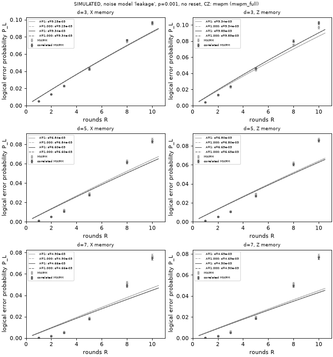

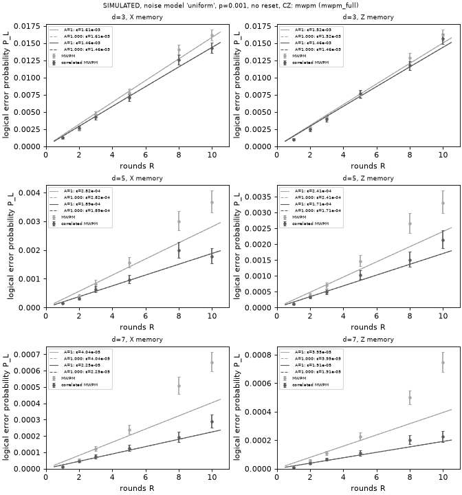

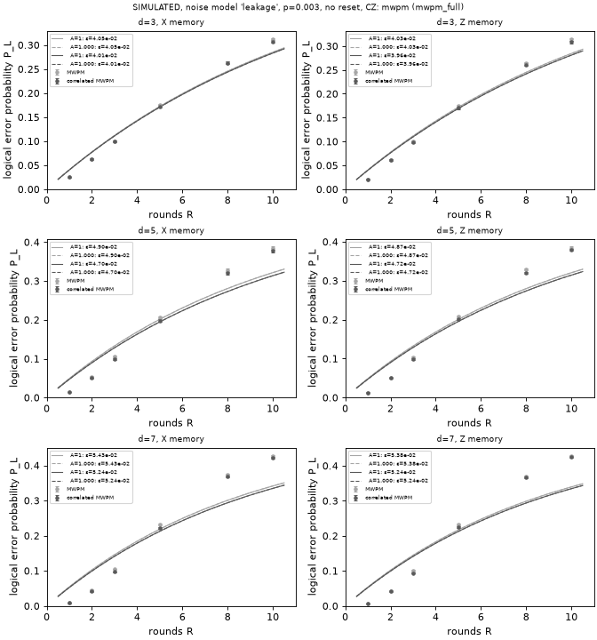

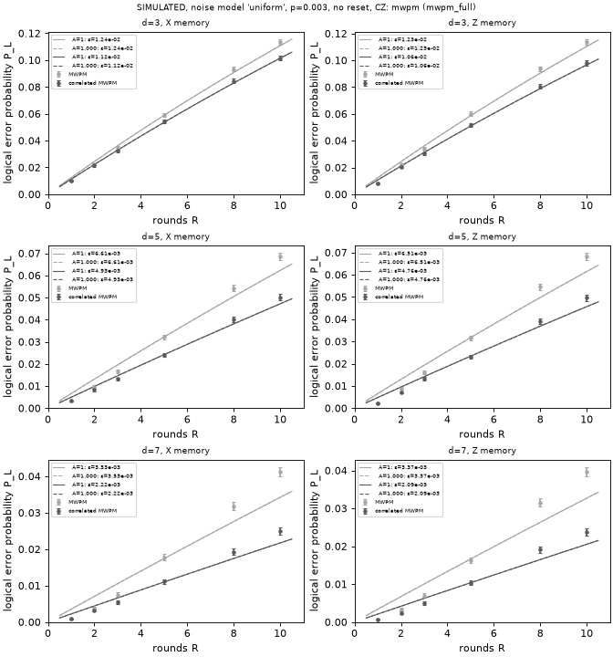

### rnn_lstm (rnn_lstm_emerald), run `20261024-195414-rnn_lstm_emerald`

| group | noise | options | p | basis | decoder | #R | ε_L A=1 [95%] | χ²/dof (p) | ε_L SPAM [95%] | A | χ²/dof (p)  | ε/ε_corr A=1 [95%] | ε/ε_corr SPAM [95%, reduced] | min corr k |
|---:|---|---:|---:|---|---|---:|---:|---:|---:|---:|---:|---:|---:|---:|
| emerald_eA_X | calibrated_coherence | ramsey-w1036-mf-noleak-asym-qndx | 0.001 | X | mwpm_corr | 11 | 0.0719 [0.0715, 0.0722] | 8261.6/10 (p=0.00) | 0.0719 [0.0715, 0.0722] | 1.000 | 8261.6/9 (p=0.00) | – | – | 1608 |
| emerald_eA_X | calibrated_coherence | ramsey-w1036-mf-noleak-asym-qndx | 0.001 | X | mwpm | 11 | 0.0738 [0.0734, 0.0741] | 8576.3/10 (p=0.00) | 0.0738 [0.0734, 0.0741] | 1.000 | 8576.3/9 (p=0.00) | 1.026 [1.023, 1.029] | 1.026 [1.024, 1.029] | 1608 |
| emerald_eA_X | calibrated_coherence | ramsey-w1036-mf-noleak-asym-qndx | 0.001 | X | mwpm_corr_uniform | 11 | 0.0731 [0.0728, 0.0735] | 8159.8/10 (p=0.00) | 0.0731 [0.0728, 0.0735] | 1.000 | 8159.8/9 (p=0.00) | 1.017 [1.013, 1.022] | 1.017 [1.012, 1.022] | 1608 |
| emerald_eA_X | calibrated_coherence | ramsey-w1036-mf-noleak-asym-qndx | 0.001 | X | rnn_lstm | 11 | 0.0703 [0.0699, 0.0706] | 8518.1/10 (p=0.00) | 0.0703 [0.0699, 0.0706] | 1.000 | 8518.1/9 (p=0.00) | 0.978 [0.973, 0.982] | 0.978 [0.973, 0.982] | 1608 |
| emerald_eA_X | calibrated_leakage | ramsey-w1036-mf-leakro-asym-qndx | 0.001 | X | mwpm_corr | 11 | 0.0977 [0.0972, 0.0982] | 7703.0/10 (p=0.00) | 0.0977 [0.0972, 0.0982] | 1.000 | 7703.0/9 (p=0.00) | – | – | 3438 |
| emerald_eA_X | calibrated_leakage | ramsey-w1036-mf-leakro-asym-qndx | 0.001 | X | mwpm | 11 | 0.0993 [0.0988, 0.0999] | 7737.8/10 (p=0.00) | 0.0993 [0.0988, 0.0999] | 1.000 | 7737.8/9 (p=0.00) | 1.017 [1.013, 1.020] | 1.017 [1.013, 1.020] | 3438 |
| emerald_eA_X | calibrated_leakage | ramsey-w1036-mf-leakro-asym-qndx | 0.001 | X | mwpm_corr_uniform | 11 | 0.0971 [0.0966, 0.0976] | 7549.7/10 (p=0.00) | 0.0971 [0.0966, 0.0976] | 1.000 | 7549.7/9 (p=0.00) | 0.993 [0.989, 0.998] | 0.993 [0.988, 0.997] | 3438 |
| emerald_eA_X | calibrated_leakage | ramsey-w1036-mf-leakro-asym-qndx | 0.001 | X | rnn_lstm | 11 | 0.0922 [0.0917, 0.0926] | 8217.0/10 (p=0.00) | 0.0922 [0.0917, 0.0926] | 1.000 | 8217.0/9 (p=0.00) | 0.943 [0.938, 0.948] | 0.943 [0.939, 0.947] | 3438 |
| emerald_eA_X | leakage |  | 0.003 | X | mwpm_corr | 11 | 0.0421 [0.0419, 0.0423] | 2267.2/10 (p=0.00) | 0.0421 [0.0419, 0.0423] | 1.000 | 2267.2/9 (p=0.00) | – | – | 2520 |
| emerald_eA_X | leakage |  | 0.003 | X | mwpm | 11 | 0.0428 [0.0426, 0.0431] | 2691.2/10 (p=0.00) | 0.0428 [0.0426, 0.0431] | 1.000 | 2691.2/9 (p=0.00) | 1.017 [1.012, 1.022] | 1.017 [1.013, 1.021] | 2520 |
| emerald_eA_X | leakage |  | 0.003 | X | mwpm_corr_uniform | 11 | 0.0414 [0.0412, 0.0417] | 2257.3/10 (p=0.00) | 0.0414 [0.0412, 0.0417] | 1.000 | 2257.3/9 (p=0.00) | 0.984 [0.981, 0.987] | 0.984 [0.981, 0.987] | 2520 |
| emerald_eA_X | leakage |  | 0.003 | X | rnn_lstm | 11 | 0.0386 [0.0384, 0.0388] | 2864.3/10 (p=0.00) | 0.0386 [0.0384, 0.0388] | 1.000 | 2864.3/9 (p=0.00) | 0.917 [0.912, 0.922] | 0.917 [0.912, 0.922] | 2520 |
| emerald_eA_Z | calibrated_coherence | ramsey-w1036-mf-noleak-asym-qndx | 0.001 | Z | mwpm_corr | 11 | 0.0269 [0.0267, 0.0270] | 2650.7/10 (p=0.00) | 0.0269 [0.0267, 0.0270] | 1.000 | 2650.7/9 (p=0.00) | – | – | 1023 |
| emerald_eA_Z | calibrated_coherence | ramsey-w1036-mf-noleak-asym-qndx | 0.001 | Z | mwpm | 11 | 0.0277 [0.0276, 0.0279] | 2807.2/10 (p=0.00) | 0.0277 [0.0276, 0.0279] | 1.000 | 2807.2/9 (p=0.00) | 1.033 [1.029, 1.037] | 1.033 [1.029, 1.036] | 1023 |
| emerald_eA_Z | calibrated_coherence | ramsey-w1036-mf-noleak-asym-qndx | 0.001 | Z | mwpm_corr_uniform | 11 | 0.0350 [0.0348, 0.0352] | 4124.3/10 (p=0.00) | 0.0350 [0.0348, 0.0352] | 1.000 | 4124.3/9 (p=0.00) | 1.302 [1.295, 1.309] | 1.302 [1.295, 1.309] | 1023 |
| emerald_eA_Z | calibrated_coherence | ramsey-w1036-mf-noleak-asym-qndx | 0.001 | Z | rnn_lstm | 11 | 0.0258 [0.0257, 0.0260] | 2400.0/10 (p=0.00) | 0.0258 [0.0257, 0.0260] | 1.000 | 2400.0/9 (p=0.00) | 0.962 [0.958, 0.967] | 0.962 [0.958, 0.966] | 1023 |
| emerald_eA_Z | calibrated_leakage | ramsey-w1036-mf-leakro-asym-qndx | 0.001 | Z | mwpm_corr | 11 | 0.0573 [0.0570, 0.0576] | 3882.8/10 (p=0.00) | 0.0573 [0.0570, 0.0576] | 1.000 | 3882.8/9 (p=0.00) | – | – | 2807 |
| emerald_eA_Z | calibrated_leakage | ramsey-w1036-mf-leakro-asym-qndx | 0.001 | Z | mwpm | 11 | 0.0581 [0.0578, 0.0584] | 3828.1/10 (p=0.00) | 0.0581 [0.0578, 0.0584] | 1.000 | 3828.1/9 (p=0.00) | 1.013 [1.010, 1.017] | 1.013 [1.010, 1.017] | 2807 |
| emerald_eA_Z | calibrated_leakage | ramsey-w1036-mf-leakro-asym-qndx | 0.001 | Z | mwpm_corr_uniform | 11 | 0.0652 [0.0649, 0.0655] | 5157.8/10 (p=0.00) | 0.0652 [0.0649, 0.0655] | 1.000 | 5157.8/9 (p=0.00) | 1.137 [1.132, 1.143] | 1.137 [1.132, 1.143] | 2807 |
| emerald_eA_Z | calibrated_leakage | ramsey-w1036-mf-leakro-asym-qndx | 0.001 | Z | rnn_lstm | 11 | 0.0523 [0.0520, 0.0525] | 4143.2/10 (p=0.00) | 0.0523 [0.0520, 0.0525] | 1.000 | 4143.2/9 (p=0.00) | 0.912 [0.908, 0.916] | 0.912 [0.907, 0.916] | 2807 |
| emerald_eA_Z | leakage |  | 0.003 | Z | mwpm_corr | 11 | 0.0423 [0.0421, 0.0425] | 3051.0/10 (p=0.00) | 0.0423 [0.0421, 0.0425] | 1.000 | 3051.0/9 (p=0.00) | – | – | 2091 |
| emerald_eA_Z | leakage |  | 0.003 | Z | mwpm | 11 | 0.0428 [0.0426, 0.0430] | 3000.2/10 (p=0.00) | 0.0428 [0.0426, 0.0430] | 1.000 | 3000.2/9 (p=0.00) | 1.011 [1.006, 1.015] | 1.011 [1.006, 1.015] | 2091 |
| emerald_eA_Z | leakage |  | 0.003 | Z | mwpm_corr_uniform | 11 | 0.0423 [0.0420, 0.0425] | 2936.4/10 (p=0.00) | 0.0423 [0.0420, 0.0425] | 1.000 | 2936.4/9 (p=0.00) | 0.998 [0.996, 1.001] | 0.998 [0.996, 1.002] | 2091 |
| emerald_eA_Z | leakage |  | 0.003 | Z | rnn_lstm | 11 | 0.0366 [0.0364, 0.0368] | 2588.0/10 (p=0.00) | 0.0366 [0.0364, 0.0368] | 1.000 | 2588.0/9 (p=0.00) | 0.865 [0.861, 0.870] | 0.865 [0.861, 0.870] | 2091 |

**Sensitivity fits** (mlDecoder's, not the team's `fit_ler`): the A = 1 form refit on R ≥ 3 and R ≥ 5, and a free-amplitude fit with A in (0, 2], written P_L = [1 − (1 − 2ε)^(R − R₀)]/2 with R₀ = ln A / −ln(1 − 2ε). The **headline is the A = 1 all-R fit** (the challenge's formula); "trusted" names the first fit, in the order all-R, free A, R ≥ 3, R ≥ 5, whose Pearson p ≥ 0.05. A > 1 (significant by the likelihood-ratio p) is the boundary-round effect of the no-reset circuit, not SPAM: round 1 has only basis-type detectors and round 2's detector is m₂ alone, so the curve starts R₀ rounds late. With A forced to 1, dropping early rounds shrinks that bias but does not remove it.

| group | noise | options | p | basis | decoder | A=1 all R | A=1 R≥3 | A=1 R≥5 | free A | A | R₀ | LR p (A>1) | trusted |
|---:|---|---:|---:|---|---|---:|---:|---:|---:|---:|---:|---:|---:|
| emerald_eA_X | calibrated_coherence | ramsey-w1036-mf-noleak-asym-qndx | 0.001 | X | mwpm_corr | 0.0719 [0.0715, 0.0722] (p=0) | 0.0782 [0.0778, 0.0787] (p=6.2e-235) | 0.0828 [0.0822, 0.0834] (p=3.4e-43) | 0.0909 [0.0904, 0.0915] (p=6.3e-48) | 1.18684 | 0.85 | 0 | none |
| emerald_eA_X | calibrated_coherence | ramsey-w1036-mf-noleak-asym-qndx | 0.001 | X | mwpm | 0.0738 [0.0734, 0.0741] (p=0) | 0.0806 [0.0801, 0.0810] (p=3.4e-240) | 0.0855 [0.0849, 0.0861] (p=6.5e-38) | 0.0938 [0.0933, 0.0944] (p=1e-52) | 1.19507 | 0.86 | 0 | none |
| emerald_eA_X | calibrated_coherence | ramsey-w1036-mf-noleak-asym-qndx | 0.001 | X | mwpm_corr_uniform | 0.0731 [0.0728, 0.0735] (p=0) | 0.0795 [0.0791, 0.0800] (p=2.9e-229) | 0.0840 [0.0834, 0.0846] (p=8.9e-49) | 0.0929 [0.0923, 0.0935] (p=1.4e-27) | 1.19246 | 0.86 | 0 | none |
| emerald_eA_X | calibrated_coherence | ramsey-w1036-mf-noleak-asym-qndx | 0.001 | X | rnn_lstm | 0.0703 [0.0699, 0.0706] (p=0) | 0.0763 [0.0758, 0.0767] (p=0) | 0.0810 [0.0804, 0.0816] (p=1.5e-82) | 0.0887 [0.0881, 0.0892] (p=8.7e-66) | 1.18244 | 0.86 | 0 | none |
| emerald_eA_X | calibrated_leakage | ramsey-w1036-mf-leakro-asym-qndx | 0.001 | X | mwpm_corr | 0.0977 [0.0972, 0.0982] (p=0) | 0.1088 [0.1081, 0.1095] (p=1.7e-177) | 0.1170 [0.1159, 0.1180] (p=1.7e-22) | 0.1260 [0.1252, 0.1269] (p=2.4e-54) | 1.25160 | 0.77 | 0 | none |
| emerald_eA_X | calibrated_leakage | ramsey-w1036-mf-leakro-asym-qndx | 0.001 | X | mwpm | 0.0993 [0.0988, 0.0999] (p=0) | 0.1109 [0.1102, 0.1116] (p=1.2e-166) | 0.1193 [0.1182, 0.1203] (p=4.4e-16) | 0.1287 [0.1278, 0.1295] (p=8e-48) | 1.25909 | 0.77 | 0 | none |
| emerald_eA_X | calibrated_leakage | ramsey-w1036-mf-leakro-asym-qndx | 0.001 | X | mwpm_corr_uniform | 0.0971 [0.0966, 0.0976] (p=0) | 0.1079 [0.1072, 0.1085] (p=4.4e-159) | 0.1156 [0.1146, 0.1166] (p=2.9e-12) | 0.1255 [0.1246, 0.1263] (p=1.5e-34) | 1.25176 | 0.78 | 0 | none |
| emerald_eA_X | calibrated_leakage | ramsey-w1036-mf-leakro-asym-qndx | 0.001 | X | rnn_lstm | 0.0922 [0.0917, 0.0926] (p=0) | 0.1021 [0.1015, 0.1028] (p=6.4e-241) | 0.1101 [0.1092, 0.1111] (p=2e-34) | 0.1187 [0.1179, 0.1194] (p=5.6e-68) | 1.24049 | 0.80 | 0 | none |
| emerald_eA_X | leakage |  | 0.003 | X | mwpm_corr | 0.0421 [0.0419, 0.0423] (p=0) | 0.0433 [0.0431, 0.0435] (p=3.6e-206) | 0.0447 [0.0444, 0.0449] (p=1.1e-73) | 0.0469 [0.0466, 0.0472] (p=2.1e-61) | 1.05575 | 0.55 | 0 | none |
| emerald_eA_X | leakage |  | 0.003 | X | mwpm | 0.0428 [0.0426, 0.0431] (p=0) | 0.0441 [0.0438, 0.0443] (p=1.7e-275) | 0.0457 [0.0454, 0.0460] (p=1e-100) | 0.0480 [0.0477, 0.0483] (p=9.3e-97) | 1.05931 | 0.57 | 0 | none |
| emerald_eA_X | leakage |  | 0.003 | X | mwpm_corr_uniform | 0.0414 [0.0412, 0.0417] (p=0) | 0.0425 [0.0423, 0.0428] (p=3.5e-222) | 0.0439 [0.0437, 0.0442] (p=7.5e-87) | 0.0461 [0.0458, 0.0464] (p=6.2e-71) | 1.05405 | 0.54 | 0 | none |
| emerald_eA_X | leakage |  | 0.003 | X | rnn_lstm | 0.0386 [0.0384, 0.0388] (p=0) | 0.0396 [0.0394, 0.0398] (p=0) | 0.0412 [0.0409, 0.0414] (p=4e-144) | 0.0431 [0.0429, 0.0434] (p=1.2e-138) | 1.05374 | 0.58 | 0 | none |
| emerald_eA_Z | calibrated_coherence | ramsey-w1036-mf-noleak-asym-qndx | 0.001 | Z | mwpm_corr | 0.0269 [0.0267, 0.0270] (p=0) | 0.0276 [0.0275, 0.0278] (p=1.6e-186) | 0.0284 [0.0282, 0.0286] (p=1.2e-60) | 0.0304 [0.0302, 0.0306] (p=1.7e-26) | 1.04619 | 0.72 | 0 | none |
| emerald_eA_Z | calibrated_coherence | ramsey-w1036-mf-noleak-asym-qndx | 0.001 | Z | mwpm | 0.0277 [0.0276, 0.0279] (p=0) | 0.0286 [0.0284, 0.0287] (p=2.4e-196) | 0.0294 [0.0292, 0.0296] (p=3.4e-62) | 0.0315 [0.0313, 0.0317] (p=1.6e-27) | 1.04859 | 0.73 | 0 | none |
| emerald_eA_Z | calibrated_coherence | ramsey-w1036-mf-noleak-asym-qndx | 0.001 | Z | mwpm_corr_uniform | 0.0350 [0.0348, 0.0352] (p=0) | 0.0364 [0.0362, 0.0366] (p=2.6e-231) | 0.0376 [0.0374, 0.0378] (p=6.6e-72) | 0.0407 [0.0404, 0.0409] (p=1.2e-34) | 1.06962 | 0.79 | 0 | none |
| emerald_eA_Z | calibrated_coherence | ramsey-w1036-mf-noleak-asym-qndx | 0.001 | Z | rnn_lstm | 0.0258 [0.0257, 0.0260] (p=0) | 0.0265 [0.0264, 0.0267] (p=4.9e-182) | 0.0273 [0.0271, 0.0274] (p=2.7e-61) | 0.0291 [0.0289, 0.0293] (p=9.4e-31) | 1.04237 | 0.69 | 0 | none |
| emerald_eA_Z | calibrated_leakage | ramsey-w1036-mf-leakro-asym-qndx | 0.001 | Z | mwpm_corr | 0.0573 [0.0570, 0.0576] (p=0) | 0.0599 [0.0595, 0.0602] (p=1.1e-286) | 0.0626 [0.0622, 0.0630] (p=3.4e-99) | 0.0665 [0.0661, 0.0669] (p=6.2e-79) | 1.09628 | 0.64 | 0 | none |
| emerald_eA_Z | calibrated_leakage | ramsey-w1036-mf-leakro-asym-qndx | 0.001 | Z | mwpm | 0.0581 [0.0578, 0.0584] (p=0) | 0.0607 [0.0604, 0.0610] (p=8.4e-263) | 0.0634 [0.0630, 0.0638] (p=4.9e-90) | 0.0675 [0.0670, 0.0679] (p=1.2e-65) | 1.09810 | 0.65 | 0 | none |
| emerald_eA_Z | calibrated_leakage | ramsey-w1036-mf-leakro-asym-qndx | 0.001 | Z | mwpm_corr_uniform | 0.0652 [0.0649, 0.0655] (p=0) | 0.0691 [0.0687, 0.0695] (p=5.7e-272) | 0.0727 [0.0722, 0.0732] (p=9.4e-77) | 0.0780 [0.0775, 0.0785] (p=2.2e-66) | 1.12861 | 0.71 | 0 | none |
| emerald_eA_Z | calibrated_leakage | ramsey-w1036-mf-leakro-asym-qndx | 0.001 | Z | rnn_lstm | 0.0523 [0.0520, 0.0525] (p=0) | 0.0545 [0.0542, 0.0548] (p=0) | 0.0570 [0.0567, 0.0574] (p=8.7e-127) | 0.0604 [0.0600, 0.0608] (p=1.1e-113) | 1.08867 | 0.66 | 0 | none |
| emerald_eA_Z | leakage |  | 0.003 | Z | mwpm_corr | 0.0423 [0.0421, 0.0425] (p=0) | 0.0437 [0.0435, 0.0439] (p=4.2e-262) | 0.0452 [0.0449, 0.0454] (p=9.5e-113) | 0.0480 [0.0477, 0.0483] (p=6.5e-66) | 1.06605 | 0.63 | 0 | none |
| emerald_eA_Z | leakage |  | 0.003 | Z | mwpm | 0.0428 [0.0426, 0.0430] (p=0) | 0.0442 [0.0440, 0.0444] (p=2.8e-236) | 0.0457 [0.0454, 0.0460] (p=2.8e-88) | 0.0486 [0.0483, 0.0489] (p=1.6e-51) | 1.06716 | 0.64 | 0 | none |
| emerald_eA_Z | leakage |  | 0.003 | Z | mwpm_corr_uniform | 0.0423 [0.0420, 0.0425] (p=0) | 0.0436 [0.0434, 0.0439] (p=3.9e-233) | 0.0451 [0.0448, 0.0453] (p=1.2e-93) | 0.0479 [0.0476, 0.0482] (p=2.8e-52) | 1.06571 | 0.63 | 0 | none |
| emerald_eA_Z | leakage |  | 0.003 | Z | rnn_lstm | 0.0366 [0.0364, 0.0368] (p=0) | 0.0376 [0.0374, 0.0378] (p=4.9e-277) | 0.0387 [0.0385, 0.0390] (p=7.8e-134) | 0.0409 [0.0406, 0.0412] (p=9.7e-90) | 1.05185 | 0.59 | 0 | none |

Speed on this laptop (warmed; end to end, numpy in and out). Decoder: CUDA throughput at batch 65,536 and latency per shot at batch 1, CPU (1 thread) latency at batch 1 and throughput at batch 4,096; correlated MWPM on one CPU thread.

| group | R | CUDA shots/s (b=65536) | CUDA µs (b=1) | CPU-1 µs (b=1) | CPU-1 shots/s (b=4096) | corr MWPM shots/s | corr MWPM µs (b=1) |
|---:|---:|---:|---:|---:|---:|---:|---:|
| emerald_eA_Z | 3 | 397k | 1,591.5 | 533.3 | 59k | 426k | 7.7 |
| emerald_eA_Z | 20 | 1,198k | 2,447.9 | 691.2 | 9k | 41k | 33.4 |
| emerald_eA_X | 3 | 397k | 3,451.8 | 549.4 | 60k | 396k | 8.6 |
| emerald_eA_X | 20 | 287k | 3,323.6 | 700.2 | 10k | 37k | 35.2 |

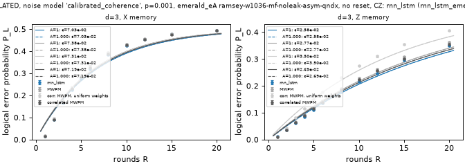

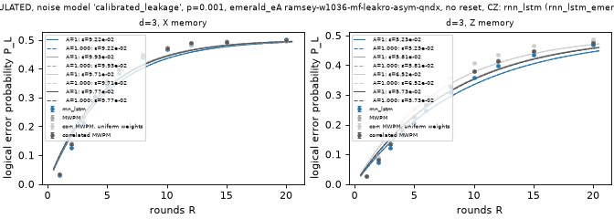

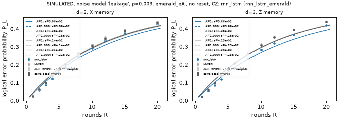

### rnn_lstm (rnn_lstm_full), run `20261024-191223-rnn_lstm_full`

| group | noise | options | p | basis | decoder | #R | ε_L A=1 [95%] | χ²/dof (p) | ε_L SPAM [95%] | A | χ²/dof (p)  | ε/ε_corr A=1 [95%] | ε/ε_corr SPAM [95%, reduced] | min corr k |
|---:|---|---:|---:|---|---|---:|---:|---:|---:|---:|---:|---:|---:|---:|
| garnet_pA_X | calibrated_coherence | ramsey-w1096-mf-noleak-asym-qndx | 0.001 | X | mwpm_corr | 11 | 0.1096 [0.1090, 0.1102] | 11444.0/10 (p=0.00) | 0.1096 [0.1090, 0.1102] | 1.000 | 11444.0/9 (p=0.00) | – | – | 2347 |
| garnet_pA_X | calibrated_coherence | ramsey-w1096-mf-noleak-asym-qndx | 0.001 | X | mwpm | 11 | 0.1103 [0.1097, 0.1109] | 11402.8/10 (p=0.00) | 0.1103 [0.1097, 0.1109] | 1.000 | 11402.8/9 (p=0.00) | 1.006 [1.004, 1.009] | 1.006 [1.004, 1.009] | 2347 |
| garnet_pA_X | calibrated_coherence | ramsey-w1096-mf-noleak-asym-qndx | 0.001 | X | mwpm_corr_uniform | 11 | 0.1112 [0.1106, 0.1118] | 11524.9/10 (p=0.00) | 0.1112 [0.1106, 0.1118] | 1.000 | 11524.9/9 (p=0.00) | 1.014 [1.010, 1.019] | 1.014 [1.010, 1.018] | 2347 |
| garnet_pA_X | calibrated_coherence | ramsey-w1096-mf-noleak-asym-qndx | 0.001 | X | rnn_lstm | 11 | 0.1081 [0.1075, 0.1086] | 11538.0/10 (p=0.00) | 0.1081 [0.1075, 0.1086] | 1.000 | 11538.0/9 (p=0.00) | 0.986 [0.981, 0.991] | 0.986 [0.981, 0.991] | 2347 |
| garnet_pA_X | calibrated_leakage | ramsey-w1096-mf-leakro-asym-qndx | 0.003 | X | mwpm_corr | 11 | 0.1330 [0.1323, 0.1337] | 10440.7/10 (p=0.00) | 0.1330 [0.1323, 0.1337] | 1.000 | 10440.7/9 (p=0.00) | – | – | 4134 |
| garnet_pA_X | calibrated_leakage | ramsey-w1096-mf-leakro-asym-qndx | 0.003 | X | mwpm | 11 | 0.1339 [0.1332, 0.1347] | 10432.4/10 (p=0.00) | 0.1339 [0.1332, 0.1347] | 1.000 | 10432.4/9 (p=0.00) | 1.007 [1.004, 1.010] | 1.007 [1.004, 1.009] | 4134 |
| garnet_pA_X | calibrated_leakage | ramsey-w1096-mf-leakro-asym-qndx | 0.003 | X | mwpm_corr_uniform | 11 | 0.1326 [0.1319, 0.1333] | 10355.6/10 (p=0.00) | 0.1326 [0.1319, 0.1333] | 1.000 | 10355.6/9 (p=0.00) | 0.997 [0.992, 1.002] | 0.997 [0.992, 1.002] | 4134 |
| garnet_pA_X | calibrated_leakage | ramsey-w1096-mf-leakro-asym-qndx | 0.003 | X | rnn_lstm | 11 | 0.1281 [0.1274, 0.1288] | 10515.1/10 (p=0.00) | 0.1281 [0.1274, 0.1288] | 1.000 | 10515.1/9 (p=0.00) | 0.963 [0.958, 0.968] | 0.963 [0.958, 0.968] | 4134 |
| garnet_pA_X | leakage |  | 0.003 | X | mwpm_corr | 11 | 0.0421 [0.0419, 0.0423] | 2267.2/10 (p=0.00) | 0.0421 [0.0419, 0.0423] | 1.000 | 2267.2/9 (p=0.00) | – | – | 2520 |
| garnet_pA_X | leakage |  | 0.003 | X | mwpm | 11 | 0.0428 [0.0426, 0.0431] | 2691.2/10 (p=0.00) | 0.0428 [0.0426, 0.0431] | 1.000 | 2691.2/9 (p=0.00) | 1.017 [1.012, 1.022] | 1.017 [1.013, 1.022] | 2520 |
| garnet_pA_X | leakage |  | 0.003 | X | mwpm_corr_uniform | 11 | 0.0414 [0.0412, 0.0417] | 2257.3/10 (p=0.00) | 0.0414 [0.0412, 0.0417] | 1.000 | 2257.3/9 (p=0.00) | 0.984 [0.981, 0.987] | 0.984 [0.981, 0.987] | 2520 |
| garnet_pA_X | leakage |  | 0.003 | X | rnn_lstm | 11 | 0.0372 [0.0370, 0.0374] | 2090.6/10 (p=0.00) | 0.0372 [0.0370, 0.0374] | 1.000 | 2090.6/9 (p=0.00) | 0.882 [0.877, 0.887] | 0.882 [0.877, 0.887] | 2520 |
| garnet_pA_Z | calibrated_coherence | ramsey-w1096-mf-noleak-asym-qndx | 0.001 | Z | mwpm_corr | 11 | 0.0401 [0.0399, 0.0403] | 2820.7/10 (p=0.00) | 0.0401 [0.0399, 0.0403] | 1.000 | 2820.7/9 (p=0.00) | – | – | 1986 |
| garnet_pA_Z | calibrated_coherence | ramsey-w1096-mf-noleak-asym-qndx | 0.001 | Z | mwpm | 11 | 0.0406 [0.0403, 0.0408] | 2813.5/10 (p=0.00) | 0.0406 [0.0403, 0.0408] | 1.000 | 2813.5/9 (p=0.00) | 1.012 [1.009, 1.015] | 1.012 [1.009, 1.015] | 1986 |
| garnet_pA_Z | calibrated_coherence | ramsey-w1096-mf-noleak-asym-qndx | 0.001 | Z | mwpm_corr_uniform | 11 | 0.0541 [0.0538, 0.0544] | 4590.0/10 (p=0.00) | 0.0541 [0.0538, 0.0544] | 1.000 | 4590.0/9 (p=0.00) | 1.350 [1.343, 1.357] | 1.350 [1.342, 1.356] | 1986 |
| garnet_pA_Z | calibrated_coherence | ramsey-w1096-mf-noleak-asym-qndx | 0.001 | Z | rnn_lstm | 11 | 0.0393 [0.0391, 0.0395] | 2909.6/10 (p=0.00) | 0.0393 [0.0391, 0.0395] | 1.000 | 2909.6/9 (p=0.00) | 0.981 [0.976, 0.985] | 0.981 [0.976, 0.985] | 1986 |
| garnet_pA_Z | calibrated_leakage | ramsey-w1096-mf-leakro-asym-qndx | 0.003 | Z | mwpm_corr | 11 | 0.0717 [0.0714, 0.0721] | 3638.3/10 (p=0.00) | 0.0717 [0.0714, 0.0721] | 1.000 | 3638.3/9 (p=0.00) | – | – | 3979 |
| garnet_pA_Z | calibrated_leakage | ramsey-w1096-mf-leakro-asym-qndx | 0.003 | Z | mwpm | 11 | 0.0721 [0.0717, 0.0724] | 3579.6/10 (p=0.00) | 0.0721 [0.0717, 0.0724] | 1.000 | 3579.6/9 (p=0.00) | 1.004 [1.002, 1.007] | 1.004 [1.002, 1.007] | 3979 |
| garnet_pA_Z | calibrated_leakage | ramsey-w1096-mf-leakro-asym-qndx | 0.003 | Z | mwpm_corr_uniform | 11 | 0.0862 [0.0857, 0.0866] | 5414.5/10 (p=0.00) | 0.0862 [0.0857, 0.0866] | 1.000 | 5414.5/9 (p=0.00) | 1.201 [1.195, 1.208] | 1.201 [1.195, 1.208] | 3979 |
| garnet_pA_Z | calibrated_leakage | ramsey-w1096-mf-leakro-asym-qndx | 0.003 | Z | rnn_lstm | 11 | 0.0673 [0.0670, 0.0677] | 3876.6/10 (p=0.00) | 0.0673 [0.0670, 0.0677] | 1.000 | 3876.6/9 (p=0.00) | 0.938 [0.934, 0.943] | 0.938 [0.934, 0.943] | 3979 |
| garnet_pA_Z | leakage |  | 0.003 | Z | mwpm_corr | 11 | 0.0423 [0.0421, 0.0425] | 3051.0/10 (p=0.00) | 0.0423 [0.0421, 0.0425] | 1.000 | 3051.0/9 (p=0.00) | – | – | 2091 |
| garnet_pA_Z | leakage |  | 0.003 | Z | mwpm | 11 | 0.0428 [0.0426, 0.0430] | 3000.2/10 (p=0.00) | 0.0428 [0.0426, 0.0430] | 1.000 | 3000.2/9 (p=0.00) | 1.011 [1.006, 1.015] | 1.011 [1.006, 1.015] | 2091 |
| garnet_pA_Z | leakage |  | 0.003 | Z | mwpm_corr_uniform | 11 | 0.0423 [0.0420, 0.0425] | 2936.4/10 (p=0.00) | 0.0423 [0.0420, 0.0425] | 1.000 | 2936.4/9 (p=0.00) | 0.998 [0.995, 1.001] | 0.998 [0.995, 1.001] | 2091 |
| garnet_pA_Z | leakage |  | 0.003 | Z | rnn_lstm | 11 | 0.0360 [0.0358, 0.0362] | 2147.9/10 (p=0.00) | 0.0360 [0.0358, 0.0362] | 1.000 | 2147.9/9 (p=0.00) | 0.850 [0.846, 0.855] | 0.850 [0.846, 0.854] | 2091 |

**Sensitivity fits** (mlDecoder's, not the team's `fit_ler`): the A = 1 form refit on R ≥ 3 and R ≥ 5, and a free-amplitude fit with A in (0, 2], written P_L = [1 − (1 − 2ε)^(R − R₀)]/2 with R₀ = ln A / −ln(1 − 2ε). The **headline is the A = 1 all-R fit** (the challenge's formula); "trusted" names the first fit, in the order all-R, free A, R ≥ 3, R ≥ 5, whose Pearson p ≥ 0.05. A > 1 (significant by the likelihood-ratio p) is the boundary-round effect of the no-reset circuit, not SPAM: round 1 has only basis-type detectors and round 2's detector is m₂ alone, so the curve starts R₀ rounds late. With A forced to 1, dropping early rounds shrinks that bias but does not remove it.

| group | noise | options | p | basis | decoder | A=1 all R | A=1 R≥3 | A=1 R≥5 | free A | A | R₀ | LR p (A>1) | trusted |
|---:|---|---:|---:|---|---|---:|---:|---:|---:|---:|---:|---:|---:|
| garnet_pA_X | calibrated_coherence | ramsey-w1096-mf-noleak-asym-qndx | 0.001 | X | mwpm_corr | 0.1096 [0.1090, 0.1102] (p=0) | 0.1270 [0.1261, 0.1278] (p=4.1e-153) | 0.1378 [0.1364, 0.1392] (p=4.6e-13) | 0.1514 [0.1504, 0.1524] (p=7.2e-38) | 1.37035 | 0.87 | 0 | none |
| garnet_pA_X | calibrated_coherence | ramsey-w1096-mf-noleak-asym-qndx | 0.001 | X | mwpm | 0.1103 [0.1097, 0.1109] (p=0) | 0.1278 [0.1270, 0.1287] (p=5.5e-151) | 0.1389 [0.1375, 0.1404] (p=5.2e-09) | 0.1527 [0.1516, 0.1537] (p=1.3e-32) | 1.37473 | 0.87 | 0 | none |
| garnet_pA_X | calibrated_coherence | ramsey-w1096-mf-noleak-asym-qndx | 0.001 | X | mwpm_corr_uniform | 0.1112 [0.1106, 0.1118] (p=0) | 0.1292 [0.1283, 0.1301] (p=2.2e-152) | 0.1407 [0.1392, 0.1422] (p=8.1e-07) | 0.1541 [0.1531, 0.1551] (p=5e-39) | 1.37925 | 0.87 | 0 | none |
| garnet_pA_X | calibrated_coherence | ramsey-w1096-mf-noleak-asym-qndx | 0.001 | X | rnn_lstm | 0.1081 [0.1075, 0.1086] (p=0) | 0.1250 [0.1241, 0.1258] (p=8.3e-189) | 0.1368 [0.1354, 0.1382] (p=1.3e-19) | 0.1485 [0.1475, 0.1495] (p=3.6e-57) | 1.35968 | 0.87 | 0 | none |
| garnet_pA_X | calibrated_leakage | ramsey-w1096-mf-leakro-asym-qndx | 0.003 | X | mwpm_corr | 0.1330 [0.1323, 0.1337] (p=0) | 0.1586 [0.1574, 0.1598] (p=5.2e-72) | 0.1717 [0.1694, 0.1742] (p=3.2e-05) | 0.1878 [0.1864, 0.1892] (p=2.5e-22) | 1.47289 | 0.82 | 0 | none |
| garnet_pA_X | calibrated_leakage | ramsey-w1096-mf-leakro-asym-qndx | 0.003 | X | mwpm | 0.1339 [0.1332, 0.1347] (p=0) | 0.1597 [0.1585, 0.1609] (p=4.5e-71) | 0.1736 [0.1711, 0.1761] (p=0.00025) | 0.1896 [0.1882, 0.1910] (p=1.9e-16) | 1.48072 | 0.82 | 0 | none |
| garnet_pA_X | calibrated_leakage | ramsey-w1096-mf-leakro-asym-qndx | 0.003 | X | mwpm_corr_uniform | 0.1326 [0.1319, 0.1333] (p=0) | 0.1577 [0.1565, 0.1589] (p=3.5e-93) | 0.1727 [0.1703, 0.1752] (p=0.0047) | 0.1864 [0.1850, 0.1877] (p=5.5e-28) | 1.46454 | 0.82 | 0 | none |
| garnet_pA_X | calibrated_leakage | ramsey-w1096-mf-leakro-asym-qndx | 0.003 | X | rnn_lstm | 0.1281 [0.1274, 0.1288] (p=0) | 0.1516 [0.1505, 0.1527] (p=6.4e-118) | 0.1670 [0.1649, 0.1693] (p=7.3e-09) | 0.1786 [0.1773, 0.1799] (p=5e-44) | 1.43778 | 0.82 | 0 | none |
| garnet_pA_X | leakage |  | 0.003 | X | mwpm_corr | 0.0421 [0.0419, 0.0423] (p=0) | 0.0433 [0.0431, 0.0435] (p=3.6e-206) | 0.0447 [0.0444, 0.0449] (p=1.1e-73) | 0.0469 [0.0466, 0.0472] (p=2.1e-61) | 1.05575 | 0.55 | 0 | none |
| garnet_pA_X | leakage |  | 0.003 | X | mwpm | 0.0428 [0.0426, 0.0431] (p=0) | 0.0441 [0.0438, 0.0443] (p=1.7e-275) | 0.0457 [0.0454, 0.0460] (p=1e-100) | 0.0480 [0.0477, 0.0483] (p=9.3e-97) | 1.05931 | 0.57 | 0 | none |
| garnet_pA_X | leakage |  | 0.003 | X | mwpm_corr_uniform | 0.0414 [0.0412, 0.0417] (p=0) | 0.0425 [0.0423, 0.0428] (p=3.5e-222) | 0.0439 [0.0437, 0.0442] (p=7.5e-87) | 0.0461 [0.0458, 0.0464] (p=6.2e-71) | 1.05405 | 0.54 | 0 | none |
| garnet_pA_X | leakage |  | 0.003 | X | rnn_lstm | 0.0372 [0.0370, 0.0374] (p=0) | 0.0380 [0.0378, 0.0382] (p=8.7e-240) | 0.0392 [0.0390, 0.0394] (p=7.8e-100) | 0.0410 [0.0408, 0.0413] (p=2.5e-84) | 1.04643 | 0.53 | 0 | none |
| garnet_pA_Z | calibrated_coherence | ramsey-w1096-mf-noleak-asym-qndx | 0.001 | Z | mwpm_corr | 0.0401 [0.0399, 0.0403] (p=0) | 0.0414 [0.0412, 0.0417] (p=3.3e-182) | 0.0427 [0.0424, 0.0429] (p=5.8e-62) | 0.0454 [0.0451, 0.0457] (p=1.2e-44) | 1.06226 | 0.63 | 0 | none |
| garnet_pA_Z | calibrated_coherence | ramsey-w1096-mf-noleak-asym-qndx | 0.001 | Z | mwpm | 0.0406 [0.0403, 0.0408] (p=0) | 0.0420 [0.0417, 0.0422] (p=1.2e-167) | 0.0432 [0.0429, 0.0434] (p=4.9e-57) | 0.0460 [0.0457, 0.0462] (p=7.8e-40) | 1.06330 | 0.64 | 0 | none |
| garnet_pA_Z | calibrated_coherence | ramsey-w1096-mf-noleak-asym-qndx | 0.001 | Z | mwpm_corr_uniform | 0.0541 [0.0538, 0.0544] (p=0) | 0.0569 [0.0566, 0.0572] (p=3.9e-201) | 0.0591 [0.0587, 0.0594] (p=1.1e-67) | 0.0640 [0.0636, 0.0644] (p=1.7e-29) | 1.10605 | 0.74 | 0 | none |
| garnet_pA_Z | calibrated_coherence | ramsey-w1096-mf-noleak-asym-qndx | 0.001 | Z | rnn_lstm | 0.0393 [0.0391, 0.0395] (p=0) | 0.0406 [0.0403, 0.0408] (p=2.7e-233) | 0.0419 [0.0416, 0.0421] (p=3.8e-93) | 0.0445 [0.0442, 0.0447] (p=1.7e-58) | 1.06107 | 0.64 | 0 | none |
| garnet_pA_Z | calibrated_leakage | ramsey-w1096-mf-leakro-asym-qndx | 0.003 | Z | mwpm_corr | 0.0717 [0.0714, 0.0721] (p=0) | 0.0757 [0.0753, 0.0761] (p=1.2e-193) | 0.0794 [0.0789, 0.0800] (p=1.3e-48) | 0.0838 [0.0832, 0.0843] (p=3e-70) | 1.11573 | 0.60 | 0 | none |
| garnet_pA_Z | calibrated_leakage | ramsey-w1096-mf-leakro-asym-qndx | 0.003 | Z | mwpm | 0.0721 [0.0717, 0.0724] (p=0) | 0.0760 [0.0756, 0.0765] (p=1.2e-183) | 0.0797 [0.0791, 0.0802] (p=1.7e-46) | 0.0842 [0.0836, 0.0847] (p=6.6e-62) | 1.11624 | 0.60 | 0 | none |
| garnet_pA_Z | calibrated_leakage | ramsey-w1096-mf-leakro-asym-qndx | 0.003 | Z | mwpm_corr_uniform | 0.0862 [0.0857, 0.0866] (p=0) | 0.0931 [0.0925, 0.0936] (p=2.3e-184) | 0.0987 [0.0980, 0.0995] (p=2e-35) | 0.1060 [0.1053, 0.1067] (p=2.5e-39) | 1.18098 | 0.70 | 0 | none |
| garnet_pA_Z | calibrated_leakage | ramsey-w1096-mf-leakro-asym-qndx | 0.003 | Z | rnn_lstm | 0.0673 [0.0670, 0.0677] (p=0) | 0.0707 [0.0703, 0.0711] (p=2.1e-282) | 0.0745 [0.0740, 0.0750] (p=1.7e-86) | 0.0783 [0.0778, 0.0788] (p=1.3e-105) | 1.10862 | 0.61 | 0 | none |
| garnet_pA_Z | leakage |  | 0.003 | Z | mwpm_corr | 0.0423 [0.0421, 0.0425] (p=0) | 0.0437 [0.0435, 0.0439] (p=4.2e-262) | 0.0452 [0.0449, 0.0454] (p=9.5e-113) | 0.0480 [0.0477, 0.0483] (p=6.5e-66) | 1.06605 | 0.63 | 0 | none |
| garnet_pA_Z | leakage |  | 0.003 | Z | mwpm | 0.0428 [0.0426, 0.0430] (p=0) | 0.0442 [0.0440, 0.0444] (p=2.8e-236) | 0.0457 [0.0454, 0.0460] (p=2.8e-88) | 0.0486 [0.0483, 0.0489] (p=1.6e-51) | 1.06716 | 0.64 | 0 | none |
| garnet_pA_Z | leakage |  | 0.003 | Z | mwpm_corr_uniform | 0.0423 [0.0420, 0.0425] (p=0) | 0.0436 [0.0434, 0.0439] (p=3.9e-233) | 0.0451 [0.0448, 0.0453] (p=1.2e-93) | 0.0479 [0.0476, 0.0482] (p=2.8e-52) | 1.06571 | 0.63 | 0 | none |
| garnet_pA_Z | leakage |  | 0.003 | Z | rnn_lstm | 0.0360 [0.0358, 0.0362] (p=0) | 0.0368 [0.0366, 0.0370] (p=4.2e-223) | 0.0378 [0.0376, 0.0380] (p=1.1e-121) | 0.0399 [0.0397, 0.0402] (p=2.4e-67) | 1.04766 | 0.56 | 0 | none |

Speed on this laptop (warmed; end to end, numpy in and out). Decoder: CUDA throughput at batch 65,536 and latency per shot at batch 1, CPU (1 thread) latency at batch 1 and throughput at batch 4,096; correlated MWPM on one CPU thread.

| group | R | CUDA shots/s (b=65536) | CUDA µs (b=1) | CPU-1 µs (b=1) | CPU-1 shots/s (b=4096) | corr MWPM shots/s | corr MWPM µs (b=1) |
|---:|---:|---:|---:|---:|---:|---:|---:|
| garnet_pA_Z | 3 | 382k | 1,540.2 | 471.0 | 62k | 356k | 7.7 |
| garnet_pA_Z | 20 | 1,360k | 1,942.7 | 688.5 | 10k | 34k | 39.4 |
| garnet_pA_X | 3 | 378k | 1,463.2 | 627.8 | 60k | 359k | 9.5 |
| garnet_pA_X | 20 | 1,354k | 1,915.8 | 701.1 | 9k | 34k | 39.1 |

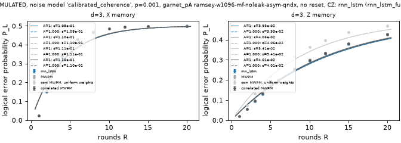

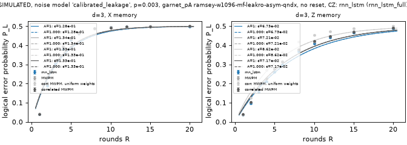

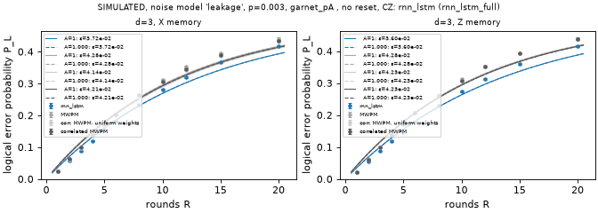

## Analyses

Shot-level studies of where the decoders disagree (`python -m mlDecoder.analysis why --run <mlp run-id> --noise <noise>`); simulated data.

### Overfitting audit: run `20261024-155006-mlp_full`

P_L of each frozen model on shots it trained on (held-in), on its validation set and on the frozen test set (Wilson 95%). z = (P_test − P_train)/σ; **flag** if the model does better on its training shots than on test by more than 2σ. Epochs = training shots seen / pool size (pool runs only).

Separation: **seed sequences**: numpy SeedSequence(entropy=20261024, spawn_key=(8 uint32 words of sha256(spec), DATA_VERSION=1, split id {'train': 1, 'val': 2, 'test': 3, 'pilot': 4, 'test2': 5}, run seed, chunk)); **run seed**: 1234; **test seed**: 0 (canonical: test and pilot shots depend on the spec alone); **stream chunks**: Pauli stream: chunk 2147483647; leakage pool: chunks 0..; fresh leakage stream: chunks 1000000000..; **test used for**: final scoring only: run.train_and_score decodes the frozen test set after fit() has returned and frozen the weights; **val used for**: early stopping and checkpoint choice only: train._train keeps the state with the fewest val failures (ties: lower val loss) and stops after patience_evals evaluations without improvement; **hyperparameters**: fixed in configs/mlp_*.json before any test scoring; no search was run on val or test; **test size**: chosen from a correlated-MWPM pilot on the separate 'pilot' split, never from test; **features**: detection events only: MLPDecoder._check / decode_packed take det_events; obs_flips enter only as BCE labels and in failure counting.

| noise | p | d | basis | R | params | data | pool | epochs | P_L train (held-in) | P_L val | P_L test | z train<test | z val<test | flag |
|---|---:|---:|---|---:|---:|---|---:|---:|---:|---:|---:|---:|---:|---|
| leakage | 0.001 | 3 | X | 1 | 34,305 | pool | 2,000,000 | 56 | 4.18e-03 [3.91e-03, 4.47e-03] | 4.04e-03 [3.52e-03, 4.64e-03] | 4.10e-03 [3.72e-03, 4.52e-03] | -0.3 | +0.2 |  |
| leakage | 0.001 | 3 | X | 2 | 35,329 | pool | 2,000,000 | 77 | 8.69e-03 [8.29e-03, 9.11e-03] | 8.72e-03 [7.94e-03, 9.57e-03] | 9.21e-03 [8.64e-03, 9.82e-03] | +1.4 | +1.0 |  |
| leakage | 0.001 | 3 | X | 3 | 45,505 | pool | 2,000,000 | 74 | 1.26e-02 [1.21e-02, 1.31e-02] | 1.56e-02 [1.46e-02, 1.67e-02] | 1.54e-02 [1.46e-02, 1.62e-02] | +6.0 | -0.3 | **FLAG** |
| leakage | 0.001 | 3 | X | 5 | 125,761 | pool | 2,000,000 | 62 | 2.35e-02 [2.29e-02, 2.42e-02] | 2.97e-02 [2.82e-02, 3.12e-02] | 2.89e-02 [2.78e-02, 2.99e-02] | +8.5 | -0.9 | **FLAG** |
| leakage | 0.001 | 3 | X | 8 | 321,025 | pool | 2,000,000 | 48 | 4.53e-02 [4.44e-02, 4.63e-02] | 5.45e-02 [5.26e-02, 5.66e-02] | 5.37e-02 [5.23e-02, 5.51e-02] | +9.8 | -0.7 | **FLAG** |
| leakage | 0.001 | 3 | X | 10 | 501,121 | pool | 2,000,000 | 43 | 5.91e-02 [5.80e-02, 6.01e-02] | 7.61e-02 [7.38e-02, 7.85e-02] | 7.55e-02 [7.39e-02, 7.72e-02] | +16.7 | -0.4 | **FLAG** |
| leakage | 0.001 | 3 | Z | 1 | 34,305 | pool | 2,000,000 | 136 | 3.58e-03 [3.33e-03, 3.85e-03] | 3.26e-03 [2.80e-03, 3.80e-03] | 3.82e-03 [3.46e-03, 4.22e-03] | +1.0 | +1.7 |  |
| leakage | 0.001 | 3 | Z | 2 | 35,329 | pool | 2,000,000 | 82 | 8.09e-03 [7.71e-03, 8.50e-03] | 8.84e-03 [8.06e-03, 9.70e-03] | 9.19e-03 [8.62e-03, 9.80e-03] | +3.0 | +0.7 | **FLAG** |
| leakage | 0.001 | 3 | Z | 3 | 45,505 | pool | 2,000,000 | 81 | 1.36e-02 [1.31e-02, 1.41e-02] | 1.51e-02 [1.41e-02, 1.62e-02] | 1.49e-02 [1.41e-02, 1.56e-02] | +2.7 | -0.4 | **FLAG** |
| leakage | 0.001 | 3 | Z | 5 | 125,761 | pool | 2,000,000 | 70 | 2.32e-02 [2.25e-02, 2.39e-02] | 3.01e-02 [2.86e-02, 3.16e-02] | 2.87e-02 [2.76e-02, 2.97e-02] | +8.7 | -1.5 | **FLAG** |
| leakage | 0.001 | 3 | Z | 8 | 321,025 | pool | 2,000,000 | 55 | 4.43e-02 [4.34e-02, 4.52e-02] | 5.60e-02 [5.40e-02, 5.80e-02] | 5.44e-02 [5.31e-02, 5.59e-02] | +11.9 | -1.2 | **FLAG** |
| leakage | 0.001 | 3 | Z | 10 | 501,121 | pool | 2,000,000 | 47 | 5.56e-02 [5.46e-02, 5.66e-02] | 7.35e-02 [7.13e-02, 7.59e-02] | 7.45e-02 [7.29e-02, 7.62e-02] | +19.4 | +0.7 | **FLAG** |
| leakage | 0.001 | 5 | X | 1 | 36,353 | pool | 1,000,000 | 139 | 8.90e-04 [7.69e-04, 1.03e-03] | 1.78e-03 [1.45e-03, 2.19e-03] | 2.01e-03 [1.83e-03, 2.22e-03] | +9.3 | +1.1 | **FLAG** |
| leakage | 0.001 | 5 | X | 2 | 83,713 | pool | 1,000,000 | 137 | 1.13e-03 [9.97e-04, 1.29e-03] | 8.00e-03 [7.26e-03, 8.82e-03] | 8.22e-03 [7.68e-03, 8.80e-03] | +24.0 | +0.4 | **FLAG** |
| leakage | 0.001 | 5 | X | 3 | 187,777 | pool | 1,000,000 | 114 | 3.19e-03 [2.95e-03, 3.45e-03] | 1.84e-02 [1.73e-02, 1.96e-02] | 1.86e-02 [1.77e-02, 1.94e-02] | +34.5 | +0.2 | **FLAG** |
| leakage | 0.001 | 5 | X | 5 | 520,321 | pool | 1,000,000 | 69 | 3.12e-02 [3.04e-02, 3.19e-02] | 5.36e-02 [5.17e-02, 5.56e-02] | 5.46e-02 [5.32e-02, 5.60e-02] | +28.6 | +0.8 | **FLAG** |
| leakage | 0.001 | 5 | X | 8 | 1,330,177 | pool | 1,000,000 | 48 | 5.93e-02 [5.83e-02, 6.03e-02] | 1.38e-01 [1.35e-01, 1.41e-01] | 1.37e-01 [1.35e-01, 1.39e-01] | +64.4 | -0.6 | **FLAG** |
| leakage | 0.001 | 5 | X | 10 | 2,077,441 | pool | 1,000,000 | 31 | 1.59e-01 [1.57e-01, 1.61e-01] | 1.85e-01 [1.82e-01, 1.89e-01] | 1.89e-01 [1.87e-01, 1.91e-01] | +20.2 | +1.6 | **FLAG** |
| leakage | 0.001 | 5 | Z | 1 | 36,353 | pool | 1,000,000 | 95 | 9.50e-04 [8.24e-04, 1.09e-03] | 2.00e-03 [1.64e-03, 2.43e-03] | 1.73e-03 [1.56e-03, 1.93e-03] | +6.8 | -1.2 | **FLAG** |
| leakage | 0.001 | 5 | Z | 2 | 83,713 | pool | 1,000,000 | 94 | 2.22e-03 [2.03e-03, 2.44e-03] | 8.48e-03 [7.71e-03, 9.32e-03] | 9.32e-03 [8.74e-03, 9.93e-03] | +22.1 | +1.6 | **FLAG** |
| leakage | 0.001 | 5 | Z | 3 | 187,777 | pool | 1,000,000 | 83 | 8.96e-03 [8.56e-03, 9.38e-03] | 1.92e-02 [1.80e-02, 2.04e-02] | 1.92e-02 [1.83e-02, 2.00e-02] | +21.2 | -0.0 | **FLAG** |
| leakage | 0.001 | 5 | Z | 5 | 520,321 | pool | 1,000,000 | 67 | 3.52e-02 [3.44e-02, 3.60e-02] | 5.36e-02 [5.17e-02, 5.56e-02] | 5.64e-02 [5.50e-02, 5.79e-02] | +25.3 | +2.2 | **FLAG** |
| leakage | 0.001 | 5 | Z | 8 | 1,330,177 | pool | 1,000,000 | 45 | 7.97e-02 [7.85e-02, 8.09e-02] | 1.37e-01 [1.34e-01, 1.40e-01] | 1.38e-01 [1.36e-01, 1.40e-01] | +46.6 | +0.4 | **FLAG** |
| leakage | 0.001 | 5 | Z | 10 | 2,077,441 | pool | 1,000,000 | 31 | 1.61e-01 [1.59e-01, 1.62e-01] | 1.88e-01 [1.84e-01, 1.91e-01] | 1.89e-01 [1.86e-01, 1.91e-01] | +19.1 | +0.6 | **FLAG** |
| leakage | 0.001 | 7 | X | 1 | 83,713 | pool | 500,000 | 162 | 0.00e+00 [0.00e+00, 1.92e-05] | 3.52e-03 [3.04e-03, 4.08e-03] | 3.77e-03 [3.61e-03, 3.95e-03] | +43.5 | +0.9 | **FLAG** |
| leakage | 0.001 | 7 | X | 2 | 333,313 | pool | 500,000 | 155 | 0.00e+00 [0.00e+00, 1.92e-05] | 1.96e-02 [1.84e-02, 2.08e-02] | 1.95e-02 [1.87e-02, 2.04e-02] | +44.6 | -0.1 | **FLAG** |
| leakage | 0.001 | 7 | X | 3 | 748,801 | pool | 500,000 | 108 | 0.00e+00 [0.00e+00, 1.92e-05] | 5.19e-02 [5.00e-02, 5.39e-02] | 5.11e-02 [4.98e-02, 5.25e-02] | +73.4 | -0.7 | **FLAG** |
| leakage | 0.001 | 7 | X | 5 | 2,077,441 | pool | 500,000 | 54 | 9.74e-02 [9.61e-02, 9.87e-02] | 1.30e-01 [1.27e-01, 1.33e-01] | 1.30e-01 [1.28e-01, 1.32e-01] | +26.2 | -0.0 | **FLAG** |
| leakage | 0.001 | 7 | X | 8 | 5,314,561 | pool | 500,000 | 30 | 9.86e-02 [9.73e-02, 9.99e-02] | 2.75e-01 [2.71e-01, 2.79e-01] | 2.75e-01 [2.72e-01, 2.78e-01] | +112.9 | +0.1 | **FLAG** |
| leakage | 0.001 | 7 | X | 10 | 8,302,081 | pool | 500,000 | 19 | 1.31e-01 [1.30e-01, 1.33e-01] | 3.53e-01 [3.49e-01, 3.58e-01] | 3.52e-01 [3.49e-01, 3.55e-01] | +130.7 | -0.6 | **FLAG** |
| leakage | 0.001 | 7 | Z | 1 | 83,713 | pool | 500,000 | 158 | 5.00e-06 [8.83e-07, 2.83e-05] | 3.44e-03 [2.96e-03, 3.99e-03] | 3.63e-03 [3.49e-03, 3.77e-03] | +50.3 | +0.7 | **FLAG** |
| leakage | 0.001 | 7 | Z | 2 | 333,313 | pool | 500,000 | 152 | 0.00e+00 [0.00e+00, 1.92e-05] | 1.69e-02 [1.58e-02, 1.80e-02] | 1.86e-02 [1.78e-02, 1.95e-02] | +43.6 | +2.4 | **FLAG** |
| leakage | 0.001 | 7 | Z | 3 | 748,801 | pool | 500,000 | 112 | 0.00e+00 [0.00e+00, 1.92e-05] | 5.03e-02 [4.84e-02, 5.23e-02] | 5.05e-02 [4.92e-02, 5.19e-02] | +72.9 | +0.2 | **FLAG** |
| leakage | 0.001 | 7 | Z | 5 | 2,077,441 | pool | 500,000 | 55 | 1.01e-01 [9.99e-02, 1.03e-01] | 1.34e-01 [1.31e-01, 1.37e-01] | 1.33e-01 [1.31e-01, 1.35e-01] | +25.1 | -0.5 | **FLAG** |
| leakage | 0.001 | 7 | Z | 8 | 5,314,561 | pool | 500,000 | 30 | 4.65e-02 [4.56e-02, 4.75e-02] | 2.66e-01 [2.63e-01, 2.70e-01] | 2.66e-01 [2.63e-01, 2.68e-01] | +148.6 | -0.3 | **FLAG** |
| leakage | 0.001 | 7 | Z | 10 | 8,302,081 | pool | 500,000 | 19 | 2.78e-01 [2.76e-01, 2.80e-01] | 3.43e-01 [3.39e-01, 3.48e-01] | 3.45e-01 [3.42e-01, 3.48e-01] | +36.9 | +0.5 | **FLAG** |
| uniform | 0.001 | 3 | X | 1 | 34,305 | fresh | – | – | 1.16e-03 [1.02e-03, 1.31e-03] | 1.11e-03 [9.69e-04, 1.26e-03] | 1.32e-03 [1.17e-03, 1.49e-03] | +1.5 | +2.0 |  |
| uniform | 0.001 | 3 | X | 2 | 35,329 | fresh | – | – | 2.49e-03 [2.29e-03, 2.71e-03] | 2.62e-03 [2.40e-03, 2.85e-03] | 2.31e-03 [2.03e-03, 2.63e-03] | -1.0 | -1.6 |  |
| uniform | 0.001 | 3 | X | 3 | 45,505 | fresh | – | – | 3.43e-03 [3.19e-03, 3.68e-03] | 3.77e-03 [3.51e-03, 4.05e-03] | 3.83e-03 [3.47e-03, 4.23e-03] | +1.7 | +0.3 |  |
| uniform | 0.001 | 3 | X | 5 | 125,761 | fresh | – | – | 6.17e-03 [5.85e-03, 6.51e-03] | 6.18e-03 [5.85e-03, 6.53e-03] | 6.46e-03 [5.98e-03, 6.98e-03] | +1.0 | +0.9 |  |
| uniform | 0.001 | 3 | X | 8 | 321,025 | fresh | – | – | 1.02e-02 [9.77e-03, 1.06e-02] | 1.01e-02 [9.69e-03, 1.06e-02] | 1.10e-02 [1.04e-02, 1.17e-02] | +2.0 | +2.2 | **FLAG** |
| uniform | 0.001 | 3 | X | 10 | 501,121 | fresh | – | – | 1.28e-02 [1.24e-02, 1.33e-02] | 1.30e-02 [1.25e-02, 1.35e-02] | 1.32e-02 [1.25e-02, 1.39e-02] | +0.8 | +0.5 |  |
| uniform | 0.001 | 3 | Z | 1 | 34,305 | fresh | – | – | 9.86e-04 [8.61e-04, 1.13e-03] | 9.05e-04 [7.82e-04, 1.05e-03] | 9.90e-04 [8.61e-04, 1.14e-03] | +0.0 | +0.9 |  |
| uniform | 0.001 | 3 | Z | 2 | 35,329 | fresh | – | – | 2.35e-03 [2.15e-03, 2.56e-03] | 2.48e-03 [2.28e-03, 2.71e-03] | 2.45e-03 [2.16e-03, 2.78e-03] | +0.5 | -0.2 |  |
| uniform | 0.001 | 3 | Z | 3 | 45,505 | fresh | – | – | 3.62e-03 [3.38e-03, 3.89e-03] | 3.39e-03 [3.14e-03, 3.65e-03] | 3.51e-03 [3.16e-03, 3.90e-03] | -0.5 | +0.5 |  |
| uniform | 0.001 | 3 | Z | 5 | 125,761 | fresh | – | – | 6.25e-03 [5.93e-03, 6.60e-03] | 6.28e-03 [5.94e-03, 6.63e-03] | 6.33e-03 [5.86e-03, 6.84e-03] | +0.3 | +0.2 |  |
| uniform | 0.001 | 3 | Z | 8 | 321,025 | fresh | – | – | 1.04e-02 [9.94e-03, 1.08e-02] | 1.04e-02 [9.94e-03, 1.08e-02] | 1.02e-02 [9.56e-03, 1.08e-02] | -0.5 | -0.6 |  |
| uniform | 0.001 | 3 | Z | 10 | 501,121 | fresh | – | – | 1.25e-02 [1.20e-02, 1.30e-02] | 1.26e-02 [1.21e-02, 1.31e-02] | 1.27e-02 [1.20e-02, 1.34e-02] | +0.5 | +0.3 |  |
| uniform | 0.001 | 5 | X | 1 | 36,353 | fresh | – | – | 2.54e-04 [1.94e-04, 3.31e-04] | 2.50e-04 [1.90e-04, 3.30e-04] | 2.27e-04 [1.99e-04, 2.59e-04] | -0.7 | -0.6 |  |
| uniform | 0.001 | 5 | X | 2 | 83,713 | fresh | – | – | 5.35e-04 [4.46e-04, 6.43e-04] | 5.05e-04 [4.16e-04, 6.14e-04] | 5.73e-04 [4.94e-04, 6.66e-04] | +0.6 | +1.0 |  |
| uniform | 0.001 | 5 | X | 3 | 187,777 | fresh | – | – | 1.02e-03 [8.92e-04, 1.16e-03] | 1.20e-03 [1.06e-03, 1.36e-03] | 1.11e-03 [9.73e-04, 1.27e-03] | +0.9 | -0.8 |  |
| uniform | 0.001 | 5 | X | 5 | 520,321 | fresh | – | – | 2.81e-03 [2.59e-03, 3.04e-03] | 2.68e-03 [2.47e-03, 2.92e-03] | 2.64e-03 [2.42e-03, 2.87e-03] | -1.0 | -0.3 |  |
| uniform | 0.001 | 5 | X | 8 | 1,330,177 | fresh | – | – | 7.11e-03 [6.76e-03, 7.47e-03] | 7.14e-03 [6.78e-03, 7.52e-03] | 7.87e-03 [7.34e-03, 8.44e-03] | +2.3 | +2.2 | **FLAG** |
| uniform | 0.001 | 5 | X | 10 | 2,077,441 | fresh | – | – | 1.32e-02 [1.27e-02, 1.37e-02] | 1.35e-02 [1.30e-02, 1.41e-02] | 1.36e-02 [1.29e-02, 1.43e-02] | +0.8 | +0.0 |  |
| uniform | 0.001 | 5 | Z | 1 | 36,353 | fresh | – | – | 1.46e-04 [1.03e-04, 2.07e-04] | 1.75e-04 [1.26e-04, 2.43e-04] | 1.91e-04 [1.69e-04, 2.15e-04] | +1.6 | +0.5 |  |
| uniform | 0.001 | 5 | Z | 2 | 83,713 | fresh | – | – | 5.82e-04 [4.88e-04, 6.94e-04] | 5.65e-04 [4.70e-04, 6.79e-04] | 5.77e-04 [5.08e-04, 6.57e-04] | -0.1 | +0.2 |  |
| uniform | 0.001 | 5 | Z | 3 | 187,777 | fresh | – | – | 1.07e-03 [9.40e-04, 1.22e-03] | 1.10e-03 [9.59e-04, 1.25e-03] | 1.02e-03 [9.12e-04, 1.14e-03] | -0.6 | -0.8 |  |
| uniform | 0.001 | 5 | Z | 5 | 520,321 | fresh | – | – | 2.73e-03 [2.52e-03, 2.96e-03] | 2.69e-03 [2.48e-03, 2.93e-03] | 2.74e-03 [2.52e-03, 2.97e-03] | +0.0 | +0.2 |  |
| uniform | 0.001 | 5 | Z | 8 | 1,330,177 | fresh | – | – | 7.15e-03 [6.80e-03, 7.52e-03] | 6.81e-03 [6.45e-03, 7.17e-03] | 6.92e-03 [6.42e-03, 7.45e-03] | -0.7 | +0.4 |  |
| uniform | 0.001 | 5 | Z | 10 | 2,077,441 | fresh | – | – | 1.17e-02 [1.12e-02, 1.22e-02] | 1.17e-02 [1.12e-02, 1.22e-02] | 1.18e-02 [1.11e-02, 1.25e-02] | +0.2 | +0.2 |  |
| uniform | 0.001 | 7 | X | 1 | 83,713 | fresh | – | – | 2.34e-04 [1.77e-04, 3.11e-04] | 2.50e-04 [1.69e-04, 3.69e-04] | 2.37e-04 [2.27e-04, 2.47e-04] | +0.1 | -0.3 |  |
| uniform | 0.001 | 7 | X | 2 | 333,313 | fresh | – | – | 1.05e-03 [9.23e-04, 1.20e-03] | 1.22e-03 [1.02e-03, 1.46e-03] | 1.03e-03 [9.94e-04, 1.06e-03] | -0.4 | -1.7 |  |
| uniform | 0.001 | 7 | X | 3 | 748,801 | fresh | – | – | 1.86e-03 [1.68e-03, 2.05e-03] | 1.96e-03 [1.70e-03, 2.25e-03] | 1.86e-03 [1.80e-03, 1.93e-03] | +0.1 | -0.7 |  |
| uniform | 0.001 | 7 | X | 5 | 2,077,441 | fresh | – | – | 6.02e-03 [5.69e-03, 6.36e-03] | 6.37e-03 [5.90e-03, 6.88e-03] | 6.11e-03 [5.97e-03, 6.25e-03] | +0.5 | -1.0 |  |
| uniform | 0.001 | 7 | X | 8 | 5,314,561 | fresh | – | – | 2.47e-02 [2.40e-02, 2.54e-02] | 2.51e-02 [2.42e-02, 2.61e-02] | 2.48e-02 [2.44e-02, 2.51e-02] | +0.2 | -0.6 |  |
| uniform | 0.001 | 7 | X | 10 | 8,302,081 | fresh | – | – | 4.56e-02 [4.47e-02, 4.65e-02] | 4.60e-02 [4.47e-02, 4.73e-02] | 4.51e-02 [4.46e-02, 4.56e-02] | -0.8 | -1.2 |  |
| uniform | 0.001 | 7 | Z | 1 | 83,713 | fresh | – | – | 2.44e-04 [1.85e-04, 3.22e-04] | 3.10e-04 [2.18e-04, 4.40e-04] | 2.18e-04 [2.09e-04, 2.27e-04] | -0.7 | -1.6 |  |
| uniform | 0.001 | 7 | Z | 2 | 333,313 | fresh | – | – | 6.88e-04 [5.84e-04, 8.12e-04] | 6.70e-04 [5.28e-04, 8.51e-04] | 6.91e-04 [6.61e-04, 7.22e-04] | +0.0 | +0.3 |  |
| uniform | 0.001 | 7 | Z | 3 | 748,801 | fresh | – | – | 1.87e-03 [1.69e-03, 2.07e-03] | 1.99e-03 [1.73e-03, 2.29e-03] | 1.91e-03 [1.86e-03, 1.97e-03] | +0.4 | -0.5 |  |
| uniform | 0.001 | 7 | Z | 5 | 2,077,441 | fresh | – | – | 6.63e-03 [6.28e-03, 6.99e-03] | 7.02e-03 [6.52e-03, 7.56e-03] | 6.70e-03 [6.56e-03, 6.85e-03] | +0.4 | -1.2 |  |
| uniform | 0.001 | 7 | Z | 8 | 5,314,561 | fresh | – | – | 2.61e-02 [2.54e-02, 2.68e-02] | 2.55e-02 [2.46e-02, 2.65e-02] | 2.58e-02 [2.55e-02, 2.62e-02] | -0.7 | +0.5 |  |
| uniform | 0.001 | 7 | Z | 10 | 8,302,081 | fresh | – | – | 4.52e-02 [4.43e-02, 4.61e-02] | 4.59e-02 [4.46e-02, 4.72e-02] | 4.59e-02 [4.54e-02, 4.64e-02] | +1.2 | -0.0 |  |

Flagged (train beats test by > 2σ): d3_r3_X_leakage_p0.001_cz_nr, d3_r5_X_leakage_p0.001_cz_nr, d3_r8_X_leakage_p0.001_cz_nr, d3_r10_X_leakage_p0.001_cz_nr, d3_r2_Z_leakage_p0.001_cz_nr, d3_r3_Z_leakage_p0.001_cz_nr, d3_r5_Z_leakage_p0.001_cz_nr, d3_r8_Z_leakage_p0.001_cz_nr, d3_r10_Z_leakage_p0.001_cz_nr, d5_r1_X_leakage_p0.001_cz_nr, d5_r2_X_leakage_p0.001_cz_nr, d5_r3_X_leakage_p0.001_cz_nr, d5_r5_X_leakage_p0.001_cz_nr, d5_r8_X_leakage_p0.001_cz_nr, d5_r10_X_leakage_p0.001_cz_nr, d5_r1_Z_leakage_p0.001_cz_nr, d5_r2_Z_leakage_p0.001_cz_nr, d5_r3_Z_leakage_p0.001_cz_nr, d5_r5_Z_leakage_p0.001_cz_nr, d5_r8_Z_leakage_p0.001_cz_nr, d5_r10_Z_leakage_p0.001_cz_nr, d7_r1_X_leakage_p0.001_cz_nr, d7_r2_X_leakage_p0.001_cz_nr, d7_r3_X_leakage_p0.001_cz_nr, d7_r5_X_leakage_p0.001_cz_nr, d7_r8_X_leakage_p0.001_cz_nr, d7_r10_X_leakage_p0.001_cz_nr, d7_r1_Z_leakage_p0.001_cz_nr, d7_r2_Z_leakage_p0.001_cz_nr, d7_r3_Z_leakage_p0.001_cz_nr, d7_r5_Z_leakage_p0.001_cz_nr, d7_r8_Z_leakage_p0.001_cz_nr, d7_r10_Z_leakage_p0.001_cz_nr, d3_r8_X_uniform_p0.001_cz_nr, d5_r8_X_uniform_p0.001_cz_nr.

### Fresh-test replication: d=3 `leakage` p=0.001 (run `20261024-155006-mlp_full`)

test2: a new canonical split stream (split id 5, seed 0), the same spec and the same N as the frozen test set, generated after the models were frozen. A = 1 fits (fit_ler), profile 95% intervals; agreement z = difference / combined standard error. Simulated data.

| basis | decoder | ε_L frozen test [95%] | ε_L test2 [95%] | z | agree |
|---|---|---:|---:|---:|---|
| X | MLP | 6.701e-03 [6.604e-03, 6.800e-03] | 6.735e-03 [6.638e-03, 6.834e-03] | +0.48 | yes |
| X | correlated MWPM | 9.340e-03 [9.223e-03, 9.458e-03] | 9.332e-03 [9.215e-03, 9.450e-03] | -0.09 | yes |
| X | ratio MLP/MWPM | 0.717 | 0.722 | | |
| Z | MLP | 6.653e-03 [6.556e-03, 6.751e-03] | 6.679e-03 [6.582e-03, 6.777e-03] | +0.37 | yes |
| Z | correlated MWPM | 9.847e-03 [9.727e-03, 9.968e-03] | 9.800e-03 [9.680e-03, 9.921e-03] | -0.54 | yes |
| Z | ratio MLP/MWPM | 0.676 | 0.682 | | |

Per round count, failures on test2 (MLP / correlated MWPM) and the paired ΔP_L:

| basis | R | N | test: MLP / MWPM | test2: MLP / MWPM | test2 ΔP_L [95%] |
|---|---:|---:|---:|---:|---:|
| X | 1 | 100,000 | 410 / 504 | 395 / 505 | -1.10e-03 [-1.41e-03, -7.90e-04] |
| X | 2 | 100,000 | 921 / 1329 | 941 / 1341 | -4.00e-03 [-4.57e-03, -3.42e-03] |
| X | 3 | 100,000 | 1539 / 2289 | 1443 / 2307 | -8.64e-03 [-9.45e-03, -7.84e-03] |
| X | 5 | 100,000 | 2885 / 4288 | 2872 / 4338 | -1.47e-02 [-1.58e-02, -1.35e-02] |
| X | 8 | 100,000 | 5369 / 7593 | 5572 / 7460 | -1.89e-02 [-2.05e-02, -1.73e-02] |
| X | 10 | 100,000 | 7554 / 9632 | 7546 / 9663 | -2.12e-02 [-2.30e-02, -1.93e-02] |
| Z | 1 | 100,000 | 382 / 404 | 383 / 432 | -4.90e-04 [-7.20e-04, -2.60e-04] |
| Z | 2 | 100,000 | 919 / 1318 | 886 / 1341 | -4.55e-03 [-5.13e-03, -3.95e-03] |
| Z | 3 | 100,000 | 1485 / 2372 | 1568 / 2371 | -8.03e-03 [-8.88e-03, -7.18e-03] |
| Z | 5 | 100,000 | 2866 / 4602 | 2958 / 4623 | -1.67e-02 [-1.79e-02, -1.54e-02] |
| Z | 8 | 100,000 | 5444 / 7998 | 5455 / 7916 | -2.46e-02 [-2.63e-02, -2.30e-02] |
| Z | 10 | 100,000 | 7454 / 10254 | 7369 / 10143 | -2.77e-02 [-2.97e-02, -2.58e-02] |

### Fresh-test replication: d=3 `uniform` p=0.001 (run `20261024-155006-mlp_full`)

test2: a new canonical split stream (split id 5, seed 0), the same spec and the same N as the frozen test set, generated after the models were frozen. A = 1 fits (fit_ler), profile 95% intervals; agreement z = difference / combined standard error. Simulated data.

| basis | decoder | ε_L frozen test [95%] | ε_L test2 [95%] | z | agree |
|---|---|---:|---:|---:|---|
| X | MLP | 1.323e-03 [1.282e-03, 1.365e-03] | 1.309e-03 [1.268e-03, 1.351e-03] | -0.48 | yes |
| X | correlated MWPM | 1.457e-03 [1.414e-03, 1.501e-03] | 1.436e-03 [1.393e-03, 1.480e-03] | -0.66 | yes |
| X | ratio MLP/MWPM | 0.908 | 0.912 | | |
| Z | MLP | 1.246e-03 [1.207e-03, 1.287e-03] | 1.244e-03 [1.205e-03, 1.285e-03] | -0.07 | yes |
| Z | correlated MWPM | 1.459e-03 [1.416e-03, 1.503e-03] | 1.444e-03 [1.401e-03, 1.487e-03] | -0.50 | yes |
| Z | ratio MLP/MWPM | 0.854 | 0.862 | | |

Per round count, failures on test2 (MLP / correlated MWPM) and the paired ΔP_L:

| basis | R | N | test: MLP / MWPM | test2: MLP / MWPM | test2 ΔP_L [95%] |
|---|---:|---:|---:|---:|---:|
| X | 1 | 200,000 | 264 / 253 | 263 / 255 | +4.00e-05 [-4.50e-05, +1.25e-04] |
| X | 2 | 100,000 | 231 / 265 | 272 / 292 | -2.00e-04 [-3.70e-04, -3.00e-05] |
| X | 3 | 100,000 | 383 / 428 | 382 / 429 | -4.70e-04 [-7.20e-04, -2.20e-04] |
| X | 5 | 100,000 | 646 / 704 | 654 / 698 | -4.40e-04 [-7.70e-04, -1.10e-04] |
| X | 8 | 100,000 | 1099 / 1257 | 1038 / 1153 | -1.15e-03 [-1.60e-03, -7.00e-04] |
| X | 10 | 100,000 | 1317 / 1427 | 1289 / 1446 | -1.57e-03 [-2.10e-03, -1.04e-03] |
| Z | 1 | 200,000 | 198 / 200 | 230 / 222 | +4.00e-05 [+0.00e+00, +8.50e-05] |
| Z | 2 | 100,000 | 245 / 245 | 233 / 241 | -8.00e-05 [-2.10e-04, +5.00e-05] |
| Z | 3 | 100,000 | 351 / 396 | 353 / 380 | -2.70e-04 [-5.10e-04, -3.00e-05] |
| Z | 5 | 100,000 | 633 / 764 | 621 / 750 | -1.29e-03 [-1.65e-03, -9.30e-04] |
| Z | 8 | 100,000 | 1016 / 1173 | 1003 / 1199 | -1.96e-03 [-2.45e-03, -1.46e-03] |
| Z | 10 | 100,000 | 1269 / 1563 | 1266 / 1503 | -2.37e-03 [-2.94e-03, -1.79e-03] |

### Why the MLP wins: d=3 `leakage` p=0.001 (run `20261024-155006-mlp_full`)

Analysis only (no timing), on frozen test shots, the run's saved MLPs on one CPU thread (float32; the run scored them on CUDA with float16 autocast, which differs on a few borderline shots per 100k), and cached correlated-MWPM predictions. Streak: consecutive rounds in which one check's detector fires; streaks >= 3 are counted once each. Simulated data.

**Who gets which shots right**, per configuration (MLP-only right = correlated MWPM wrong, MLP right):

| basis | R | N | both right | both wrong | MLP-only right | MWPM-only right | MLP fails | MWPM fails |
|---|---:|---:|---:|---:|---:|---:|---:|---:|
| X | 1 | 100,000 | 99,424 | 338 | 166 | 72 | 410 | 504 |
| X | 2 | 100,000 | 98,447 | 697 | 632 | 224 | 921 | 1,329 |
| X | 3 | 100,000 | 97,215 | 1,041 | 1,248 | 496 | 1,537 | 2,289 |
| X | 5 | 100,000 | 94,576 | 1,748 | 2,540 | 1,136 | 2,884 | 4,288 |
| X | 8 | 100,000 | 90,069 | 3,034 | 4,559 | 2,338 | 5,372 | 7,593 |
| X | 10 | 100,000 | 86,779 | 3,969 | 5,663 | 3,589 | 7,558 | 9,632 |
| Z | 1 | 100,000 | 99,537 | 323 | 81 | 59 | 382 | 404 |
| Z | 2 | 100,000 | 98,428 | 665 | 653 | 254 | 919 | 1,318 |
| Z | 3 | 100,000 | 97,114 | 970 | 1,402 | 514 | 1,484 | 2,372 |
| Z | 5 | 100,000 | 94,275 | 1,744 | 2,858 | 1,123 | 2,867 | 4,602 |
| Z | 8 | 100,000 | 89,550 | 2,990 | 5,008 | 2,452 | 5,442 | 7,998 |
| Z | 10 | 100,000 | 86,235 | 3,943 | 6,311 | 3,511 | 7,454 | 10,254 |

**The two discordant groups**, means per shot pooled over configurations (weighted by shots in the group):

| group | shots | events | longest streak | streaks ≥ 3 | most firings on one check | median abs(logit) | type X | type Z | round 0 | round 1 | bulk rounds | final | weight-2 checks | weight-4 checks |
|---|---:|---:|---:|---:|---:|---:|---:|---:|---:|---:|---:|---:|---:|---:|
| mlp only right | 31,121 | 11.17 | 2.64 | 0.84 | 3.23 | 1.77 | 5.47 | 5.71 | 0.22 | 0.99 | 9.21 | 0.74 | 3.99 | 7.18 |
| mwpm only right | 15,768 | 11.75 | 2.74 | 0.90 | 3.45 | 0.78 | 5.85 | 5.90 | 0.27 | 1.03 | 9.73 | 0.71 | 4.41 | 7.34 |
| both wrong | 21,462 | 9.28 | 2.33 | 0.65 | 2.85 | 1.60 | 4.62 | 4.66 | 0.24 | 0.90 | 7.47 | 0.67 | 3.39 | 5.90 |

**P_L conditional on the longest streak**, basis X, pooled over R (share = the bin's part of MWPM failures minus MLP failures):

| longest streak | shots | fraction | P_L MLP | P_L MWPM | share of advantage |
|---|---:|---:|---:|---:|---:|
| 0–1 | 461,746 | 0.770 | 9.77e-03 | 1.23e-02 | 0.16 |
| 2 | 96,615 | 0.161 | 6.46e-02 | 9.35e-02 | 0.40 |
| 3 | 24,842 | 0.041 | 1.66e-01 | 2.36e-01 | 0.25 |
| 4 | 10,801 | 0.018 | 2.08e-01 | 2.88e-01 | 0.12 |
| ≥5 | 5,996 | 0.010 | 2.61e-01 | 3.27e-01 | 0.06 |

**P_L conditional on the total detection events**, basis X, pooled over R (share = the bin's part of MWPM failures minus MLP failures):

| total detection events | shots | fraction | P_L MLP | P_L MWPM | share of advantage |
|---|---:|---:|---:|---:|---:|
| 0 | 310,130 | 0.517 | 6.45e-06 | 6.45e-06 | 0.00 |
| 1–2 | 130,077 | 0.217 | 1.24e-02 | 1.36e-02 | 0.02 |
| 3–4 | 65,970 | 0.110 | 4.27e-02 | 5.52e-02 | 0.12 |
| 5–8 | 50,254 | 0.084 | 9.31e-02 | 1.38e-01 | 0.33 |
| 9–16 | 31,410 | 0.052 | 1.90e-01 | 2.69e-01 | 0.36 |
| ≥17 | 12,159 | 0.020 | 2.96e-01 | 3.96e-01 | 0.18 |

**P_L conditional on the longest streak**, basis Z, pooled over R (share = the bin's part of MWPM failures minus MLP failures):

| longest streak | shots | fraction | P_L MLP | P_L MWPM | share of advantage |
|---|---:|---:|---:|---:|---:|
| 0–1 | 462,064 | 0.770 | 9.40e-03 | 1.30e-02 | 0.20 |
| 2 | 96,615 | 0.161 | 6.79e-02 | 9.76e-02 | 0.34 |
| 3 | 24,884 | 0.041 | 1.60e-01 | 2.50e-01 | 0.27 |
| 4 | 10,657 | 0.018 | 2.07e-01 | 3.09e-01 | 0.13 |
| ≥5 | 5,780 | 0.010 | 2.54e-01 | 3.41e-01 | 0.06 |

**P_L conditional on the total detection events**, basis Z, pooled over R (share = the bin's part of MWPM failures minus MLP failures):

| total detection events | shots | fraction | P_L MLP | P_L MWPM | share of advantage |
|---|---:|---:|---:|---:|---:|
| 0 | 310,982 | 0.518 | 9.65e-06 | 9.65e-06 | 0.00 |
| 1–2 | 130,398 | 0.217 | 1.17e-02 | 1.34e-02 | 0.03 |
| 3–4 | 65,441 | 0.109 | 4.36e-02 | 5.97e-02 | 0.13 |
| 5–8 | 50,115 | 0.084 | 9.76e-02 | 1.49e-01 | 0.31 |
| 9–16 | 31,132 | 0.052 | 1.86e-01 | 2.87e-01 | 0.37 |
| ≥17 | 11,932 | 0.020 | 2.92e-01 | 4.10e-01 | 0.17 |

**P_L conditional on the longest streak**, basis X+Z, pooled over R (share = the bin's part of MWPM failures minus MLP failures):

| longest streak | shots | fraction | P_L MLP | P_L MWPM | share of advantage |
|---|---:|---:|---:|---:|---:|
| 0–1 | 923,810 | 0.770 | 9.59e-03 | 1.26e-02 | 0.18 |
| 2 | 193,230 | 0.161 | 6.63e-02 | 9.55e-02 | 0.37 |
| 3 | 49,726 | 0.041 | 1.63e-01 | 2.43e-01 | 0.26 |
| 4 | 21,458 | 0.018 | 2.08e-01 | 2.99e-01 | 0.13 |
| ≥5 | 11,776 | 0.010 | 2.57e-01 | 3.34e-01 | 0.06 |

**P_L conditional on the total detection events**, basis X+Z, pooled over R (share = the bin's part of MWPM failures minus MLP failures):

| total detection events | shots | fraction | P_L MLP | P_L MWPM | share of advantage |
|---|---:|---:|---:|---:|---:|
| 0 | 621,112 | 0.518 | 8.05e-06 | 8.05e-06 | 0.00 |
| 1–2 | 260,475 | 0.217 | 1.21e-02 | 1.35e-02 | 0.02 |
| 3–4 | 131,411 | 0.110 | 4.31e-02 | 5.75e-02 | 0.12 |
| 5–8 | 100,369 | 0.084 | 9.54e-02 | 1.44e-01 | 0.32 |
| 9–16 | 62,542 | 0.052 | 1.88e-01 | 2.78e-01 | 0.37 |
| ≥17 | 24,091 | 0.020 | 2.94e-01 | 4.03e-01 | 0.17 |

### Why the MLP wins: d=3 `uniform` p=0.001 (run `20261024-155006-mlp_full`)

Analysis only (no timing), on frozen test shots, the run's saved MLPs on one CPU thread (float32; the run scored them on CUDA with float16 autocast, which differs on a few borderline shots per 100k), and cached correlated-MWPM predictions. Streak: consecutive rounds in which one check's detector fires; streaks >= 3 are counted once each. Simulated data.

**Who gets which shots right**, per configuration (MLP-only right = correlated MWPM wrong, MLP right):

| basis | R | N | both right | both wrong | MLP-only right | MWPM-only right | MLP fails | MWPM fails |
|---|---:|---:|---:|---:|---:|---:|---:|---:|
| X | 1 | 200,000 | 199,702 | 219 | 34 | 45 | 264 | 253 |
| X | 2 | 100,000 | 99,703 | 199 | 66 | 32 | 231 | 265 |
| X | 3 | 100,000 | 99,513 | 324 | 104 | 59 | 383 | 428 |
| X | 5 | 100,000 | 99,180 | 530 | 174 | 116 | 646 | 704 |
| X | 8 | 100,000 | 98,514 | 870 | 387 | 229 | 1,099 | 1,257 |
| X | 10 | 100,000 | 98,268 | 1,013 | 414 | 305 | 1,318 | 1,427 |
| Z | 1 | 200,000 | 199,791 | 189 | 11 | 9 | 198 | 200 |
| Z | 2 | 100,000 | 99,732 | 222 | 23 | 23 | 245 | 245 |
| Z | 3 | 100,000 | 99,547 | 294 | 102 | 57 | 351 | 396 |
| Z | 5 | 100,000 | 99,110 | 507 | 257 | 126 | 633 | 764 |
| Z | 8 | 100,000 | 98,591 | 780 | 393 | 236 | 1,016 | 1,173 |
| Z | 10 | 100,000 | 98,150 | 982 | 581 | 287 | 1,269 | 1,563 |

**The two discordant groups**, means per shot pooled over configurations (weighted by shots in the group):

| group | shots | events | longest streak | streaks ≥ 3 | most firings on one check | median abs(logit) | type X | type Z | round 0 | round 1 | bulk rounds | final | weight-2 checks | weight-4 checks |
|---|---:|---:|---:|---:|---:|---:|---:|---:|---:|---:|---:|---:|---:|---:|
| mlp only right | 2,546 | 4.94 | 1.52 | 0.04 | 1.77 | 1.59 | 2.52 | 2.41 | 0.20 | 0.78 | 3.77 | 0.19 | 1.73 | 3.20 |
| mwpm only right | 1,524 | 5.51 | 1.73 | 0.07 | 2.09 | 0.52 | 2.80 | 2.70 | 0.29 | 0.80 | 4.11 | 0.30 | 1.98 | 3.53 |
| both wrong | 6,129 | 3.90 | 1.41 | 0.03 | 1.63 | 2.04 | 1.95 | 1.96 | 0.29 | 0.63 | 2.63 | 0.35 | 1.42 | 2.49 |

**P_L conditional on the longest streak**, basis X, pooled over R (share = the bin's part of MWPM failures minus MLP failures):

| longest streak | shots | fraction | P_L MLP | P_L MWPM | share of advantage |
|---|---:|---:|---:|---:|---:|
| 0–1 | 620,779 | 0.887 | 3.59e-03 | 4.07e-03 | 0.77 |
| 2 | 76,436 | 0.109 | 2.04e-02 | 2.15e-02 | 0.20 |
| 3 | 2,511 | 0.004 | 5.42e-02 | 5.77e-02 | 0.02 |
| 4 | 263 | 0.000 | 5.70e-02 | 6.84e-02 | 0.01 |
| ≥5 | 11 | 0.000 | 1.82e-01 | 1.82e-01 | 0.00 |

**P_L conditional on the total detection events**, basis X, pooled over R (share = the bin's part of MWPM failures minus MLP failures):

| total detection events | shots | fraction | P_L MLP | P_L MWPM | share of advantage |
|---|---:|---:|---:|---:|---:|
| 0 | 453,071 | 0.647 | 0.00e+00 | 0.00e+00 | 0.00 |
| 1–2 | 157,108 | 0.224 | 5.98e-03 | 6.52e-03 | 0.22 |
| 3–4 | 63,198 | 0.090 | 2.38e-02 | 2.70e-02 | 0.52 |
| 5–8 | 25,159 | 0.036 | 5.23e-02 | 5.66e-02 | 0.28 |
| 9–16 | 1,464 | 0.002 | 1.26e-01 | 1.22e-01 | -0.02 |
| ≥17 | 0 | 0.000 | – | – | 0.00 |

**P_L conditional on the longest streak**, basis Z, pooled over R (share = the bin's part of MWPM failures minus MLP failures):

| longest streak | shots | fraction | P_L MLP | P_L MWPM | share of advantage |
|---|---:|---:|---:|---:|---:|
| 0–1 | 621,398 | 0.888 | 3.38e-03 | 4.22e-03 | 0.83 |
| 2 | 75,950 | 0.108 | 1.94e-02 | 2.09e-02 | 0.18 |
| 3 | 2,382 | 0.003 | 5.12e-02 | 5.08e-02 | -0.00 |
| 4 | 260 | 0.000 | 5.38e-02 | 3.85e-02 | -0.01 |
| ≥5 | 10 | 0.000 | 2.00e-01 | 2.00e-01 | 0.00 |

**P_L conditional on the total detection events**, basis Z, pooled over R (share = the bin's part of MWPM failures minus MLP failures):

| total detection events | shots | fraction | P_L MLP | P_L MWPM | share of advantage |
|---|---:|---:|---:|---:|---:|
| 0 | 455,962 | 0.651 | 0.00e+00 | 0.00e+00 | 0.00 |
| 1–2 | 155,739 | 0.222 | 5.04e-03 | 5.88e-03 | 0.21 |
| 3–4 | 62,174 | 0.089 | 2.41e-02 | 2.86e-02 | 0.44 |
| 5–8 | 24,663 | 0.035 | 5.06e-02 | 5.92e-02 | 0.34 |
| 9–16 | 1,462 | 0.002 | 1.24e-01 | 1.29e-01 | 0.01 |
| ≥17 | 0 | 0.000 | – | – | 0.00 |

**P_L conditional on the longest streak**, basis X+Z, pooled over R (share = the bin's part of MWPM failures minus MLP failures):

| longest streak | shots | fraction | P_L MLP | P_L MWPM | share of advantage |
|---|---:|---:|---:|---:|---:|
| 0–1 | 1,242,177 | 0.887 | 3.48e-03 | 4.15e-03 | 0.80 |
| 2 | 152,386 | 0.109 | 1.99e-02 | 2.12e-02 | 0.19 |
| 3 | 4,893 | 0.003 | 5.27e-02 | 5.44e-02 | 0.01 |
| 4 | 523 | 0.000 | 5.54e-02 | 5.35e-02 | -0.00 |
| ≥5 | 21 | 0.000 | 1.90e-01 | 1.90e-01 | 0.00 |

**P_L conditional on the total detection events**, basis X+Z, pooled over R (share = the bin's part of MWPM failures minus MLP failures):

| total detection events | shots | fraction | P_L MLP | P_L MWPM | share of advantage |
|---|---:|---:|---:|---:|---:|
| 0 | 909,033 | 0.649 | 0.00e+00 | 0.00e+00 | 0.00 |
| 1–2 | 312,847 | 0.223 | 5.51e-03 | 6.20e-03 | 0.21 |
| 3–4 | 125,372 | 0.090 | 2.39e-02 | 2.78e-02 | 0.47 |
| 5–8 | 49,822 | 0.036 | 5.14e-02 | 5.79e-02 | 0.32 |
| 9–16 | 2,926 | 0.002 | 1.25e-01 | 1.25e-01 | 0.00 |
| ≥17 | 0 | 0.000 | – | – | 0.00 |

## rnn_lstm (rnn_lstm_emerald), run `20261024-195414-rnn_lstm_emerald`: SIMULATED development

One model per (device patch, basis), pre-trained on the run's noise mixture (all R together), scored on the frozen development sets of the components marked eval. **These are simulated shots, not results.** ΔP_L = P_L(model) − P_L(correlated MWPM, the set's own calibrated prior), paired-bootstrap 95%. "uniform" is correlated MWPM with weights from the uniform model.

**emerald_eA_Z**: 2-layer LSTM (128) over rounds, main head with final data events (128, ReLU), auxiliary head (weight 0.5), 243,714 parameters; trained 540 s on 111.3M shots (2.13M of them reused leakage chunks), time budget reached; val P_L 0.2013.

| noise | options | p | R | N | rnn_lstm P_L [95%] | corr MWPM | uniform | ΔP_L vs corr [95%] | verdict |
|---|---:|---:|---:|---:|---:|---:|---:|---:|---|
| calibrated_coherence | ramsey-w1036-mf-noleak-asym-qndx | 0.001 | 1 | 100,000 | 0.0108 [0.0101, 0.0114] | 0.0102 | 0.0102 | +5.40e-04 [1.80e-04, 9.10e-04] | loss |
| calibrated_coherence | ramsey-w1036-mf-noleak-asym-qndx | 0.001 | 2 | 100,000 | 0.0344 [0.0333, 0.0356] | 0.0352 | 0.0427 | -7.70e-04 [-1.54e-03, 1.00e-05] | tie |
| calibrated_coherence | ramsey-w1036-mf-noleak-asym-qndx | 0.001 | 3 | 100,000 | 0.0614 [0.0599, 0.0629] | 0.0633 | 0.0818 | -1.87e-03 [-2.96e-03, -7.80e-04] | **win** |
| calibrated_coherence | ramsey-w1036-mf-noleak-asym-qndx | 0.001 | 4 | 100,000 | 0.0845 [0.0828, 0.0862] | 0.0884 | 0.1151 | -3.96e-03 [-5.29e-03, -2.64e-03] | **win** |
| calibrated_coherence | ramsey-w1036-mf-noleak-asym-qndx | 0.001 | 5 | 100,000 | 0.1112 [0.1092, 0.1131] | 0.1156 | 0.1475 | -4.45e-03 [-6.00e-03, -2.93e-03] | **win** |
| calibrated_coherence | ramsey-w1036-mf-noleak-asym-qndx | 0.001 | 6 | 100,000 | 0.1345 [0.1324, 0.1366] | 0.1385 | 0.1764 | -4.03e-03 [-5.73e-03, -2.35e-03] | **win** |
| calibrated_coherence | ramsey-w1036-mf-noleak-asym-qndx | 0.001 | 8 | 100,000 | 0.1777 [0.1754, 0.1801] | 0.1846 | 0.2321 | -6.86e-03 [-8.85e-03, -4.90e-03] | **win** |
| calibrated_coherence | ramsey-w1036-mf-noleak-asym-qndx | 0.001 | 10 | 100,000 | 0.2157 [0.2131, 0.2182] | 0.2230 | 0.2749 | -7.28e-03 [-9.48e-03, -5.07e-03] | **win** |
| calibrated_coherence | ramsey-w1036-mf-noleak-asym-qndx | 0.001 | 12 | 100,000 | 0.2469 [0.2443, 0.2496] | 0.2563 | 0.3099 | -9.35e-03 [-0.0118, -6.96e-03] | **win** |
| calibrated_coherence | ramsey-w1036-mf-noleak-asym-qndx | 0.001 | 15 | 100,000 | 0.2950 [0.2921, 0.2978] | 0.3014 | 0.3549 | -6.49e-03 [-9.16e-03, -3.80e-03] | **win** |
| calibrated_coherence | ramsey-w1036-mf-noleak-asym-qndx | 0.001 | 20 | 100,000 | 0.3489 [0.3460, 0.3519] | 0.3559 | 0.4070 | -7.01e-03 [-0.0101, -4.08e-03] | **win** |
| calibrated_leakage | ramsey-w1036-mf-leakro-asym-qndx | 0.001 | 1 | 100,000 | 0.0253 [0.0243, 0.0263] | 0.0281 | 0.0266 | -2.77e-03 [-3.30e-03, -2.22e-03] | **win** |
| calibrated_leakage | ramsey-w1036-mf-leakro-asym-qndx | 0.001 | 2 | 100,000 | 0.0726 [0.0710, 0.0742] | 0.0826 | 0.0897 | -9.97e-03 [-0.0111, -8.79e-03] | **win** |
| calibrated_leakage | ramsey-w1036-mf-leakro-asym-qndx | 0.001 | 3 | 100,000 | 0.1204 [0.1184, 0.1224] | 0.1340 | 0.1524 | -0.0137 [-0.0153, -0.0121] | **win** |
| calibrated_leakage | ramsey-w1036-mf-leakro-asym-qndx | 0.001 | 4 | 100,000 | 0.1648 [0.1625, 0.1671] | 0.1815 | 0.2074 | -0.0168 [-0.0187, -0.0149] | **win** |
| calibrated_leakage | ramsey-w1036-mf-leakro-asym-qndx | 0.001 | 5 | 100,000 | 0.2066 [0.2041, 0.2091] | 0.2256 | 0.2553 | -0.0191 [-0.0213, -0.0168] | **win** |
| calibrated_leakage | ramsey-w1036-mf-leakro-asym-qndx | 0.001 | 6 | 100,000 | 0.2463 [0.2436, 0.2490] | 0.2654 | 0.2967 | -0.0191 [-0.0215, -0.0166] | **win** |
| calibrated_leakage | ramsey-w1036-mf-leakro-asym-qndx | 0.001 | 8 | 100,000 | 0.3085 [0.3057, 0.3114] | 0.3272 | 0.3586 | -0.0187 [-0.0216, -0.0158] | **win** |
| calibrated_leakage | ramsey-w1036-mf-leakro-asym-qndx | 0.001 | 10 | 100,000 | 0.3593 [0.3563, 0.3623] | 0.3792 | 0.4078 | -0.0199 [-0.0231, -0.0167] | **win** |
| calibrated_leakage | ramsey-w1036-mf-leakro-asym-qndx | 0.001 | 12 | 100,000 | 0.3969 [0.3939, 0.3999] | 0.4119 | 0.4361 | -0.0150 [-0.0185, -0.0115] | **win** |
| calibrated_leakage | ramsey-w1036-mf-leakro-asym-qndx | 0.001 | 15 | 100,000 | 0.4350 [0.4319, 0.4381] | 0.4470 | 0.4641 | -0.0120 [-0.0158, -8.30e-03] | **win** |
| calibrated_leakage | ramsey-w1036-mf-leakro-asym-qndx | 0.001 | 20 | 100,000 | 0.4684 [0.4653, 0.4715] | 0.4761 | 0.4859 | -7.71e-03 [-0.0117, -3.64e-03] | **win** |
| leakage |  | 0.003 | 1 | 100,000 | 0.0203 [0.0195, 0.0212] | 0.0209 | 0.0208 | -5.70e-04 [-9.80e-04, -1.70e-04] | **win** |
| leakage |  | 0.003 | 2 | 100,000 | 0.0539 [0.0525, 0.0553] | 0.0613 | 0.0609 | -7.40e-03 [-8.52e-03, -6.27e-03] | **win** |
| leakage |  | 0.003 | 3 | 100,000 | 0.0857 [0.0840, 0.0875] | 0.0992 | 0.0997 | -0.0135 [-0.0150, -0.0120] | **win** |
| leakage |  | 0.003 | 4 | 100,000 | 0.1195 [0.1175, 0.1215] | 0.1384 | 0.1389 | -0.0189 [-0.0208, -0.0170] | **win** |
| leakage |  | 0.003 | 5 | 100,000 | 0.1473 [0.1451, 0.1495] | 0.1706 | 0.1718 | -0.0233 [-0.0254, -0.0211] | **win** |
| leakage |  | 0.003 | 6 | 100,000 | 0.1792 [0.1768, 0.1815] | 0.2063 | 0.2063 | -0.0272 [-0.0296, -0.0248] | **win** |
| leakage |  | 0.003 | 8 | 100,000 | 0.2333 [0.2307, 0.2359] | 0.2609 | 0.2616 | -0.0276 [-0.0304, -0.0249] | **win** |
| leakage |  | 0.003 | 10 | 100,000 | 0.2811 [0.2783, 0.2839] | 0.3082 | 0.3074 | -0.0271 [-0.0302, -0.0240] | **win** |
| leakage |  | 0.003 | 12 | 100,000 | 0.3177 [0.3148, 0.3206] | 0.3521 | 0.3513 | -0.0344 [-0.0377, -0.0311] | **win** |
| leakage |  | 0.003 | 15 | 100,000 | 0.3668 [0.3638, 0.3698] | 0.3942 | 0.3922 | -0.0274 [-0.0310, -0.0238] | **win** |
| leakage |  | 0.003 | 20 | 100,000 | 0.4175 [0.4144, 0.4206] | 0.4389 | 0.4365 | -0.0214 [-0.0253, -0.0175] | **win** |

**emerald_eA_X**: 2-layer LSTM (128) over rounds, main head with final data events (128, ReLU), auxiliary head (weight 0.5), 243,714 parameters; trained 540 s on 99.0M shots (3.06M of them reused leakage chunks), time budget reached; val P_L 0.2783.

| noise | options | p | R | N | rnn_lstm P_L [95%] | corr MWPM | uniform | ΔP_L vs corr [95%] | verdict |
|---|---:|---:|---:|---:|---:|---:|---:|---:|---|
| calibrated_coherence | ramsey-w1036-mf-noleak-asym-qndx | 0.001 | 1 | 100,000 | 0.0153 [0.0145, 0.0161] | 0.0161 | 0.0157 | -8.00e-04 [-1.42e-03, -1.80e-04] | **win** |
| calibrated_coherence | ramsey-w1036-mf-noleak-asym-qndx | 0.001 | 2 | 100,000 | 0.0891 [0.0873, 0.0908] | 0.0909 | 0.0963 | -1.82e-03 [-2.92e-03, -7.20e-04] | **win** |
| calibrated_coherence | ramsey-w1036-mf-noleak-asym-qndx | 0.001 | 3 | 100,000 | 0.1643 [0.1620, 0.1666] | 0.1711 | 0.1737 | -6.83e-03 [-8.56e-03, -5.07e-03] | **win** |
| calibrated_coherence | ramsey-w1036-mf-noleak-asym-qndx | 0.001 | 4 | 100,000 | 0.2249 [0.2224, 0.2275] | 0.2315 | 0.2368 | -6.61e-03 [-8.71e-03, -4.47e-03] | **win** |
| calibrated_coherence | ramsey-w1036-mf-noleak-asym-qndx | 0.001 | 5 | 100,000 | 0.2752 [0.2724, 0.2779] | 0.2841 | 0.2863 | -8.97e-03 [-0.0115, -6.48e-03] | **win** |
| calibrated_coherence | ramsey-w1036-mf-noleak-asym-qndx | 0.001 | 6 | 100,000 | 0.3189 [0.3160, 0.3218] | 0.3255 | 0.3284 | -6.64e-03 [-9.40e-03, -3.93e-03] | **win** |
| calibrated_coherence | ramsey-w1036-mf-noleak-asym-qndx | 0.001 | 8 | 100,000 | 0.3835 [0.3805, 0.3865] | 0.3862 | 0.3899 | -2.74e-03 [-5.88e-03, 4.10e-04] | tie |
| calibrated_coherence | ramsey-w1036-mf-noleak-asym-qndx | 0.001 | 10 | 100,000 | 0.4244 [0.4213, 0.4274] | 0.4264 | 0.4283 | -2.03e-03 [-5.57e-03, 1.34e-03] | tie |
| calibrated_coherence | ramsey-w1036-mf-noleak-asym-qndx | 0.001 | 12 | 100,000 | 0.4525 [0.4494, 0.4555] | 0.4531 | 0.4542 | -6.00e-04 [-4.31e-03, 3.07e-03] | tie |
| calibrated_coherence | ramsey-w1036-mf-noleak-asym-qndx | 0.001 | 15 | 100,000 | 0.4766 [0.4735, 0.4797] | 0.4738 | 0.4792 | +2.84e-03 [-1.11e-03, 6.80e-03] | tie |
| calibrated_coherence | ramsey-w1036-mf-noleak-asym-qndx | 0.001 | 20 | 100,000 | 0.4952 [0.4921, 0.4983] | 0.4930 | 0.4923 | +2.17e-03 [-1.98e-03, 6.35e-03] | tie |
| calibrated_leakage | ramsey-w1036-mf-leakro-asym-qndx | 0.001 | 1 | 100,000 | 0.0294 [0.0283, 0.0304] | 0.0344 | 0.0331 | -5.03e-03 [-5.85e-03, -4.20e-03] | **win** |
| calibrated_leakage | ramsey-w1036-mf-leakro-asym-qndx | 0.001 | 2 | 100,000 | 0.1267 [0.1246, 0.1288] | 0.1366 | 0.1384 | -9.94e-03 [-0.0114, -8.53e-03] | **win** |
| calibrated_leakage | ramsey-w1036-mf-leakro-asym-qndx | 0.001 | 3 | 100,000 | 0.2150 [0.2124, 0.2175] | 0.2323 | 0.2308 | -0.0173 [-0.0194, -0.0152] | **win** |
| calibrated_leakage | ramsey-w1036-mf-leakro-asym-qndx | 0.001 | 4 | 100,000 | 0.2891 [0.2863, 0.2919] | 0.3029 | 0.3024 | -0.0139 [-0.0164, -0.0113] | **win** |
| calibrated_leakage | ramsey-w1036-mf-leakro-asym-qndx | 0.001 | 5 | 100,000 | 0.3445 [0.3416, 0.3475] | 0.3577 | 0.3585 | -0.0132 [-0.0161, -0.0102] | **win** |
| calibrated_leakage | ramsey-w1036-mf-leakro-asym-qndx | 0.001 | 6 | 100,000 | 0.3836 [0.3806, 0.3866] | 0.3983 | 0.3942 | -0.0147 [-0.0179, -0.0115] | **win** |
| calibrated_leakage | ramsey-w1036-mf-leakro-asym-qndx | 0.001 | 8 | 100,000 | 0.4383 [0.4352, 0.4414] | 0.4465 | 0.4462 | -8.14e-03 [-0.0119, -4.54e-03] | **win** |
| calibrated_leakage | ramsey-w1036-mf-leakro-asym-qndx | 0.001 | 10 | 100,000 | 0.4681 [0.4650, 0.4712] | 0.4718 | 0.4698 | -3.70e-03 [-7.63e-03, 2.30e-04] | tie |
| calibrated_leakage | ramsey-w1036-mf-leakro-asym-qndx | 0.001 | 12 | 100,000 | 0.4837 [0.4806, 0.4868] | 0.4888 | 0.4821 | -5.08e-03 [-9.17e-03, -9.90e-04] | **win** |
| calibrated_leakage | ramsey-w1036-mf-leakro-asym-qndx | 0.001 | 15 | 100,000 | 0.4938 [0.4907, 0.4969] | 0.4937 | 0.4920 | +3.00e-05 [-4.20e-03, 4.33e-03] | tie |
| calibrated_leakage | ramsey-w1036-mf-leakro-asym-qndx | 0.001 | 20 | 100,000 | 0.5011 [0.4980, 0.5042] | 0.4988 | 0.4979 | +2.28e-03 [-1.96e-03, 6.65e-03] | tie |
| leakage |  | 0.003 | 1 | 100,000 | 0.0228 [0.0219, 0.0237] | 0.0252 | 0.0252 | -2.41e-03 [-3.05e-03, -1.77e-03] | **win** |
| leakage |  | 0.003 | 2 | 100,000 | 0.0569 [0.0555, 0.0583] | 0.0622 | 0.0617 | -5.29e-03 [-6.35e-03, -4.21e-03] | **win** |
| leakage |  | 0.003 | 3 | 100,000 | 0.0878 [0.0861, 0.0896] | 0.0994 | 0.0979 | -0.0117 [-0.0131, -0.0102] | **win** |
| leakage |  | 0.003 | 4 | 100,000 | 0.1216 [0.1196, 0.1237] | 0.1381 | 0.1352 | -0.0164 [-0.0182, -0.0147] | **win** |
| leakage |  | 0.003 | 5 | 100,000 | 0.1568 [0.1546, 0.1591] | 0.1723 | 0.1687 | -0.0155 [-0.0175, -0.0134] | **win** |
| leakage |  | 0.003 | 6 | 100,000 | 0.1868 [0.1844, 0.1892] | 0.2039 | 0.2003 | -0.0170 [-0.0194, -0.0147] | **win** |
| leakage |  | 0.003 | 8 | 100,000 | 0.2432 [0.2405, 0.2458] | 0.2630 | 0.2590 | -0.0198 [-0.0225, -0.0170] | **win** |
| leakage |  | 0.003 | 10 | 100,000 | 0.2908 [0.2880, 0.2936] | 0.3073 | 0.3047 | -0.0165 [-0.0195, -0.0134] | **win** |
| leakage |  | 0.003 | 12 | 100,000 | 0.3334 [0.3305, 0.3363] | 0.3461 | 0.3419 | -0.0127 [-0.0161, -9.43e-03] | **win** |
| leakage |  | 0.003 | 15 | 100,000 | 0.3769 [0.3739, 0.3799] | 0.3893 | 0.3874 | -0.0125 [-0.0161, -8.91e-03] | **win** |
| leakage |  | 0.003 | 20 | 100,000 | 0.4298 [0.4267, 0.4328] | 0.4332 | 0.4327 | -3.45e-03 [-7.35e-03, 5.00e-04] | tie |

## rnn_lstm (rnn_lstm_full), run `20261024-191223-rnn_lstm_full`: SIMULATED development

One model per (device patch, basis), pre-trained on the run's noise mixture (all R together), scored on the frozen development sets of the components marked eval. **These are simulated shots, not results.** ΔP_L = P_L(model) − P_L(correlated MWPM, the set's own calibrated prior), paired-bootstrap 95%. "uniform" is correlated MWPM with weights from the uniform model.

**garnet_pA_Z**: 2-layer LSTM (128) over rounds, main head with final data events (128, ReLU), auxiliary head (weight 0.5), 243,714 parameters; trained 540 s on 119.7M shots (11.08M of them reused leakage chunks), time budget reached; val P_L 0.2305.

| noise | options | p | R | N | rnn_lstm P_L [95%] | corr MWPM | uniform | ΔP_L vs corr [95%] | verdict |
|---|---:|---:|---:|---:|---:|---:|---:|---:|---|
| calibrated_coherence | ramsey-w1096-mf-noleak-asym-qndx | 0.001 | 1 | 100,000 | 0.0195 [0.0187, 0.0204] | 0.0199 | 0.0196 | -3.70e-04 [-8.00e-04, 6.00e-05] | tie |
| calibrated_coherence | ramsey-w1096-mf-noleak-asym-qndx | 0.001 | 2 | 100,000 | 0.0548 [0.0534, 0.0562] | 0.0542 | 0.0728 | +5.80e-04 [-3.10e-04, 1.49e-03] | tie |
| calibrated_coherence | ramsey-w1096-mf-noleak-asym-qndx | 0.001 | 3 | 100,000 | 0.0929 [0.0911, 0.0947] | 0.0964 | 0.1310 | -3.56e-03 [-4.86e-03, -2.25e-03] | **win** |
| calibrated_coherence | ramsey-w1096-mf-noleak-asym-qndx | 0.001 | 4 | 100,000 | 0.1290 [0.1269, 0.1311] | 0.1325 | 0.1766 | -3.49e-03 [-5.08e-03, -1.89e-03] | **win** |
| calibrated_coherence | ramsey-w1096-mf-noleak-asym-qndx | 0.001 | 5 | 100,000 | 0.1627 [0.1604, 0.1650] | 0.1672 | 0.2176 | -4.52e-03 [-6.40e-03, -2.73e-03] | **win** |
| calibrated_coherence | ramsey-w1096-mf-noleak-asym-qndx | 0.001 | 6 | 100,000 | 0.1919 [0.1895, 0.1944] | 0.1968 | 0.2562 | -4.86e-03 [-6.89e-03, -2.87e-03] | **win** |
| calibrated_coherence | ramsey-w1096-mf-noleak-asym-qndx | 0.001 | 8 | 100,000 | 0.2480 [0.2453, 0.2506] | 0.2542 | 0.3174 | -6.21e-03 [-8.59e-03, -3.85e-03] | **win** |
| calibrated_coherence | ramsey-w1096-mf-noleak-asym-qndx | 0.001 | 10 | 100,000 | 0.2955 [0.2927, 0.2984] | 0.2985 | 0.3640 | -2.98e-03 [-5.57e-03, -3.40e-04] | **win** |
| calibrated_coherence | ramsey-w1096-mf-noleak-asym-qndx | 0.001 | 12 | 100,000 | 0.3315 [0.3286, 0.3344] | 0.3353 | 0.3976 | -3.74e-03 [-6.60e-03, -8.80e-04] | **win** |
| calibrated_coherence | ramsey-w1096-mf-noleak-asym-qndx | 0.001 | 15 | 100,000 | 0.3782 [0.3752, 0.3812] | 0.3803 | 0.4373 | -2.17e-03 [-5.33e-03, 9.60e-04] | tie |
| calibrated_coherence | ramsey-w1096-mf-noleak-asym-qndx | 0.001 | 20 | 100,000 | 0.4289 [0.4259, 0.4320] | 0.4260 | 0.4688 | +2.98e-03 [-5.40e-04, 6.55e-03] | tie |
| calibrated_leakage | ramsey-w1096-mf-leakro-asym-qndx | 0.003 | 1 | 100,000 | 0.0370 [0.0358, 0.0382] | 0.0398 | 0.0372 | -2.80e-03 [-3.41e-03, -2.18e-03] | **win** |
| calibrated_leakage | ramsey-w1096-mf-leakro-asym-qndx | 0.003 | 2 | 100,000 | 0.0969 [0.0950, 0.0987] | 0.1026 | 0.1250 | -5.75e-03 [-6.98e-03, -4.49e-03] | **win** |
| calibrated_leakage | ramsey-w1096-mf-leakro-asym-qndx | 0.003 | 3 | 100,000 | 0.1570 [0.1548, 0.1593] | 0.1703 | 0.2036 | -0.0133 [-0.0150, -0.0115] | **win** |
| calibrated_leakage | ramsey-w1096-mf-leakro-asym-qndx | 0.003 | 4 | 100,000 | 0.2095 [0.2070, 0.2120] | 0.2261 | 0.2691 | -0.0166 [-0.0186, -0.0145] | **win** |
| calibrated_leakage | ramsey-w1096-mf-leakro-asym-qndx | 0.003 | 5 | 100,000 | 0.2597 [0.2570, 0.2625] | 0.2762 | 0.3219 | -0.0164 [-0.0189, -0.0141] | **win** |
| calibrated_leakage | ramsey-w1096-mf-leakro-asym-qndx | 0.003 | 6 | 100,000 | 0.2991 [0.2963, 0.3020] | 0.3151 | 0.3620 | -0.0160 [-0.0186, -0.0134] | **win** |
| calibrated_leakage | ramsey-w1096-mf-leakro-asym-qndx | 0.003 | 8 | 100,000 | 0.3673 [0.3643, 0.3703] | 0.3780 | 0.4189 | -0.0106 [-0.0137, -7.64e-03] | **win** |
| calibrated_leakage | ramsey-w1096-mf-leakro-asym-qndx | 0.003 | 10 | 100,000 | 0.4092 [0.4061, 0.4122] | 0.4214 | 0.4525 | -0.0123 [-0.0156, -8.80e-03] | **win** |
| calibrated_leakage | ramsey-w1096-mf-leakro-asym-qndx | 0.003 | 12 | 100,000 | 0.4423 [0.4392, 0.4454] | 0.4474 | 0.4731 | -5.07e-03 [-8.70e-03, -1.47e-03] | **win** |
| calibrated_leakage | ramsey-w1096-mf-leakro-asym-qndx | 0.003 | 15 | 100,000 | 0.4674 [0.4643, 0.4705] | 0.4705 | 0.4894 | -3.07e-03 [-6.89e-03, 8.20e-04] | tie |
| calibrated_leakage | ramsey-w1096-mf-leakro-asym-qndx | 0.003 | 20 | 100,000 | 0.4886 [0.4855, 0.4917] | 0.4898 | 0.5002 | -1.22e-03 [-5.42e-03, 3.02e-03] | tie |
| leakage |  | 0.003 | 1 | 100,000 | 0.0207 [0.0198, 0.0216] | 0.0209 | 0.0208 | -2.40e-04 [-5.20e-04, 4.00e-05] | tie |
| leakage |  | 0.003 | 2 | 100,000 | 0.0548 [0.0534, 0.0562] | 0.0613 | 0.0609 | -6.46e-03 [-7.62e-03, -5.30e-03] | **win** |
| leakage |  | 0.003 | 3 | 100,000 | 0.0874 [0.0857, 0.0892] | 0.0992 | 0.0997 | -0.0118 [-0.0134, -0.0103] | **win** |
| leakage |  | 0.003 | 4 | 100,000 | 0.1188 [0.1168, 0.1208] | 0.1384 | 0.1389 | -0.0196 [-0.0215, -0.0177] | **win** |
| leakage |  | 0.003 | 5 | 100,000 | 0.1452 [0.1431, 0.1474] | 0.1706 | 0.1718 | -0.0254 [-0.0275, -0.0232] | **win** |
| leakage |  | 0.003 | 6 | 100,000 | 0.1766 [0.1742, 0.1789] | 0.2063 | 0.2063 | -0.0297 [-0.0322, -0.0273] | **win** |
| leakage |  | 0.003 | 8 | 100,000 | 0.2291 [0.2265, 0.2317] | 0.2609 | 0.2616 | -0.0318 [-0.0346, -0.0290] | **win** |
| leakage |  | 0.003 | 10 | 100,000 | 0.2744 [0.2716, 0.2771] | 0.3082 | 0.3074 | -0.0338 [-0.0370, -0.0307] | **win** |
| leakage |  | 0.003 | 12 | 100,000 | 0.3126 [0.3098, 0.3155] | 0.3521 | 0.3513 | -0.0395 [-0.0429, -0.0361] | **win** |
| leakage |  | 0.003 | 15 | 100,000 | 0.3597 [0.3567, 0.3627] | 0.3942 | 0.3922 | -0.0345 [-0.0381, -0.0309] | **win** |
| leakage |  | 0.003 | 20 | 100,000 | 0.4155 [0.4124, 0.4186] | 0.4389 | 0.4365 | -0.0234 [-0.0272, -0.0195] | **win** |

**garnet_pA_X**: 2-layer LSTM (128) over rounds, main head with final data events (128, ReLU), auxiliary head (weight 0.5), 243,714 parameters; trained 540 s on 118.8M shots (11.31M of them reused leakage chunks), time budget reached; val P_L 0.3135.

| noise | options | p | R | N | rnn_lstm P_L [95%] | corr MWPM | uniform | ΔP_L vs corr [95%] | verdict |
|---|---:|---:|---:|---:|---:|---:|---:|---:|---|
| calibrated_coherence | ramsey-w1096-mf-noleak-asym-qndx | 0.001 | 1 | 100,000 | 0.0235 [0.0226, 0.0244] | 0.0235 | 0.0241 | +2.00e-05 [-4.80e-04, 5.30e-04] | tie |
| calibrated_coherence | ramsey-w1096-mf-noleak-asym-qndx | 0.001 | 2 | 100,000 | 0.1498 [0.1476, 0.1520] | 0.1543 | 0.1573 | -4.53e-03 [-6.08e-03, -2.99e-03] | **win** |
| calibrated_coherence | ramsey-w1096-mf-noleak-asym-qndx | 0.001 | 3 | 100,000 | 0.2588 [0.2561, 0.2615] | 0.2638 | 0.2666 | -5.00e-03 [-7.29e-03, -2.70e-03] | **win** |
| calibrated_coherence | ramsey-w1096-mf-noleak-asym-qndx | 0.001 | 4 | 100,000 | 0.3344 [0.3315, 0.3374] | 0.3410 | 0.3454 | -6.60e-03 [-9.37e-03, -3.80e-03] | **win** |
| calibrated_coherence | ramsey-w1096-mf-noleak-asym-qndx | 0.001 | 5 | 100,000 | 0.3903 [0.3873, 0.3933] | 0.3920 | 0.3990 | -1.74e-03 [-4.87e-03, 1.42e-03] | tie |
| calibrated_coherence | ramsey-w1096-mf-noleak-asym-qndx | 0.001 | 6 | 100,000 | 0.4251 [0.4221, 0.4282] | 0.4295 | 0.4303 | -4.41e-03 [-7.86e-03, -9.50e-04] | **win** |
| calibrated_coherence | ramsey-w1096-mf-noleak-asym-qndx | 0.001 | 8 | 100,000 | 0.4710 [0.4679, 0.4741] | 0.4663 | 0.4701 | +4.74e-03 [9.70e-04, 8.51e-03] | loss |
| calibrated_coherence | ramsey-w1096-mf-noleak-asym-qndx | 0.001 | 10 | 100,000 | 0.4854 [0.4823, 0.4884] | 0.4866 | 0.4864 | -1.28e-03 [-5.30e-03, 2.75e-03] | tie |
| calibrated_coherence | ramsey-w1096-mf-noleak-asym-qndx | 0.001 | 12 | 100,000 | 0.4953 [0.4922, 0.4984] | 0.4952 | 0.4936 | +6.00e-05 [-4.11e-03, 4.18e-03] | tie |
| calibrated_coherence | ramsey-w1096-mf-noleak-asym-qndx | 0.001 | 15 | 100,000 | 0.4984 [0.4953, 0.5015] | 0.4988 | 0.4985 | -4.30e-04 [-4.64e-03, 3.84e-03] | tie |
| calibrated_coherence | ramsey-w1096-mf-noleak-asym-qndx | 0.001 | 20 | 100,000 | 0.4982 [0.4951, 0.5013] | 0.4990 | 0.4986 | -8.00e-04 [-5.06e-03, 3.53e-03] | tie |
| calibrated_leakage | ramsey-w1096-mf-leakro-asym-qndx | 0.003 | 1 | 100,000 | 0.0396 [0.0384, 0.0408] | 0.0413 | 0.0421 | -1.78e-03 [-2.46e-03, -1.07e-03] | **win** |
| calibrated_leakage | ramsey-w1096-mf-leakro-asym-qndx | 0.003 | 2 | 100,000 | 0.1893 [0.1869, 0.1918] | 0.2018 | 0.2006 | -0.0124 [-0.0143, -0.0106] | **win** |
| calibrated_leakage | ramsey-w1096-mf-leakro-asym-qndx | 0.003 | 3 | 100,000 | 0.3058 [0.3030, 0.3087] | 0.3206 | 0.3160 | -0.0148 [-0.0174, -0.0122] | **win** |
| calibrated_leakage | ramsey-w1096-mf-leakro-asym-qndx | 0.003 | 4 | 100,000 | 0.3807 [0.3777, 0.3838] | 0.3926 | 0.3921 | -0.0118 [-0.0149, -8.78e-03] | **win** |
| calibrated_leakage | ramsey-w1096-mf-leakro-asym-qndx | 0.003 | 5 | 100,000 | 0.4279 [0.4248, 0.4309] | 0.4342 | 0.4363 | -6.32e-03 [-9.83e-03, -2.88e-03] | **win** |
| calibrated_leakage | ramsey-w1096-mf-leakro-asym-qndx | 0.003 | 6 | 100,000 | 0.4591 [0.4560, 0.4622] | 0.4620 | 0.4616 | -2.98e-03 [-6.68e-03, 6.80e-04] | tie |
| calibrated_leakage | ramsey-w1096-mf-leakro-asym-qndx | 0.003 | 8 | 100,000 | 0.4878 [0.4847, 0.4909] | 0.4894 | 0.4872 | -1.68e-03 [-5.78e-03, 2.35e-03] | tie |
| calibrated_leakage | ramsey-w1096-mf-leakro-asym-qndx | 0.003 | 10 | 100,000 | 0.4949 [0.4918, 0.4980] | 0.4935 | 0.4960 | +1.42e-03 [-2.82e-03, 5.64e-03] | tie |
| calibrated_leakage | ramsey-w1096-mf-leakro-asym-qndx | 0.003 | 12 | 100,000 | 0.4989 [0.4958, 0.5020] | 0.4972 | 0.4989 | +1.71e-03 [-2.62e-03, 6.01e-03] | tie |
| calibrated_leakage | ramsey-w1096-mf-leakro-asym-qndx | 0.003 | 15 | 100,000 | 0.4993 [0.4962, 0.5023] | 0.4983 | 0.5005 | +9.40e-04 [-3.38e-03, 5.24e-03] | tie |
| calibrated_leakage | ramsey-w1096-mf-leakro-asym-qndx | 0.003 | 20 | 100,000 | 0.4994 [0.4963, 0.5025] | 0.5010 | 0.5005 | -1.66e-03 [-5.99e-03, 2.58e-03] | tie |
| leakage |  | 0.003 | 1 | 100,000 | 0.0233 [0.0224, 0.0242] | 0.0252 | 0.0252 | -1.91e-03 [-2.46e-03, -1.36e-03] | **win** |
| leakage |  | 0.003 | 2 | 100,000 | 0.0566 [0.0552, 0.0580] | 0.0622 | 0.0617 | -5.58e-03 [-6.61e-03, -4.54e-03] | **win** |
| leakage |  | 0.003 | 3 | 100,000 | 0.0879 [0.0861, 0.0896] | 0.0994 | 0.0979 | -0.0116 [-0.0130, -0.0101] | **win** |
| leakage |  | 0.003 | 4 | 100,000 | 0.1197 [0.1177, 0.1217] | 0.1381 | 0.1352 | -0.0184 [-0.0202, -0.0167] | **win** |
| leakage |  | 0.003 | 5 | 100,000 | 0.1536 [0.1514, 0.1559] | 0.1723 | 0.1687 | -0.0187 [-0.0207, -0.0166] | **win** |
| leakage |  | 0.003 | 6 | 100,000 | 0.1815 [0.1791, 0.1839] | 0.2039 | 0.2003 | -0.0224 [-0.0247, -0.0201] | **win** |
| leakage |  | 0.003 | 8 | 100,000 | 0.2344 [0.2318, 0.2370] | 0.2630 | 0.2590 | -0.0286 [-0.0313, -0.0259] | **win** |
| leakage |  | 0.003 | 10 | 100,000 | 0.2809 [0.2781, 0.2837] | 0.3073 | 0.3047 | -0.0264 [-0.0294, -0.0234] | **win** |
| leakage |  | 0.003 | 12 | 100,000 | 0.3206 [0.3177, 0.3235] | 0.3461 | 0.3419 | -0.0255 [-0.0287, -0.0222] | **win** |
| leakage |  | 0.003 | 15 | 100,000 | 0.3670 [0.3640, 0.3700] | 0.3893 | 0.3874 | -0.0224 [-0.0260, -0.0189] | **win** |
| leakage |  | 0.003 | 20 | 100,000 | 0.4184 [0.4153, 0.4215] | 0.4332 | 0.4327 | -0.0148 [-0.0187, -0.0110] | **win** |

## mlp (mlp_freshleak)

1 points against correlated MWPM on the same shots: **1 wins, 0 ties, 0 losses** (paired 95% interval for ΔP_L = P_L(mlp) − P_L(corr MWPM) below, containing, or above zero). "Disc." is the discordant pair: shots only this decoder gets wrong / shots only correlated MWPM gets wrong. Speed: CUDA throughput at batch 65,536, CUDA and 1-thread CPU latency per shot at batch 1, all end to end (numpy in, numpy out).

### leakage, p = 0.001

| d | basis | R | N | k | P_L [95%] | corr P_L | ΔP_L vs corr [95%] | disc. | verdict | beats 0 | train s | shots seen | params | CUDA shots/s | CUDA µs (b=1) | CPU-1 µs (b=1) |
|---:|---|---:|---:|---:|---:|---:|---:|---:|---|---:|---:|---:|---:|---:|---:|---:|
| 3 | Z | 10 | 100,000 | 6709 | 0.0671 [0.0656, 0.0687] | 0.1025 | -0.0355 [-0.0373, -0.0336] | 2923/6468 | **win** | yes | 600 | 39.6M | 501,121 | – | – | – |

## mlp (mlp_full)

72 points against correlated MWPM on the same shots: **20 wins, 4 ties, 48 losses** (paired 95% interval for ΔP_L = P_L(mlp) − P_L(corr MWPM) below, containing, or above zero). "Disc." is the discordant pair: shots only this decoder gets wrong / shots only correlated MWPM gets wrong. Speed: CUDA throughput at batch 65,536, CUDA and 1-thread CPU latency per shot at batch 1, all end to end (numpy in, numpy out).

### leakage, p = 0.001

| d | basis | R | N | k | P_L [95%] | corr P_L | ΔP_L vs corr [95%] | disc. | verdict | beats 0 | train s | shots seen | params | CUDA shots/s | CUDA µs (b=1) | CPU-1 µs (b=1) |
|---:|---|---:|---:|---:|---:|---:|---:|---:|---|---:|---:|---:|---:|---:|---:|---:|
| 3 | X | 1 | 100,000 | 410 | 4.10e-03 [3.72e-03, 4.52e-03] | 5.04e-03 | -9.40e-04 [-1.24e-03, -6.40e-04] | 72/166 | **win** | yes | 34 | 111.5M | 34,305 | 34,094k | 503.4 | 66.7 |
| 3 | X | 2 | 100,000 | 921 | 9.21e-03 [8.64e-03, 9.82e-03] | 0.0133 | -4.08e-03 [-4.65e-03, -3.50e-03] | 224/632 | **win** | yes | 50 | 153.7M | 35,329 | 26,756k | 712.3 | 97.1 |
| 3 | X | 3 | 100,000 | 1539 | 0.0154 [0.0146, 0.0162] | 0.0229 | -7.50e-03 [-8.32e-03, -6.68e-03] | 497/1247 | **win** | yes | 50 | 148.1M | 45,505 | 26,295k | 701.7 | 99.8 |
| 3 | X | 5 | 100,000 | 2885 | 0.0289 [0.0278, 0.0299] | 0.0429 | -0.0140 [-0.0152, -0.0128] | 1136/2539 | **win** | yes | 42 | 124.7M | 125,761 | 7,452k | 1,240.3 | 122.0 |
| 3 | X | 8 | 100,000 | 5369 | 0.0537 [0.0523, 0.0551] | 0.0759 | -0.0222 [-0.0239, -0.0206] | 2336/4560 | **win** | yes | 30 | 95.5M | 321,025 | 15,717k | 1,350.8 | 157.6 |
| 3 | X | 10 | 100,000 | 7554 | 0.0755 [0.0739, 0.0772] | 0.0963 | -0.0208 [-0.0227, -0.0189] | 3586/5664 | **win** | yes | 30 | 86.9M | 501,121 | 12,462k | 1,222.0 | 181.1 |
| 3 | Z | 1 | 100,000 | 382 | 3.82e-03 [3.46e-03, 4.22e-03] | 4.04e-03 | -2.20e-04 [-4.50e-04, 1.00e-05] | 59/81 | tie | yes | 50 | 271.0M | 34,305 | 60,134k | 232.1 | 55.7 |
| 3 | Z | 2 | 100,000 | 919 | 9.19e-03 [8.62e-03, 9.80e-03] | 0.0132 | -3.99e-03 [-4.57e-03, -3.39e-03] | 254/653 | **win** | yes | 44 | 164.5M | 35,329 | 22,552k | 613.6 | 104.4 |
| 3 | Z | 3 | 100,000 | 1485 | 0.0149 [0.0141, 0.0156] | 0.0237 | -8.87e-03 [-9.73e-03, -8.01e-03] | 515/1402 | **win** | yes | 48 | 162.7M | 45,505 | 32,901k | 368.8 | 77.8 |
| 3 | Z | 5 | 100,000 | 2866 | 0.0287 [0.0276, 0.0297] | 0.0460 | -0.0174 [-0.0186, -0.0161] | 1123/2859 | **win** | yes | 34 | 139.6M | 125,761 | 31,305k | 440.4 | 100.6 |
| 3 | Z | 8 | 100,000 | 5444 | 0.0544 [0.0531, 0.0559] | 0.0800 | -0.0255 [-0.0272, -0.0239] | 2451/5005 | **win** | yes | 28 | 110.0M | 321,025 | 19,500k | 520.5 | 136.1 |
| 3 | Z | 10 | 100,000 | 7454 | 0.0745 [0.0729, 0.0762] | 0.1025 | -0.0280 [-0.0300, -0.0261] | 3511/6311 | **win** | yes | 30 | 94.5M | 501,121 | 13,176k | 568.2 | 159.5 |
| 5 | X | 1 | 200,000 | 403 | 2.01e-03 [1.83e-03, 2.22e-03] | 1.26e-03 | +7.60e-04 [5.80e-04, 9.35e-04] | 241/89 | loss | yes | 30 | 138.6M | 36,353 | 44,763k | 361.2 | 75.0 |
| 5 | X | 2 | 100,000 | 822 | 8.22e-03 [7.68e-03, 8.80e-03] | 5.21e-03 | +3.01e-03 [2.44e-03, 3.57e-03] | 581/280 | loss | yes | 30 | 136.5M | 83,713 | 30,805k | 477.1 | 104.3 |
| 5 | X | 3 | 100,000 | 1855 | 0.0186 [0.0177, 0.0194] | 0.0107 | +7.82e-03 [6.95e-03, 8.67e-03] | 1362/580 | loss | yes | 28 | 114.5M | 187,777 | 22,130k | 528.4 | 137.3 |
| 5 | X | 5 | 100,000 | 5455 | 0.0546 [0.0532, 0.0560] | 0.0276 | +0.0270 [0.0255, 0.0285] | 4280/1582 | loss | yes | 24 | 69.1M | 520,321 | 10,591k | 1,635.3 | 218.0 |
| 5 | X | 8 | 100,000 | 13722 | 0.1372 [0.1351, 0.1394] | 0.0615 | +0.0757 [0.0734, 0.0780] | 11077/3508 | loss | yes | 28 | 48.4M | 1,330,177 | 5,507k | 1,295.9 | 326.8 |
| 5 | X | 10 | 100,000 | 18892 | 0.1889 [0.1865, 0.1914] | 0.0831 | +0.1058 [0.1031, 0.1085] | 15307/4724 | loss | yes | 24 | 30.5M | 2,077,441 | 3,600k | 1,193.1 | 389.4 |
| 5 | Z | 1 | 200,000 | 347 | 1.73e-03 [1.56e-03, 1.93e-03] | 1.19e-03 | +5.45e-04 [3.95e-04, 7.00e-04] | 181/72 | loss | yes | 30 | 95.0M | 36,353 | 15,356k | 663.0 | 92.9 |
| 5 | Z | 2 | 100,000 | 932 | 9.32e-03 [8.74e-03, 9.93e-03] | 5.17e-03 | +4.15e-03 [3.56e-03, 4.73e-03] | 662/247 | loss | yes | 30 | 93.9M | 83,713 | 19,162k | 914.2 | 145.5 |
| 5 | Z | 3 | 100,000 | 1917 | 0.0192 [0.0183, 0.0200] | 0.0107 | +8.44e-03 [7.56e-03, 9.31e-03] | 1433/589 | loss | yes | 26 | 83.0M | 187,777 | 17,034k | 1,451.0 | 177.6 |
| 5 | Z | 5 | 100,000 | 5643 | 0.0564 [0.0550, 0.0579] | 0.0274 | +0.0290 [0.0275, 0.0305] | 4489/1590 | loss | yes | 24 | 67.5M | 520,321 | 10,044k | 1,076.3 | 208.5 |
| 5 | Z | 8 | 100,000 | 13784 | 0.1378 [0.1357, 0.1400] | 0.0606 | +0.0772 [0.0749, 0.0796] | 11216/3493 | loss | yes | 26 | 45.4M | 1,330,177 | 5,428k | 1,631.8 | 324.6 |
| 5 | Z | 10 | 100,000 | 18891 | 0.1889 [0.1865, 0.1913] | 0.0858 | +0.1031 [0.1003, 0.1058] | 15293/4986 | loss | yes | 24 | 31.2M | 2,077,441 | 3,600k | 616.3 | 322.8 |
| 7 | X | 1 | 500,000 | 1886 | 3.77e-03 [3.61e-03, 3.95e-03] | 3.42e-04 | +3.43e-03 [3.26e-03, 3.60e-03] | 1798/83 | loss | yes | 25 | 81.0M | 83,713 | 34,171k | 419.8 | 114.3 |
| 7 | X | 2 | 100,000 | 1954 | 0.0195 [0.0187, 0.0204] | 1.80e-03 | +0.0177 [0.0169, 0.0186] | 1869/95 | loss | yes | 25 | 77.3M | 333,313 | 15,679k | 532.3 | 145.4 |
| 7 | X | 3 | 100,000 | 5110 | 0.0511 [0.0498, 0.0525] | 4.87e-03 | +0.0462 [0.0449, 0.0476] | 4906/283 | loss | yes | 25 | 54.1M | 748,801 | 7,948k | 619.1 | 203.3 |
| 7 | X | 5 | 100,000 | 13023 | 0.1302 [0.1282, 0.1323] | 0.0178 | +0.1124 [0.1103, 0.1146] | 12320/1076 | loss | yes | 22 | 27.0M | 2,077,441 | 3,777k | 613.2 | 293.3 |
| 7 | X | 8 | 100,000 | 27493 | 0.2749 [0.2722, 0.2777] | 0.0491 | +0.2258 [0.2228, 0.2287] | 25271/2691 | loss | yes | 25 | 15.0M | 5,314,561 | 1,865k | 636.7 | 1,125.0 |
| 7 | X | 10 | 100,000 | 35189 | 0.3519 [0.3489, 0.3549] | 0.0749 | +0.2770 [0.2737, 0.2802] | 31752/4049 | loss | yes | 25 | 9.7M | 8,302,081 | 1,248k | 667.0 | 1,794.1 |
| 7 | Z | 1 | 700,000 | 2538 | 3.63e-03 [3.49e-03, 3.77e-03] | 2.86e-04 | +3.34e-03 [3.20e-03, 3.48e-03] | 2435/97 | loss | yes | 25 | 78.8M | 83,713 | 34,708k | 431.7 | 97.6 |
| 7 | Z | 2 | 100,000 | 1862 | 0.0186 [0.0178, 0.0195] | 1.91e-03 | +0.0167 [0.0159, 0.0176] | 1777/106 | loss | yes | 25 | 75.9M | 333,313 | 16,101k | 568.3 | 146.3 |
| 7 | Z | 3 | 100,000 | 5051 | 0.0505 [0.0492, 0.0519] | 5.23e-03 | +0.0453 [0.0439, 0.0467] | 4839/311 | loss | yes | 25 | 55.9M | 748,801 | 7,931k | 597.7 | 207.1 |
| 7 | Z | 5 | 100,000 | 13307 | 0.1331 [0.1310, 0.1352] | 0.0185 | +0.1146 [0.1124, 0.1168] | 12558/1099 | loss | yes | 22 | 27.7M | 2,077,441 | 3,749k | 605.1 | 300.1 |
| 7 | Z | 8 | 100,000 | 26553 | 0.2655 [0.2628, 0.2683] | 0.0499 | +0.2156 [0.2126, 0.2185] | 24309/2749 | loss | yes | 25 | 15.1M | 5,314,561 | 1,857k | 614.9 | 1,156.0 |
| 7 | Z | 10 | 100,000 | 34476 | 0.3448 [0.3418, 0.3477] | 0.0766 | +0.2681 [0.2648, 0.2714] | 31052/4237 | loss | yes | 25 | 9.4M | 8,302,081 | 1,205k | 662.0 | 1,907.1 |

### uniform, p = 0.001

| d | basis | R | N | k | P_L [95%] | corr P_L | ΔP_L vs corr [95%] | disc. | verdict | beats 0 | train s | shots seen | params | CUDA shots/s | CUDA µs (b=1) | CPU-1 µs (b=1) |
|---:|---|---:|---:|---:|---:|---:|---:|---:|---|---:|---:|---:|---:|---:|---:|---:|
| 3 | X | 1 | 200,000 | 264 | 1.32e-03 [1.17e-03, 1.49e-03] | 1.27e-03 | +5.50e-05 [-3.50e-05, 1.45e-04] | 45/34 | tie | yes | 30 | 160.7M | 34,305 | 64,301k | 243.1 | 49.8 |
| 3 | X | 2 | 100,000 | 231 | 2.31e-03 [2.03e-03, 2.63e-03] | 2.65e-03 | -3.40e-04 [-5.30e-04, -1.50e-04] | 32/66 | **win** | yes | 50 | 253.5M | 35,329 | 52,541k | 295.6 | 61.2 |
| 3 | X | 3 | 100,000 | 383 | 3.83e-03 [3.47e-03, 4.23e-03] | 4.28e-03 | -4.50e-04 [-7.00e-04, -2.00e-04] | 59/104 | **win** | yes | 50 | 236.7M | 45,505 | 38,249k | 322.2 | 68.9 |
| 3 | X | 5 | 100,000 | 646 | 6.46e-03 [5.98e-03, 6.98e-03] | 7.04e-03 | -5.80e-04 [-9.10e-04, -2.50e-04] | 116/174 | **win** | yes | 50 | 207.0M | 125,761 | 33,173k | 390.6 | 86.5 |
| 3 | X | 8 | 100,000 | 1099 | 0.0110 [0.0104, 0.0117] | 0.0126 | -1.58e-03 [-2.06e-03, -1.09e-03] | 229/387 | **win** | yes | 50 | 167.7M | 321,025 | 20,166k | 504.5 | 119.5 |
| 3 | X | 10 | 100,000 | 1317 | 0.0132 [0.0125, 0.0139] | 0.0143 | -1.10e-03 [-1.62e-03, -5.70e-04] | 304/414 | **win** | yes | 50 | 139.3M | 501,121 | 14,743k | 498.1 | 141.3 |
| 3 | Z | 1 | 200,000 | 198 | 9.90e-04 [8.61e-04, 1.14e-03] | 1.00e-03 | -1.00e-05 [-5.50e-05, 3.50e-05] | 9/11 | tie | yes | 38 | 211.5M | 34,305 | 68,709k | 232.9 | 48.8 |
| 3 | Z | 2 | 100,000 | 245 | 2.45e-03 [2.16e-03, 2.78e-03] | 2.45e-03 | 0 [-1.30e-04, 1.30e-04] | 23/23 | tie | yes | 50 | 254.6M | 35,329 | 51,560k | 305.6 | 59.9 |
| 3 | Z | 3 | 100,000 | 351 | 3.51e-03 [3.16e-03, 3.90e-03] | 3.96e-03 | -4.50e-04 [-7.00e-04, -2.00e-04] | 57/102 | **win** | yes | 40 | 180.4M | 45,505 | 44,132k | 353.1 | 79.1 |
| 3 | Z | 5 | 100,000 | 633 | 6.33e-03 [5.86e-03, 6.84e-03] | 7.64e-03 | -1.31e-03 [-1.70e-03, -9.30e-04] | 126/257 | **win** | yes | 50 | 196.4M | 125,761 | 21,752k | 488.6 | 88.5 |
| 3 | Z | 8 | 100,000 | 1016 | 0.0102 [9.56e-03, 0.0108] | 0.0117 | -1.57e-03 [-2.05e-03, -1.08e-03] | 236/393 | **win** | yes | 50 | 157.3M | 321,025 | 17,777k | 503.0 | 122.7 |
| 3 | Z | 10 | 100,000 | 1269 | 0.0127 [0.0120, 0.0134] | 0.0156 | -2.94e-03 [-3.52e-03, -2.35e-03] | 287/581 | **win** | yes | 50 | 137.6M | 501,121 | 14,510k | 520.8 | 161.7 |
| 5 | X | 1 | 1,000,000 | 227 | 2.27e-04 [1.99e-04, 2.59e-04] | 1.46e-04 | +8.10e-05 [6.00e-05, 1.03e-04] | 102/21 | loss | yes | 30 | 140.9M | 36,353 | 50,015k | 301.3 | 71.3 |
| 5 | X | 2 | 300,000 | 172 | 5.73e-04 [4.94e-04, 6.66e-04] | 3.23e-04 | +2.50e-04 [1.77e-04, 3.27e-04] | 105/30 | loss | yes | 30 | 107.6M | 83,713 | 26,725k | 402.0 | 92.4 |
| 5 | X | 3 | 200,000 | 222 | 1.11e-03 [9.73e-04, 1.27e-03] | 6.35e-04 | +4.75e-04 [3.40e-04, 6.15e-04] | 143/48 | loss | yes | 30 | 92.7M | 187,777 | 21,098k | 440.2 | 113.6 |
| 5 | X | 5 | 200,000 | 528 | 2.64e-03 [2.42e-03, 2.87e-03] | 9.75e-04 | +1.67e-03 [1.45e-03, 1.88e-03] | 406/73 | loss | yes | 30 | 65.9M | 520,321 | 11,431k | 537.5 | 167.1 |
| 5 | X | 8 | 100,000 | 787 | 7.87e-03 [7.34e-03, 8.44e-03] | 1.99e-03 | +5.88e-03 [5.35e-03, 6.40e-03] | 659/71 | loss | yes | 30 | 35.9M | 1,330,177 | 5,621k | 595.9 | 247.9 |
| 5 | X | 10 | 100,000 | 1356 | 0.0136 [0.0129, 0.0143] | 1.78e-03 | +0.0118 [0.0111, 0.0125] | 1245/67 | loss | yes | 30 | 26.0M | 2,077,441 | 3,852k | 612.5 | 301.8 |
| 5 | Z | 1 | 1,400,000 | 267 | 1.91e-04 [1.69e-04, 2.15e-04] | 1.13e-04 | +7.79e-05 [6.07e-05, 9.50e-05] | 133/24 | loss | yes | 30 | 140.9M | 36,353 | 28,020k | 292.7 | 62.3 |
| 5 | Z | 2 | 400,000 | 231 | 5.77e-04 [5.08e-04, 6.57e-04] | 3.30e-04 | +2.47e-04 [1.85e-04, 3.13e-04] | 136/37 | loss | yes | 30 | 107.7M | 83,713 | 30,228k | 382.2 | 90.5 |
| 5 | Z | 3 | 300,000 | 306 | 1.02e-03 [9.12e-04, 1.14e-03] | 4.93e-04 | +5.27e-04 [4.27e-04, 6.33e-04] | 208/50 | loss | yes | 30 | 92.7M | 187,777 | 20,565k | 496.0 | 118.8 |
| 5 | Z | 5 | 200,000 | 547 | 2.74e-03 [2.52e-03, 2.97e-03] | 1.03e-03 | +1.70e-03 [1.48e-03, 1.93e-03] | 425/84 | loss | yes | 30 | 66.4M | 520,321 | 11,705k | 522.5 | 158.7 |
| 5 | Z | 8 | 100,000 | 692 | 6.92e-03 [6.42e-03, 7.45e-03] | 1.50e-03 | +5.42e-03 [4.92e-03, 5.92e-03] | 598/56 | loss | yes | 30 | 36.1M | 1,330,177 | 5,808k | 598.1 | 239.2 |
| 5 | Z | 10 | 100,000 | 1179 | 0.0118 [0.0111, 0.0125] | 2.13e-03 | +9.66e-03 [9.01e-03, 0.0103] | 1055/89 | loss | yes | 30 | 25.9M | 2,077,441 | 3,683k | 626.6 | 311.9 |
| 7 | X | 1 | 9,000,000 | 2130 | 2.37e-04 [2.27e-04, 2.47e-04] | 1.32e-05 | +2.23e-04 [2.13e-04, 2.34e-04] | 2054/43 | loss | yes | 25 | 62.1M | 83,713 | 43,640k | 384.5 | 99.4 |
| 7 | X | 2 | 3,800,000 | 3896 | 1.03e-03 [9.94e-04, 1.06e-03] | 4.63e-05 | +9.79e-04 [9.47e-04, 1.01e-03] | 3804/84 | loss | yes | 25 | 40.4M | 333,313 | 16,399k | 564.8 | 141.1 |
| 7 | X | 3 | 1,800,000 | 3356 | 1.86e-03 [1.80e-03, 1.93e-03] | 7.28e-05 | +1.79e-03 [1.73e-03, 1.86e-03] | 3292/67 | loss | yes | 25 | 35.6M | 748,801 | 7,986k | 563.6 | 192.3 |
| 7 | X | 5 | 1,200,000 | 7327 | 6.11e-03 [5.97e-03, 6.25e-03] | 1.26e-04 | +5.98e-03 [5.84e-03, 6.12e-03] | 7245/69 | loss | yes | 25 | 20.6M | 2,077,441 | 3,678k | 645.9 | 305.3 |
| 7 | X | 8 | 700,000 | 17337 | 0.0248 [0.0244, 0.0251] | 1.91e-04 | +0.0246 [0.0242, 0.0250] | 17267/64 | loss | yes | 25 | 11.1M | 5,314,561 | 1,761k | 638.7 | 1,208.9 |
| 7 | X | 10 | 700,000 | 31587 | 0.0451 [0.0446, 0.0456] | 2.87e-04 | +0.0448 [0.0443, 0.0453] | 31492/106 | loss | yes | 25 | 7.7M | 8,302,081 | 1,182k | 664.9 | 1,993.9 |
| 7 | Z | 1 | 10,000,000 | 2181 | 2.18e-04 [2.09e-04, 2.27e-04] | 9.90e-06 | +2.08e-04 [1.99e-04, 2.18e-04] | 2124/42 | loss | yes | 25 | 55.3M | 83,713 | 49,086k | 422.4 | 125.2 |
| 7 | Z | 2 | 2,900,000 | 2004 | 6.91e-04 [6.61e-04, 7.22e-04] | 3.83e-05 | +6.53e-04 [6.23e-04, 6.83e-04] | 1944/51 | loss | yes | 25 | 49.5M | 333,313 | 17,169k | 496.0 | 132.2 |
| 7 | Z | 3 | 2,500,000 | 4781 | 1.91e-03 [1.86e-03, 1.97e-03] | 6.40e-05 | +1.85e-03 [1.79e-03, 1.90e-03] | 4698/77 | loss | yes | 25 | 37.2M | 748,801 | 8,298k | 595.0 | 214.7 |
| 7 | Z | 5 | 1,200,000 | 8044 | 6.70e-03 [6.56e-03, 6.85e-03] | 1.09e-04 | +6.59e-03 [6.45e-03, 6.74e-03] | 7968/55 | loss | yes | 25 | 21.0M | 2,077,441 | 3,371k | 628.0 | 318.7 |
| 7 | Z | 8 | 800,000 | 20656 | 0.0258 [0.0255, 0.0262] | 2.02e-04 | +0.0256 [0.0253, 0.0260] | 20564/70 | loss | yes | 25 | 11.2M | 5,314,561 | 1,724k | 694.9 | 1,281.6 |
| 7 | Z | 10 | 600,000 | 27535 | 0.0459 [0.0454, 0.0464] | 2.23e-04 | +0.0457 [0.0451, 0.0462] | 27476/75 | loss | yes | 25 | 7.7M | 8,302,081 | 1,304k | 680.1 | 2,004.6 |

## mlp (mlp_headroom)

1 points against correlated MWPM on the same shots: **1 wins, 0 ties, 0 losses** (paired 95% interval for ΔP_L = P_L(mlp) − P_L(corr MWPM) below, containing, or above zero). "Disc." is the discordant pair: shots only this decoder gets wrong / shots only correlated MWPM gets wrong. Speed: CUDA throughput at batch 65,536, CUDA and 1-thread CPU latency per shot at batch 1, all end to end (numpy in, numpy out).

### leakage, p = 0.001

| d | basis | R | N | k | P_L [95%] | corr P_L | ΔP_L vs corr [95%] | disc. | verdict | beats 0 | train s | shots seen | params | CUDA shots/s | CUDA µs (b=1) | CPU-1 µs (b=1) |
|---:|---|---:|---:|---:|---:|---:|---:|---:|---|---:|---:|---:|---:|---:|---:|---:|
| 3 | Z | 10 | 100,000 | 7588 | 0.0759 [0.0743, 0.0775] | 0.1025 | -0.0267 [-0.0286, -0.0247] | 3657/6323 | **win** | yes | 300 | 951.6M | 501,121 | – | – | – |

## mlp (mlp_smoke)

1 points against correlated MWPM on the same shots: **0 wins, 0 ties, 1 losses** (paired 95% interval for ΔP_L = P_L(mlp) − P_L(corr MWPM) below, containing, or above zero). "Disc." is the discordant pair: shots only this decoder gets wrong / shots only correlated MWPM gets wrong. Speed: CUDA throughput at batch 65,536, CUDA and 1-thread CPU latency per shot at batch 1, all end to end (numpy in, numpy out).

### uniform, p = 0.001

| d | basis | R | N | k | P_L [95%] | corr P_L | ΔP_L vs corr [95%] | disc. | verdict | beats 0 | train s | shots seen | params | CUDA shots/s | CUDA µs (b=1) | CPU-1 µs (b=1) |
|---:|---|---:|---:|---:|---:|---:|---:|---:|---|---:|---:|---:|---:|---:|---:|---:|
| 3 | Z | 3 | 100,000 | 675 | 6.75e-03 [6.26e-03, 7.28e-03] | 3.96e-03 | +2.79e-03 [2.35e-03, 3.24e-03] | 405/126 | loss | yes | 2 | 1.0M | 42,049 | – | – | 72.7 |

Checks: distinct_train_shots PASS (5e+04); train_seconds PASS (2.357); beats_always_zero PASS (-0.04355).
