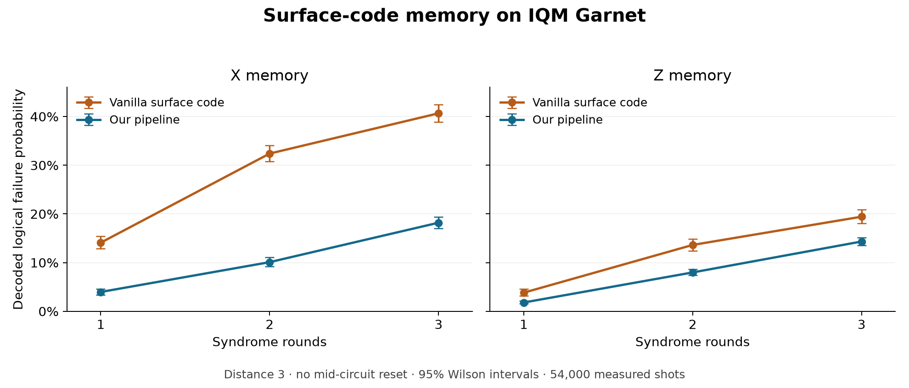
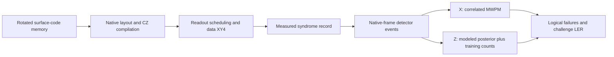

# Surface-code memory on IQM Garnet

**IQM challenge submission: reduce logical error through native compilation,
idle protection and inference from the complete syndrome record.**

We encode one logical qubit in a distance-three rotated surface code on Garnet:
nine data qubits and eight check ancillas. The experiment prepares logical X or
Z memory, repeats syndrome extraction without ancilla resets, and decodes the
final logical observable. We evaluate the complete pipeline against a vanilla
surface-code implementation using the challenge's per-round logical error rate
(LER).

| Memory | Vanilla surface code | Our pipeline | Relative LER reduction |
|---|---:|---:|---:|
| X | 18.517% (17.748–19.314%) | **5.808% (5.492–6.136%)** | **68.6%** |
| Z | 6.722% (6.326–7.135%) | **4.255% (4.066–4.449%)** | **36.7%** |

LER follows the challenge fit over rounds 1, 2 and 3; parentheses give 95%
profile intervals. The comparison uses 54,000 measured shots on one Garnet
calibration. Each implementation has its own fixed native layout and acquisition
window. [Evaluation](docs/EVALUATION.md) gives the baseline definition, raw
failures, comparison intervals and fit diagnostics.



The figure shows decoded failure probability at each circuit length, with 95%
Wilson intervals. Per-round LER is obtained by fitting these points.

## How the pipeline answers the challenge



| Challenge requirement | Implementation |
|---|---|
| Generate and execute encoded memory | Annotated Stim circuit, native Qiskit circuit, IQM pulse compilation |
| Reduce physical error exposure | Native embedding, local gate cancellation, measurement-aware scheduling, data-qubit XY4 |
| Interpret reused ancillas correctly | Generated no-reset detector equations and source/native measurement alignment |
| Use hardware noise information | Native gate/readout calibration and training-only detector-correlation fitting |
| Decode the logical observable | Correlated matching for X; exact modeled posterior with empirical shrinkage for Z |
| Evaluate the improvement | All-shot scoring, R1–3 binomial LER fit and vanilla surface-code comparison |

X uses terminal-readout fusion with correlated minimum-weight perfect matching
(MWPM). Z uses measurement fences and a complete posterior lookup with
`alpha=10` training-count regularization. Both use data-qubit XY4. The
[methods](docs/METHODS.md) explain every step and the physical and statistical
reasons for using different X/Z policies.

## Reproduce the comparison

Use Python 3.11+ from a Git checkout. In PowerShell:

```powershell
python -m venv .venv
.\.venv\Scripts\Activate.ps1
python -m pip install -e ".[test]" -e ./ethan
python -m examples.reproduce
```

The command verifies the measurement and decoder hashes, reconstructs detector
frames, decodes all **54,000 shots**, and recomputes the fits and comparison
intervals. Reproduction runs offline. Add `--json` for structured output.

To use the decoder with the bundled circuit's detector definitions:

```python
from challenge.submission import load_policy

decoder = load_policy("Z", rounds=3)
predicted_logical_flips = decoder.decode_batch(detection_events)
```

Input has shape `(shots, 8 * rounds)`; output has shape `(shots, 1)`. Predictions
are observable flips relative to the ideal logical reference.

## Read the submission

- [Methods](docs/METHODS.md): code, compiler, pulse control, priors, decoders and X/Z rationale.
- [Evaluation](docs/EVALUATION.md): vanilla baseline, measurements, LER and uncertainty.
- [Error analysis](docs/ERROR_ANALYSIS.md): residual physical channels and inference limits.
- [Reproduction](docs/REPRODUCIBILITY.md): environment, data schema and verification.
- [References](docs/REFERENCES.md): scientific and software foundations.

The implementation is organized into [`challenge/`](challenge/) for circuit,
evaluation and submission interfaces, [`ethan/src/iqm_surface_code/`](ethan/src/iqm_surface_code/)
for native compilation and full-history lookup, and [`darawork/decoders/`](darawork/decoders/)
for matching and detector-model fitting. [`benchmarks/garnet/`](benchmarks/garnet/)
contains the reproducible comparison. See [Contributing](CONTRIBUTING.md) for
development and testing.
