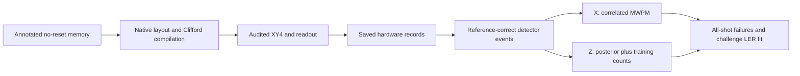

# duquantumIQM

**A measured, reproducible surface-code memory experiment on IQM Garnet.**

This project stores one logical qubit in a distance-three rotated surface code:
9 data qubits and 8 check ancillas, with native connectivity and no mid-circuit
reset. It preserves the complete chain from circuit construction to physical
pulse compilation, measured syndromes, decoding and logical-error statistics.

**Hardware acquisition is complete.** The supported starting point is offline
replay of the retained winning policies. No IQM account, API key or QPU access
is needed for the quickstart below.

[Winning pipeline](docs/WINNING_PIPELINE.md) · [Techniques](docs/TECHNIQUES.md) ·
[Remaining errors](docs/ERROR_ANALYSIS.md) · [Results](docs/RESULTS.md) ·
[Reproduction](docs/REPRODUCIBILITY.md)

## The retained policies

| | X memory | Z memory |
|---|---|---|
| Stored/read observable | Logical X | Logical Z |
| Native compiler | Terminal-readout fusion | Measurement-fenced optimization |
| Idle protection | Data-qubit XY4 | Data-qubit XY4 |
| Decoder | Native calibrated, correlated MWPM | Exact modeled posterior + training counts, `alpha=10` |
| Qualified hardware scope | Distance 3, rounds 1–3 | Distance 3, rounds 1–3 |

These choices follow held-out hardware comparisons. A more elaborate decoder
did not establish an X improvement; the posterior hybrid did establish a Z
improvement. X and Z labels name the stored observable: X memory is sensitive
to logical phase flips, while Z memory is sensitive to logical bit flips.
[Why the policies differ](docs/WINNING_PIPELINE.md#why-x-and-z-use-different-techniques)
separates the physical explanation from what the data actually proves.



## Hardware evidence

The same retained policy was evaluated in two studies. Values below are the
challenge's fitted per-round LER over **R=1,2,3**, followed by conditional 95%
profile intervals; they are not single-round failure probabilities.

| Retained policy | Selection study: 300,000 total study shots | Later validation: 96,000 new study shots |
|---|---:|---:|
| X | **5.220%** (4.976–5.471%) | **5.808%** (5.492–6.136%) |
| Z | **3.763%** (3.559–3.974%) | **4.255%** (4.066–4.449%) |

The original Z hybrid improved over native model-only ML by 0.157 percentage
points, with a multiplicity-adjusted gain interval of **+0.037 to +0.274 points**.
The follow-up retained both policies: adaptive DD, additional fitting and
recurrent decoding did not meet the frozen promotion rules. Techniques are
combined only when the measured evidence justifies the combination.

**The stationary fit is rejected in both studies.** These are descriptive fits
to the requested challenge equation, not established stationary cycle rates.
The later values are reported separately, without pooling sessions or selecting
the lower number. [Results and raw counts](docs/RESULTS.md) explain the fit,
uncertainty, selection rules and limits of the claim.

## Offline quickstart

From a Git checkout, use Python 3.11+ and a virtual environment. In PowerShell:

```powershell
python -m venv .venv
.\.venv\Scripts\Activate.ps1
python -m pip install -e ".[test]" -e ./ethan
python -m examples.replay_winners
```

The example reloads the frozen X/Z winners, decodes all **36,000 retained-policy
confirmation shots** from the later study and reproduces their failure counts
and LER fits. It writes no artifacts, blocks network connections during replay
and never reads credentials. Add `--json` for structured output. This path needs
neither Qiskit, the IQM SDK nor PyTorch.

To decode your own detection events in the published circuit/frame:

```python
from challenge.benchmark_rounds import load_adopted

policy, decoder = load_adopted(
    "results/decoders/history/20261025T004600Z", basis="Z", rounds=3
)
predictions = decoder.decode_batch(detection_events)  # (shots, 1), binary
```

Run from the repository root. Input must match the saved native/source detector
definitions, not just their array width. Observable truth is used only for
scoring; it is never passed to this inference API. Larger-distance simulation
and R1–7 diagnostics are separate from the qualified winner policy.

[Reproducibility guide](docs/REPRODUCIBILITY.md) covers full evidence replay,
optional research dependencies, tests, expected outputs and hash verification.

## Repository map

| Location | Role |
|---|---|
| [`docs/`](docs/README.md) | Current explanation, methods, errors, results and reproduction |
| [`examples/replay_winners.py`](examples/replay_winners.py) | Small, offline entry point for the retained policies |
| [`challenge/`](challenge/) | Shared circuit/statistics tools and explicit selection/validation runners |
| [`ethan/`](ethan/) | Native compiler, layout, pulse audit and complete ML lookup implementation (`iqm_surface_code`) |
| [`darawork/`](darawork/) | Matching, training-only DEM fitting, posterior/empirical and other research decoders |
| [`iyanu/`](iyanu/) | Neural, coherence-aware and LDPC decoder experiments |
| [`results/decoders/hybrid/20261024T234900Z/`](results/decoders/hybrid/20261024T234900Z/) | Immutable headline-selection evidence and winning decoder states |
| [`results/decoders/history/20261025T004600Z/`](results/decoders/history/20261025T004600Z/) | Immutable bounded follow-up and independent validation |
| [`tests/`](tests/) / [`ethan/tests/`](ethan/tests/) | Shared and isolated-package regressions |

The original [IQM challenge brief](challenge/README.md),
[implementation history](IMPLEMENTATION.md) and
[transversal-gate extension](TRANSVERSAL_GATES.md) remain available. The brief
targets Emerald; the hardware results presented here were acquired on Garnet.
Folder names preserve the contributions and provenance of the independent
implementations. Research modules are not all active in the retained policy.

See [documentation navigation](docs/README.md), [references](docs/REFERENCES.md)
and [contribution guidance](CONTRIBUTING.md). Offline CI checks the winner replay
and raw-record validation; the broader research suites are described separately.
