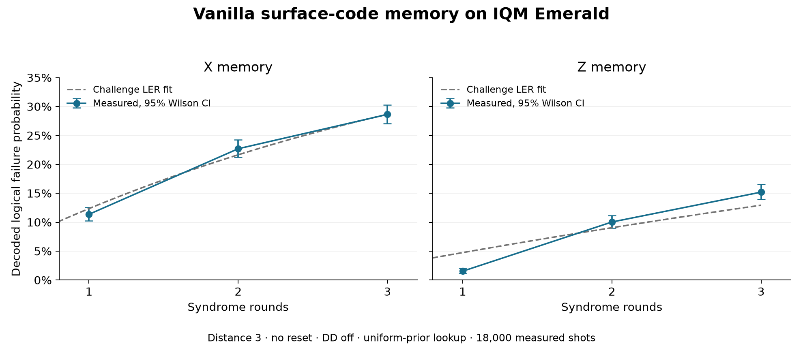

# Vanilla surface-code baseline on IQM Emerald

The Emerald baseline measures a distance-three rotated surface-code memory on
the 54-qubit processor. Nine data qubits and eight reused ancillas store one
logical qubit. Both logical X and Z memory use one, two and three syndrome
rounds, with 3,000 shots at each point: **18,000 hardware shots in six jobs**.

| Memory | Challenge R1–3 LER | 95% profile interval | Fit deviance / df |
|---|---:|---:|---:|
| X | **12.352%** | 11.773–12.953% | 4.67 / 2 |
| Z | **4.749%** | 4.424–5.089% | 108.62 / 2 |



## Baseline definition

| Element | Configuration |
|---|---|
| Code | Distance-three rotated surface code, 9 data + 8 ancillas |
| Logical workload | Identity memory in X and Z |
| Ancilla reuse | No mid-circuit reset; generated initialization, two-round bulk and terminal parities |
| Schedule | Canonical four-CX-layer extraction, lowered literally through H-CZ-H |
| Placement | First exact graph embedding in deterministic native-qubit order |
| Routing | Zero SWAPs; every CZ checked against the live coupling graph |
| Compilation | Qiskit optimization level 0; native IQM synthesis; original barriers retained |
| Idle control | Dynamical decoupling disabled |
| Readout selection | Heralding off; all 3,000 returned shots scored at each point |
| Reset policy | Active reset off; ordinary initial preparation retained |
| Decoder prior | Fixed uniform circuit Pauli probability `p=0.003` |
| Decoder | Complete full-history logical maximum-likelihood lookup |
| Training | Zero hardware training shots |

Calibration `23e12f6b-c23c-4736-8736-b0142989c0e6` is fixed across the run.
The placement uses QB1, QB2, QB3, QB4, QB5, QB6, QB9, QB10, QB11, QB12, QB13,
QB18, QB19, QB20, QB21, QB26 and QB27. The map is selected from connectivity;
calibration observations are saved as device context.

R1/R2/R3 contain 24/48/72 native CZs and 17/25/33 measurements. Source and
native Clifford circuits preserve the same detector events and logical flips,
with an explicit map between their measurement columns.

## Measurements and challenge LER

| Rounds | X failures / shots | X failure probability, 95% Wilson CI | Z failures / shots | Z failure probability, 95% Wilson CI |
|---:|---:|---:|---:|---:|
| 1 | 341 / 3,000 | 11.367% (10.280–12.552%) | 46 / 3,000 | 1.533% (1.152–2.039%) |
| 2 | 681 / 3,000 | 22.700% (21.237–24.233%) | 301 / 3,000 | 10.033% (9.009–11.160%) |
| 3 | 859 / 3,000 | 28.633% (27.044–30.277%) | 456 / 3,000 | 15.200% (13.960–16.529%) |

The [challenge](../challenge/README.md) specifies

$$
P_L(r)=\frac{1-(1-2\epsilon_L)^r}{2}.
$$

We maximize the binomial likelihood across R1/R2/R3 with amplitude fixed to
one. Each failed shot is a mismatch between the predicted and measured
reference-relative logical flip. The figure shows the directly measured
probabilities and their Wilson intervals; the dashed curve is the fitted equation.

For two degrees of freedom, the 5% chi-square critical deviance is 5.99.
X has deviance 4.67 (`p=0.0967`); Z has deviance 108.62 (`p=2.60e-24`).
The Z curve has substantial round dependence beyond the constant-rate model.
Its LER summarizes the requested equation, alongside the individual measured
points. Profile intervals quantify uncertainty within that fitted equation.

## Decode the entire measured history

The prior applies uniform H/CZ depolarization, preparation and measurement
flips, and data depolarization before each round. Each DEM fault is a joint
XOR mask of detectors and the logical observable. A Walsh–Hadamard convolution
sums modeled fault combinations into `P(s,L)`. The lookup returns the more
probable logical class for the complete detector history; ties choose zero.

R1/R2/R3 have 8/16/24 detector bits. The complete tables cover every history
and occupy 256 B / 64 KiB / 16 MiB. Tables are constructed from the model and
fixed before submission. The only inference input is the measured detector
vector. Observable labels enter scoring afterward.

The uniform prior models circuit-level H/CZ faults. Native R decomposition,
spatial noise variation, pulse timing, repeated-readout disturbance and leakage
remain sources of mismatch between that prior and physical Emerald execution.

## Acquisition and resource record

The six cases use fixed randomized order with seed `8193`. Each lookup is
validated on 20,000 independent matched-model simulation shots before hardware
submission. Simulation seeds and model failure probabilities are in the manifest.
These simulated records are separate from the 18,000 hardware measurements.

Every request fixes DD off, heralding off, active reset off, placement and
calibration. Requested shots are reserved in a durable ledger before submission;
job IDs are stored immediately upon acceptance. The run requested and returned
exactly 18,000 shots, with no retries or extra smoke jobs. All records preserve
original acquisition order.

| R3 resource | X | Z |
|---|---:|---:|
| Lookup construction | 4.475 s | 4.234 s |
| Decision table | 16 MiB | 16 MiB |
| Sampled whole-process peak RSS | 944.9 MiB | 941.6 MiB |
| Warmed 3,000-shot batch decode, median of 31 | 0.1593 ms | 0.2863 ms |
| Warmed batch throughput | 18.832 million shots/s | 10.479 million shots/s |

Construction has an estimated 512 MiB transform-workspace peak. Sampled RSS
includes the IQM stack. Decode timing excludes loading, record conversion and
construction. The acquisition host used Python 3.12.5 on Windows with 20 logical
CPUs; host details, thread environment and versions are recorded in the manifest.

## Reproduce offline

From a Git checkout with the two base distributions installed:

```powershell
python -m pip install -e ".[test]" -e ./ethan
python -m examples.replay_emerald
```

The replay verifies circuit, request, table and measurement hashes, reconstructs
both detector frames, decodes all 18,000 shots and recomputes both challenge
fits. Add `--json` for structured output.

The [evidence bundle](../benchmarks/emerald/vanilla/20261025T022556Z/)
contains the [manifest](../benchmarks/emerald/vanilla/20261025T022556Z/manifest.json),
circuits, frozen requests/tables, original-order measurements, calibration and
the [generated report](../benchmarks/emerald/vanilla/20261025T022556Z/report.md).
The runner is [`challenge/benchmark_emerald.py`](../challenge/benchmark_emerald.py).

To prepare a separate acquisition, use a new output directory with the pinned
hardware environment and an Emerald-authorized token:

```powershell
python -m challenge.benchmark_emerald --action prepare --run results/decoders/emerald_vanilla/NEW_RUN --token-file apikey.jom
python -m challenge.benchmark_emerald --action run --run results/decoders/emerald_vanilla/NEW_RUN --token-file apikey.jom --submit
```

`--action collect` retrieves existing jobs. `--action replay` reads saved evidence
offline. Imports and tests leave hardware and credentials untouched.
