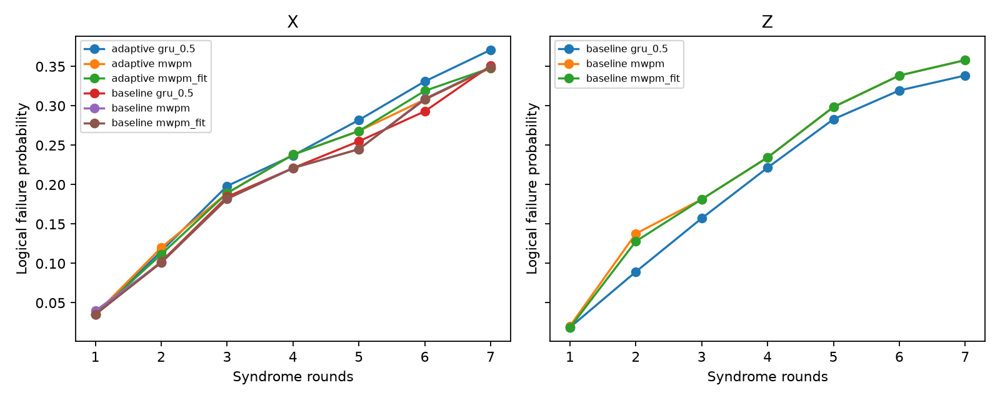

# Remaining sources of error

The retained policies reduce or interpret errors; they do not eliminate them.
This dataset establishes residual logical failures and model limitations. It
does **not** identify a causal percentage contribution for every physical noise
channel. No channel-share pie chart or calibrated leakage-removal claim follows
from binary syndromes alone.

## What is directly observed

The later confirmation retained the original compiler/decoders and produced:

| Memory | R1 failures | R2 failures | R3 failures | Shots per point |
|---|---:|---:|---:|---:|
| X | 159 (3.975%) | 404 (10.100%) | 728 (18.200%) | 4,000 |
| Z | 145 (1.8125%) | 639 (7.9875%) | 1,147 (14.3375%) | 8,000 |

These are decoded logical failure probabilities at specific circuit lengths.
The fitted challenge LER is a separate statistic: X 5.808%, Z 4.255% over R1–3.
The stationary fit is rejected: X deviance 52.10 on 2 degrees of freedom,
Z 198.86 on 2 degrees of freedom. The relatively clean first round and larger
later failures are real features that a constant-rate fit does not explain.

Initialization/terminal boundaries, repeated measurement exposure, correlated
faults, decoder mismatch and time variation can all contribute to such a shape.
This observation does not uniquely distinguish them. In particular, growth
with round count is not proof that persistent leakage dominates.

The earlier study's retained-policy fits were lower, at X 5.220% and Z 3.763%.
Both studies used the same recorded calibration ID, but a calibration ID does
not certify time-invariant hardware. The data establishes a changed observed
rate; it does not establish a temperature, T1, drift or leakage explanation.

## Physical fault channels and what remains

| Source | How it can cause logical failure | What the retained pipeline does | Remaining limitation |
|---|---|---|---|
| CZ and single-qubit gate faults | Faults propagate through checks; several faults can mimic another logical class | Native placement, gate cancellation, hook-safe ordering, calibrated prior | Calibration averages do not fully describe coherent, context-dependent or correlated faults |
| Ancilla assignment error | A wrong reported bit produces misleading temporal detector events | Uses complete no-reset history and measurement-specific readout priors | State/asymmetric and history-dependent assignment errors can differ from a symmetric bit-flip model |
| Terminal data readout | Wrong data bits affect the final checks and logical parity | Correct terminal detectors, native readout implementation, joint inference | Final destructive measurement has no later syndrome round to resolve every ambiguity |
| Measurement disturbance | Repeated readout changes ancilla state or perturbs nearby data | Preserved scheduling; empirical X backaction prior | The Pauli proxy is not a measured physical channel and does not remove disturbance |
| Idle dephasing | Data waits while ancillas are measured or other gates finish | Data-qubit XY4 | DD is imperfect and frequency-selective; the native winner prior has no explicit timed-idle channel |
| T1 relaxation | Population decays during preparation, gates or waits | Shorter native work and calibrated effective gate errors | Unitary DD cannot restore lost population; non-unital dynamics exceed a simple Pauli model |
| Leakage and slow return | Population outside the qubit space can persist and corrupt partners over several rounds | Indirect pattern information in measured syndromes; stress simulation | No direct per-shot leakage flag, removal/reset protocol or calibrated persistent-qutrit model |
| Crosstalk and spectator effects | Simultaneous drive/readout or residual interactions create correlated faults | Native scheduling, joint DEM faults, guarded correlation fitting | Static DEMs do not capture every context- or history-dependent interaction |
| Initialization | Imperfect preparation changes initial parity/reference reliability | Explicit initial detectors and a recorded preparation prior | The reset/preparation error prior includes an assumption, not a measured reset-fidelity determination |
| Finite distance | Several faults or ambiguous histories exceed the patch's correcting capability | Distance-three encoding and logical-class decoding | One measured distance cannot establish a threshold, distance scaling or break-even |

These mechanisms are physically plausible and represented to different degrees
in the code. Their **relative causal importance on this run is unresolved**.
Literature on other superconducting processors motivates them; it is not a
substitute for a Garnet-specific channel decomposition.

### Assignment error is different from backaction

An assignment error changes a classical reported bit. It need not change the
physical post-measurement state. Backaction or non-QND behavior changes that
state, and can influence subsequent checks. Treating both as the same extra
readout bit flip loses temporal structure, especially without ancilla resets.

The native model uses compiled readout implementations to set assignment
priors and a separate phenomenological backaction term for the selected X
prior. Its Z scale of zero does not claim physically perfect Z readout.
The different settings are empirical decoder choices, not direct measurements
of distinct causal noise rates.

### Leakage metrics require careful interpretation

The calibration contains repeated-readout QND/leakage metrics. They are not
automatically per-CZ leakage probabilities. A high metric on a data qubit that
is measured only at the end also does not prove that a repeatedly measured
ancilla caused memory failure. Data and ancilla roles, gate implementation and
the measurement protocol must match the proposed interpretation.

The simulator can maintain hidden persistent leakage flags, but those flags
never reach inference. Hardware decoders receive measured binary history, not
the true qutrit state. Without direct leakage-sensitive measurements or
controlled interventions, binary syndrome correlations cannot uniquely identify
leakage rather than other correlated faults.

### DD has a real control-error tradeoff

The retained XY4 sequence seeks to suppress unwanted idle evolution. Adding
more pulses also adds imperfect control. At R3, adaptive DD inserted roughly
twice as many IQ instructions as the retained sequence. Its X confirmation
did not improve the released policy. That is a performance result, not an
isolation of which pulse-error mechanism caused it.

Fast ancilla readout shortened the R3 compiled schedule by 952 ns but did not
win pilot selection. The total schedule contains the same 298,000 ns initial
preparation wait; it must not be reported as coherent memory time. SDK QND
measurement was not calibrated on the acquired device, so it was not tested.

## Inference and model errors

The decoder only knows a prior and the measured record. Several physical fault
histories can produce the same record with different logical outcomes; some
uncertainty is irreducible from those inputs. Matching chooses a likely fault
explanation; modeled ML sums logical classes. Neither fixes an inaccurate
physical model automatically.

The retained native prior has these explicit limitations:

- Gate calibration is reduced to depolarizing Pauli probabilities; coherent
  interference and non-unital relaxation are not reproduced exactly.
- Inserted DD-pulse errors and timed idle decoherence are omitted explicitly.
- The backaction term is a static qubit-level proxy, not persistent leakage.
- DEM extraction permits the declared disjoint-channel approximation. “Exact
  modeled posterior” means exact summation inside that approximate DEM.
- Calibration/readout priors may not track changing hardware or all contexts.

Fitting detector correlations can compensate for some mismatch, but finite
training counts make those estimates noisy. In the selected Z pipeline the
R3 refit was rejected on the internal training check. The model-only prior was
kept there. This prevents “more fitting” from becoming an unconditional rule.

The posterior/count hybrid also has finite-data limits. R3 contains 24 detector
bits, so there are more than sixteen million possible histories but only
6,000 training shots in that original case. Shrinkage protects rare histories;
it cannot learn arbitrary hardware behavior from absent examples. Neural
models face their own generalization and simulation-to-hardware gaps. A finite
negative trial does not establish that all neural decoders must fail.

## Statistical and scope limitations

Profile intervals assume the selected statistical fit; they do not establish
its physical stationarity. Failure-vector bootstrap intervals compare the same
predeclared descriptive estimator while respecting round/block strata. They do
not cover all future calibration drift, model-selection uncertainty or arbitrary
new devices. Two acquisition windows under one calibration are a limited
repetition, not a multi-day stability study.

No shots are discarded for difficult syndromes or possible leakage. There is
no real-time feedback demonstration, distance-scaling threshold, unencoded
break-even result or universal logical-computation benchmark. Both Pauli memory
bases were tested; that is not a full arbitrary-state process characterization.

The distinction between engineering correctness and suppression is useful:
correct frame/parity handling removes analysis mistakes, native compilation/DD
can change physical fault exposure, and decoding improves inference from the
same measured record. Each requires its own evidence. They cannot be added as
independent percentage gains without controlled comparisons.

## Longer histories as diagnostics

This figure shows failure probability versus rounds, **not per-cycle LER**.
R1–3 have 4,000 X shots per physical arm and 8,000 Z shots; R4–7 have 1,000 X
shots per arm and 2,000 Z shots. The report retains pointwise uncertainty.
The plotted long-history decoders are consistent across the diagnostic window.
The retained Z posterior stops at R3 and is not silently extended by a fallback.
A learned decoder improving over a weaker Z matching reference at long rounds
does not establish a new best retained headline.

See [Results](RESULTS.md) for counts and tests, [Techniques](TECHNIQUES.md) for
mitigation mechanisms, and [References](REFERENCES.md) for the general theory.
