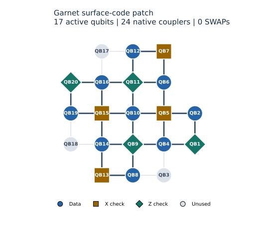

# Zero-SWAP routing on Garnet

**The current optimized Garnet memory uses zero routing SWAPs. This is the
minimum possible routing SWAP count for its fixed distance-three schedule.**

The certificate checks all twelve published native circuits: X/Z memory,
rounds 1–3, and both acquisition blocks. Each uses seventeen physical qubits
and exactly the source schedule's CZ interactions.

| Syndrome rounds | Source CZ gates | Native CZ gates | Added entanglers | Routing SWAPs |
|---:|---:|---:|---:|---:|
| 1 | 24 | 24 | 0 | **0** |
| 2 | 48 | 48 | 0 | **0** |
| 3 | 72 | 72 | 0 | **0** |

Every row holds for both memory bases and both acquisition blocks.



Dark edges are the 24 required native couplers. Light edges connect unused
device sites. The full recorded device has twenty qubits and thirty CZ couplers.

| Role | Physical qubits |
|---|---|
| Data | QB2, QB4, QB6, QB8, QB10, QB12, QB14, QB16, QB19 |
| X checks | QB5, QB7, QB13, QB15 |
| Z checks | QB1, QB9, QB11, QB20 |
| Unused | QB3, QB17, QB18 |

## Why placement removes the need for SWAPs

A routing SWAP moves two quantum states between hardware sites so that a later
two-qubit gate can use an available coupler. A good initial placement can make
every requested interaction local immediately. Qiskit's
[routing documentation](https://quantum.cloud.ibm.com/docs/en/api/qiskit/2.1/transpiler)
distinguishes this placement from routing and specifies that `routing_method="none"`
raises an error when routing is required.

The mapper enumerates injective embeddings of the surface-code interaction
graph into Garnet's calibrated coupling graph. It ranks legal embeddings with
the gate/readout fidelity proxy. Calibration ranking selects among placements
that already require zero routing; it does not relax the connectivity constraint.

Let `G_C` be the circuit graph and `G_H` the hardware graph. The stored map `f`
has seventeen distinct images and satisfies

```text
for every (u,v) in E(G_C): (f(u),f(v)) is in E(G_H).
```

All required two-qubit operations are CZ gates on these native edges. Local
basis rotations convert the parity-extraction circuit to the native gate basis.
Repeating a round uses the same edges and the same placement. No state relocation
is required. This constructs a routing with `S=0`; since `S>=0` for any routing,
the construction attains `S_min=0`.

The 24 interactions per round follow directly from four weight-four and four
weight-two checks: `4*4 + 4*2 = 24`. The certificate also recovers four X and four
Z checks by Clifford back-propagation of their first measurements.

## Evidence from the compiled circuits

Counting literal `SWAP` instructions alone is insufficient. A compiler can
decompose a SWAP into three CX gates, each expressible using CZ and local
rotations. The [translation-stage documentation](https://quantum.cloud.ibm.com/docs/en/guides/transpiler-stages)
illustrates this decomposition. The audit therefore checks the complete
two-qubit inventory and its physical wires:

1. Verify the published circuit hashes and their recorded scientific-source hashes.
2. Match the architecture calibration ID to the measurement manifest:
   `a18a947f-0408-4628-81ea-1715637e434f`.
3. Check the injective seventeen-qubit map against the native circuit coordinates.
4. Verify every required pair is a calibrated CZ coupler.
5. Require exactly `24*rounds` CZs, with the same pair multiplicities as the source.
6. Require the same ordered interaction partners on every physical wire.
7. Check measurement wires against the fixed map and the saved column permutation.
8. Check the recorded pre/post-optimization inventories and the compiler's
   explicit `routing_method="none"` setting.

The negative tests reject literal SWAPs, decomposed SWAPs with extra CZs,
missing couplers, changed wire order, invalid placements and changed measurement
wires. The audit is offline and requires no Qiskit, hardware SDK or credentials.

## Reproduce the proof

From the repository root, with the base packages and `./ethan` installed:

```powershell
python -m challenge.audit_garnet_routing
```

Expected output:

```text
Garnet: verified 12 native memory circuits; 0 routing SWAPs (minimum 0).
X/Z R1: 24 source CZ = 24 native CZ; 0 added entanglers.
X/Z R2: 48 source CZ = 48 native CZ; 0 added entanglers.
X/Z R3: 72 source CZ = 72 native CZ; 0 added entanglers.
```

Add `--json` for the complete certificate or `--plot` to redraw the layout.
The [certificate](assets/garnet_routing_certificate.json) records every audited
source/native circuit hash, the placement and all per-case checks. Its
[architecture snapshot](assets/garnet_architecture.json) contains the calibrated
qubit ordering and couplers. The certificate hashes the architecture's canonical
JSON representation, so newline conversion does not change that hash.

The [vanilla comparison](EVALUATION.md) also uses zero routing SWAPs. This criterion
is achieved by both implementations; their LER difference comes from other
pipeline choices. The optimality proof concerns routing SWAPs for this fixed
memory schedule. It does not assert a global minimum over all possible QEC circuits.
